# Knowledge Graph

> **Generated file.** Produced by `tools/build.py` from `curriculum/curriculum.json` (parsed from the authoritative syllabus). Do not edit by hand; change the source data or the generator instead.

How the 64 subject areas group into the seven layers of the source's Part XIV map. Each subject is drawn once, in the first layer that names it. Colour is documentation status (grey, amber, green as in the subject indexes).

```mermaid
flowchart TB
    subgraph L1["Computer Science Foundations"]
        direction LR
        S1["1 Computer Fundamentals"]
        S2["2 Mathematics for Computer Science"]
        S3["3 Digital Logic and Computer Organization"]
        S4["4 Operating Systems"]
        S5["5 Computer Networking"]
    end
    subgraph L2["Programming and Software Engineering"]
        direction LR
        S6["6 Programming Fundamentals"]
        S7["7 Programming Paradigms"]
        S8["8 Programming Languages and Ecosystem"]
        S9["9 Data Structures and Algorithms"]
        S10["10 Compilers and Programming Language Internals"]
        S11["11 Software Development Lifecycle"]
        S12["12 Software Design Principles and Architecture"]
        S13["13 Version Control and Developer Workflow"]
        S14["14 Development Environments and Tools"]
        S30["30 Software Testing and Quality Assurance"]
    end
    subgraph L3["Application Engineering"]
        direction LR
        S16["16 Backend Development"]
        S17["17 Frontend Development"]
        S18["18 UI/UX and Human-Computer Interaction"]
        S19["19 Mobile Application Development"]
        S20["20 Desktop Application Development"]
        S21["21 API Integration and Messaging Systems"]
    end
    subgraph L4["Systems Engineering"]
        direction LR
        S15["15 Database Management Systems"]
        S22["22 Distributed Systems"]
        S23["23 System Design"]
    end
    subgraph L5["Infrastructure"]
        direction LR
        S24["24 Cloud Computing"]
        S25["25 Containers and Container Orchestration"]
        S26["26 DevOps Engineering"]
        S27["27 Site Reliability Engineering"]
        S28["28 Observability and Monitoring"]
        S29["29 Performance Engineering"]
        S31["31 Cybersecurity and Software Security"]
    end
    subgraph L6["Data and Intelligence"]
        direction LR
        S32["32 Data Engineering"]
        S33["33 Data Science and Business Intelligence"]
        S34["34 Artificial Intelligence Fundamentals"]
        S35["35 Mathematics for Machine Learning"]
        S36["36 Machine Learning"]
        S37["37 Deep Learning"]
        S38["38 Natural Language Processing"]
        S39["39 Computer Vision"]
        S40["40 Reinforcement Learning"]
        S41["41 Generative AI"]
        S42["42 Large Language Models"]
        S43["43 Retrieval-Augmented Generation"]
        S45["45 AI Engineering and MLOps"]
    end
    subgraph L7["Advanced and Frontier Computing"]
        direction LR
        S44["44 AI Agents and Agentic Systems"]
        S48["48 AR, VR, MR and Spatial Computing"]
        S51["51 Robotics and Autonomous Systems"]
        S52["52 Blockchain and Web3"]
        S53["53 High-Performance Computing"]
        S54["54 Quantum Computing"]
    end
    subgraph LO["Other specialised domains"]
        direction LR
        S47["47 Game Development"]
        S49["49 Embedded Systems and Firmware Engineering"]
        S50["50 Internet of Things"]
        S55["55 Edge Computing and Fog Computing"]
        S56["56 Bioinformatics and Computational Biology"]
        S57["57 Other Specialized Domains"]
    end
    subgraph LX["Cross-cutting professional practice"]
        direction LR
        S46["46 Responsible AI, AI Safety and AI Governance"]
        S58["58 AI Tools Used by Modern Software Engineers"]
        S59["59 Engineering Standards and Software Quality"]
        S60["60 Software Configuration and Release Management"]
        S61["61 Engineering Economics"]
        S62["62 Software Ethics, Law and Governance"]
        S63["63 Technical Communication and Leadership"]
        S64["64 Research and Advanced Computer Science"]
    end
    L1 --> L2 --> L3 --> L4 --> L5 --> L6 --> L7
    L7 --> LO
    LX -.-> L1
    classDef ns fill:#eceff1,stroke:#78909c,color:#263238;
    classDef ip fill:#fff8e1,stroke:#f9a825,color:#263238;
    classDef dr fill:#e8f5e9,stroke:#2e7d32,color:#1b2a1d;
    class S1 ip;
    class S2 ns;
    class S3 ns;
    class S4 ns;
    class S5 ns;
    class S6 ns;
    class S7 ns;
    class S8 ns;
    class S9 ns;
    class S10 ns;
    class S11 ns;
    class S12 ns;
    class S13 ns;
    class S14 ns;
    class S15 ns;
    class S16 ns;
    class S17 ns;
    class S18 ns;
    class S19 ns;
    class S20 ns;
    class S21 ns;
    class S22 ns;
    class S23 ns;
    class S24 ns;
    class S25 ns;
    class S26 ns;
    class S27 ns;
    class S28 ns;
    class S29 ns;
    class S30 ns;
    class S31 ns;
    class S32 ns;
    class S33 ns;
    class S34 ns;
    class S35 ns;
    class S36 ns;
    class S37 ns;
    class S38 ns;
    class S39 ns;
    class S40 ns;
    class S41 ns;
    class S42 ns;
    class S43 ns;
    class S44 ns;
    class S45 ns;
    class S46 ns;
    class S47 ns;
    class S48 ns;
    class S49 ns;
    class S50 ns;
    class S51 ns;
    class S52 ns;
    class S53 ns;
    class S54 ns;
    class S55 ns;
    class S56 ns;
    class S57 ns;
    class S58 ns;
    class S59 ns;
    class S60 ns;
    class S61 ns;
    class S62 ns;
    class S63 ns;
    class S64 ns;
```

Arrows between layers show the simplified order used by the source; for the real subject-level dependencies see the [prerequisite map](curriculum/prerequisite-map.md). A subject listed in two layers of the source (for example architecture and databases appear in more than one) is drawn in its first layer only.

## Layer membership

| Layer | Subjects |
| --- | --- |
| Computer Science Foundations | [1](docs/01-computer-science-foundations/01-computer-fundamentals/index.md), [2](docs/01-computer-science-foundations/02-mathematics-for-computer-science/index.md), [3](docs/01-computer-science-foundations/03-digital-logic-and-computer-organization/index.md), [4](docs/01-computer-science-foundations/04-operating-systems/index.md), [5](docs/01-computer-science-foundations/05-computer-networking/index.md) |
| Programming and Software Engineering | [6](docs/02-programming-and-software-development/06-programming-fundamentals/index.md), [7](docs/02-programming-and-software-development/07-programming-paradigms/index.md), [8](docs/02-programming-and-software-development/08-programming-languages-and-ecosystem/index.md), [9](docs/02-programming-and-software-development/09-data-structures-and-algorithms/index.md), [10](docs/02-programming-and-software-development/10-compilers-and-language-internals/index.md), [11](docs/03-professional-software-engineering/11-software-development-lifecycle/index.md), [12](docs/03-professional-software-engineering/12-software-design-principles-and-architecture/index.md), [13](docs/03-professional-software-engineering/13-version-control-and-developer-workflow/index.md), [14](docs/03-professional-software-engineering/14-development-environments-and-tools/index.md), [30](docs/07-software-quality-and-cybersecurity/30-software-testing-and-quality-assurance/index.md) |
| Application Engineering | [16](docs/04-building-software-products/16-backend-development/index.md), [17](docs/04-building-software-products/17-frontend-development/index.md), [18](docs/04-building-software-products/18-ui-ux-and-human-computer-interaction/index.md), [19](docs/04-building-software-products/19-mobile-application-development/index.md), [20](docs/04-building-software-products/20-desktop-application-development/index.md), [21](docs/04-building-software-products/21-api-integration-and-messaging-systems/index.md) |
| Systems Engineering | [12](docs/03-professional-software-engineering/12-software-design-principles-and-architecture/index.md), [15](docs/04-building-software-products/15-database-management-systems/index.md), [22](docs/05-distributed-systems-and-system-design/22-distributed-systems/index.md), [23](docs/05-distributed-systems-and-system-design/23-system-design/index.md), [5](docs/01-computer-science-foundations/05-computer-networking/index.md) |
| Infrastructure | [24](docs/06-cloud-devops-and-infrastructure/24-cloud-computing/index.md), [25](docs/06-cloud-devops-and-infrastructure/25-containers-and-orchestration/index.md), [26](docs/06-cloud-devops-and-infrastructure/26-devops-engineering/index.md), [27](docs/06-cloud-devops-and-infrastructure/27-site-reliability-engineering/index.md), [28](docs/06-cloud-devops-and-infrastructure/28-observability-and-monitoring/index.md), [29](docs/06-cloud-devops-and-infrastructure/29-performance-engineering/index.md), [31](docs/07-software-quality-and-cybersecurity/31-cybersecurity-and-software-security/index.md) |
| Data and Intelligence | [32](docs/08-data-engineering-data-science-and-analytics/32-data-engineering/index.md), [33](docs/08-data-engineering-data-science-and-analytics/33-data-science-and-business-intelligence/index.md), [34](docs/09-artificial-intelligence-and-machine-learning/34-artificial-intelligence-fundamentals/index.md), [35](docs/09-artificial-intelligence-and-machine-learning/35-mathematics-for-machine-learning/index.md), [36](docs/09-artificial-intelligence-and-machine-learning/36-machine-learning/index.md), [37](docs/09-artificial-intelligence-and-machine-learning/37-deep-learning/index.md), [38](docs/09-artificial-intelligence-and-machine-learning/38-natural-language-processing/index.md), [39](docs/09-artificial-intelligence-and-machine-learning/39-computer-vision/index.md), [40](docs/09-artificial-intelligence-and-machine-learning/40-reinforcement-learning/index.md), [41](docs/09-artificial-intelligence-and-machine-learning/41-generative-ai/index.md), [42](docs/09-artificial-intelligence-and-machine-learning/42-large-language-models/index.md), [43](docs/09-artificial-intelligence-and-machine-learning/43-retrieval-augmented-generation/index.md), [45](docs/09-artificial-intelligence-and-machine-learning/45-ai-engineering-and-mlops/index.md) |
| Advanced and Frontier Computing | [44](docs/09-artificial-intelligence-and-machine-learning/44-ai-agents-and-agentic-systems/index.md), [48](docs/10-specialized-software-engineering-domains/48-ar-vr-mr-and-spatial-computing/index.md), [51](docs/10-specialized-software-engineering-domains/51-robotics-and-autonomous-systems/index.md), [52](docs/10-specialized-software-engineering-domains/52-blockchain-and-web3/index.md), [53](docs/10-specialized-software-engineering-domains/53-high-performance-computing/index.md), [54](docs/10-specialized-software-engineering-domains/54-quantum-computing/index.md), [3](docs/01-computer-science-foundations/03-digital-logic-and-computer-organization/index.md) |
| Other specialised domains | [47](docs/10-specialized-software-engineering-domains/47-game-development/index.md), [49](docs/10-specialized-software-engineering-domains/49-embedded-systems-and-firmware-engineering/index.md), [50](docs/10-specialized-software-engineering-domains/50-internet-of-things/index.md), [55](docs/10-specialized-software-engineering-domains/55-edge-and-fog-computing/index.md), [56](docs/10-specialized-software-engineering-domains/56-bioinformatics-and-computational-biology/index.md), [57](docs/10-specialized-software-engineering-domains/57-other-specialized-domains/index.md) |
| Cross-cutting professional practice | [46](docs/09-artificial-intelligence-and-machine-learning/46-responsible-ai-safety-and-governance/index.md), [58](docs/11-ai-assisted-software-engineering/58-ai-tools-for-software-engineers/index.md), [59](docs/12-professional-engineering-practices/59-engineering-standards-and-software-quality/index.md), [60](docs/12-professional-engineering-practices/60-software-configuration-and-release-management/index.md), [61](docs/12-professional-engineering-practices/61-engineering-economics/index.md), [62](docs/12-professional-engineering-practices/62-software-ethics-law-and-governance/index.md), [63](docs/12-professional-engineering-practices/63-technical-communication-and-leadership/index.md), [64](docs/12-professional-engineering-practices/64-research-and-advanced-computer-science/index.md) |

See also: [Part XIV](docs/14-how-the-entire-field-fits-together/index.md), the narrative version of this map.
