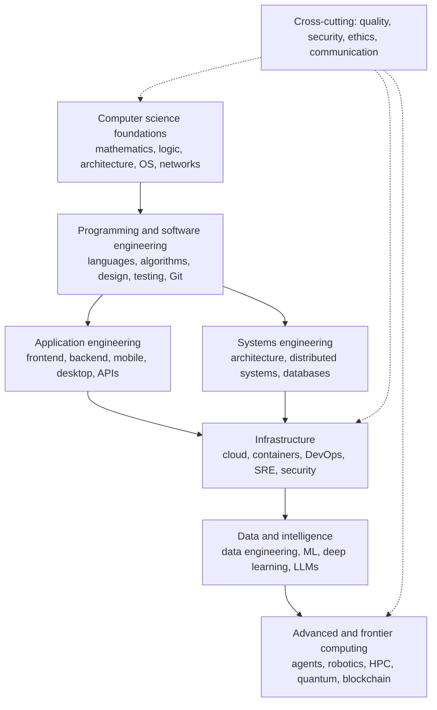

# Software Engineer

**A structured, beginner-to-research knowledge library for computer science and software engineering.**

*Software Engineer* is an open educational resource that aims to take a learner from "what is a computer?" to professional engineering, specialisation and research-level understanding. It is built around one authoritative syllabus of **15 parts and 64 numbered subject areas**, and every topic in that syllabus is tracked so that nothing is silently dropped.

> **Honest status:** this is the foundation of a very large project. The structure, the full curriculum inventory, the coverage matrix and the validation tooling are in place; written lessons so far cover the beginning of Part I. The statistics below are generated from the repository, so they always reflect what actually exists. Nothing is called *Complete* until it has been independently reviewed.

## What this is, and what it is not

- It **is** a carefully architected library: concept explanations, internal mechanisms, diagrams, runnable code, exercises, trade-offs and references, with consistent cross-links between topics.
- It is **not** a collection of interview notes, shallow definitions or links to other tutorials.
- Every lesson is written so that a beginner can follow the idea first, and then goes deeper for experienced engineers.

## Where to start

| If you are… | Start with |
|---|---|
| New to computing | [START-HERE.md](START-HERE.md), then [1. Computer Fundamentals](docs/01-computer-science-foundations/01-computer-fundamentals/index.md) |
| A working engineer filling gaps | [MASTER-INDEX.md](MASTER-INDEX.md) or the [prerequisite map](curriculum/prerequisite-map.md) |
| Choosing a specialisation | [LEARNING-PATHS.md](LEARNING-PATHS.md) |
| Looking for advanced or frontier material | [Part IX: AI and ML](docs/09-artificial-intelligence-and-machine-learning/index.md), [Part X: specialised domains](docs/10-specialized-software-engineering-domains/index.md) |
| Wondering whether a topic is covered | [coverage matrix](curriculum/coverage-matrix.md) |

## The curriculum at a glance

| Part | Theme |
|---|---|
| [I — Computer Science Foundations](docs/01-computer-science-foundations/index.md) | Computers, mathematics, digital logic, operating systems, networking |
| [II — Programming and Software Development](docs/02-programming-and-software-development/index.md) | Programming, paradigms, languages, data structures and algorithms, compilers |
| [III — Professional Software Engineering](docs/03-professional-software-engineering/index.md) | Lifecycle, design, architecture, version control, tooling |
| [IV — Building Software Products](docs/04-building-software-products/index.md) | Databases, backend, frontend, UX, mobile, desktop, integration |
| [V — Distributed Systems and System Design](docs/05-distributed-systems-and-system-design/index.md) | Consistency, consensus, system design |
| [VI — Cloud, DevOps and Infrastructure](docs/06-cloud-devops-and-infrastructure/index.md) | Cloud, containers, DevOps, SRE, observability, performance |
| [VII — Software Quality and Cybersecurity](docs/07-software-quality-and-cybersecurity/index.md) | Testing, security, cryptography |
| [VIII — Data Engineering, Data Science and Analytics](docs/08-data-engineering-data-science-and-analytics/index.md) | Pipelines, big data, analytics |
| [IX — Artificial Intelligence and Machine Learning](docs/09-artificial-intelligence-and-machine-learning/index.md) | Mathematics to ML, deep learning, LLMs, RAG, agents, MLOps, safety |
| [X — Specialised Domains](docs/10-specialized-software-engineering-domains/index.md) | Games, XR, embedded, IoT, robotics, blockchain, HPC, quantum |
| [XI — AI-Assisted Software Engineering](docs/11-ai-assisted-software-engineering/index.md) | AI coding tools and agentic development |
| [XII — Professional Engineering Practices](docs/12-professional-engineering-practices/index.md) | Standards, release management, ethics, communication, research |
| [XIII — Technology Ecosystem](docs/13-complete-technology-ecosystem/index.md) | An index of tools and platforms |
| [XIV — How the Field Fits Together](docs/14-how-the-entire-field-fits-together/index.md) | The dependency structure of the whole field |
| [XV — Practical Learning Order](docs/15-practical-learning-order/index.md) | A realistic order, and generalist versus specialist |



*The diagram simplifies the source's Part XIV map. The real, subject-level dependencies are in the [prerequisite map](curriculum/prerequisite-map.md) and the [knowledge graph](KNOWLEDGE-GRAPH.md).*

## How the library is organised

```text
software-engineer/
├── README.md  START-HERE.md  MASTER-INDEX.md  LEARNING-PATHS.md  KNOWLEDGE-GRAPH.md
├── PROGRESS.md  ROADMAP.md  GLOSSARY.md  FAQ.md  REFERENCES.md  CHANGELOG.md
├── CONTRIBUTING.md  CODE_OF_CONDUCT.md  SECURITY.md  LICENSE  CITATION.cff
├── COMPLETE-CURRICULUM.md     the source syllabus, every topic with a stable ID
├── curriculum/                curriculum.json (single source of truth), coverage matrix,
│                              prerequisite map, technology index, extraction report
├── docs/                      the lessons: docs/<part>/<NN-subject>/<NN-chapter>/<NN-lesson>.md
├── learning-paths/            role-specific paths (planned)
├── resources/                 books, papers, specifications, projects
└── tools/                     parse_syllabus.py, build.py, validate.py
```

Each chapter directory corresponds to one group in the source syllabus, so the directory tree mirrors the syllabus.

## Current state (generated)

<!-- BEGIN STATS -->
| Measure | Value |
| --- | --- |
| Parts | 15 |
| Numbered subject areas | 64 |
| Chapters (groups) in the syllabus | 246 |
| Syllabus topics inside the 64 subjects | 3032 |
| Lessons written | 15 |
| Topics covered by a drafted-or-better lesson | 28 of 3032 (0.9%) |
| Topics reviewed or complete | 0 |
<!-- END STATS -->

## How quality is enforced

- **Source of truth.** [`curriculum/curriculum.json`](curriculum/curriculum.json) is parsed deterministically from the source `.docx`; [`tools/validate.py`](tools/validate.py) re-counts the `.docx` independently and compares.
- **Honest statuses.** *Not started → In progress → Drafted → Reviewed → Complete.* A lesson that merely exists is at most *Drafted*. See the [coverage matrix](curriculum/coverage-matrix.md) for the definitions.
- **Executable examples.** Every runnable code block is executed by the validator and its output compared with the documented output.
- **Real diagram parsing.** Every Mermaid diagram is parsed by the Mermaid CLI.
- **Link checking.** Every relative link and heading anchor is resolved.

Run all checks with `python3 tools/validate.py` (Python 3.10+, PyYAML, gcc, and `mmdc` with a Chromium for diagrams).

## Contributing and licence

Contributions that improve accuracy, depth, diagrams, exercises and references are welcome; see [CONTRIBUTING.md](CONTRIBUTING.md) and the [Code of Conduct](CODE_OF_CONDUCT.md). **No licence has been chosen yet.** [LICENSE](LICENSE) is a documented placeholder until the repository owner decides; until then, assume no permissions beyond those the law grants by default.
