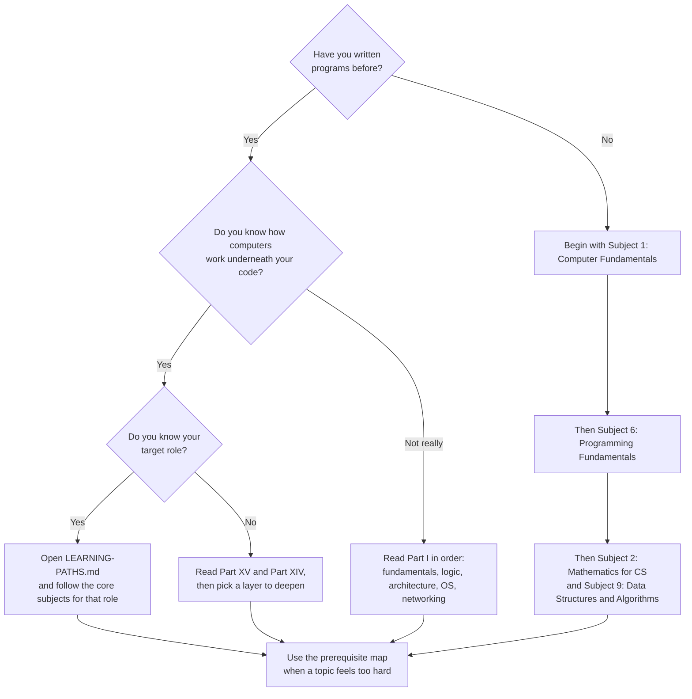

# Start Here

This library is large on purpose, and nobody needs all of it. This page helps you find your entry point, explains how a lesson is laid out, and suggests how to study.

## 1. Find your entry point

| Entry point | Go to |
|---|---|
| Absolute beginner | [1. Computer Fundamentals](docs/01-computer-science-foundations/01-computer-fundamentals/index.md) |
| Experienced, want a reference | [MASTER-INDEX.md](MASTER-INDEX.md) |
| Want a role-based plan | [LEARNING-PATHS.md](LEARNING-PATHS.md) |
| Stuck on a topic | [prerequisite map](curriculum/prerequisite-map.md) |
| Want advanced or frontier material | [Part IX](docs/09-artificial-intelligence-and-machine-learning/index.md) and [Part X](docs/10-specialized-software-engineering-domains/index.md) |

Do not try to master every subject. Part XV's own message is that generalist foundations and specialist depth are different things; see [Part XV](docs/15-practical-learning-order/index.md).

## 2. How a lesson is laid out

Every lesson starts with a generated header (difficulty, estimated time, prerequisites, the exact syllabus topics it covers, and its status) and ends with related topics and previous/next navigation. Between them, a full lesson follows this arc:

1. **What you will learn**: the outcomes you can check yourself against.
2. **Introduction and intuition**: what the idea is, why it exists, and a plain-language picture before any formalism.
3. **Technical foundations and step-by-step working**: definitions, mechanisms, and a worked trace of how it behaves.
4. **Diagrams**: Mermaid diagrams that show structure, flow or state.
5. **Code**: runnable examples (clearly labelled) with the output you should see.
6. **Real-world use, advanced material and trade-offs**: how engineers use the idea, and where it breaks down.
7. **Common mistakes, exercises and interview questions**: with solutions hidden behind a fold so you can try first.
8. **Further reading**: official documentation, standards, textbooks and papers.

## 3. How to study

- **Read the intuition before the formalism**, and stop if the intuition is not clear; the lesson has failed you, not the other way round. Please report it.
- **Run the code.** Change a value, predict the result, then check.
- **Attempt each exercise before opening its solution.**
- **Follow cross-links when a term is unfamiliar.** The [glossary](GLOSSARY.md) is a quick refresher.
- **Check the status.** *Drafted* means a complete lesson that has passed automated checks but not an independent technical review. See the [coverage matrix](curriculum/coverage-matrix.md) for the definitions.

## 4. What you need

- Python 3.10 or newer for most examples.
- A C compiler (gcc or clang) for the C examples; they are written for the C11 standard.
- Nothing else is required to read the lessons. To run the repository's own checks you also need PyYAML, and for diagram validation the Mermaid CLI and a Chromium browser; see [CONTRIBUTING.md](CONTRIBUTING.md).

## 5. What exists right now

This is a growing library. The authoritative list of what is written is generated in [PROGRESS.md](PROGRESS.md) and [MASTER-INDEX.md](MASTER-INDEX.md); topics that are not written yet are marked *planned* or *not started* rather than hidden.
