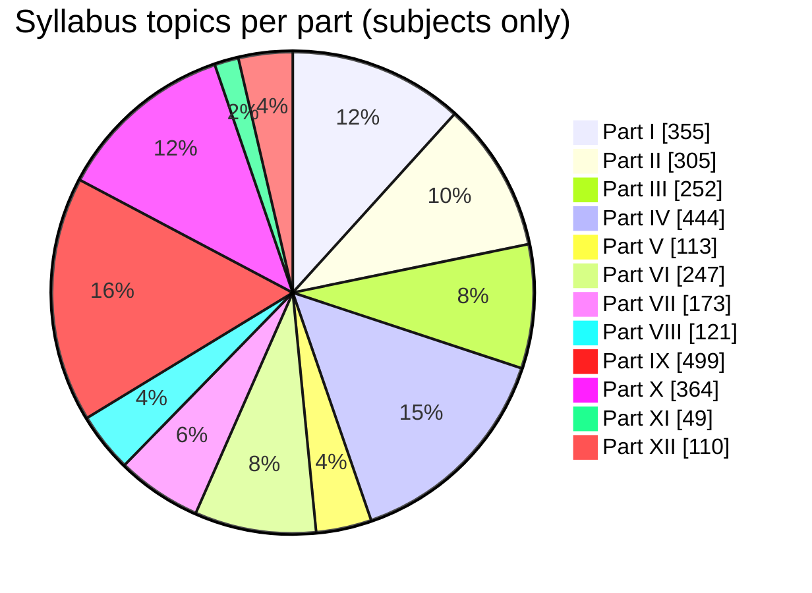

# Curriculum Index

> **Generated file.** Produced by `tools/build.py` from `curriculum/curriculum.json` (parsed from the authoritative syllabus). Do not edit by hand; change the source data or the generator instead.

A numeric summary of the source syllabus and where each subject lives in this repository.

## Source totals

| Measure | Count |
| --- | --- |
| Parts | 15 |
| Numbered subject areas | 64 |
| Groups (chapters) inside subjects | 246 |
| Topics inside subjects | 3032 |
| Groups inside Parts XIII–XV | 53 |
| Topics inside Parts XIII–XV | 229 |

Topic kinds inside subjects: item = 2923, row = 34, card = 11, also = 20, framework = 26, service = 18.

## Topics per part

## Parts

| Part | Subjects | Groups | Topics |
| --- | --- | --- | --- |
| [Part I — Computer Science Foundations](../docs/01-computer-science-foundations/index.md) | 5 | 36 | 355 |
| [Part II — Programming and Software Development](../docs/02-programming-and-software-development/index.md) | 5 | 24 | 305 |
| [Part III — Professional Software Engineering](../docs/03-professional-software-engineering/index.md) | 4 | 19 | 252 |
| [Part IV — Building Software Products](../docs/04-building-software-products/index.md) | 7 | 31 | 444 |
| [Part V — Distributed Systems and System Design](../docs/05-distributed-systems-and-system-design/index.md) | 2 | 12 | 113 |
| [Part VI — Cloud, DevOps and Infrastructure](../docs/06-cloud-devops-and-infrastructure/index.md) | 6 | 16 | 247 |
| [Part VII — Software Quality and Cybersecurity](../docs/07-software-quality-and-cybersecurity/index.md) | 2 | 14 | 173 |
| [Part VIII — Data Engineering, Data Science and Analytics](../docs/08-data-engineering-data-science-and-analytics/index.md) | 2 | 13 | 121 |
| [Part IX — Artificial Intelligence and Machine Learning](../docs/09-artificial-intelligence-and-machine-learning/index.md) | 13 | 40 | 499 |
| [Part X — Specialized Software Engineering Domains](../docs/10-specialized-software-engineering-domains/index.md) | 11 | 30 | 364 |
| [Part XI — AI-Assisted Software Engineering](../docs/11-ai-assisted-software-engineering/index.md) | 1 | 5 | 49 |
| [Part XII — Professional Engineering Practices](../docs/12-professional-engineering-practices/index.md) | 6 | 6 | 110 |
| [Part XIII — Complete Technology Ecosystem](../docs/13-complete-technology-ecosystem/index.md) | — | 44 | 158 |
| [Part XIV — How the Entire Field Fits Together](../docs/14-how-the-entire-field-fits-together/index.md) | — | 7 | 39 |
| [Part XV — Practical Learning Order](../docs/15-practical-learning-order/index.md) | — | 2 | 32 |

## Subject areas

| # | Subject | Part | Groups | Topics | Source tags |
| --- | --- | --- | --- | --- | --- |
| 1 | [Computer Fundamentals](../docs/01-computer-science-foundations/01-computer-fundamentals/index.md) | Part I | 6 | 51 | Start here · Beginner → Advanced |
| 2 | [Mathematics for Computer Science](../docs/01-computer-science-foundations/02-mathematics-for-computer-science/index.md) | Part I | 10 | 101 | Beginner → Research level |
| 3 | [Digital Logic and Computer Organization](../docs/01-computer-science-foundations/03-digital-logic-and-computer-organization/index.md) | Part I | 4 | 43 | — |
| 4 | [Operating Systems](../docs/01-computer-science-foundations/04-operating-systems/index.md) | Part I | 8 | 74 | — |
| 5 | [Computer Networking](../docs/01-computer-science-foundations/05-computer-networking/index.md) | Part I | 8 | 86 | — |
| 6 | [Programming Fundamentals](../docs/02-programming-and-software-development/06-programming-fundamentals/index.md) | Part II | 6 | 61 | Essential for every software developer |
| 7 | [Programming Paradigms](../docs/02-programming-and-software-development/07-programming-paradigms/index.md) | Part II | 3 | 53 | — |
| 8 | [Programming Languages and Ecosystem](../docs/02-programming-and-software-development/08-programming-languages-and-ecosystem/index.md) | Part II | 2 | 50 | — |
| 9 | [Data Structures and Algorithms (DSA)](../docs/02-programming-and-software-development/09-data-structures-and-algorithms/index.md) | Part II | 10 | 110 | Core interview and problem-solving subject |
| 10 | [Compilers and Programming Language Internals](../docs/02-programming-and-software-development/10-compilers-and-language-internals/index.md) | Part II | 3 | 31 | — |
| 11 | [Software Development Lifecycle (SDLC)](../docs/03-professional-software-engineering/11-software-development-lifecycle/index.md) | Part III | 5 | 56 | — |
| 12 | [Software Design Principles and Architecture](../docs/03-professional-software-engineering/12-software-design-principles-and-architecture/index.md) | Part III | 8 | 108 | Essential for senior engineers |
| 13 | [Version Control and Developer Workflow](../docs/03-professional-software-engineering/13-version-control-and-developer-workflow/index.md) | Part III | 1 | 35 | — |
| 14 | [Development Environments and Tools](../docs/03-professional-software-engineering/14-development-environments-and-tools/index.md) | Part III | 5 | 53 | — |
| 15 | [Database Management Systems (DBMS)](../docs/04-building-software-products/15-database-management-systems/index.md) | Part IV | 8 | 106 | Essential |
| 16 | [Backend Development](../docs/04-building-software-products/16-backend-development/index.md) | Part IV | 6 | 93 | Major software engineering specialization |
| 17 | [Frontend Development](../docs/04-building-software-products/17-frontend-development/index.md) | Part IV | 8 | 115 | — |
| 18 | [UI/UX and Human-Computer Interaction](../docs/04-building-software-products/18-ui-ux-and-human-computer-interaction/index.md) | Part IV | 1 | 31 | — |
| 19 | [Mobile Application Development](../docs/04-building-software-products/19-mobile-application-development/index.md) | Part IV | 5 | 51 | — |
| 20 | [Desktop Application Development](../docs/04-building-software-products/20-desktop-application-development/index.md) | Part IV | 1 | 20 | — |
| 21 | [API Integration and Messaging Systems](../docs/04-building-software-products/21-api-integration-and-messaging-systems/index.md) | Part IV | 2 | 28 | — |
| 22 | [Distributed Systems](../docs/05-distributed-systems-and-system-design/22-distributed-systems/index.md) | Part V | 7 | 56 | Advanced software engineering |
| 23 | [System Design](../docs/05-distributed-systems-and-system-design/23-system-design/index.md) | Part V | 5 | 57 | — |
| 24 | [Cloud Computing](../docs/06-cloud-devops-and-infrastructure/24-cloud-computing/index.md) | Part VI | 5 | 68 | — |
| 25 | [Containers and Container Orchestration](../docs/06-cloud-devops-and-infrastructure/25-containers-and-orchestration/index.md) | Part VI | 2 | 49 | — |
| 26 | [DevOps Engineering](../docs/06-cloud-devops-and-infrastructure/26-devops-engineering/index.md) | Part VI | 5 | 49 | — |
| 27 | [Site Reliability Engineering (SRE)](../docs/06-cloud-devops-and-infrastructure/27-site-reliability-engineering/index.md) | Part VI | 1 | 27 | — |
| 28 | [Observability and Monitoring](../docs/06-cloud-devops-and-infrastructure/28-observability-and-monitoring/index.md) | Part VI | 2 | 33 | — |
| 29 | [Performance Engineering](../docs/06-cloud-devops-and-infrastructure/29-performance-engineering/index.md) | Part VI | 1 | 21 | — |
| 30 | [Software Testing and Quality Assurance](../docs/07-software-quality-and-cybersecurity/30-software-testing-and-quality-assurance/index.md) | Part VII | 6 | 69 | Essential |
| 31 | [Cybersecurity and Software Security](../docs/07-software-quality-and-cybersecurity/31-cybersecurity-and-software-security/index.md) | Part VII | 8 | 104 | Important for every professional engineer |
| 32 | [Data Engineering](../docs/08-data-engineering-data-science-and-analytics/32-data-engineering/index.md) | Part VIII | 8 | 77 | — |
| 33 | [Data Science and Business Intelligence](../docs/08-data-engineering-data-science-and-analytics/33-data-science-and-business-intelligence/index.md) | Part VIII | 5 | 44 | — |
| 34 | [Artificial Intelligence Fundamentals](../docs/09-artificial-intelligence-and-machine-learning/34-artificial-intelligence-fundamentals/index.md) | Part IX | 1 | 17 | — |
| 35 | [Mathematics for Machine Learning](../docs/09-artificial-intelligence-and-machine-learning/35-mathematics-for-machine-learning/index.md) | Part IX | 1 | 17 | — |
| 36 | [Machine Learning](../docs/09-artificial-intelligence-and-machine-learning/36-machine-learning/index.md) | Part IX | 7 | 65 | Beginner → Advanced |
| 37 | [Deep Learning](../docs/09-artificial-intelligence-and-machine-learning/37-deep-learning/index.md) | Part IX | 4 | 43 | — |
| 38 | [Natural Language Processing (NLP)](../docs/09-artificial-intelligence-and-machine-learning/38-natural-language-processing/index.md) | Part IX | 2 | 32 | — |
| 39 | [Computer Vision](../docs/09-artificial-intelligence-and-machine-learning/39-computer-vision/index.md) | Part IX | 2 | 27 | — |
| 40 | [Reinforcement Learning](../docs/09-artificial-intelligence-and-machine-learning/40-reinforcement-learning/index.md) | Part IX | 1 | 24 | — |
| 41 | [Generative AI](../docs/09-artificial-intelligence-and-machine-learning/41-generative-ai/index.md) | Part IX | 4 | 33 | Modern AI engineering |
| 42 | [Large Language Models (LLMs)](../docs/09-artificial-intelligence-and-machine-learning/42-large-language-models/index.md) | Part IX | 5 | 64 | Advanced AI engineering |
| 43 | [Retrieval-Augmented Generation (RAG)](../docs/09-artificial-intelligence-and-machine-learning/43-retrieval-augmented-generation/index.md) | Part IX | 3 | 43 | — |
| 44 | [AI Agents and Agentic Systems](../docs/09-artificial-intelligence-and-machine-learning/44-ai-agents-and-agentic-systems/index.md) | Part IX | 6 | 61 | Advanced and rapidly evolving area |
| 45 | [AI Engineering and MLOps](../docs/09-artificial-intelligence-and-machine-learning/45-ai-engineering-and-mlops/index.md) | Part IX | 3 | 50 | — |
| 46 | [Responsible AI, AI Safety and AI Governance](../docs/09-artificial-intelligence-and-machine-learning/46-responsible-ai-safety-and-governance/index.md) | Part IX | 1 | 23 | — |
| 47 | [Game Development](../docs/10-specialized-software-engineering-domains/47-game-development/index.md) | Part X | 3 | 41 | — |
| 48 | [AR, VR, MR and Spatial Computing](../docs/10-specialized-software-engineering-domains/48-ar-vr-mr-and-spatial-computing/index.md) | Part X | 1 | 20 | — |
| 49 | [Embedded Systems and Firmware Engineering](../docs/10-specialized-software-engineering-domains/49-embedded-systems-and-firmware-engineering/index.md) | Part X | 2 | 38 | — |
| 50 | [Internet of Things (IoT)](../docs/10-specialized-software-engineering-domains/50-internet-of-things/index.md) | Part X | 1 | 23 | — |
| 51 | [Robotics and Autonomous Systems](../docs/10-specialized-software-engineering-domains/51-robotics-and-autonomous-systems/index.md) | Part X | 2 | 30 | — |
| 52 | [Blockchain and Web3](../docs/10-specialized-software-engineering-domains/52-blockchain-and-web3/index.md) | Part X | 1 | 30 | — |
| 53 | [High-Performance Computing (HPC)](../docs/10-specialized-software-engineering-domains/53-high-performance-computing/index.md) | Part X | 1 | 21 | — |
| 54 | [Quantum Computing](../docs/10-specialized-software-engineering-domains/54-quantum-computing/index.md) | Part X | 9 | 77 | Frontier computing |
| 55 | [Edge Computing and Fog Computing](../docs/10-specialized-software-engineering-domains/55-edge-and-fog-computing/index.md) | Part X | 1 | 14 | — |
| 56 | [Bioinformatics and Computational Biology](../docs/10-specialized-software-engineering-domains/56-bioinformatics-and-computational-biology/index.md) | Part X | 1 | 13 | — |
| 57 | [Other Specialized Domains](../docs/10-specialized-software-engineering-domains/57-other-specialized-domains/index.md) | Part X | 8 | 57 | — |
| 58 | [AI Tools Used by Modern Software Engineers](../docs/11-ai-assisted-software-engineering/58-ai-tools-for-software-engineers/index.md) | Part XI | 5 | 49 | — |
| 59 | [Engineering Standards and Software Quality](../docs/12-professional-engineering-practices/59-engineering-standards-and-software-quality/index.md) | Part XII | 1 | 17 | — |
| 60 | [Software Configuration and Release Management](../docs/12-professional-engineering-practices/60-software-configuration-and-release-management/index.md) | Part XII | 1 | 17 | — |
| 61 | [Engineering Economics](../docs/12-professional-engineering-practices/61-engineering-economics/index.md) | Part XII | 1 | 15 | — |
| 62 | [Software Ethics, Law and Governance](../docs/12-professional-engineering-practices/62-software-ethics-law-and-governance/index.md) | Part XII | 1 | 19 | — |
| 63 | [Technical Communication and Leadership](../docs/12-professional-engineering-practices/63-technical-communication-and-leadership/index.md) | Part XII | 1 | 17 | — |
| 64 | [Research and Advanced Computer Science](../docs/12-professional-engineering-practices/64-research-and-advanced-computer-science/index.md) | Part XII | 1 | 25 | — |
