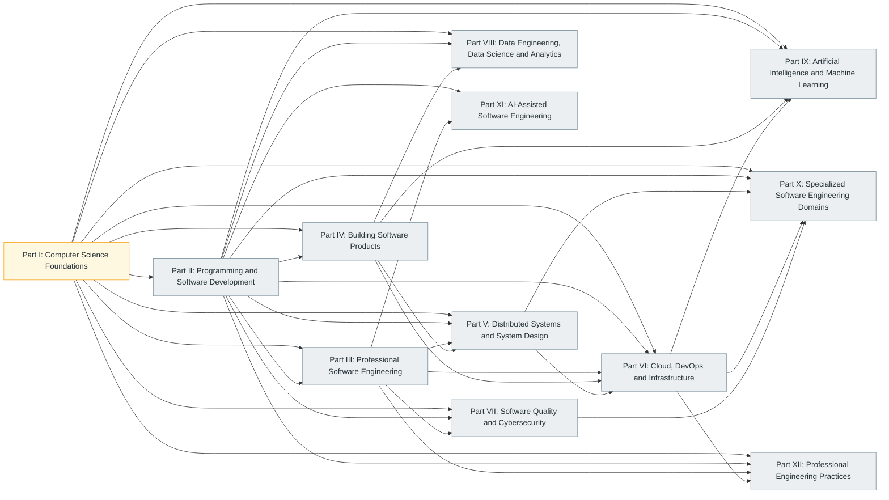

# Prerequisite Map

> **Generated file.** Produced by `tools/build.py` from `curriculum/curriculum.json` (parsed from the authoritative syllabus). Do not edit by hand; change the source data or the generator instead.

Dependencies between subject areas. Prerequisite edges are authored in `curriculum/subject-meta.json`; they say what should be understood *first*, not what is merely related. The graph is checked to be acyclic.

## Between parts

An arrow from Part A to Part B means at least one subject in B lists a subject in A as a prerequisite.

## Subject by subject

| Subject | Prerequisites | Related |
| --- | --- | --- |
| [1. Computer Fundamentals](../docs/01-computer-science-foundations/01-computer-fundamentals/index.md) | — | [2](../docs/01-computer-science-foundations/02-mathematics-for-computer-science/index.md), [3](../docs/01-computer-science-foundations/03-digital-logic-and-computer-organization/index.md), [4](../docs/01-computer-science-foundations/04-operating-systems/index.md) |
| [2. Mathematics for Computer Science](../docs/01-computer-science-foundations/02-mathematics-for-computer-science/index.md) | — | [9](../docs/02-programming-and-software-development/09-data-structures-and-algorithms/index.md), [35](../docs/09-artificial-intelligence-and-machine-learning/35-mathematics-for-machine-learning/index.md), [31](../docs/07-software-quality-and-cybersecurity/31-cybersecurity-and-software-security/index.md), [54](../docs/10-specialized-software-engineering-domains/54-quantum-computing/index.md) |
| [3. Digital Logic and Computer Organization](../docs/01-computer-science-foundations/03-digital-logic-and-computer-organization/index.md) | [1](../docs/01-computer-science-foundations/01-computer-fundamentals/index.md) | [4](../docs/01-computer-science-foundations/04-operating-systems/index.md), [49](../docs/10-specialized-software-engineering-domains/49-embedded-systems-and-firmware-engineering/index.md), [53](../docs/10-specialized-software-engineering-domains/53-high-performance-computing/index.md) |
| [4. Operating Systems](../docs/01-computer-science-foundations/04-operating-systems/index.md) | [1](../docs/01-computer-science-foundations/01-computer-fundamentals/index.md), [3](../docs/01-computer-science-foundations/03-digital-logic-and-computer-organization/index.md) | [5](../docs/01-computer-science-foundations/05-computer-networking/index.md), [29](../docs/06-cloud-devops-and-infrastructure/29-performance-engineering/index.md), [53](../docs/10-specialized-software-engineering-domains/53-high-performance-computing/index.md), [6](../docs/02-programming-and-software-development/06-programming-fundamentals/index.md) |
| [5. Computer Networking](../docs/01-computer-science-foundations/05-computer-networking/index.md) | [1](../docs/01-computer-science-foundations/01-computer-fundamentals/index.md), [4](../docs/01-computer-science-foundations/04-operating-systems/index.md) | [16](../docs/04-building-software-products/16-backend-development/index.md), [22](../docs/05-distributed-systems-and-system-design/22-distributed-systems/index.md), [31](../docs/07-software-quality-and-cybersecurity/31-cybersecurity-and-software-security/index.md) |
| [6. Programming Fundamentals](../docs/02-programming-and-software-development/06-programming-fundamentals/index.md) | [1](../docs/01-computer-science-foundations/01-computer-fundamentals/index.md) | [7](../docs/02-programming-and-software-development/07-programming-paradigms/index.md), [8](../docs/02-programming-and-software-development/08-programming-languages-and-ecosystem/index.md), [9](../docs/02-programming-and-software-development/09-data-structures-and-algorithms/index.md) |
| [7. Programming Paradigms](../docs/02-programming-and-software-development/07-programming-paradigms/index.md) | [6](../docs/02-programming-and-software-development/06-programming-fundamentals/index.md) | [8](../docs/02-programming-and-software-development/08-programming-languages-and-ecosystem/index.md), [12](../docs/03-professional-software-engineering/12-software-design-principles-and-architecture/index.md) |
| [8. Programming Languages and Ecosystem](../docs/02-programming-and-software-development/08-programming-languages-and-ecosystem/index.md) | [6](../docs/02-programming-and-software-development/06-programming-fundamentals/index.md) | [7](../docs/02-programming-and-software-development/07-programming-paradigms/index.md), [10](../docs/02-programming-and-software-development/10-compilers-and-language-internals/index.md), [14](../docs/03-professional-software-engineering/14-development-environments-and-tools/index.md) |
| [9. Data Structures and Algorithms (DSA)](../docs/02-programming-and-software-development/09-data-structures-and-algorithms/index.md) | [2](../docs/01-computer-science-foundations/02-mathematics-for-computer-science/index.md), [6](../docs/02-programming-and-software-development/06-programming-fundamentals/index.md) | [10](../docs/02-programming-and-software-development/10-compilers-and-language-internals/index.md), [23](../docs/05-distributed-systems-and-system-design/23-system-design/index.md), [29](../docs/06-cloud-devops-and-infrastructure/29-performance-engineering/index.md) |
| [10. Compilers and Programming Language Internals](../docs/02-programming-and-software-development/10-compilers-and-language-internals/index.md) | [3](../docs/01-computer-science-foundations/03-digital-logic-and-computer-organization/index.md), [6](../docs/02-programming-and-software-development/06-programming-fundamentals/index.md), [8](../docs/02-programming-and-software-development/08-programming-languages-and-ecosystem/index.md), [9](../docs/02-programming-and-software-development/09-data-structures-and-algorithms/index.md) | [4](../docs/01-computer-science-foundations/04-operating-systems/index.md), [7](../docs/02-programming-and-software-development/07-programming-paradigms/index.md) |
| [11. Software Development Lifecycle (SDLC)](../docs/03-professional-software-engineering/11-software-development-lifecycle/index.md) | [6](../docs/02-programming-and-software-development/06-programming-fundamentals/index.md) | [12](../docs/03-professional-software-engineering/12-software-design-principles-and-architecture/index.md), [30](../docs/07-software-quality-and-cybersecurity/30-software-testing-and-quality-assurance/index.md), [59](../docs/12-professional-engineering-practices/59-engineering-standards-and-software-quality/index.md), [60](../docs/12-professional-engineering-practices/60-software-configuration-and-release-management/index.md) |
| [12. Software Design Principles and Architecture](../docs/03-professional-software-engineering/12-software-design-principles-and-architecture/index.md) | [6](../docs/02-programming-and-software-development/06-programming-fundamentals/index.md), [7](../docs/02-programming-and-software-development/07-programming-paradigms/index.md) | [11](../docs/03-professional-software-engineering/11-software-development-lifecycle/index.md), [16](../docs/04-building-software-products/16-backend-development/index.md), [22](../docs/05-distributed-systems-and-system-design/22-distributed-systems/index.md), [23](../docs/05-distributed-systems-and-system-design/23-system-design/index.md) |
| [13. Version Control and Developer Workflow](../docs/03-professional-software-engineering/13-version-control-and-developer-workflow/index.md) | [1](../docs/01-computer-science-foundations/01-computer-fundamentals/index.md) | [14](../docs/03-professional-software-engineering/14-development-environments-and-tools/index.md), [26](../docs/06-cloud-devops-and-infrastructure/26-devops-engineering/index.md), [60](../docs/12-professional-engineering-practices/60-software-configuration-and-release-management/index.md) |
| [14. Development Environments and Tools](../docs/03-professional-software-engineering/14-development-environments-and-tools/index.md) | [1](../docs/01-computer-science-foundations/01-computer-fundamentals/index.md), [6](../docs/02-programming-and-software-development/06-programming-fundamentals/index.md) | [13](../docs/03-professional-software-engineering/13-version-control-and-developer-workflow/index.md), [26](../docs/06-cloud-devops-and-infrastructure/26-devops-engineering/index.md) |
| [15. Database Management Systems (DBMS)](../docs/04-building-software-products/15-database-management-systems/index.md) | [2](../docs/01-computer-science-foundations/02-mathematics-for-computer-science/index.md), [9](../docs/02-programming-and-software-development/09-data-structures-and-algorithms/index.md) | [16](../docs/04-building-software-products/16-backend-development/index.md), [22](../docs/05-distributed-systems-and-system-design/22-distributed-systems/index.md), [32](../docs/08-data-engineering-data-science-and-analytics/32-data-engineering/index.md) |
| [16. Backend Development](../docs/04-building-software-products/16-backend-development/index.md) | [5](../docs/01-computer-science-foundations/05-computer-networking/index.md), [6](../docs/02-programming-and-software-development/06-programming-fundamentals/index.md), [15](../docs/04-building-software-products/15-database-management-systems/index.md) | [21](../docs/04-building-software-products/21-api-integration-and-messaging-systems/index.md), [23](../docs/05-distributed-systems-and-system-design/23-system-design/index.md), [31](../docs/07-software-quality-and-cybersecurity/31-cybersecurity-and-software-security/index.md) |
| [17. Frontend Development](../docs/04-building-software-products/17-frontend-development/index.md) | [5](../docs/01-computer-science-foundations/05-computer-networking/index.md), [6](../docs/02-programming-and-software-development/06-programming-fundamentals/index.md) | [16](../docs/04-building-software-products/16-backend-development/index.md), [18](../docs/04-building-software-products/18-ui-ux-and-human-computer-interaction/index.md), [21](../docs/04-building-software-products/21-api-integration-and-messaging-systems/index.md) |
| [18. UI/UX and Human-Computer Interaction](../docs/04-building-software-products/18-ui-ux-and-human-computer-interaction/index.md) | [1](../docs/01-computer-science-foundations/01-computer-fundamentals/index.md) | [17](../docs/04-building-software-products/17-frontend-development/index.md), [19](../docs/04-building-software-products/19-mobile-application-development/index.md), [20](../docs/04-building-software-products/20-desktop-application-development/index.md) |
| [19. Mobile Application Development](../docs/04-building-software-products/19-mobile-application-development/index.md) | [6](../docs/02-programming-and-software-development/06-programming-fundamentals/index.md), [7](../docs/02-programming-and-software-development/07-programming-paradigms/index.md) | [17](../docs/04-building-software-products/17-frontend-development/index.md), [18](../docs/04-building-software-products/18-ui-ux-and-human-computer-interaction/index.md), [21](../docs/04-building-software-products/21-api-integration-and-messaging-systems/index.md) |
| [20. Desktop Application Development](../docs/04-building-software-products/20-desktop-application-development/index.md) | [6](../docs/02-programming-and-software-development/06-programming-fundamentals/index.md), [7](../docs/02-programming-and-software-development/07-programming-paradigms/index.md) | [4](../docs/01-computer-science-foundations/04-operating-systems/index.md), [18](../docs/04-building-software-products/18-ui-ux-and-human-computer-interaction/index.md) |
| [21. API Integration and Messaging Systems](../docs/04-building-software-products/21-api-integration-and-messaging-systems/index.md) | [5](../docs/01-computer-science-foundations/05-computer-networking/index.md), [16](../docs/04-building-software-products/16-backend-development/index.md) | [22](../docs/05-distributed-systems-and-system-design/22-distributed-systems/index.md), [23](../docs/05-distributed-systems-and-system-design/23-system-design/index.md) |
| [22. Distributed Systems](../docs/05-distributed-systems-and-system-design/22-distributed-systems/index.md) | [4](../docs/01-computer-science-foundations/04-operating-systems/index.md), [5](../docs/01-computer-science-foundations/05-computer-networking/index.md), [9](../docs/02-programming-and-software-development/09-data-structures-and-algorithms/index.md), [15](../docs/04-building-software-products/15-database-management-systems/index.md) | [23](../docs/05-distributed-systems-and-system-design/23-system-design/index.md), [24](../docs/06-cloud-devops-and-infrastructure/24-cloud-computing/index.md), [27](../docs/06-cloud-devops-and-infrastructure/27-site-reliability-engineering/index.md) |
| [23. System Design](../docs/05-distributed-systems-and-system-design/23-system-design/index.md) | [12](../docs/03-professional-software-engineering/12-software-design-principles-and-architecture/index.md), [15](../docs/04-building-software-products/15-database-management-systems/index.md), [22](../docs/05-distributed-systems-and-system-design/22-distributed-systems/index.md) | [16](../docs/04-building-software-products/16-backend-development/index.md), [24](../docs/06-cloud-devops-and-infrastructure/24-cloud-computing/index.md), [29](../docs/06-cloud-devops-and-infrastructure/29-performance-engineering/index.md) |
| [24. Cloud Computing](../docs/06-cloud-devops-and-infrastructure/24-cloud-computing/index.md) | [4](../docs/01-computer-science-foundations/04-operating-systems/index.md), [5](../docs/01-computer-science-foundations/05-computer-networking/index.md) | [25](../docs/06-cloud-devops-and-infrastructure/25-containers-and-orchestration/index.md), [26](../docs/06-cloud-devops-and-infrastructure/26-devops-engineering/index.md), [31](../docs/07-software-quality-and-cybersecurity/31-cybersecurity-and-software-security/index.md) |
| [25. Containers and Container Orchestration](../docs/06-cloud-devops-and-infrastructure/25-containers-and-orchestration/index.md) | [4](../docs/01-computer-science-foundations/04-operating-systems/index.md), [24](../docs/06-cloud-devops-and-infrastructure/24-cloud-computing/index.md) | [26](../docs/06-cloud-devops-and-infrastructure/26-devops-engineering/index.md), [27](../docs/06-cloud-devops-and-infrastructure/27-site-reliability-engineering/index.md) |
| [26. DevOps Engineering](../docs/06-cloud-devops-and-infrastructure/26-devops-engineering/index.md) | [13](../docs/03-professional-software-engineering/13-version-control-and-developer-workflow/index.md), [24](../docs/06-cloud-devops-and-infrastructure/24-cloud-computing/index.md), [25](../docs/06-cloud-devops-and-infrastructure/25-containers-and-orchestration/index.md) | [27](../docs/06-cloud-devops-and-infrastructure/27-site-reliability-engineering/index.md), [28](../docs/06-cloud-devops-and-infrastructure/28-observability-and-monitoring/index.md), [30](../docs/07-software-quality-and-cybersecurity/30-software-testing-and-quality-assurance/index.md) |
| [27. Site Reliability Engineering (SRE)](../docs/06-cloud-devops-and-infrastructure/27-site-reliability-engineering/index.md) | [22](../docs/05-distributed-systems-and-system-design/22-distributed-systems/index.md), [26](../docs/06-cloud-devops-and-infrastructure/26-devops-engineering/index.md), [28](../docs/06-cloud-devops-and-infrastructure/28-observability-and-monitoring/index.md) | [29](../docs/06-cloud-devops-and-infrastructure/29-performance-engineering/index.md) |
| [28. Observability and Monitoring](../docs/06-cloud-devops-and-infrastructure/28-observability-and-monitoring/index.md) | [16](../docs/04-building-software-products/16-backend-development/index.md) | [26](../docs/06-cloud-devops-and-infrastructure/26-devops-engineering/index.md), [27](../docs/06-cloud-devops-and-infrastructure/27-site-reliability-engineering/index.md), [29](../docs/06-cloud-devops-and-infrastructure/29-performance-engineering/index.md) |
| [29. Performance Engineering](../docs/06-cloud-devops-and-infrastructure/29-performance-engineering/index.md) | [3](../docs/01-computer-science-foundations/03-digital-logic-and-computer-organization/index.md), [4](../docs/01-computer-science-foundations/04-operating-systems/index.md), [9](../docs/02-programming-and-software-development/09-data-structures-and-algorithms/index.md) | [23](../docs/05-distributed-systems-and-system-design/23-system-design/index.md), [28](../docs/06-cloud-devops-and-infrastructure/28-observability-and-monitoring/index.md) |
| [30. Software Testing and Quality Assurance](../docs/07-software-quality-and-cybersecurity/30-software-testing-and-quality-assurance/index.md) | [6](../docs/02-programming-and-software-development/06-programming-fundamentals/index.md), [11](../docs/03-professional-software-engineering/11-software-development-lifecycle/index.md) | [12](../docs/03-professional-software-engineering/12-software-design-principles-and-architecture/index.md), [26](../docs/06-cloud-devops-and-infrastructure/26-devops-engineering/index.md), [59](../docs/12-professional-engineering-practices/59-engineering-standards-and-software-quality/index.md) |
| [31. Cybersecurity and Software Security](../docs/07-software-quality-and-cybersecurity/31-cybersecurity-and-software-security/index.md) | [2](../docs/01-computer-science-foundations/02-mathematics-for-computer-science/index.md), [5](../docs/01-computer-science-foundations/05-computer-networking/index.md) | [16](../docs/04-building-software-products/16-backend-development/index.md), [24](../docs/06-cloud-devops-and-infrastructure/24-cloud-computing/index.md), [30](../docs/07-software-quality-and-cybersecurity/30-software-testing-and-quality-assurance/index.md) |
| [32. Data Engineering](../docs/08-data-engineering-data-science-and-analytics/32-data-engineering/index.md) | [6](../docs/02-programming-and-software-development/06-programming-fundamentals/index.md), [15](../docs/04-building-software-products/15-database-management-systems/index.md) | [22](../docs/05-distributed-systems-and-system-design/22-distributed-systems/index.md), [33](../docs/08-data-engineering-data-science-and-analytics/33-data-science-and-business-intelligence/index.md) |
| [33. Data Science and Business Intelligence](../docs/08-data-engineering-data-science-and-analytics/33-data-science-and-business-intelligence/index.md) | [2](../docs/01-computer-science-foundations/02-mathematics-for-computer-science/index.md), [6](../docs/02-programming-and-software-development/06-programming-fundamentals/index.md) | [32](../docs/08-data-engineering-data-science-and-analytics/32-data-engineering/index.md), [36](../docs/09-artificial-intelligence-and-machine-learning/36-machine-learning/index.md) |
| [34. Artificial Intelligence Fundamentals](../docs/09-artificial-intelligence-and-machine-learning/34-artificial-intelligence-fundamentals/index.md) | [2](../docs/01-computer-science-foundations/02-mathematics-for-computer-science/index.md), [6](../docs/02-programming-and-software-development/06-programming-fundamentals/index.md) | [35](../docs/09-artificial-intelligence-and-machine-learning/35-mathematics-for-machine-learning/index.md), [36](../docs/09-artificial-intelligence-and-machine-learning/36-machine-learning/index.md) |
| [35. Mathematics for Machine Learning](../docs/09-artificial-intelligence-and-machine-learning/35-mathematics-for-machine-learning/index.md) | [2](../docs/01-computer-science-foundations/02-mathematics-for-computer-science/index.md) | [36](../docs/09-artificial-intelligence-and-machine-learning/36-machine-learning/index.md), [37](../docs/09-artificial-intelligence-and-machine-learning/37-deep-learning/index.md) |
| [36. Machine Learning](../docs/09-artificial-intelligence-and-machine-learning/36-machine-learning/index.md) | [34](../docs/09-artificial-intelligence-and-machine-learning/34-artificial-intelligence-fundamentals/index.md), [35](../docs/09-artificial-intelligence-and-machine-learning/35-mathematics-for-machine-learning/index.md), [6](../docs/02-programming-and-software-development/06-programming-fundamentals/index.md) | [33](../docs/08-data-engineering-data-science-and-analytics/33-data-science-and-business-intelligence/index.md), [37](../docs/09-artificial-intelligence-and-machine-learning/37-deep-learning/index.md) |
| [37. Deep Learning](../docs/09-artificial-intelligence-and-machine-learning/37-deep-learning/index.md) | [36](../docs/09-artificial-intelligence-and-machine-learning/36-machine-learning/index.md) | [38](../docs/09-artificial-intelligence-and-machine-learning/38-natural-language-processing/index.md), [39](../docs/09-artificial-intelligence-and-machine-learning/39-computer-vision/index.md), [41](../docs/09-artificial-intelligence-and-machine-learning/41-generative-ai/index.md) |
| [38. Natural Language Processing (NLP)](../docs/09-artificial-intelligence-and-machine-learning/38-natural-language-processing/index.md) | [36](../docs/09-artificial-intelligence-and-machine-learning/36-machine-learning/index.md), [37](../docs/09-artificial-intelligence-and-machine-learning/37-deep-learning/index.md) | [42](../docs/09-artificial-intelligence-and-machine-learning/42-large-language-models/index.md) |
| [39. Computer Vision](../docs/09-artificial-intelligence-and-machine-learning/39-computer-vision/index.md) | [37](../docs/09-artificial-intelligence-and-machine-learning/37-deep-learning/index.md) | [51](../docs/10-specialized-software-engineering-domains/51-robotics-and-autonomous-systems/index.md), [48](../docs/10-specialized-software-engineering-domains/48-ar-vr-mr-and-spatial-computing/index.md) |
| [40. Reinforcement Learning](../docs/09-artificial-intelligence-and-machine-learning/40-reinforcement-learning/index.md) | [35](../docs/09-artificial-intelligence-and-machine-learning/35-mathematics-for-machine-learning/index.md), [36](../docs/09-artificial-intelligence-and-machine-learning/36-machine-learning/index.md) | [37](../docs/09-artificial-intelligence-and-machine-learning/37-deep-learning/index.md), [44](../docs/09-artificial-intelligence-and-machine-learning/44-ai-agents-and-agentic-systems/index.md), [51](../docs/10-specialized-software-engineering-domains/51-robotics-and-autonomous-systems/index.md) |
| [41. Generative AI](../docs/09-artificial-intelligence-and-machine-learning/41-generative-ai/index.md) | [37](../docs/09-artificial-intelligence-and-machine-learning/37-deep-learning/index.md) | [38](../docs/09-artificial-intelligence-and-machine-learning/38-natural-language-processing/index.md), [39](../docs/09-artificial-intelligence-and-machine-learning/39-computer-vision/index.md), [42](../docs/09-artificial-intelligence-and-machine-learning/42-large-language-models/index.md) |
| [42. Large Language Models (LLMs)](../docs/09-artificial-intelligence-and-machine-learning/42-large-language-models/index.md) | [37](../docs/09-artificial-intelligence-and-machine-learning/37-deep-learning/index.md), [38](../docs/09-artificial-intelligence-and-machine-learning/38-natural-language-processing/index.md) | [41](../docs/09-artificial-intelligence-and-machine-learning/41-generative-ai/index.md), [43](../docs/09-artificial-intelligence-and-machine-learning/43-retrieval-augmented-generation/index.md), [44](../docs/09-artificial-intelligence-and-machine-learning/44-ai-agents-and-agentic-systems/index.md) |
| [43. Retrieval-Augmented Generation (RAG)](../docs/09-artificial-intelligence-and-machine-learning/43-retrieval-augmented-generation/index.md) | [15](../docs/04-building-software-products/15-database-management-systems/index.md), [42](../docs/09-artificial-intelligence-and-machine-learning/42-large-language-models/index.md) | [44](../docs/09-artificial-intelligence-and-machine-learning/44-ai-agents-and-agentic-systems/index.md), [45](../docs/09-artificial-intelligence-and-machine-learning/45-ai-engineering-and-mlops/index.md) |
| [44. AI Agents and Agentic Systems](../docs/09-artificial-intelligence-and-machine-learning/44-ai-agents-and-agentic-systems/index.md) | [42](../docs/09-artificial-intelligence-and-machine-learning/42-large-language-models/index.md), [43](../docs/09-artificial-intelligence-and-machine-learning/43-retrieval-augmented-generation/index.md) | [45](../docs/09-artificial-intelligence-and-machine-learning/45-ai-engineering-and-mlops/index.md), [46](../docs/09-artificial-intelligence-and-machine-learning/46-responsible-ai-safety-and-governance/index.md), [58](../docs/11-ai-assisted-software-engineering/58-ai-tools-for-software-engineers/index.md) |
| [45. AI Engineering and MLOps](../docs/09-artificial-intelligence-and-machine-learning/45-ai-engineering-and-mlops/index.md) | [26](../docs/06-cloud-devops-and-infrastructure/26-devops-engineering/index.md), [36](../docs/09-artificial-intelligence-and-machine-learning/36-machine-learning/index.md) | [42](../docs/09-artificial-intelligence-and-machine-learning/42-large-language-models/index.md), [43](../docs/09-artificial-intelligence-and-machine-learning/43-retrieval-augmented-generation/index.md), [44](../docs/09-artificial-intelligence-and-machine-learning/44-ai-agents-and-agentic-systems/index.md) |
| [46. Responsible AI, AI Safety and AI Governance](../docs/09-artificial-intelligence-and-machine-learning/46-responsible-ai-safety-and-governance/index.md) | [34](../docs/09-artificial-intelligence-and-machine-learning/34-artificial-intelligence-fundamentals/index.md) | [45](../docs/09-artificial-intelligence-and-machine-learning/45-ai-engineering-and-mlops/index.md), [62](../docs/12-professional-engineering-practices/62-software-ethics-law-and-governance/index.md) |
| [47. Game Development](../docs/10-specialized-software-engineering-domains/47-game-development/index.md) | [2](../docs/01-computer-science-foundations/02-mathematics-for-computer-science/index.md), [6](../docs/02-programming-and-software-development/06-programming-fundamentals/index.md), [9](../docs/02-programming-and-software-development/09-data-structures-and-algorithms/index.md) | [48](../docs/10-specialized-software-engineering-domains/48-ar-vr-mr-and-spatial-computing/index.md), [53](../docs/10-specialized-software-engineering-domains/53-high-performance-computing/index.md) |
| [48. AR, VR, MR and Spatial Computing](../docs/10-specialized-software-engineering-domains/48-ar-vr-mr-and-spatial-computing/index.md) | [2](../docs/01-computer-science-foundations/02-mathematics-for-computer-science/index.md), [47](../docs/10-specialized-software-engineering-domains/47-game-development/index.md) | [39](../docs/09-artificial-intelligence-and-machine-learning/39-computer-vision/index.md), [51](../docs/10-specialized-software-engineering-domains/51-robotics-and-autonomous-systems/index.md) |
| [49. Embedded Systems and Firmware Engineering](../docs/10-specialized-software-engineering-domains/49-embedded-systems-and-firmware-engineering/index.md) | [3](../docs/01-computer-science-foundations/03-digital-logic-and-computer-organization/index.md), [6](../docs/02-programming-and-software-development/06-programming-fundamentals/index.md) | [4](../docs/01-computer-science-foundations/04-operating-systems/index.md), [50](../docs/10-specialized-software-engineering-domains/50-internet-of-things/index.md), [51](../docs/10-specialized-software-engineering-domains/51-robotics-and-autonomous-systems/index.md) |
| [50. Internet of Things (IoT)](../docs/10-specialized-software-engineering-domains/50-internet-of-things/index.md) | [5](../docs/01-computer-science-foundations/05-computer-networking/index.md), [49](../docs/10-specialized-software-engineering-domains/49-embedded-systems-and-firmware-engineering/index.md) | [31](../docs/07-software-quality-and-cybersecurity/31-cybersecurity-and-software-security/index.md), [55](../docs/10-specialized-software-engineering-domains/55-edge-and-fog-computing/index.md) |
| [51. Robotics and Autonomous Systems](../docs/10-specialized-software-engineering-domains/51-robotics-and-autonomous-systems/index.md) | [2](../docs/01-computer-science-foundations/02-mathematics-for-computer-science/index.md), [6](../docs/02-programming-and-software-development/06-programming-fundamentals/index.md) | [39](../docs/09-artificial-intelligence-and-machine-learning/39-computer-vision/index.md), [40](../docs/09-artificial-intelligence-and-machine-learning/40-reinforcement-learning/index.md), [49](../docs/10-specialized-software-engineering-domains/49-embedded-systems-and-firmware-engineering/index.md) |
| [52. Blockchain and Web3](../docs/10-specialized-software-engineering-domains/52-blockchain-and-web3/index.md) | [22](../docs/05-distributed-systems-and-system-design/22-distributed-systems/index.md), [31](../docs/07-software-quality-and-cybersecurity/31-cybersecurity-and-software-security/index.md) | [15](../docs/04-building-software-products/15-database-management-systems/index.md) |
| [53. High-Performance Computing (HPC)](../docs/10-specialized-software-engineering-domains/53-high-performance-computing/index.md) | [3](../docs/01-computer-science-foundations/03-digital-logic-and-computer-organization/index.md), [4](../docs/01-computer-science-foundations/04-operating-systems/index.md) | [29](../docs/06-cloud-devops-and-infrastructure/29-performance-engineering/index.md), [54](../docs/10-specialized-software-engineering-domains/54-quantum-computing/index.md) |
| [54. Quantum Computing](../docs/10-specialized-software-engineering-domains/54-quantum-computing/index.md) | [2](../docs/01-computer-science-foundations/02-mathematics-for-computer-science/index.md) | [31](../docs/07-software-quality-and-cybersecurity/31-cybersecurity-and-software-security/index.md), [53](../docs/10-specialized-software-engineering-domains/53-high-performance-computing/index.md) |
| [55. Edge Computing and Fog Computing](../docs/10-specialized-software-engineering-domains/55-edge-and-fog-computing/index.md) | [5](../docs/01-computer-science-foundations/05-computer-networking/index.md), [24](../docs/06-cloud-devops-and-infrastructure/24-cloud-computing/index.md) | [50](../docs/10-specialized-software-engineering-domains/50-internet-of-things/index.md) |
| [56. Bioinformatics and Computational Biology](../docs/10-specialized-software-engineering-domains/56-bioinformatics-and-computational-biology/index.md) | [2](../docs/01-computer-science-foundations/02-mathematics-for-computer-science/index.md), [9](../docs/02-programming-and-software-development/09-data-structures-and-algorithms/index.md) | [33](../docs/08-data-engineering-data-science-and-analytics/33-data-science-and-business-intelligence/index.md), [36](../docs/09-artificial-intelligence-and-machine-learning/36-machine-learning/index.md) |
| [57. Other Specialized Domains](../docs/10-specialized-software-engineering-domains/57-other-specialized-domains/index.md) | — | [31](../docs/07-software-quality-and-cybersecurity/31-cybersecurity-and-software-security/index.md), [62](../docs/12-professional-engineering-practices/62-software-ethics-law-and-governance/index.md) |
| [58. AI Tools Used by Modern Software Engineers](../docs/11-ai-assisted-software-engineering/58-ai-tools-for-software-engineers/index.md) | [6](../docs/02-programming-and-software-development/06-programming-fundamentals/index.md), [13](../docs/03-professional-software-engineering/13-version-control-and-developer-workflow/index.md) | [30](../docs/07-software-quality-and-cybersecurity/30-software-testing-and-quality-assurance/index.md), [44](../docs/09-artificial-intelligence-and-machine-learning/44-ai-agents-and-agentic-systems/index.md) |
| [59. Engineering Standards and Software Quality](../docs/12-professional-engineering-practices/59-engineering-standards-and-software-quality/index.md) | [11](../docs/03-professional-software-engineering/11-software-development-lifecycle/index.md) | [30](../docs/07-software-quality-and-cybersecurity/30-software-testing-and-quality-assurance/index.md), [60](../docs/12-professional-engineering-practices/60-software-configuration-and-release-management/index.md) |
| [60. Software Configuration and Release Management](../docs/12-professional-engineering-practices/60-software-configuration-and-release-management/index.md) | [13](../docs/03-professional-software-engineering/13-version-control-and-developer-workflow/index.md), [26](../docs/06-cloud-devops-and-infrastructure/26-devops-engineering/index.md) | [59](../docs/12-professional-engineering-practices/59-engineering-standards-and-software-quality/index.md) |
| [61. Engineering Economics](../docs/12-professional-engineering-practices/61-engineering-economics/index.md) | [11](../docs/03-professional-software-engineering/11-software-development-lifecycle/index.md) | [23](../docs/05-distributed-systems-and-system-design/23-system-design/index.md), [24](../docs/06-cloud-devops-and-infrastructure/24-cloud-computing/index.md) |
| [62. Software Ethics, Law and Governance](../docs/12-professional-engineering-practices/62-software-ethics-law-and-governance/index.md) | — | [31](../docs/07-software-quality-and-cybersecurity/31-cybersecurity-and-software-security/index.md), [46](../docs/09-artificial-intelligence-and-machine-learning/46-responsible-ai-safety-and-governance/index.md) |
| [63. Technical Communication and Leadership](../docs/12-professional-engineering-practices/63-technical-communication-and-leadership/index.md) | — | [11](../docs/03-professional-software-engineering/11-software-development-lifecycle/index.md) |
| [64. Research and Advanced Computer Science](../docs/12-professional-engineering-practices/64-research-and-advanced-computer-science/index.md) | [2](../docs/01-computer-science-foundations/02-mathematics-for-computer-science/index.md), [9](../docs/02-programming-and-software-development/09-data-structures-and-algorithms/index.md) | [10](../docs/02-programming-and-software-development/10-compilers-and-language-internals/index.md), [22](../docs/05-distributed-systems-and-system-design/22-distributed-systems/index.md), [54](../docs/10-specialized-software-engineering-domains/54-quantum-computing/index.md) |
