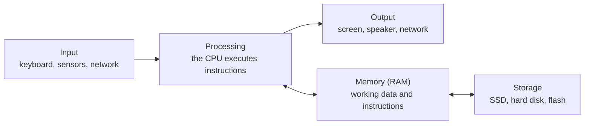
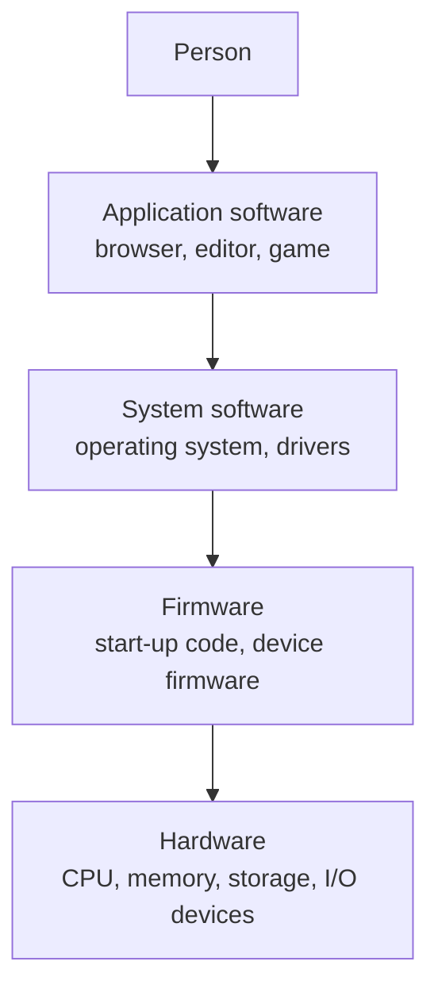

# What Is a Computer?

<!-- BEGIN HEADER (generated by tools/build.py from the front matter; edit the front matter, not this block) -->
> [Home](../../../../README.md) › [Part I — Computer Science Foundations](../../index.md) › [1. Computer Fundamentals](../index.md) › [Chapter 1: Introduction to computers](index.md)

- **Difficulty:** Absolute beginner
- **Estimated time:** about 50 minutes
- **Prerequisites:** none beyond the earlier lessons in this chapter
- **Syllabus topics covered:** `01.01.01` What is a computer? · `01.01.02` Hardware vs software · `01.01.03` Input, processing, output and storage
- **Status:** Drafted (passes the automated checks; awaiting independent technical review). Last reviewed 2026-11-01.
<!-- END HEADER -->

## What you will learn

- State what makes a machine a *computer* rather than a fixed-function device.
- Describe the input, processing, output and storage cycle and name the parts that perform each role.
- Distinguish hardware, firmware and software, and explain why the boundary between them is a design choice.
- Explain the stored-program idea and why it matters for everything from compilers to operating systems.
- Tell memory apart from storage, a distinction that causes endless confusion.

## Introduction

A **computer** is a machine that follows a stored list of instructions to turn input data into output data, using memory to hold both the instructions and the data it is working on.

Four properties are packed into that sentence:

1. **It accepts input**: from a keyboard, a sensor, a network connection or a file.
2. **It stores information**: both the *data* being worked on and the *instructions* that say what to do with it.
3. **It processes**: it carries out the instructions, one small step at a time.
4. **It produces output**: pixels on a screen, a sound, a signal to a motor, a message on the network.

The word that separates a computer from other machines is **programmable**. A mechanical clock does one thing because of the way its gears are cut. A computer does whatever its current *program* says, and you can change the program without touching the machine. That single property is why the same device can be a phone, a word processor and a game console.

### Where the idea came from

The concept developed over more than a century, and it helps to see the milestones as answers to successive problems:

- **1830s and 1840s: the Analytical Engine.** Charles Babbage designed a mechanical machine with a "mill" for arithmetic, a "store" for numbers and punched cards for instructions. It was never completed, but its structure anticipates modern computers. Ada Lovelace's 1843 notes on the Engine described how it could be programmed.
- **1936: the universal machine.** Alan Turing described a theoretical machine that could read a description of *any other machine* and imitate it. This is the theoretical root of the idea that one machine can run any program.
- **1945: the stored program.** Early electronic computers such as ENIAC were reprogrammed by changing cables and switches, which could take days. A report on the proposed EDVAC computer, written by John von Neumann and summarising ideas developed by a larger team, described keeping instructions in the same memory as data, so that changing a program meant only loading different numbers into memory.
- **1948 and 1949: working stored-program machines.** The Manchester "Baby" ran its first program in 1948 and EDSAC at Cambridge in 1949; they were among the first working stored-program computers.

You do not need to memorise dates. The point is the sequence of ideas: *a machine for calculating*, then *a machine for any calculation described to it*, then *a machine whose calculation is itself just data in memory*.

## Intuitive understanding

Picture a restaurant kitchen.

| Kitchen | Computer |
|---|---|
| The recipe | The **program**: a list of instructions |
| The ingredients delivered | The **input data** |
| The cook | The **processor** (CPU) |
| The counter where the cook works | **Memory** (RAM) |
| The pantry and the freezer | **Storage** (SSD, hard disk) |
| The plated dish | The **output** |

The same kitchen can produce any dish if you hand the cook a different recipe. That is what "programmable" means.

Two warnings, because every analogy leaks. First, a cook *understands* the recipe; a processor understands nothing. It has a very small repertoire of primitive operations (add two numbers, compare them, copy a value from one place to another, jump to a different instruction) and executes them with perfect literalness. Second, the speed is what makes the difference in kind: a modern processor performs billions of these primitive steps every second, so a long chain of trivial operations can produce behaviour that looks intelligent. The power of a computer comes from *composing* simple steps, not from any single step being clever.

## Technical foundations

### The input, processing, output and storage cycle

Every computer, from a microwave controller to a data-centre server, can be described with four roles. This is often called the **IPOS** model.



*Reading the diagram:* data arrives from an input device and is processed. The processor continuously reads from and writes to **memory**, where the running program and its working data live. **Storage** holds information for the long term, and it is loaded into memory when needed and saved back when it should survive a power cut. Results leave through an output device. Network connections act as input *and* output.

| Role | Typical devices | What it does |
|---|---|---|
| Input | Keyboard, mouse, touchscreen, microphone, camera, sensors, network receive | Brings data into the machine |
| Processing | CPU, GPU, other accelerators | Executes instructions and transforms data |
| Memory | RAM, CPU registers and caches | Holds what is being worked on *right now* |
| Storage | SSD, hard disk, flash memory | Keeps data when the power is off |
| Output | Display, speaker, printer, motors, network send | Delivers results to people or other systems |

### Memory versus storage

These two are confused constantly, so it is worth being precise.

| | Memory (RAM) | Storage (SSD, disk) |
|---|---|---|
| Speed | Very fast: access in the order of tens to hundreds of nanoseconds | Much slower: tens of microseconds for flash, milliseconds for spinning disks |
| After power-off | Contents are lost (volatile) | Contents are kept (non-volatile) |
| Size | Gigabytes in typical personal machines | Hundreds of gigabytes to many terabytes |
| Access by the CPU | Directly, by address | Through the operating system and a device driver |

The speed figures are orders of magnitude, not specifications. The relationship (RAM is far faster than storage, and storage is far larger and permanent) is the stable part. It is the reason the whole machine is arranged as a *hierarchy*, which you will see in [subject 3](../../03-digital-logic-and-computer-organization/index.md).

### Hardware, firmware and software

- **Hardware** is the physical equipment: processor, memory chips, storage devices, circuit boards, screens, cables.
- **Software** is the set of instructions and data that tell hardware what to do: applications, the operating system, libraries.
- **Firmware** is software stored permanently in a device's own non-volatile memory, closely tied to that device. The code that initialises a computer when it is powered on, and the code running inside a keyboard, a router or an SSD controller, are firmware.



*Reading the diagram:* each layer uses the one beneath it and hides its details from the one above. An application asks the operating system to save a file; the operating system speaks to the storage device through a driver; the device's firmware translates the request into physical operations on flash chips. This is a simplified picture (real systems have more layers) but it explains why a web browser does not need to know what brand of SSD you own.

> **Advanced insight:** the hardware/software boundary is an engineering choice, not a law of nature. Any function can in principle be done either in a circuit (fast, fixed, costly to change) or in software (slower, flexible, easy to update). Graphics once done by software on the CPU moved into dedicated graphics hardware; CPUs themselves use *microcode*, a layer of firmware-like instructions inside the chip, to implement some complex instructions. Programmable chips (FPGAs) blur the line further.

### The stored-program concept

In a stored-program computer, **instructions and data are both just patterns of bits held in the same memory**. The processor does not know in advance which patterns are code: it treats whatever its instruction pointer is aimed at as an instruction.

This idea has profound consequences:

- A **compiler** is a program whose *output* is another program, written to memory or disk as data.
- An **operating system loader** reads a program file as data, copies it into memory and then starts executing it.
- A program can inspect or modify other programs, which makes debuggers, emulators and virtual machines possible.
- It also makes some attacks possible: if an attacker can place bytes in memory and trick the processor into executing them, those bytes become code. Modern systems respond by marking data regions as non-executable.

<!-- run:python -->
```python
# A program is also data. This one reads its own source as ordinary text.
from pathlib import Path
source = Path(__file__).read_text()
print(source.splitlines()[0])
print("lines:", len(source.splitlines()))
```

<!-- expect -->
```text
# A program is also data. This one reads its own source as ordinary text.
lines: 5
```

The program printed its own first line because to the machine, the file containing the program is just text until something chooses to *execute* it.

## Step-by-step working: the cycle in a real program

The next program has all four IPOS roles in about twenty lines. It needs Python 3.10 or newer.

<!-- run:python -->
```python
import tempfile
from pathlib import Path

# INPUT: here the text is built in; a real program might read a file or the keyboard
text = "the quick brown fox jumps over the lazy dog the end"

# PROCESSING: count how often each word occurs
counts = {}
for word in text.split():
    counts[word] = counts.get(word, 0) + 1

# OUTPUT: show the three most frequent words on the screen
top = sorted(counts.items(), key=lambda item: (-item[1], item[0]))[:3]
for word, n in top:
    print(f"{word}: {n}")

# STORAGE: save the result to a file, then read it back to prove it persisted
with tempfile.TemporaryDirectory() as folder:
    path = Path(folder) / "counts.txt"
    path.write_text("\n".join(f"{w} {n}" for w, n in sorted(counts.items())) + "\n")
    print("saved", len(path.read_text().splitlines()), "lines")
```

<!-- expect -->
```text
the: 3
brown: 1
dog: 1
saved 9 lines
```

Walking through it:

1. **Initial state.** The variable `text` holds the input in memory.
2. **Processing.** The loop visits each word. `counts.get(word, 0) + 1` reads the current count (or zero), adds one and stores it back: memory is read and written continuously.
3. **Intermediate state.** After the loop, `counts` maps nine distinct words to their frequencies; "the" has 3.
4. **Output.** The three most frequent words are printed. Ties are broken alphabetically, which is why `brown` and `dog` appear after `the`.
5. **Storage.** The result is written to a file inside a temporary folder and read back. When the program ends, the variables vanish from memory but the file, until the temporary folder is deleted at the end of the `with` block, was real, persistent storage.
6. **Edge cases.** An empty `text` gives an empty `counts` and prints nothing before "saved 0 lines" (the file would contain only a newline). A text with different capitalisation (`The` versus `the`) would count them as different words, because the program compares exact characters.

**Complexity.** The loop does one dictionary update per word, so the time is proportional to the number of words, written $O(n)$. The dictionary holds each distinct word once, so the memory is proportional to the number of distinct words.

## Real-world applications

- **A smartphone** is a general-purpose computer with many inputs (touch, camera, microphone, GPS, radios) and many outputs (display, speaker, vibration, radios), running an operating system and thousands of programs.
- **A modern car** contains many embedded computers, each controlling a subsystem such as the engine, brakes or infotainment, and communicating over internal networks. They are covered in [embedded systems](../../../../docs/10-specialized-software-engineering-domains/49-embedded-systems-and-firmware-engineering/index.md).
- **A web server** is a computer whose main inputs and outputs are network messages; its programs answer requests from other computers (see [Client vs server](03-client-server-and-remote-computing.md)).
- **A scientific supercomputer** is a very large collection of processors working on one problem.

The principle is identical at every scale; what changes is the balance of inputs, outputs, memory and processing speed.

## Comparisons and trade-offs

| | Fixed-function machine | Programmable computer |
|---|---|---|
| Behaviour is defined by | Its physical design | A program held in memory |
| To change behaviour | Redesign or rewire | Load a different program |
| Efficiency for one job | Can be extremely high | Pays a cost for generality |
| Examples | A mechanical clock, an analogue thermostat, dedicated logic in a simple appliance | A laptop, a phone, a server |

Engineers constantly move along this spectrum. A circuit designed for one task (an ASIC) is faster and uses less energy than a general processor doing the same task in software, but cannot be updated. Many products combine both: a general processor for flexibility and dedicated hardware for the heavy, stable parts.

> **Advanced insight:** *von Neumann versus Harvard.* The classic stored-program design keeps instructions and data in one memory, which creates a shared path that can become a bottleneck. A **Harvard** design has separate instruction and data memories. Many small microcontrollers are Harvard machines, which makes loading new programs at run time harder than on a PC. Modern general-purpose CPUs present one memory to programs but typically use *separate* instruction and data caches internally, a hybrid sometimes called a modified Harvard design.

## Universality and its limits

Turing's result implies that, apart from speed and memory size, all general-purpose computers can compute the same things: any of them can imitate any other by running an emulator. It also implies a limit. Some precisely stated questions about programs, such as "will this arbitrary program ever stop?", cannot be answered by *any* program. These ideas belong to the theory of computation, covered in [subject 64](../../../../docs/12-professional-engineering-practices/64-research-and-advanced-computer-science/index.md) and in the algorithms material of [subject 9](../../../../docs/02-programming-and-software-development/09-data-structures-and-algorithms/index.md). Physical computers have finite memory, so strictly speaking they are enormously large finite-state machines; treating memory as effectively unbounded is a useful approximation.

Not every machine fits the stored-program model: quantum computers use a different computational model, and neuromorphic hardware differs again ([subject 54](../../../../docs/10-specialized-software-engineering-domains/54-quantum-computing/index.md)). Unless stated otherwise, this library means *classical stored-program computers* when it says "computer".

## Common mistakes

> **Common mistake:** *Treating memory and storage as the same thing.* "16 GB" of RAM and "512 GB" of storage are different resources. Running out of one does not mean you can use the other.

- **Calling the CPU "the computer".** The processor is one component; a computer also needs memory, storage, input and output.
- **Thinking software is not physical.** Software is stored as bits in physical media (charge in flash cells, magnetic domains, voltages in RAM). It is *abstract* in the sense that the same program can live in different media, not in the sense that it has no physical existence.
- **Believing the computer "understands" instructions.** It executes patterns mechanically. All meaning is supplied by the people who write programs and interpret outputs.
- **Equating "computer" with "PC".** Most computers in the world are embedded in other products.
- **Assuming a program is only "code".** A running program is code *plus* data in memory plus the state of the processor.

## Exercises

**Beginner**

1. Classify each as input, processing, memory, storage or output: microphone, SSD, speaker, CPU, RAM, touchscreen's touch sensor, USB flash drive, display.
2. For each of a smartwatch and a washing machine, name one input, one output and one thing that is stored.

**Intermediate**

3. Modify the word-count program to print the *longest* word and to ignore capitalisation. State which IPOS roles your change affects.
4. Explain, in your own words, why turning the power off erases a document you have not saved, even though the computer has a large disk.

**Advanced**

5. A pure Harvard microcontroller keeps its program in flash memory that the running program cannot write to directly. Explain why this makes "installing an app" at run time harder than on a phone, and describe how a phone's operating system gets around it.

**Expert**

6. Is a basic pocket calculator a computer? Argue both sides using the four properties and the word *programmable*. Then explain why even a general-purpose computer, which has finite memory, is not exactly a Turing machine.

<details>
<summary>Solutions and hints</summary>

1. Input: microphone, touchscreen's touch sensor. Output: speaker, display. Processing: CPU. Memory: RAM. Storage: SSD, USB flash drive.
2. Examples: a watch's heart-rate sensor (input), its display (output), the step count history (stored). A washing machine's door switch (input), its motor (output), the programs or settings in its controller (stored).
3. Use `max(counts, key=len)` and call `.lower()` on `text` before splitting. The change affects *processing* only; input, output and storage are unchanged.
4. The unsaved document lives in RAM, which needs power to hold its contents. Disk holds only what has been written to it.
5. In a Harvard design, instructions come from a separate memory that is usually written only by a special procedure (a bootloader or programming tool), so ordinary programs cannot create new code and run it. A phone's processor fetches instructions from the same main memory as data: the operating system copies the app's code into memory, marks those pages executable, and jumps to it.
6. A basic calculator has a fixed set of operations, little or no ability to store and run a user-defined sequence, and so is better described as fixed-function; if it allows stored programs, it is a (very small) computer. A real computer has a finite number of states, whereas a Turing machine has an unbounded tape; the difference matters in theory but not for most practical reasoning.

</details>

## Interview and practical questions

**What is the difference between RAM and storage?** RAM is fast, volatile working memory directly addressed by the CPU; storage is slower, larger and non-volatile. A program must be loaded from storage into RAM to run, and data must be written back to storage to persist.

**What is the stored-program concept and why does it matter?** Instructions and data are held in the same memory as bit patterns. It means software can be loaded, replaced and generated like any other data, which is what makes operating systems, compilers and virtual machines possible, and also why executable-memory protections matter for security.

**Is firmware hardware or software?** Software, but software stored permanently on a device and tightly bound to it. It sits at the boundary, which is why firmware updates exist.

**Why is a CPU on its own not a complete computer?** It performs processing but needs memory to hold programs and data, plus input, output and usually storage, to be useful.

## Further reading

**Textbooks**

- Charles Petzold, *Code: The Hidden Language of Computer Hardware and Software* (Microsoft Press). A narrative introduction from simple switches to a working processor.
- David A. Patterson and John L. Hennessy, *Computer Organization and Design* (Morgan Kaufmann), chapter 1.

**Historical and research sources**

- John von Neumann, "First Draft of a Report on the EDVAC" (1945).
- Alan M. Turing, "On Computable Numbers, with an Application to the Entscheidungsproblem", *Proceedings of the London Mathematical Society* (1936–37).

**Official documentation for the code used here**

- Python standard library: [`pathlib`](https://docs.python.org/3/library/pathlib.html) and [`tempfile`](https://docs.python.org/3/library/tempfile.html).

See also the repository's [books](../../../../resources/recommended-books.md) and [papers](../../../../resources/research-papers.md) lists.

<!-- BEGIN FOOTER (generated by tools/build.py) -->
---

## Related topics

- [Types of Computers](02-types-of-computers.md)
- [Positional Number Systems](../02-number-systems/01-positional-number-systems.md)

## Navigation

**Previous:** [subject index](../index.md) · **Up:** [Chapter 1: Introduction to computers](index.md) · **Next:** [Types of Computers](02-types-of-computers.md)
<!-- END FOOTER -->
