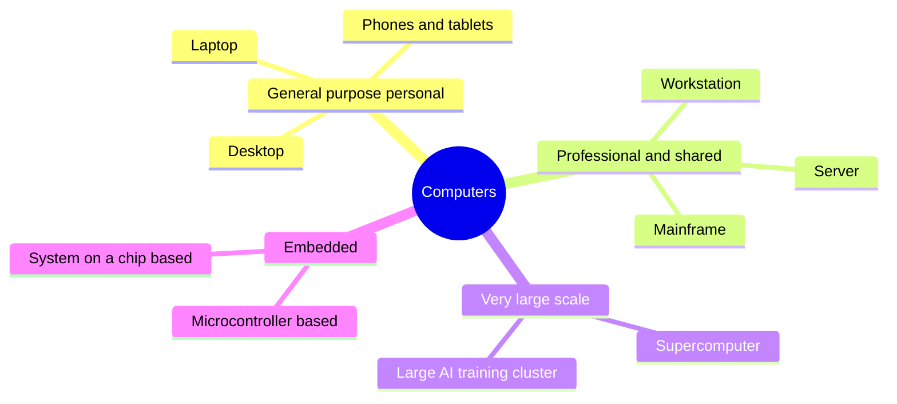

# Types of Computers

<!-- BEGIN HEADER (generated by tools/build.py from the front matter; edit the front matter, not this block) -->
> [Home](../../../../README.md) › [Part I — Computer Science Foundations](../../index.md) › [1. Computer Fundamentals](../index.md) › [Chapter 1: Introduction to computers](index.md)

- **Difficulty:** Absolute beginner
- **Estimated time:** about 45 minutes
- **Prerequisites:** [What Is a Computer?](01-what-is-a-computer.md)
- **Syllabus topics covered:** `01.01.04` Types of computers · `01.01.05` Desktop, laptop, workstation, server, supercomputer · `01.01.06` Embedded computers
- **Status:** Drafted (passes the automated checks; awaiting independent technical review). Last reviewed 2026-11-01.
<!-- END HEADER -->

## What you will learn

- Classify a computer along the dimensions that matter: purpose, scale, role and form factor.
- Explain what distinguishes a desktop, laptop, workstation, server and supercomputer, and what each is optimised for.
- Explain what makes a computer *embedded*, and the difference between a microcontroller and a general-purpose processor.
- Choose a sensible type of machine for a given job, and justify the trade-off.

## Introduction

All the machines in this lesson follow the same input, processing, output and storage cycle from [What Is a Computer?](01-what-is-a-computer.md). They differ in what they are *optimised for*. Engineers rarely ask "which computer is best?" and almost always ask "which computer is best **for this job**, given cost, power, size, reliability and speed?" Knowing the main types gives you the vocabulary to answer.

There is no official list, and the boundaries overlap: a high-end laptop can outperform a low-end workstation, and a small single-board computer can act as a server. The useful way to think is in terms of **dimensions**:

| Dimension | Question it answers | Examples |
|---|---|---|
| Purpose | Is it a flexible general-purpose machine, or built into a product for one job? | Laptop versus a thermostat's controller |
| Scale | How much computing, memory and power does it have? | Phone versus supercomputer |
| Role | Does it mainly *use* services or *provide* them? | Client versus server (next lesson) |
| Form factor | How is it packaged and used? | Handheld, desk, rack, room-sized |
| Architecture | Which instruction set does its processor implement? | x86-64, Arm, RISC-V |

## Intuitive understanding

Think of vehicles. A bicycle, a family car, a delivery van, a freight train and a rocket all move things, but you would never ask which is "best". A bicycle is cheap and simple, a train moves enormous loads along fixed routes, and a rocket is for a job nothing else can do. Computers are the same: the right one depends on the load, the route, the budget and the environment.



*Reading the diagram:* the branches group machines by how they are used. The boundaries are blurry on purpose; the last branch, embedded computers, is by far the most numerous.

## Technical foundations

### The personal machines: desktop and laptop

A **desktop** computer is designed to stay in one place with mains power, a separate screen and keyboard, and room for cooling. Because size and battery are not constraints, designers can spend power and volume on performance, and parts are often replaceable and upgradeable.

A **laptop** integrates the screen, keyboard, battery and processor into one portable unit. The binding constraints are **power** and **heat**: a processor cannot run at full speed indefinitely if the chassis cannot shed the heat or the battery cannot supply the power, so laptops balance speed against battery life and temperature. Phones and tablets are the extreme version of this trade-off. Their processors are usually **systems on a chip**, packages that place the CPU cores, graphics, memory controller, radios and other blocks on one piece of silicon to save space and power.

### Workstation

A **workstation** is a high-end personal machine for demanding professional work such as engineering design, video editing or scientific analysis. Compared with an ordinary desktop it typically emphasises sustained performance and reliability: many processor cores, large memory (often with error-correcting memory), professional graphics hardware, and configurations certified for specific software. The distinction from a desktop is one of *intended use and engineering margin*, not a different kind of machine.

### Server

A **server** is a computer whose job is to **provide a service to other computers** over a network: serving web pages, storing files, running databases, handling email. "Server" describes a *role*, which you will study in [Client vs server](03-client-server-and-remote-computing.md); any computer can play it. Machines built *specifically* to act as servers are tuned for different priorities than a laptop:

- **Availability.** Redundant power supplies and fans, and drives that can be replaced while the machine runs.
- **Error resilience.** Error-correcting memory (ECC), which detects and corrects some bit errors that would silently corrupt data in ordinary memory.
- **Throughput and scale.** Many cores and large memory, often in a rack-mounted chassis with no screen, managed remotely.
- **Density.** Many servers share a data centre, which is why power and cooling dominate their cost.

A "cloud server" or "instance" is usually a **virtual machine**: a software-simulated computer running on a physical server that hosts many such machines at once ([subject 24](../../../../docs/06-cloud-devops-and-infrastructure/24-cloud-computing/index.md)).

### Mainframe

A **mainframe** is a large computer built for extremely high reliability and for processing enormous numbers of transactions, such as banking and airline reservations. It is not in the syllabus list for this chapter, but you will meet the word, so know the idea: where a server farm gets reliability by using *many* ordinary machines, a mainframe gets it by engineering a single system with very high internal redundancy and input/output capacity.

### Supercomputer

A **supercomputer** is built to solve a small number of very large problems as fast as possible by running one job across a very large number of processors working in parallel. Key ingredients are a high-speed interconnect between nodes, a parallel file system, and software that splits a problem into pieces ([subject 53](../../../../docs/10-specialized-software-engineering-domains/53-high-performance-computing/index.md)). Typical uses are weather and climate modelling, physics, materials science and, increasingly, training large AI models.

Performance is measured in floating-point operations per second (FLOPS). **Exascale** means $10^{18}$ FLOPS. On the TOP500 ranking of supercomputers, which is published twice a year and measures a standard benchmark called High Performance Linpack, the first system to exceed one exaflop/s was *Frontier* at Oak Ridge National Laboratory in the United States, announced in May 2022. Rankings change, so consult [top500.org](https://www.top500.org/) for the current list rather than relying on any fixed claim.

### Embedded computers

An **embedded computer** is a computer built *into* a larger product to control it, usually with a single dedicated purpose and no general user interface. Examples are the controllers in a microwave oven, a car's braking system, a thermostat, a medical device, or a factory robot. Embedded computers are by far the most numerous kind of computer.

Two broad families exist:

- **Microcontrollers (MCUs)** combine a small processor, a modest amount of memory (often kilobytes to a few megabytes), program storage and *peripherals* (timers, analogue-to-digital converters, communication ports) on one inexpensive chip. They run a single program, sometimes with a small real-time operating system, and often have no operating system at all.
- **Embedded microprocessors and SoCs** are far more capable chips that run a full operating system such as Linux or Android. A home router, a smart TV and a car's infotainment system are typical.

What defines the embedded world is its **constraints**:

| Constraint | Why it matters |
|---|---|
| Cost | A cent saved on a chip multiplies across millions of units |
| Power | Some devices must run for years on a battery |
| Memory and speed | Often tiny compared with a laptop, so code must be efficient |
| Real-time behaviour | A missed deadline can be a failure, not just a slowdown (an airbag controller cannot "lag") |
| Reliability and safety | The device may be unreachable or safety-critical |
| Updatability | Firmware must often be updated remotely and safely, or never |

Embedded engineering is covered in [subject 49](../../../../docs/10-specialized-software-engineering-domains/49-embedded-systems-and-firmware-engineering/index.md).

## Comparing the types

The ranges below are **illustrative orders of magnitude at the time of writing**. Hardware changes quickly, so what lasts is the *relative ordering* and the design priorities, not the numbers.

| Type | Typical memory | Typical processing units | Optimised for |
|---|---|---|---|
| Microcontroller | Kilobytes to a few megabytes | One small core | Cost, power, real-time control |
| Smartphone or tablet | Several gigabytes | Several CPU cores plus GPU and accelerators | Power efficiency, integration |
| Laptop | Roughly 8 to 32 GB | Several to a dozen or more cores | Portability, battery life |
| Desktop | Roughly 16 GB and upward | Several to a few dozen cores | Performance per cost, upgradeability |
| Workstation | Tens to hundreds of GB | Many cores, professional graphics | Sustained performance, reliability |
| Server | Tens of GB to several TB | Dozens to hundreds of cores per machine | Availability, throughput |
| Supercomputer | Aggregate memory in the petabyte range | Hundreds of thousands to millions of cores across many nodes | Parallel scale on one problem |

> **Common mistake:** *"A server is just a bigger PC."* A server is defined by its **role**, not its size. A small single-board computer on your desk can be a server, and a powerful workstation can sit idle as a client. Hardware sold as "server-grade" differs mainly in reliability and manageability.

## Seeing the machine you are on

The following program asks the operating system a few questions about the computer it runs on. It needs Python 3.10 or newer. The output differs from machine to machine, so it is not compared against a fixed answer.

<!-- run:python -->
```python
import os
import platform
import sys

print("operating system :", platform.system())
print("processor family :", platform.machine())
print("logical CPUs     :", os.cpu_count())
print("word size (bits) :", sys.maxsize.bit_length() + 1)
```

Example output from the small Linux virtual machine used to test this lesson (yours will differ):

```text
operating system : Linux
processor family : x86_64
logical CPUs     : 1
word size (bits) : 64
```

How it works: `platform.machine()` reports the processor family (for example `x86_64` or `arm64`), `os.cpu_count()` the number of logical processors the operating system can schedule onto, and `sys.maxsize` is the largest value a pointer-sized signed integer can hold, so adding one to its bit length gives the machine's word size. A phone, a laptop and a cloud server will each print something different, yet the same program runs on all of them, which is the point of the abstractions in the previous lesson.

## Real-world applications and trade-offs

| Scenario | Sensible choice | Why |
|---|---|---|
| A student writing code and reading | Laptop | Portability and battery matter more than peak speed |
| A studio editing high-resolution video | Workstation | Sustained load, large memory, professional graphics |
| A start-up serving a website | Rented cloud servers | Pay for capacity as needed; no hardware to maintain |
| A weather service forecasting | Supercomputer | One enormous parallel problem that must finish in time |
| A smart doorbell | Embedded SoC | Low cost and power, always on, specialised |
| A bank processing payments | Mainframe or highly redundant server clusters | Reliability and transaction volume |

The central trade-off is **generality against efficiency**. A general-purpose processor can run anything but spends silicon and energy on flexibility; specialised hardware does one thing superbly. Modern systems are therefore often **heterogeneous**: CPUs handle general work, graphics processors (GPUs) handle massively parallel numerical work, and dedicated accelerators handle tasks such as neural-network inference. Another trade-off, between one big machine and many small ones, returns in [system design](../../../../docs/05-distributed-systems-and-system-design/23-system-design/index.md).

> **Advanced insight:** *instruction sets.* A processor family implements an **instruction set architecture** (ISA), the contract between software and hardware. x86-64 and Arm dominate personal computers, servers and phones, and RISC-V is an open ISA used increasingly in embedded and research settings. A program compiled for one ISA does not run on another without translation, which is why "which architecture?" is a real question when choosing hardware ([subject 3](../../../../docs/01-computer-science-foundations/03-digital-logic-and-computer-organization/index.md)).

## Common mistakes

- **Equating clock speed with performance.** Performance depends on how much work is done per cycle, the number of cores, memory speed and the workload, not only on gigahertz.
- **Thinking a supercomputer is one giant CPU.** It is many ordinary-looking nodes connected by a very fast network; the hard part is splitting the problem.
- **Assuming embedded means simple or weak.** Some embedded systems, such as car infotainment or network equipment, are powerful. The constraint is that they are *dedicated and constrained*, not necessarily slow.
- **Thinking the cloud has no computers.** The cloud is other people's servers, rented on demand.
- **Ignoring power.** Energy and cooling are first-order limits from phones to data centres.

## Exercises

**Beginner**

1. Place each in a type: a smart speaker, a gaming PC, a rack in a data centre, a car's engine controller, a machine ranked on the TOP500.
2. Name two properties that make a server different from a laptop *other than* its size.

**Intermediate**

3. A coffee machine has a processor, a few buttons, a display and a heater. Which type is it? List four constraints its designers face.
4. Run the machine-inspection program on two machines you have access to and explain every difference in the output.

**Advanced**

5. A website must stay available if a single machine fails. Explain why this pushes the design towards several modest servers rather than one very powerful one, and name the cost of that choice.

**Expert**

6. Argue whether a modern phone is better described as a *laptop-class* computer or an *embedded* computer. Which dimensions from the table support each view?

<details>
<summary>Solutions and hints</summary>

1. Smart speaker: embedded SoC. Gaming PC: desktop. Rack in a data centre: servers. Engine controller: embedded (microcontroller). TOP500 machine: supercomputer.
2. Redundancy and hot-swappable components for availability; error-correcting memory; remote management; designed for continuous operation.
3. Embedded, probably microcontroller-based. Constraints: cost, safety (heater control must fail safe), real-time control of temperature, no recovery from a crash by a user rebooting, long product life.
4. Expect differences in operating system, processor family, core count and word size; explain each from the descriptions above.
5. One machine is a single point of failure. Several machines let the service continue when one fails. The cost is complexity: the machines must coordinate, share data and balance load, which is the subject of distributed systems.
6. Laptop-class: general-purpose, runs a full OS, installs arbitrary apps, comparable memory. Embedded: heavily integrated SoC, power-constrained, closed firmware, built into a sealed product. Most engineers treat it as a general-purpose computer built with embedded-style constraints.

</details>

## Interview and practical questions

**What is the difference between a microcontroller and a microprocessor?** A microcontroller integrates processor, memory, program storage and peripherals on one chip and typically runs one dedicated program. A microprocessor is mainly the processing unit; it relies on external memory and peripherals and is used where a full operating system runs.

**Why do servers use ECC memory?** Cosmic rays and electrical noise occasionally flip a bit. ECC adds redundant bits so single-bit errors can be corrected and many multi-bit errors detected, which matters when silent data corruption is unacceptable.

**What is exascale computing?** Computing at $10^{18}$ floating-point operations per second. The first TOP500 system to exceed this on the Linpack benchmark was Frontier, announced in 2022.

**A client asks for the cheapest machine for a new always-on sensor that uploads data hourly. What do you ask first?** How much data, how often, with what power source and network, and what happens if it fails. Those requirements decide between a microcontroller with a radio and a small SoC running Linux.

## Further reading

**Standards and reference data**

- TOP500 project: [top500.org](https://www.top500.org/), the official list and its history of exascale systems.

**Textbooks**

- Patterson and Hennessy, *Computer Organization and Design*, chapter 1, on the classes of computing and the end of single-core performance scaling.
- Tanenbaum and Austin, *Structured Computer Organization*, the introduction, on the range of computer types.

**Official documentation for the code used here**

- Python standard library: [`platform`](https://docs.python.org/3/library/platform.html), [`os.cpu_count`](https://docs.python.org/3/library/os.html#os.cpu_count) and [`sys`](https://docs.python.org/3/library/sys.html).

<!-- BEGIN FOOTER (generated by tools/build.py) -->
---

## Related topics

- [Client-Server and Remote Computing](03-client-server-and-remote-computing.md)

## Navigation

**Previous:** [What Is a Computer?](01-what-is-a-computer.md) · **Up:** [Chapter 1: Introduction to computers](index.md) · **Next:** [Client-Server and Remote Computing](03-client-server-and-remote-computing.md)
<!-- END FOOTER -->
