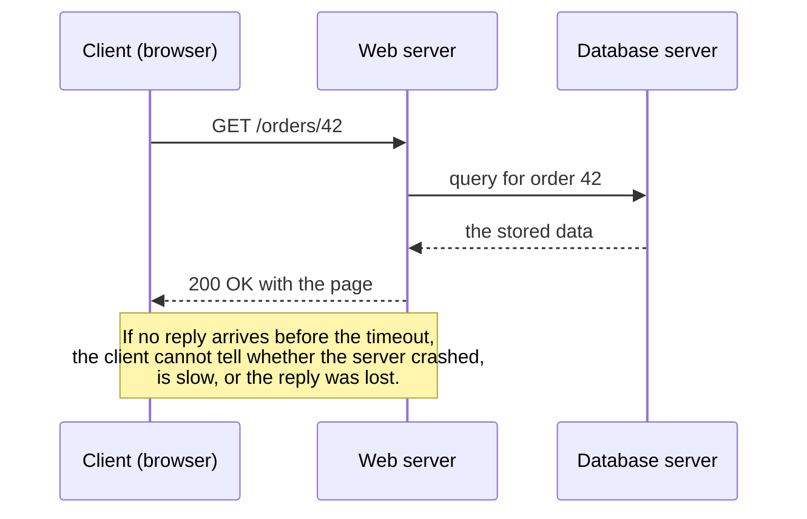
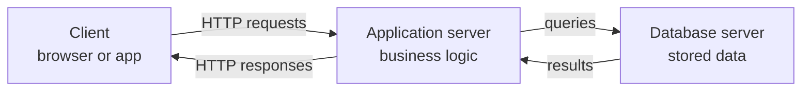

# Client-Server and Remote Computing

<!-- BEGIN HEADER (generated by tools/build.py from the front matter; edit the front matter, not this block) -->
> [Home](../../../../README.md) › [Part I — Computer Science Foundations](../../index.md) › [1. Computer Fundamentals](../index.md) › [Chapter 1: Introduction to computers](index.md)

- **Difficulty:** Beginner
- **Estimated time:** about 55 minutes
- **Prerequisites:** [What Is a Computer?](01-what-is-a-computer.md) · [Types of Computers](02-types-of-computers.md)
- **Syllabus topics covered:** `01.01.07` Client vs server · `01.01.08` Local vs remote computing
- **Status:** Drafted (passes the automated checks; awaiting independent technical review). Last reviewed 2026-11-01.
<!-- END HEADER -->

## What you will learn

- Define *client* and *server* as **roles**, not kinds of hardware, and trace a request and its response.
- Explain what a protocol is and what it means for communication to be stateless.
- Compare computing locally with computing remotely on latency, availability, security, cost and scale.
- Calculate the physical lower bound on network latency and explain why a remote call is fundamentally different from a local one.
- Run a complete client and server on your own machine.

## Introduction

When you open a web page, your browser asks another computer for the page and that computer sends it back. The asking program is the **client** and the answering program is the **server**. This pattern, **client-server**, underlies the web, email, online games, mobile apps, databases and cloud computing.

The second half of the lesson asks a closely related question: *where* should computation happen? You can do work **locally**, on the device in front of you, or **remotely**, on another machine reached over a network. Neither is better in general. The choice is a trade-off between speed, capacity, cost, privacy and reliability, and you will make it again and again as an engineer.

## Intuitive understanding

Think of a restaurant. A customer (the **client**) reads a menu and places an order. The kitchen (the **server**) prepares it and sends it out. Some important properties carry straight over:

- The customer **initiates**; the kitchen waits for orders. Servers are *listening*.
- The customer cannot see inside the kitchen. All they have is the **menu**, an agreed set of things one may ask for. In computing this agreed interface is the **protocol**.
- One kitchen serves **many customers at once**, so it must be organised to cope with that.
- Roles depend on the moment. The kitchen is the customer when it orders ingredients from a supplier. In the same way, a web server that asks a database for data is a *client of the database*.

## Technical foundations

### Roles, requests and responses

A **client** is a program that initiates communication to obtain a service. A **server** is a program that waits for requests and responds to them. Both are *software roles*; "the server" is often loosely used for the machine running the server software, but any computer can host either role, or both.



*Reading the diagram:* time flows downward. The client sends a request; the server may itself become a client of the database; the response travels back. The note at the bottom is the most important idea in the lesson and is expanded below.

### Protocols

Client and server can only cooperate if they agree on the format and order of messages: a **protocol**. HTTP (the web), SMTP and IMAP (email) and database wire protocols are all examples. A protocol specifies what a valid request looks like, what responses exist, and what happens on error. Because the contract is explicit, a client written by one team in one language can talk to a server written by another team in a different language. The HTTP request and response model is defined in the IETF's *HTTP Semantics* specification (RFC 9110). Networking protocols are studied in depth in [subject 5](../../../../docs/01-computer-science-foundations/05-computer-networking/index.md).

### Addresses and ports

A client needs to know *where* the server is. A server is identified by an **address** (which machine) and a **port** (which service on that machine). The special address `127.0.0.1` means "this very machine" (the *loopback* address), which makes it ideal for experiments: client and server can both run on your laptop and still communicate through the operating system's networking code.

### Stateless and stateful services

A protocol is **stateless** if each request carries everything the server needs to process it, so the server does not have to remember earlier requests. HTTP is designed this way. Statelessness makes servers easy to replace and scale (any server can handle any request), but applications that need memory across requests, such as a shopping cart, must carry it in a token or cookie sent with each request, or store it in a shared database.

### Common architectures



This is a **three-tier** arrangement: presentation (client), application logic, and data. Simpler **two-tier** designs have the client talk directly to a database. In **peer-to-peer** systems every participant is both client and server; file-sharing and some messaging systems work this way. A **thin client** does little work itself and relies on a server (a plain web page, a remote desktop), while a **thick client** does substantial work locally (a video game, a desktop application); modern web applications sit between the two.

## Step-by-step working: a complete client and server

This program starts a tiny web server on your own machine and then acts as a client to it. It uses only Python's standard library (Python 3.10 or newer) and listens only on the loopback address.

<!-- run:python -->
```python
import http.server
import threading
import urllib.request


class Handler(http.server.BaseHTTPRequestHandler):
    def do_GET(self):
        body = b"Hello from the server"
        self.send_response(200)
        self.send_header("Content-Type", "text/plain; charset=utf-8")
        self.send_header("Content-Length", str(len(body)))
        self.end_headers()
        self.wfile.write(body)

    def log_message(self, *args):  # keep the example output clean
        pass


server = http.server.HTTPServer(("127.0.0.1", 0), Handler)  # port 0: the OS picks a free port
port = server.server_address[1]
threading.Thread(target=server.serve_forever, daemon=True).start()

with urllib.request.urlopen(f"http://127.0.0.1:{port}/") as response:
    print("status:", response.status)
    print("content-type:", response.headers["Content-Type"])
    print("body:", response.read().decode())

server.shutdown()
```

<!-- expect -->
```text
status: 200
content-type: text/plain; charset=utf-8
body: Hello from the server
```

Walking through it:

1. **Initial state.** Nothing is listening. The `Handler` class describes what to do when a `GET` request arrives.
2. **The server starts.** `HTTPServer(("127.0.0.1", 0), Handler)` asks the operating system for a listening socket on a free port (port `0` means "choose one for me"). `serve_forever` runs in a background thread so the same program can continue as a client.
3. **The request.** `urlopen` opens a connection to that address and port and sends an HTTP `GET` request.
4. **The server's processing.** The handler writes a status line (`200`), headers describing the body, then the body bytes.
5. **The response.** The client reads the status, a header and the body, and prints them.
6. **Shutdown.** `server.shutdown()` stops the listening loop.

**Edge cases and failure conditions.** If you asked for a port that is already in use, binding would fail with an error. If the server were not running, `urlopen` would raise a connection error. If the server accepted the connection but never replied, the client would wait until a timeout, which it does not have by default unless you set one. These failure modes do not exist for ordinary function calls, as the next section explains.

> **Production note:** Python's `http.server` is for learning and quick experiments. It performs only basic security checks and is not designed for production. Real services use hardened servers and frameworks ([subject 16](../../../../docs/04-building-software-products/16-backend-development/index.md)).

## Local versus remote computing

**Local computing** means the work and the data stay on the user's own device. **Remote computing** means they are on another machine reached over a network. The "other machine" may be across the room, across the planet, or a rented virtual machine in a data centre.

### The physical floor on latency

Signals in optical fibre travel at roughly two thirds of the speed of light in a vacuum, about 200,000 km per second. Distance therefore sets a hard minimum on **latency**, the time for a message to get from one place to another. A **round trip** requires travelling there and back.

<!-- run:python -->
```python
SPEED_IN_FIBER_KM_PER_S = 200_000  # roughly two thirds of the speed of light in a vacuum

for km in (1, 100, 1_000, 10_000):
    round_trip_ms = 2 * km / SPEED_IN_FIBER_KM_PER_S * 1000
    print(f"{km:>6} km -> minimum round trip {round_trip_ms:7.2f} ms")
```

<!-- expect -->
```text
     1 km -> minimum round trip    0.01 ms
   100 km -> minimum round trip    1.00 ms
  1000 km -> minimum round trip   10.00 ms
 10000 km -> minimum round trip  100.00 ms
```

These are **lower bounds**. Real round trips are longer because the cable does not run in a straight line, and every router adds processing and queueing delay. The key conclusion is that no engineering can make a trans-continental round trip faster than tens of milliseconds, so software that makes many *sequential* remote calls to a distant server becomes slow however powerful the server is.

**Latency** and **bandwidth** are different. Latency is how long one message takes; bandwidth is how much data per second the link can carry. A lorry full of hard drives has enormous bandwidth and terrible latency; a short message over a fast link has the opposite profile.

### Remote calls can fail in ways local calls cannot

A local function call either returns a result or raises an error. A remote call has more outcomes:

- The request is lost before reaching the server.
- The server runs it, but the reply is lost, so the client sees nothing even though the work *happened*.
- The server is slow, and the client cannot distinguish "slow" from "dead".
- The server crashes halfway through.

This is why distributed software needs timeouts, retries and operations that are safe to repeat. The classic list of false assumptions engineers make about networks, usually attributed to L. Peter Deutsch and colleagues at Sun Microsystems in the 1990s and known as the *fallacies of distributed computing*, begins with "the network is reliable" and "latency is zero". Subject 22 treats the consequences systematically ([distributed systems](../../../../docs/05-distributed-systems-and-system-design/22-distributed-systems/index.md)).

### Trade-offs

| Concern | Local | Remote |
|---|---|---|
| Latency | Very low | Bounded below by distance and network |
| Works offline | Yes | No, unless designed to cache |
| Compute and storage capacity | Limited to the device | Can be very large and elastic |
| Privacy and data control | Data stays with the user | Data leaves the device and is trusted to another party |
| Updates and maintenance | Each user must update | The operator updates once, for everyone |
| Cost model | Buy hardware up front | Pay as you use, often continuously |
| Consistency across devices | Needs explicit syncing | Natural: one shared source of truth |
| Attack surface | Local malware and theft | Network exposure and the server's security |

Real systems are almost always **hybrids**. A mobile app keeps a local cache so that it opens instantly and works offline, and synchronises with a server. A content delivery network keeps copies of data near users to cut latency. Computing placed close to the data source, between device and cloud, is called edge computing ([subject 55](../../../../docs/10-specialized-software-engineering-domains/55-edge-and-fog-computing/index.md)). Cloud platforms that rent servers on demand are the topic of [subject 24](../../../../docs/06-cloud-devops-and-infrastructure/24-cloud-computing/index.md).

## Real-world applications

- **Web browsing.** The browser is a client; web servers deliver pages and data; the servers are in turn clients of databases and other services.
- **Mobile apps.** A thick client for the interface, plus servers for accounts, data and notifications.
- **Online games.** The client renders and predicts movement for responsiveness; an *authoritative server* decides what actually happened, so that cheating by modifying the client does not work.
- **Email.** Mail clients talk to mail servers, which talk to each other.
- **Remote administration.** Secure Shell (SSH) lets you run commands on a remote machine as though local.

> **Advanced insight:** *roles can invert.* A server cannot normally open a connection to a browser that is behind a firewall, so technologies such as long-lived connections let the **client** open the connection and then the **server push** messages down it. Who initiated the connection is not the same as who sends data.

The separation of roles also produces a security rule.

> **Important:** *Never trust the client.* Code running on a user's device is under the user's control and can be modified. Any check that matters, such as permissions, prices or game rules, must be enforced **on the server**. Client-side checks are only a courtesy for speed and usability.

## Common mistakes

- **Equating "server" with a type of hardware.** It is a role, as the previous lesson stressed.
- **Treating a remote call like a local call.** Ignoring timeouts, partial failure and retries is the commonest source of fragile distributed software.
- **Assuming "remote" means "the internet".** The same code can talk to a process on another continent, on the local network or on the same machine, as the example above did.
- **Doing sequential remote calls in a loop.** Ten dependent calls at 100 ms each is a full second before the user sees anything.
- **Trusting data from the client** without validation on the server.
- **Forgetting that a retry may repeat work.** If the first request succeeded but its reply was lost, retrying a "charge this card" request would charge twice unless the operation is designed to be safe to repeat.

## Exercises

**Beginner**

1. In each case, name the client and the server: reading mail in a mail app, streaming a film, printing to a shared network printer.
2. Explain why `127.0.0.1` is useful when learning about client-server programs.

**Intermediate**

3. Change the handler in the program to return the requested path (`self.path`) and request `/hello` from the client. What changes in the output?
4. Make a list of three features of a note-taking app and decide for each whether it should run locally or remotely, with a reason.

**Advanced**

5. A data centre is 12,000 km away along the cable. What is the minimum round-trip time, and how many *strictly sequential* requests could a page make in one second if each needed a fresh round trip? How would you restructure the page to feel faster?

**Expert**

6. A client sends "transfer 100 to account B" and the connection drops before the reply arrives. Design a protocol change that makes it safe to retry, and explain what the server must remember.

<details>
<summary>Solutions and hints</summary>

1. Mail app is the client and the mail server the server; the player is the client and the streaming service the server; the computer sending the print job is the client and the printer (or print server) the server.
2. It refers to the local machine, so client and server can both run on one computer without any real network, which makes experiments safe and fast.
3. Add `body = f"You asked for {self.path}".encode()` before sending headers. The client then prints `body: You asked for /hello` (use a request URL ending in `/hello`).
4. Typing a note: local (instant, works offline). Search across all notes: could be either (local if the notes fit on the device, remote for large collections). Sync across devices: remote, because a shared source of truth is needed.
5. $2 \times 12{,}000 / 200{,}000 = 0.12$ s, so about eight sequential round trips per second at best, fewer in practice. Restructure by sending independent requests in parallel, combining several into one request, caching, and moving data closer to users.
6. Give each logical transfer a unique idempotency key chosen by the client. The server records the key and result of each processed request; if it sees the same key again it returns the stored result instead of repeating the transfer.

</details>

## Interview and practical questions

**What is the difference between a client and a server?** A client initiates a request for a service; a server listens and responds. They are roles that a single machine or program may play at different times.

**What does stateless mean, and why does it help scaling?** Each request contains all the information needed to handle it, so no server has to remember a particular client. Any server instance can answer any request, which makes it easy to add and replace instances behind a load balancer.

**Latency versus bandwidth?** Latency is the delay for one message; bandwidth is the amount of data per unit time. Many small sequential requests are limited by latency; one large download is limited by bandwidth.

**Why must validation happen on the server even if the client also validates?** The client is controlled by the user and can be altered or bypassed; only server-side checks protect the system.

**What can go wrong after a client sends a request and receives no reply?** The request may not have arrived, may have been processed with the reply lost, or may still be in progress. A robust client therefore uses timeouts and only retries operations that are safe to repeat.

## Further reading

**Standards**

- IETF, *HTTP Semantics*, RFC 9110: [rfc-editor.org](https://www.rfc-editor.org/rfc/rfc9110).

**Textbooks**

- James F. Kurose and Keith W. Ross, *Computer Networking: A Top-Down Approach* (Pearson), chapter 2 on the application layer and client-server architecture.
- Andrew S. Tanenbaum and Maarten van Steen, *Distributed Systems* (for the deeper treatment of failure and coordination).

**Official documentation for the code used here**

- Python standard library: [`http.server`](https://docs.python.org/3/library/http.server.html), [`urllib.request`](https://docs.python.org/3/library/urllib.request.html) and [`threading`](https://docs.python.org/3/library/threading.html).

<!-- BEGIN FOOTER (generated by tools/build.py) -->
---

## Related topics

- [Positional Number Systems](../02-number-systems/01-positional-number-systems.md)

## Navigation

**Previous:** [Types of Computers](02-types-of-computers.md) · **Up:** [Chapter 1: Introduction to computers](index.md) · **Next:** [Positional Number Systems](../02-number-systems/01-positional-number-systems.md)
<!-- END FOOTER -->
