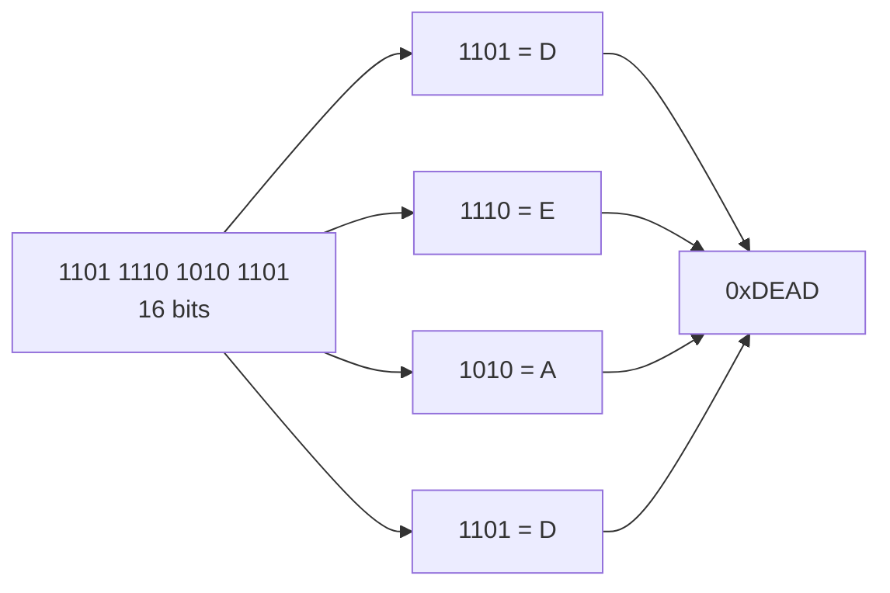

# Positional Number Systems

<!-- BEGIN HEADER (generated by tools/build.py from the front matter; edit the front matter, not this block) -->
> [Home](../../../../README.md) › [Part I — Computer Science Foundations](../../index.md) › [1. Computer Fundamentals](../index.md) › [Chapter 2: Number systems](index.md)

- **Difficulty:** Absolute beginner to intermediate
- **Estimated time:** about 60 minutes
- **Prerequisites:** [What Is a Computer?](../01-introduction-to-computers/01-what-is-a-computer.md)
- **Syllabus topics covered:** `01.02.01` Decimal · `01.02.02` Binary · `01.02.03` Octal · `01.02.04` Hexadecimal
- **Status:** Drafted (passes the automated checks; awaiting independent technical review). Last reviewed 2026-11-01.
<!-- END HEADER -->

## What you will learn

- Explain the difference between a *number* and the *numeral* used to write it.
- Read and write numbers in decimal, binary, octal and hexadecimal, and state the value of each digit position.
- Explain why computers use binary, and why people use hexadecimal to read it.
- Work out how many digits or bits are needed to represent a given number of values.
- Recognise two special binary codes, binary-coded decimal and Gray code, and say when each is used.

## Introduction

A **number** is an abstract quantity: *how many*. A **numeral** is the written form we use for it. "13", "XIII", "1101" and "0xD" are four numerals for the same number, thirteen. Computing constantly switches between numerals, so it is essential to keep the two ideas apart.

Almost every numeral system in use today is **positional**: the *position* of a digit decides how much it is worth. In "505" the two fives are worth different amounts because they sit in different places. Roman numerals are not positional (an X means ten wherever it appears), which is one reason arithmetic with them is awkward. A positional system needs a symbol for *zero* to mark an empty position, which is why the idea of zero was a key invention for arithmetic.

The number of distinct digit symbols a system uses is its **base** or **radix**. The four bases that matter in computing are:

| Name | Base | Digits |
|---|---|---|
| Decimal | 10 | 0 to 9 |
| Binary | 2 | 0 and 1 |
| Octal | 8 | 0 to 7 |
| Hexadecimal | 16 | 0 to 9 and A to F |

## Intuitive understanding

Think of a car's odometer: a row of wheels, each showing 0 to 9. The right-hand wheel turns fastest. When it rolls past 9 it returns to 0 and nudges the next wheel up by one. Counting is nothing more than this carrying.

Now imagine an odometer whose wheels have only two positions, 0 and 1. Counting goes 000, 001, then the right wheel rolls over, so 010, 011, then 100, and so on. That is **binary counting**. The rules are identical to decimal; only the number of symbols per wheel has changed.

This picture also explains capacity. With $n$ wheels of $b$ symbols each there are $b^n$ different readings, from all zeros to all $(b-1)$s. Four binary wheels give $2^4 = 16$ readings, 0 to 15. Three decimal wheels give $10^3 = 1000$, 0 to 999.

## Technical foundations

### The place-value rule

In base $b$, a numeral with digits $d_{n-1} \ldots d_1 d_0$ represents

$$
\text{value} = \sum_{i=0}^{n-1} d_i \, b^{\,i} = d_{n-1} b^{n-1} + \cdots + d_1 b + d_0
$$

where each $d_i$ is a digit with $0 \le d_i \le b-1$, and $b^i$ is the **weight** of position $i$, counted from 0 at the right. Digits after a radix point continue with negative powers ($b^{-1}, b^{-2}, \ldots$); [the next lesson](02-number-system-conversions.md) uses that.

Example in decimal: $505 = 5 \cdot 10^2 + 0 \cdot 10^1 + 5 \cdot 10^0 = 500 + 0 + 5$.

Example in binary: $1101_2 = 1\cdot 2^3 + 1\cdot 2^2 + 0\cdot 2^1 + 1\cdot 2^0 = 8 + 4 + 0 + 1 = 13$. The subscript says which base the numeral is in.

### Counting in four bases

| Decimal | Binary | Octal | Hex |
|---|---|---|---|
| 0 | 00000 | 0 | 0 |
| 1 | 00001 | 1 | 1 |
| 2 | 00010 | 2 | 2 |
| 3 | 00011 | 3 | 3 |
| 4 | 00100 | 4 | 4 |
| 5 | 00101 | 5 | 5 |
| 6 | 00110 | 6 | 6 |
| 7 | 00111 | 7 | 7 |
| 8 | 01000 | 10 | 8 |
| 9 | 01001 | 11 | 9 |
| 10 | 01010 | 12 | A |
| 11 | 01011 | 13 | B |
| 12 | 01100 | 14 | C |
| 13 | 01101 | 15 | D |
| 14 | 01110 | 16 | E |
| 15 | 01111 | 17 | F |
| 16 | 10000 | 20 | 10 |

Notice that "10" always means "one group of the base": ten in decimal, two in binary, eight in octal, sixteen in hexadecimal. Memorise the powers of two, because they appear everywhere in computing:

| $2^0$ | $2^1$ | $2^2$ | $2^3$ | $2^4$ | $2^5$ | $2^6$ | $2^7$ | $2^8$ | $2^9$ | $2^{10}$ |
|---|---|---|---|---|---|---|---|---|---|---|
| 1 | 2 | 4 | 8 | 16 | 32 | 64 | 128 | 256 | 512 | 1024 |

### How many digits or bits do I need?

With $n$ digits in base $b$ you can represent $b^n$ distinct values, the numbers $0$ to $b^n - 1$. Turning this round, to represent $N$ distinct values you need $\lceil \log_b N \rceil$ digits, where $\lceil\cdot\rceil$ rounds up. For bits, that is $\lceil \log_2 N \rceil$.

- 256 values need $\log_2 256 = 8$ bits.
- 1000 values need 10 bits, because $2^9 = 512 < 1000 \le 1024 = 2^{10}$.
- An $n$-bit value needs $\lceil n/4 \rceil$ hexadecimal digits, since each hex digit carries 4 bits.

### Why computers use binary

A physical circuit distinguishes states by measurable quantities, such as a high or low voltage. The fewer states it must tell apart, the larger the safety margin between them, so the more tolerant it is of electrical noise, ageing and manufacturing variation. Two states give the biggest margin. Binary also maps directly onto logic: a wire that is on or off corresponds to *true* or *false*, and Claude Shannon showed in his 1937 thesis (published 1938) that Boolean algebra describes switching circuits exactly, which is the basis of [Boolean logic](../index.md#chapter-4-boolean-logic) and digital design.

It is not true that binary is the only possible choice. A few experimental ternary (three-valued) computers were built, such as the Soviet Setun in the late 1950s, but binary became universal because it was simplest and most reliable to manufacture at scale.

> **Advanced insight:** *radix economy.* If the cost of a digit is proportional to the number of symbols $b$, and you need about $\ln N / \ln b$ digits for $N$ values, the total cost is proportional to $b/\ln b$. That is minimised at $b = e \approx 2.718$, so among whole numbers base 3 is the most economical, with bases 2 and 4 tied just behind it. Binary wins in practice not on this metric but because two-state circuits are easier and more robust to build.

### Octal and hexadecimal: shorthand for binary

Long binary strings are error-prone for people. Because $8 = 2^3$ and $16 = 2^4$, **each octal digit corresponds to exactly 3 bits, and each hexadecimal digit to exactly 4 bits** (a *nibble*). So you convert by *grouping bits*, with no arithmetic at all.



*Reading the diagram:* split the 16 bits into four groups of four, look up each group's hex digit, and read the digits left to right. The same bits grouped in threes (padding the left with zeros to 18 bits) give $001\,101\,111\,010\,101\,101 = 157255_8$.

**Octal** survives mainly in Unix file permissions (`755` means read/write/execute for the owner and read/execute for others, three bits per user class). **Hexadecimal** is everywhere: memory addresses, byte dumps, colours (`#FF8800` is red 255, green 136, blue 0), network hardware addresses and machine-code listings.

### Notation in programs

Programming languages mark the base with a prefix, because a bare `10` is ambiguous.

| Base | Python, JavaScript, Rust | C |
|---|---|---|
| Binary | `0b1101` | `0b1101` is standard from C23 and a common compiler extension before |
| Octal | `0o755` | `0755` (a **leading zero** means octal) |
| Hexadecimal | `0xFF` | `0xFF` |

## Step-by-step working: place values in code

The first program expands a numeral into its place-value sum, which is the formula above turned into code. It needs Python 3.10 or newer.

<!-- run:python -->
```python
def expand(text: str, base: int) -> str:
    """Show the place-value expansion of an integer written in `base`."""
    digits = [int(ch, 36) for ch in text]  # '0'-'9' then 'a'-'z' map to 0..35
    if any(d >= base for d in digits):
        raise ValueError(f"{text!r} is not a valid base-{base} number")
    n = len(digits)
    terms = [f"{d}*{base}^{n - 1 - i}" for i, d in enumerate(digits)]
    value = sum(d * base ** (n - 1 - i) for i, d in enumerate(digits))
    return " + ".join(terms) + f" = {value}"


print(expand("1101", 2))
print(expand("157255", 8))
print(expand("dead", 16))
```

<!-- expect -->
```text
1*2^3 + 1*2^2 + 0*2^1 + 1*2^0 = 13
1*8^5 + 5*8^4 + 7*8^3 + 2*8^2 + 5*8^1 + 5*8^0 = 57005
13*16^3 + 14*16^2 + 10*16^1 + 13*16^0 = 57005
```

Step by step for the last line: `d`, `e`, `a`, `d` are digits 13, 14, 10, 13. Position 3 (leftmost) has weight $16^3 = 4096$, giving $13 \cdot 4096 = 53248$; then $14 \cdot 256 = 3584$; then $10 \cdot 16 = 160$; then $13$. The total is $53248 + 3584 + 160 + 13 = 57005$. The binary, octal and hexadecimal numerals above are all the **same number**.

If you pass an invalid digit (such as `"129"` in base 8) the function raises `ValueError`; a numeral can never contain a digit as large as its base.

The second program shows the same number in all four bases using Python's literals and formatting.

<!-- run:python -->
```python
n = 57005
print(n, bin(n), oct(n), hex(n))
print(0b1101111010101101 == 0o157255 == 0xDEAD == 57005)
print(f"{n:016b}  {n:o}  {n:X}")
print(int("DEAD", 16), int("157255", 8), int("1101111010101101", 2))
```

<!-- expect -->
```text
57005 0b1101111010101101 0o157255 0xdead
True
1101111010101101  157255  DEAD
57005 57005 57005
```

`bin`, `oct` and `hex` return text with a prefix; the format codes `b`, `o` and `X` (with an optional width and `0` padding, as in `016b`) give the digits only; `int(text, base)` parses a numeral in a given base. Line 2 demonstrates that all four *literals* denote the same value.

C has the same ideas, plus a famous trap. This program needs a C11 compiler.

<!-- run:c -->
```c
#include <stdio.h>

int main(void) {
    int a = 010;   /* a leading zero means OCTAL in C: this is 8, not 10 */
    int b = 0x1F;  /* hexadecimal: 31 */
    printf("%d %d\n", a, b);
    printf("%o %x %X\n", 31, 255, 255);
    return 0;
}
```

<!-- expect -->
```text
8 31
37 ff FF
```

The second `printf` prints 31 in octal (`37`) and 255 in lower- and upper-case hexadecimal. The first line is the trap: `010` is not ten.

## Two special binary codes

These are not number systems in the positional sense, but they are ways of using bits that you will meet in hardware and in data formats.

### Binary-coded decimal (BCD)

In **BCD** each *decimal digit* is stored in its own 4 bits. The number 59 is stored as `0101 1001` (5 then 9), not as the pure binary `0011 1011`. BCD is wasteful, because 4 bits could hold 16 values but only 10 are used, so it needs about 20% more bits than binary for the same range. Its advantage is that conversion to and from decimal digits is trivial and *decimal fractions stay exact*, so it appears in calculators, displays, real-time clock chips and some financial hardware, where showing "0.10" must be exactly 0.10.

### Gray code

In **Gray code** consecutive values differ in **exactly one bit**. The reflected binary Gray code of $n$ is `n ^ (n >> 1)`, where `^` is exclusive-or and `>>` shifts right one place.

<!-- run:python -->
```python
for n in range(8):
    g = n ^ (n >> 1)
    print(n, format(g, "03b"))
```

<!-- expect -->
```text
0 000
1 001
2 011
3 010
4 110
5 111
6 101
7 100
```

Every row differs from the one above it in a single bit, including the wrap from 7 back to 0. This matters for **rotary position encoders**: if a sensor reads a shaft's angle as ordinary binary, then at the boundary between 3 (`011`) and 4 (`100`) all three bits change, and if the sensors do not switch at precisely the same instant the reading can momentarily be any value, such as `111` or `000`. With Gray code only one bit changes, so the error is at most one step.

## Real-world applications

- **Colours on the web.** `#RRGGBB` packs three bytes, each written as two hex digits.
- **Memory addresses and dumps.** A debugger shows `0x7ffe5c3a9e40` because 12 hex digits are far easier to read and compare than 48 binary digits.
- **Unix permissions.** `chmod 640 file` sets the owner to read and write ($6 = 110_2$), the group to read ($4 = 100_2$) and others to nothing ($0$).
- **Identifiers and checksums.** Hashes and cryptographic keys are shown in hexadecimal.
- **Embedded hardware.** Registers are described bit by bit, and programmers write masks in hex.

## Comparisons and trade-offs

| System | Strength | Weakness | Typical use |
|---|---|---|---|
| Binary | Matches hardware exactly | Long and hard for people to read | Bit flags, logic, low-level work |
| Octal | Short; 3 bits per digit | Awkward when word sizes are multiples of 4 and 8 bits | Unix permissions |
| Decimal | Familiar | No direct relationship to bits | Human-facing numbers |
| Hexadecimal | Short; 4 bits per digit, so a byte is exactly 2 digits | Needs six extra symbols | Addresses, bytes, colours |

Octal fell out of favour for general use because the byte (8 bits) became the standard unit, and 8 is not a multiple of 3, whereas it *is* a multiple of 4.

## Common mistakes

> **Common mistake:** *Confusing the value with its numeral.* The number does not change when you change the base. "Convert 13 to binary" means *find the binary numeral for the number thirteen*, not change the number.

- **Reading `10` as ten regardless of base.** In binary it is two; in hexadecimal, sixteen.
- **Using a digit that is too large**, such as `8` in octal or `2` in binary.
- **Forgetting that leading zeros are meaningful in fixed-width fields.** `0000 0101` and `101` are the same number but different *widths*.
- **The C leading-zero trap.** `int mode = 0644;` is octal, which is what you want for file permissions, but `int x = 010;` is eight, which is rarely what a beginner intends. Python 3 rejects a bare leading zero such as `010` as a syntax error to avoid this.
- **Mixing up `0` and `O`**, and hexadecimal letters and variable names.

## Exercises

**Beginner**

1. Convert $1011_2$, $77_8$ and $2A_{16}$ to decimal by the place-value rule.
2. Write 100 in binary. Hint: find which powers of two add up to 100.
3. Group `1010 1111` into hexadecimal and `101 111` into octal.

**Intermediate**

4. What is the largest unsigned number that fits in 12 bits? How many hex digits does it need?
5. How many bits are needed to give a unique number to each of 5,000 students?
6. Run `expand("129", 8)` and explain the error.

**Advanced**

7. Prove that grouping four bits into one hexadecimal digit works, using the place-value formula and $16 = 2^4$.
8. Write a function that converts a decimal string to BCD bytes and back, and test it on 0, 59 and 1234.

**Expert**

9. Prove that the Gray code `n ^ (n >> 1)` changes exactly one bit when $n$ increases by 1.

<details>
<summary>Solutions and hints</summary>

1. $1011_2 = 11$; $77_8 = 7 \cdot 8 + 7 = 63$; $2A_{16} = 2 \cdot 16 + 10 = 42$.
2. $100 = 64 + 32 + 4$, so $1100100_2$.
3. `1010 1111` is `AF`; `101 111` is `57` in octal.
4. $2^{12} - 1 = 4095 = \text{0xFFF}$, which needs 3 hex digits.
5. $\lceil \log_2 5000 \rceil = 13$, since $2^{12} = 4096 < 5000 \le 8192 = 2^{13}$.
6. The digit `9` is not valid in base 8; the function raises `ValueError`.
7. Let a group of four bits be $b_3 b_2 b_1 b_0$ in position block $k$. Its contribution to the value is $(b_3 2^3 + b_2 2^2 + b_1 2 + b_0)\,2^{4k} = h \cdot 16^k$, where $h$ is the group's value 0 to 15. That is exactly the contribution of one hex digit $h$ in position $k$.
8. Split the decimal string into digits, store each as a nibble, and pack two nibbles per byte; reverse by reading nibbles. Check that every nibble is at most 9.
9. When $n$ becomes $n+1$, the low $k$ bits that were 1 become 0, and the next bit, a 0, becomes 1, so bits $0$ to $k$ flip and no others. Bit $i$ of the Gray code is $n_i \oplus n_{i+1}$. For $i < k$ both inputs flip, so the XOR is unchanged. For $i = k$ only $n_k$ flips (and $n_{k+1}$ does not), so that Gray bit flips. For $i > k$ nothing flips. Exactly one bit changes.

</details>

## Interview and practical questions

**Why do programmers use hexadecimal?** It is a compact, error-resistant way to write binary data: each digit is exactly 4 bits and each byte exactly two digits, so no arithmetic is needed to convert.

**How many values can $n$ bits represent, and what is the largest unsigned value?** $2^n$ values, from 0 to $2^n - 1$.

**What does `0o17` equal?** $1 \cdot 8 + 7 = 15$.

**In C, what is the value of `010`?** Eight, because a leading zero denotes an octal literal.

**Why does a rotary encoder use Gray code?** So that only one bit changes between adjacent positions, which limits a misread at a transition to one step.

## Further reading

**Textbooks**

- Charles Petzold, *Code* (Microsoft Press): the chapters on counting in other bases and on binary numbers are an excellent gentle treatment.
- Donald E. Knuth, *The Art of Computer Programming, Volume 2: Seminumerical Algorithms* (Addison-Wesley), section 4.1 on positional number systems, for the rigorous account.

**Research**

- Claude E. Shannon, "A Symbolic Analysis of Relay and Switching Circuits", *Transactions of the American Institute of Electrical Engineers* (1938): why binary logic suits circuits.

**Official documentation for the code used here**

- Python: [built-in functions `bin`, `oct`, `hex` and `int`](https://docs.python.org/3/library/functions.html) and the [format specification mini-language](https://docs.python.org/3/library/string.html#formatspec).

<!-- BEGIN FOOTER (generated by tools/build.py) -->
---

## Related topics

- [Number-System Conversions](02-number-system-conversions.md)

## Navigation

**Previous:** [Client-Server and Remote Computing](../01-introduction-to-computers/03-client-server-and-remote-computing.md) · **Up:** [Chapter 2: Number systems](index.md) · **Next:** [Number-System Conversions](02-number-system-conversions.md)
<!-- END FOOTER -->
