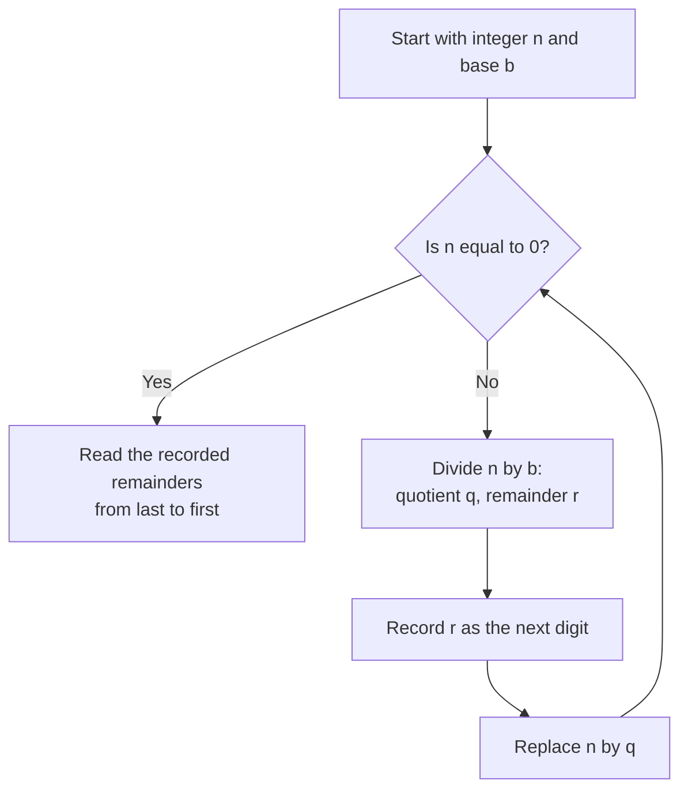

# Number-System Conversions

<!-- BEGIN HEADER (generated by tools/build.py from the front matter; edit the front matter, not this block) -->
> [Home](../../../../README.md) › [Part I — Computer Science Foundations](../../index.md) › [1. Computer Fundamentals](../index.md) › [Chapter 2: Number systems](index.md)

- **Difficulty:** Beginner to intermediate
- **Estimated time:** about 60 minutes
- **Prerequisites:** [Positional Number Systems](01-positional-number-systems.md)
- **Syllabus topics covered:** `01.02.05` Number-system conversions
- **Status:** Drafted (passes the automated checks; awaiting independent technical review). Last reviewed 2026-11-01.
<!-- END HEADER -->

## What you will learn

- Convert any integer between bases using repeated division and Horner's rule, and explain why each works.
- Convert fractions between bases using repeated multiplication.
- Decide in advance whether a fraction has a finite expansion in a given base, and explain why $0.1$ cannot be written exactly in binary.
- Use grouping as a shortcut between binary, octal and hexadecimal.
- Implement all of this in code and handle the edge cases.

## Introduction

The same number can be written in many bases, and software constantly moves between them: a program parses the text "255" into bits, prints those bits as `ff` for a debugger, and shows a colour as `#FF8800`. **Conversion** is the algorithm for finding the numeral in one base that denotes the same number as a numeral in another.

Two questions organise everything in this lesson. *Which direction?* Converting **to decimal** from another base is a sum; converting **from decimal** to another base is repeated division. *Integer or fraction?* The integer part and the fractional part need different methods. The fractional case also explains one of the most surprising facts in computing: the fraction one tenth has no exact binary representation.

## Intuitive understanding

Making change is the right mental picture. To pay 87 pence using coins worth 50, 20, 10, 5, 2 and 1, you take as many of the largest coin as fit, then continue with what is left. Converting a number to a base works the same way with "coins" of value $b^k$.

Repeated division reaches the same answer from the opposite end. Ask "how many ones are left over after grouping into bundles of $b$?" The leftover is the last digit. Then bundle the bundles and ask again. Each question peels off one digit, starting from the right.

## Technical foundations

### Any base to decimal

Use the place-value rule from the [previous lesson](01-positional-number-systems.md). A more efficient form is **Horner's rule**, which rewrites the sum so that no powers are needed:

$$
d_{n-1}b^{n-1} + \cdots + d_1 b + d_0 \;=\; \bigl(\cdots\bigl((d_{n-1}\,b + d_{n-2})\,b + d_{n-3}\bigr)\cdots\bigr)\,b + d_0 .
$$

You scan the digits from the left, and at each step multiply the running value by $b$ and add the next digit. For $1101_2$: $1 \to 1\cdot2+1 = 3 \to 3\cdot2+0 = 6 \to 6\cdot2+1 = 13$.

### Decimal integer to any base: repeated division

**Claim.** Write $n = b\,q + r$ with $0 \le r < b$ (integer division with remainder). Then $r$ is the *last digit* of $n$ in base $b$, and the remaining digits are the base-$b$ digits of $q$.

*Why.* If $n$ has base-$b$ digits $d_k \ldots d_1 d_0$, then $n = b\,(d_k b^{k-1} + \cdots + d_1) + d_0$. The bracket is the number whose digits are $d_k \ldots d_1$, and $d_0 < b$, so $d_0$ is exactly the remainder and the bracket is the quotient. Applying the same argument to the quotient gives the next digit, and so on. Because each quotient is strictly smaller than the number before it, the process ends when the quotient reaches 0, after $\lfloor \log_b n \rfloor + 1$ steps.



*Worked example:* write 57005 in hexadecimal.

| Step | Division | Quotient | Remainder (digit) |
|---|---|---|---|
| 1 | $57005 \div 16$ | 3562 | 13 = D |
| 2 | $3562 \div 16$ | 222 | 10 = A |
| 3 | $222 \div 16$ | 13 | 14 = E |
| 4 | $13 \div 16$ | 0 | 13 = D |

The remainders come out **least significant digit first**. Reading them from bottom to top gives `DEAD`. Reading them top to bottom, a very common slip, gives `DAED`, a different number.

### Fractions: repeated multiplication

For a value $0 \le x < 1$ written $0.d_1 d_2 d_3 \ldots$ in base $b$ we have $x = d_1/b + d_2/b^2 + \cdots$. Multiplying by $b$ gives $b\,x = d_1 + (d_2/b + d_3/b^2 + \cdots)$, so **the integer part of $b\,x$ is the next digit** and the fractional part carries on. Repeat: multiply the fractional part by $b$ again.

*Worked example:* $0.375$ in binary.

| Step | Multiply | Result | Digit (integer part) | Remaining fraction |
|---|---|---|---|---|
| 1 | $0.375 \times 2$ | 0.75 | 0 | 0.75 |
| 2 | $0.75 \times 2$ | 1.5 | 1 | 0.5 |
| 3 | $0.5 \times 2$ | 1.0 | 1 | 0 |

The fraction reached 0, so we stop: $0.375 = 0.011_2$, that is $\tfrac{1}{4} + \tfrac{1}{8}$.

### When does a fraction terminate?

Try $0.1$. Multiplying by 2 repeatedly gives digits $0, 0, 0, 1, 1, 0, 0, 1, 1, \ldots$ and the remaining fraction cycles back to a value seen earlier, so the pattern repeats forever: $0.1_{10} = 0.0\overline{0011}_2$.

**Theorem.** A fraction $p/q$ in lowest terms has a finite expansion in base $b$ if and only if every prime factor of $q$ is also a prime factor of $b$.

*Why.* A finite expansion with $k$ digits means $p/q \cdot b^k$ is an integer. Since $p$ and $q$ share no factor, this happens exactly when $q$ divides $b^k$ for some $k$, which is possible exactly when each prime in $q$ divides $b$.

Consequences: in base 10 (primes 2 and 5) the fraction $1/8$ terminates but $1/3$ does not. In base 2 (prime 2 only) only fractions whose denominator is a power of two terminate, so $1/8$ does and $1/10$ does not, because $10 = 2 \cdot 5$. **This is the reason $0.1$ cannot be stored exactly in a binary floating-point number**, which the [floating-point lesson](05-floating-point-and-ieee-754.md) develops.

### Between bases that are powers of each other

Because $8 = 2^3$ and $16 = 2^4$, converting between binary and octal or hexadecimal needs no arithmetic: **group the bits** from the radix point outwards (from the right for integers) and translate each group. For the integer part pad the *left* with zeros; for the fractional part pad the *right*. Conversions between two arbitrary bases are normally done through an intermediate (an integer value in memory, or decimal on paper).

## Step-by-step working: the algorithms in code

The first program implements integer conversion in both directions for bases 2 to 36. It needs Python 3.10 or newer.

<!-- run:python -->
```python
DIGITS = "0123456789abcdefghijklmnopqrstuvwxyz"


def to_base(n: int, base: int) -> str:
    """Write the integer n in the given base (2 to 36) using repeated division."""
    if not 2 <= base <= 36:
        raise ValueError("base must be between 2 and 36")
    if n < 0:
        return "-" + to_base(-n, base)
    if n == 0:
        return "0"
    out = []
    while n > 0:
        n, remainder = divmod(n, base)  # the quotient carries on; the remainder is a digit
        out.append(DIGITS[remainder])
    return "".join(reversed(out))        # digits came out least significant first


def from_base(text: str, base: int) -> int:
    """Read an integer written in the given base using Horner's rule."""
    if text.startswith("-"):
        return -from_base(text[1:], base)
    value = 0
    for ch in text.lower():
        digit = DIGITS.index(ch)         # raises ValueError for a character that is not a digit
        if digit >= base:
            raise ValueError(f"digit {ch!r} is not valid in base {base}")
        value = value * base + digit
    return value


print(to_base(57005, 2))
print(to_base(57005, 16))
print(to_base(255, 5), to_base(255, 36))
print(to_base(-10, 2), to_base(0, 7))
print(from_base("dead", 16), from_base("zz", 36))
print(all(from_base(to_base(n, b), b) == n for n in range(2000) for b in range(2, 37)))
```

<!-- expect -->
```text
1101111010101101
dead
2010 73
-1010 0
57005 1295
True
```

Line by line: `divmod(n, base)` returns the quotient and remainder together; the loop appends one digit per iteration and the final `reversed` fixes the order. In `from_base`, `value * base + digit` is Horner's rule. `255` in base 5 is `2010` because $2\cdot125 + 0\cdot25 + 1\cdot5 + 0 = 255$, and in base 36 it is `73` because $7 \cdot 36 + 3 = 255$. The last line is a **round-trip test**: it converts every number below 2000 to every base and back, and checks that nothing changes.

**Edge cases handled:** zero (the loop would otherwise produce an empty string), negative numbers (convert the magnitude and add a sign), bases outside 2 to 36, and invalid digits. **Complexity:** the loop runs once per output digit, about $\log_b n$ times. For ordinary machine-sized integers each step is constant time. For very large integers each division by a small base takes time proportional to the number's length, so naive conversion is quadratic in the number of digits; faster divide-and-conquer methods exist.

The second program converts fractions exactly. It uses Python's `Fraction` type so that no binary rounding contaminates the demonstration, and it detects when the remainder repeats.

<!-- run:python -->
```python
from fractions import Fraction

DIGITS = "0123456789abcdefghijklmnopqrstuvwxyz"


def fraction_to_base(x: Fraction, base: int, max_digits: int = 40) -> str:
    """Digits after the point for 0 <= x < 1; a repeating cycle is shown in parentheses."""
    digits, seen = [], {}
    while x != 0 and len(digits) < max_digits:
        if x in seen:                    # the same remainder as before, so the digits repeat
            start = seen[x]
            return "".join(digits[:start]) + "(" + "".join(digits[start:]) + ")"
        seen[x] = len(digits)
        x *= base
        digit = int(x)                   # the integer part is the next digit
        digits.append(DIGITS[digit])
        x -= digit
    return "".join(digits)


print(fraction_to_base(Fraction(3, 8), 2))
print(fraction_to_base(Fraction(1, 10), 2))
print(fraction_to_base(Fraction(1, 3), 2))
print(fraction_to_base(Fraction(1, 3), 10))
print(fraction_to_base(Fraction(1, 7), 10))
print(fraction_to_base(Fraction(1, 10), 3))
```

<!-- expect -->
```text
011
0(0011)
(01)
(3)
(142857)
(0022)
```

Reading the results: $3/8 = 0.011_2$ terminates. $1/10 = 0.0\overline{0011}_2$: a single `0`, then the cycle `0011` repeating. $1/3$ is $0.\overline{01}_2$ in binary and $0.\overline{3}$ in decimal. $1/7$ has the famous decimal cycle $0.\overline{142857}$. And $1/10$ in base 3 is $0.\overline{0022}_3$, which you can check by summing the repeating block: $0022_3 = 8$, and $8/(3^4 - 1) = 8/80 = 1/10$. Because a remainder is always a fraction with the same denominator, there are only finitely many possible remainders, so a repeat is guaranteed and the loop always finds a cycle or terminates, as the theorem predicts. The `max_digits` limit is a safety net only.

The third program shows the grouping shortcut.

<!-- run:python -->
```python
DIGITS = "0123456789abcdefghijklmnopqrstuvwxyz"


def bin_to_hex(bits: str) -> str:
    """Convert a binary numeral to hex by grouping bits in fours from the right."""
    bits = bits.replace(" ", "")
    bits = bits.zfill((len(bits) + 3) // 4 * 4)  # pad on the left to a multiple of 4
    groups = [bits[i:i + 4] for i in range(0, len(bits), 4)]
    return "".join(DIGITS[int(g, 2)] for g in groups).upper()


print(bin_to_hex("1101111010101101"))
print(bin_to_hex("101111"))
print(bin_to_hex("1101111010101101") == format(0b1101111010101101, "X"))
```

<!-- expect -->
```text
DEAD
2F
True
```

`101111` is padded to `0010 1111`, which is `2F`. In practice, use the built-ins (`int(text, base)`, `format(n, "b")`, `format(n, "x")`) for the common bases; write your own only when you need an unusual base or when you are learning.

> **Production note:** Python limits the length of the *decimal* text it will convert to or from very large integers (a default of 4,300 digits in recent versions) to protect against denial-of-service attacks, because that conversion is quadratic in cost. Power-of-two bases such as binary and hexadecimal are not limited. See the `int` max string digits section of the Python documentation.

## Real-world applications

- **Parsing and formatting.** Every program that reads "255" or prints `0xff` performs these algorithms, usually in a library.
- **Debugging.** Reading a hexadecimal memory dump and mentally converting a few bytes to decimal values.
- **Networking.** An IPv4 address is four bytes written in decimal; a subnet mask such as 255.255.255.0 is easiest to understand in binary.
- **Arbitrary-precision arithmetic.** Libraries that handle huge numbers convert between the base used internally and the base used for display.
- **Understanding numerical bugs.** The termination theorem is the foundation for understanding why money should not be stored in binary floating point.

## Common mistakes

> **Common mistake:** *Reading the remainders in the wrong order.* The first remainder is the *last* digit.

- **Forgetting the zero case**, which makes a naive loop return an empty string.
- **Padding on the wrong side when grouping bits.** Pad integers on the left; pad fractions on the right.
- **Converting via a floating-point number.** Converting `0.1` to binary by first storing it as a `float` shows the already-rounded value, not the true expansion. Use exact rational arithmetic, as above, to study the mathematics.
- **Assuming all decimal fractions have finite binary expansions.** Only denominators that are powers of two do.
- **Accepting invalid digits silently.** A parser must reject `9` in base 8.

## Exercises

**Beginner**

1. Convert 45 to binary and `11010110` to hexadecimal.
2. Convert `0xFF` and `0o755` to decimal.

**Intermediate**

3. Convert 0.375 and 0.8125 to binary by repeated multiplication.
4. Convert 255 to base 5 by hand and check it against the program.

**Advanced**

5. Without computing digits, decide which of $1/4$, $1/5$, $1/12$ and $1/15$ terminate in base 6, and justify each with the theorem.
6. Extend `to_base` to accept the digits string as a parameter, so that you can write numbers using your own alphabet.

**Expert**

7. Show that Horner's rule evaluates an $n$-digit numeral with $n-1$ multiplications and $n-1$ additions, whereas computing every power $b^i$ from scratch by repeated multiplication costs a number of multiplications proportional to $n^2$.
8. Prove that `fraction_to_base` always terminates, given that `Fraction` is exact.

<details>
<summary>Solutions and hints</summary>

1. $45 = 32 + 8 + 4 + 1 = 101101_2$. `1101 0110` is `D6`.
2. `0xFF` = 255. `0o755` = $7 \cdot 64 + 5 \cdot 8 + 5 = 493$.
3. $0.375 = 0.011_2$ (shown above). $0.8125 \times 2 = 1.625$ (digit 1), $0.625 \times 2 = 1.25$ (1), $0.25 \times 2 = 0.5$ (0), $0.5 \times 2 = 1.0$ (1): $0.1101_2$.
4. $255 = 2 \cdot 125 + 0 \cdot 25 + 1 \cdot 5 + 0$, so `2010`.
5. Base 6 has primes 2 and 3. $1/4$: $q = 2^2$ terminates. $1/5$: 5 does not divide 6, so it repeats. $1/12$: $12 = 2^2 \cdot 3$ terminates. $1/15$: $15 = 3 \cdot 5$, and 5 is not a factor of 6, so it repeats.
6. Replace the module-level `DIGITS` use with a parameter and check `len(digits) >= base`.
7. Horner's loop does one multiply and one add per digit after the first. Computing $b^i$ separately for each $i$ by repeated multiplication costs $i$ multiplications, and $\sum_{i=0}^{n-1} i = n(n-1)/2$.
8. The remainder after each step is a fraction in $[0, 1)$ with denominator dividing the original denominator $q$, so at most $q$ distinct remainders exist. Either it reaches 0, or it repeats within $q$ steps and the function returns the cycle. (For the `max_digits` safety limit to be irrelevant, $q \le$ `max_digits`.)

</details>

## Interview and practical questions

**How do you convert a decimal number to binary by hand?** Repeatedly divide by 2, record the remainders, and read them from last to first. Alternatively subtract the largest power of two that fits and mark that bit.

**Why can't 0.1 be represented exactly in binary?** Because $1/10 = 1/(2 \cdot 5)$ and 5 is not a factor of the base 2, so the binary expansion never terminates; it repeats as $0.0\overline{0011}$. A finite number of bits must therefore round it.

**What is the time complexity of converting an integer to base $b$?** One step per output digit, so $O(\log_b n)$ steps, each a division. For huge integers each division is itself linear in the size, giving quadratic total cost.

**How would you convert a 1,000-digit decimal string to hexadecimal?** Parse it into an arbitrary-precision integer, then repeatedly divide by 16, or divide by a large power of 16 and convert chunks. Do not use floating point.

## Further reading

**Textbooks**

- Donald E. Knuth, *The Art of Computer Programming, Volume 2: Seminumerical Algorithms* (Addison-Wesley), section 4.4, "Radix conversion".
- Henry S. Warren Jr., *Hacker's Delight* (Addison-Wesley), for bit-level conversion tricks.

**Research**

- David Goldberg, "What Every Computer Scientist Should Know About Floating-Point Arithmetic", *ACM Computing Surveys* (1991), on the consequences of non-terminating expansions.

**Official documentation for the code used here**

- Python: [`fractions`](https://docs.python.org/3/library/fractions.html), [`int` and `divmod` in the built-in functions](https://docs.python.org/3/library/functions.html), and [integer string conversion length limitation](https://docs.python.org/3/library/stdtypes.html#int-max-str-digits).

<!-- BEGIN FOOTER (generated by tools/build.py) -->
---

## Related topics

- [Binary Arithmetic](03-binary-arithmetic.md)
- [Floating-Point Representation and IEEE 754](05-floating-point-and-ieee-754.md)

## Navigation

**Previous:** [Positional Number Systems](01-positional-number-systems.md) · **Up:** [Chapter 2: Number systems](index.md) · **Next:** [Binary Arithmetic](03-binary-arithmetic.md)
<!-- END FOOTER -->
