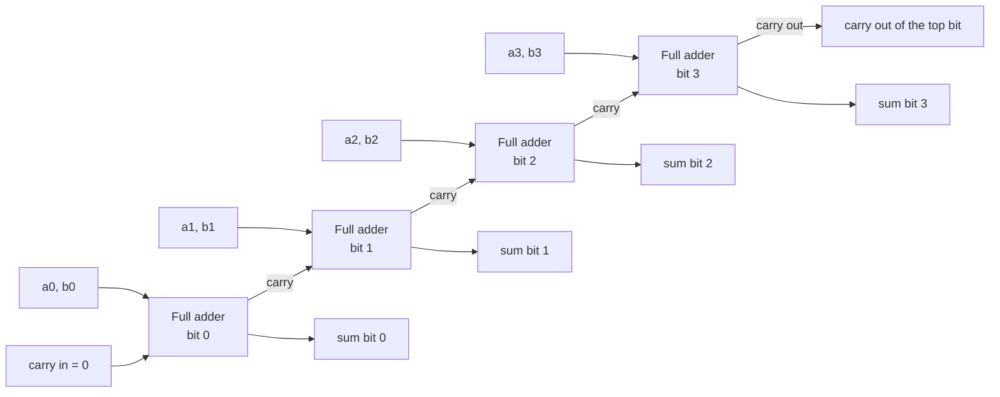

# Binary Arithmetic

<!-- BEGIN HEADER (generated by tools/build.py from the front matter; edit the front matter, not this block) -->
> [Home](../../../../README.md) › [Part I — Computer Science Foundations](../../index.md) › [1. Computer Fundamentals](../index.md) › [Chapter 2: Number systems](index.md)

- **Difficulty:** Beginner to intermediate
- **Estimated time:** about 75 minutes
- **Prerequisites:** [Positional Number Systems](01-positional-number-systems.md) · [Number-System Conversions](02-number-system-conversions.md)
- **Syllabus topics covered:** `01.02.06` Binary arithmetic
- **Status:** Drafted (passes the automated checks; awaiting independent technical review). Last reviewed 2026-11-01.
<!-- END HEADER -->

## What you will learn

- Add, subtract, multiply and divide unsigned binary numbers by hand.
- Explain how a processor adds numbers using logic gates, and why a chain of adders is slow.
- Use the bitwise operators and shifts, including the common idioms for flags and masks.
- Explain *overflow*, *wraparound* and *saturation*, and recognise the difference between them.

## Introduction

Every arithmetic operation a computer performs is, at the bottom, an operation on patterns of bits. The rules are the schoolbook rules for decimal arithmetic, simplified because there are only two digits. The surprising part is how little hardware it takes: an adder is a handful of logic gates, and the other operations are built from adding, shifting and comparing.

Two ideas make binary arithmetic different from the arithmetic you did on paper. First, numbers in a machine have a **fixed width** (8, 16, 32 or 64 bits), so a result can be too large to fit. Second, the machine also offers **bitwise operations** that treat a number as a row of independent bits, which has no everyday equivalent but is indispensable in systems programming.

## Intuitive understanding

Adding in binary is the odometer from the [positional systems lesson](01-positional-number-systems.md) with two wheel positions. You add column by column from the right. When a column adds up to 2 or more, you write the low bit and **carry** a 1 to the next column, exactly as 9 + 1 carries in decimal.

The only column sums possible are:

| Column sum | Sum bit | Carry |
|---|---|---|
| 0 + 0 | 0 | 0 |
| 0 + 1 | 1 | 0 |
| 1 + 1 | 0 | 1 |
| 1 + 1 + 1 (with an incoming carry) | 1 | 1 |

## Technical foundations

### Addition

Add $1011_2$ (11) and $0110_2$ (6), column by column from position 0:

| Bit position | 4 | 3 | 2 | 1 | 0 |
|---|---|---|---|---|---|
| Carry in | 1 | 1 | 1 | 0 | 0 |
| a (11) | 0 | 1 | 0 | 1 | 1 |
| b (6) | 0 | 0 | 1 | 1 | 0 |
| Sum bit | 1 | 0 | 0 | 0 | 1 |
| Carry out | 0 | 1 | 1 | 1 | 0 |

The result is $10001_2 = 17$. Each column's carry-out becomes the next column's carry-in. If the carry out of the *top* column is 1, the true sum needs one more bit than the operands have.

### Subtraction

By hand you can **borrow**, as in decimal. $1101_2 - 0110_2$ (13 minus 6): the right column is $1 - 0 = 1$; next, $0 - 1$ requires a borrow from the column to its left, giving $10_2 - 1 = 1$; and so on, producing $0111_2 = 7$. Hardware does not borrow. It subtracts by **adding the negative** of the second number, which is why the next lesson on [signed numbers and two's complement](04-signed-numbers-and-twos-complement.md) matters: one adder can then perform both addition and subtraction.

### Multiplication: shift and add

Multiplying by a single bit is trivial (0 or the number itself), and multiplying by $2^k$ is a left shift by $k$ places. Long multiplication is therefore: for each 1 bit of the multiplier, add a copy of the multiplicand shifted into that bit's position.

$1011_2 \times 101_2$ (11 times 5):

```text
        1011      11, because the lowest multiplier bit is 1
       0000       0, because the middle multiplier bit is 0 (shifted left 1)
    + 101100      11 shifted left 2, because the top multiplier bit is 1
    --------
      110111      = 55
```

An $n$-bit by $n$-bit product can need up to $2n$ bits.

### Division: shift and subtract

Binary long division brings down one bit of the dividend at a time into a running remainder. If the remainder is at least the divisor, subtract the divisor and write a 1 in the quotient; otherwise write a 0. Because each step only compares and subtracts, it is simple but takes one step per bit, which is one reason division is generally slower than multiplication on most processors.

### Bitwise operations and shifts

Arithmetic treats the bits of a number as one quantity. **Bitwise** operators treat each bit position independently.

| Operator | Python / C | Rule per bit | Typical use |
|---|---|---|---|
| AND | `a & b` | 1 only if both are 1 | Mask: keep or test selected bits |
| OR | `a \| b` | 1 if either is 1 | Set bits |
| XOR | `a ^ b` | 1 if the bits differ | Toggle bits; checksums; parity |
| NOT | `~a` | Flips every bit | Build masks |
| Left shift | `a << k` | Moves bits left, filling with 0 | Multiply by $2^k$ |
| Right shift | `a >> k` | Moves bits right | Divide by $2^k$, rounding down (unsigned) |

Four idioms cover most uses, for a bit position `k` and `mask = 1 << k`: **set** with `x | mask`, **clear** with `x & ~mask`, **toggle** with `x ^ mask`, **test** with `x & mask`.

<!-- run:python -->
```python
READ, WRITE, EXEC = 0b100, 0b010, 0b001

perm = READ | WRITE                          # set two flags
print(format(perm, "03b"))
perm &= ~WRITE                               # clear the WRITE flag
print(format(perm, "03b"))
perm ^= EXEC                                 # toggle the EXEC flag
print(format(perm, "03b"))
print(bool(perm & READ), bool(perm & WRITE))  # test flags

x = 0b101100
print(x & (x - 1) == 0, 64 & 63 == 0)        # power-of-two test
print(bin(x << 2), bin(x >> 2))              # shifts multiply and divide by powers of two
print(bin(x).count("1"))                     # population count: how many 1 bits
```

<!-- expect -->
```text
110
100
101
True False
False True
0b10110000 0b1011
3
```

Step by step: `READ | WRITE` sets the two bits giving `110`. `& ~WRITE` ANDs with a mask that is all ones except the WRITE bit, clearing it: `100`. XOR with `EXEC` flips the lowest bit: `101`. The tests show only READ is set. The power-of-two test works because subtracting 1 from a number flips its lowest 1 bit and all the zeros below it, so `x & (x - 1)` removes the lowest set bit, and a power of two has *only one* set bit, leaving 0. Shifting `101100` (44) left by 2 gives `10110000` (176 = 44 × 4); shifting right by 2 gives `1011` (11 = 44 // 4). The last line counts ones, giving 3.

> **Common mistake:** *operator precedence differs between languages.* In Python, `x & 1 == 0` is `(x & 1) == 0`, as you would hope. In C, `==` binds tighter than `&`, so `x & 1 == 0` means `x & (1 == 0)`, which is always 0. Always parenthesise: `(x & 1) == 0`.

## How hardware adds

A **half adder** adds two bits: the sum bit is `a XOR b` and the carry is `a AND b`. A **full adder** adds two bits plus an incoming carry using two half adders and an OR gate. Chaining $n$ full adders, each passing its carry to the next, gives an $n$-bit **ripple-carry adder**.



*Reading the diagram:* the carry signal ripples from the least significant stage to the most significant. Stage $i$ cannot finish until stage $i-1$ has produced its carry, so the delay grows in proportion to the width. The code below builds exactly this circuit from gate operations and checks it against ordinary addition.

<!-- run:python -->
```python
def half_adder(a: int, b: int) -> tuple[int, int]:
    """Add two bits. Returns (sum, carry)."""
    return a ^ b, a & b


def full_adder(a: int, b: int, carry_in: int) -> tuple[int, int]:
    """Add two bits plus an incoming carry. Returns (sum, carry_out)."""
    s1, c1 = half_adder(a, b)
    s2, c2 = half_adder(s1, carry_in)
    return s2, c1 | c2


def ripple_carry_add(x: int, y: int, width: int = 8) -> tuple[int, int]:
    """Add two unsigned `width`-bit numbers one bit at a time. Returns (sum, carry_out)."""
    result, carry = 0, 0
    for i in range(width):                    # least significant bit first
        bit, carry = full_adder((x >> i) & 1, (y >> i) & 1, carry)
        result |= bit << i
    return result, carry


print(ripple_carry_add(0b1011, 0b0110, width=5))   # 11 + 6 = 17
print(ripple_carry_add(200, 100))                  # 300 does not fit in 8 bits
ok = all(
    ripple_carry_add(x, y) == ((x + y) & 0xFF, (x + y) >> 8)
    for x in range(256) for y in range(256)
)
print("all 65536 pairs match:", ok)
```

<!-- expect -->
```text
(17, 0)
(44, 1)
all 65536 pairs match: True
```

The first call reproduces the worked table: sum 17, carry-out 0. The second shows overflow: $200 + 100 = 300 = 256 + 44$, so the 8-bit sum is 44 and the carry-out is 1. The exhaustive check tries all $256 \times 256$ input pairs against Python's own addition, split into its low 8 bits and its carry. Because the input space is small, *exhaustive* testing is possible and gives a proof rather than a sample.

> **Advanced insight:** a 64-bit ripple-carry adder would be far too slow, so real processors use a **carry-lookahead** (or other parallel-prefix) design. For each bit, define *generate* $g_i = a_i b_i$ (this stage creates a carry by itself) and *propagate* $p_i = a_i \oplus b_i$ (this stage passes an incoming carry along). Then $c_{i+1} = g_i + p_i c_i$, and unrolling this lets all carries be computed in parallel with a tree of gates whose depth grows with $\log n$ rather than $n$, at the cost of more gates.

### Multiplication and division in code

The algorithms above can be written using only shifts, adds, subtractions and bit tests:

<!-- run:python -->
```python
def shift_add_multiply(a: int, b: int) -> int:
    """Multiply unsigned integers using only shifts, adds and bit tests."""
    product = 0
    while b:
        if b & 1:           # if the lowest bit of the multiplier is 1 ...
            product += a    # ... add the shifted multiplicand
        a <<= 1             # shift the multiplicand left (times 2)
        b >>= 1             # move on to the next multiplier bit
    return product


def shift_subtract_divide(n: int, d: int) -> tuple[int, int]:
    """Binary long division. Returns (quotient, remainder)."""
    if d == 0:
        raise ZeroDivisionError("division by zero")
    quotient = remainder = 0
    for i in range(n.bit_length() - 1, -1, -1):          # from the most significant bit down
        remainder = (remainder << 1) | ((n >> i) & 1)    # bring down the next bit
        if remainder >= d:
            remainder -= d
            quotient |= 1 << i
    return quotient, remainder


print(shift_add_multiply(0b1011, 0b101))
print(shift_subtract_divide(100, 7))
print(all(shift_add_multiply(a, b) == a * b for a in range(64) for b in range(64)))
print(all(shift_subtract_divide(n, d) == divmod(n, d) for n in range(300) for d in range(1, 40)))
```

<!-- expect -->
```text
55
(14, 2)
True
True
```

Execution walkthrough for $11 \times 5$: the multiplier $b = 101_2$ has bits 1, 0, 1 from the right. Round 1 adds 11; round 2 adds nothing (bit is 0) but shifts the multiplicand to 22; round 3 adds 44, giving $11 + 44 = 55$. Both loops run once per bit of an operand, so the cost is proportional to the operand width, $O(n)$ steps for $n$-bit inputs. Edge cases: multiplying by 0 returns 0 immediately; dividing 0 gives $(0, 0)$; division by zero is rejected explicitly, because hardware divide instructions also fault in that case.

## Overflow, wraparound and saturation

A register holds a fixed number of bits, so an $n$-bit unsigned result must lie between 0 and $2^n - 1$. When the true result is larger, the hardware has three common ways of coping:

- **Wraparound (modular arithmetic).** Keep only the low $n$ bits. The result is the true value modulo $2^n$. An 8-bit counter at 255 becomes 0 after adding 1. The carry-out of the top bit tells you it happened.
- **Saturation.** Clamp the result to the largest representable value (or smallest, for subtraction). Used in graphics and digital signal processing, where a pixel value of 300 should become "fully bright" (255), not wrap to a dark 44.
- **Trap or error.** Signal an exception, or detect it in software with a checked operation.

<!-- run:python -->
```python
def wrap_add(a: int, b: int, bits: int = 8) -> int:
    return (a + b) & ((1 << bits) - 1)      # keep only the low `bits` bits: modulo 2**bits


def saturating_add(a: int, b: int, bits: int = 8) -> int:
    return min(a + b, (1 << bits) - 1)      # clamp at the largest value instead of wrapping


print(wrap_add(250, 10), saturating_add(250, 10))
print(wrap_add(100, 100), saturating_add(100, 100))
```

<!-- expect -->
```text
4 255
200 200
```

Python's own integers never overflow because they grow as needed, so the examples simulate a fixed width with a mask. In C the fixed width is real:

<!-- run:c -->
```c
#include <stdio.h>
#include <stdint.h>

int main(void) {
    uint8_t x = 250;
    x = (uint8_t)(x + 10);        /* unsigned arithmetic wraps modulo 256: well defined */
    printf("250 + 10 as uint8_t = %u\n", (unsigned)x);

    uint32_t big = 4294967295u;   /* the largest 32-bit unsigned value */
    big += 1u;
    printf("UINT32_MAX + 1 = %u\n", (unsigned)big);
    return 0;
}
```

<!-- expect -->
```text
250 + 10 as uint8_t = 4
UINT32_MAX + 1 = 0
```

In C, **unsigned** overflow is defined to wrap modulo $2^n$, as shown. **Signed** overflow is *undefined behaviour*: the standard places no requirement on what happens, and optimising compilers may assume it never occurs. The next lesson covers signed numbers.

> **Production note:** integer overflow is a classic source of security vulnerabilities. A common pattern is computing a buffer size as `count * element_size`; if the product wraps to a small number, the program allocates too little memory and then writes past it. Use checked arithmetic (compiler builtins, safe-integer libraries, or languages whose arithmetic traps or checks), and validate sizes *before* multiplying.

## Real-world applications

- **The arithmetic logic unit (ALU)** inside every processor performs addition, subtraction, AND, OR, XOR and shifts, and sets **flags** (carry, zero, sign, overflow) that later instructions test. See [subject 3](../../../../docs/01-computer-science-foundations/03-digital-logic-and-computer-organization/index.md).
- **Flags and permissions.** Operating systems and APIs pack many on/off options into one integer and test them with masks.
- **Graphics and audio.** Saturating arithmetic prevents wrap-around artefacts in pixels and samples.
- **Hashing and cryptography** rely on shifts, rotations, XOR and modular addition at fixed widths.
- **Fast tricks.** Multiplying or dividing by a power of two as a shift, and `x & (x - 1)` for the power-of-two test, appear throughout systems code. A good compiler already makes the first substitution for you.

## Common mistakes

- **Forgetting the fixed width.** Code that works on small numbers can silently wrap on large ones.
- **Treating the carry-out as an error in all cases.** For unsigned numbers it signals overflow; for signed numbers the overflow rule is different (next lesson).
- **Using `==` and `&` without parentheses in C.**
- **Shifting by the width or more.** In C, shifting a 32-bit value by 32 or more places is undefined behaviour.
- **Assuming right shift always divides.** It floors for unsigned values; for negative signed values the result depends on whether the shift is arithmetic or logical.
- **Multiplying before checking for overflow.**

## Exercises

**Beginner**

1. Add $1011_2 + 0111_2$ and check against decimal.
2. Compute $1101_2 - 0110_2$ by borrowing and verify it equals 7.

**Intermediate**

3. Multiply $110_2 \times 11_2$ by shift and add, and verify against $6 \times 3$.
4. Write `popcount(n)` that counts set bits using the `n & (n - 1)` trick, looping once per set bit.

**Advanced**

5. Prove that `x & (x - 1)` clears exactly the lowest set bit of a nonzero `x`.
6. Using the generate and propagate definitions, write the carry equations $c_1$ to $c_4$ for a 4-bit adder with $c_0 = 0$, expressed only in terms of $g$ and $p$.

**Expert**

7. Explain why ripple-carry delay is $O(n)$ whereas a parallel-prefix adder has depth $O(\log n)$, and what price the faster design pays.

<details>
<summary>Solutions and hints</summary>

1. $1011 + 0111 = 10010_2$ (11 + 7 = 18).
2. Right column $1 - 0 = 1$; next column $0 - 1$: borrow, $10_2 - 1 = 1$, leaving the column to the left reduced by 1; continuing gives $0111_2 = 7$.
3. $110 \times 11$: add $110$ and $110 \ll 1 = 1100$, giving $10010_2 = 18$.
4. `count = 0; while n: n &= n - 1; count += 1`. It iterates once per 1 bit.
5. Let the lowest set bit be at position $k$. Subtracting 1 turns bit $k$ into 0 and every bit below it (all zeros) into 1, leaving bits above $k$ unchanged. ANDing with the original keeps the bits above $k$, and bits $k$ and below become 0 (bit $k$: $1 \& 0$; lower bits: $0 \& 1$). So only bit $k$ was cleared.
6. $c_1 = g_0$; $c_2 = g_1 + p_1 g_0$; $c_3 = g_2 + p_2 g_1 + p_2 p_1 g_0$; $c_4 = g_3 + p_3 g_2 + p_3 p_2 g_1 + p_3 p_2 p_1 g_0$.
7. In ripple-carry each carry waits for the previous one, so there is a chain of $n$ stages. A prefix adder combines (generate, propagate) pairs in a tree, in which each level halves the number of groups, so the depth is $\log_2 n$. The price is more gates, more wiring and more complexity.

</details>

## Interview and practical questions

**How do you check whether an integer is a power of two?** For positive $x$, `x & (x - 1) == 0` (with correct parentheses in C), because a power of two has a single set bit.

**What is the difference between a logical and an arithmetic right shift?** A logical shift fills the vacated high bits with zeros; an arithmetic shift copies the sign bit, so it keeps negative numbers negative. Unsigned values use logical shifts.

**What happens when an unsigned integer overflows in C versus Python?** In C it wraps modulo $2^n$. In Python integers have arbitrary precision, so they simply grow.

**Why is XOR used to toggle bits and in checksums?** XOR with 1 flips a bit and XOR with 0 leaves it unchanged; XOR is also its own inverse, so applying it twice restores the original value.

**Why does multiplying two 32-bit numbers need a 64-bit result?** The product of two $n$-bit numbers can need up to $2n$ bits.

## Further reading

**Textbooks**

- David A. Patterson and John L. Hennessy, *Computer Organization and Design* (Morgan Kaufmann), the chapter on arithmetic for computers, including adders, multiplication and division hardware.
- Henry S. Warren Jr., *Hacker's Delight* (Addison-Wesley), the standard collection of bit-manipulation techniques.
- Noam Nisan and Shimon Schocken, *The Elements of Computing Systems* (MIT Press): you build the half adder, full adder and ALU yourself.

**Standards**

- ISO/IEC 9899, the C standard, for the definition of unsigned wraparound and the undefined behaviour of signed overflow and over-wide shifts.

**Official documentation for the code used here**

- Python: [bitwise operations on integers](https://docs.python.org/3/library/stdtypes.html#bitwise-operations-on-integer-types) and [`int.bit_length`](https://docs.python.org/3/library/stdtypes.html#int.bit_length).

<!-- BEGIN FOOTER (generated by tools/build.py) -->
---

## Related topics

- [Signed Numbers and Two's Complement](04-signed-numbers-and-twos-complement.md)

## Navigation

**Previous:** [Number-System Conversions](02-number-system-conversions.md) · **Up:** [Chapter 2: Number systems](index.md) · **Next:** [Signed Numbers and Two's Complement](04-signed-numbers-and-twos-complement.md)
<!-- END FOOTER -->
