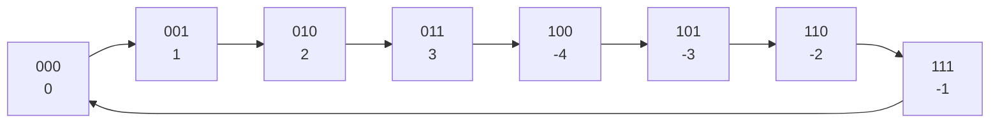

# Signed Numbers and Two's Complement

<!-- BEGIN HEADER (generated by tools/build.py from the front matter; edit the front matter, not this block) -->
> [Home](../../../../README.md) › [Part I — Computer Science Foundations](../../index.md) › [1. Computer Fundamentals](../index.md) › [Chapter 2: Number systems](index.md)

- **Difficulty:** Intermediate
- **Estimated time:** about 75 minutes
- **Prerequisites:** [Binary Arithmetic](03-binary-arithmetic.md)
- **Syllabus topics covered:** `01.02.07` Signed and unsigned numbers · `01.02.08` Two's complement
- **Status:** Drafted (passes the automated checks; awaiting independent technical review). Last reviewed 2026-11-01.
<!-- END HEADER -->

## What you will learn

- Explain the difference between signed and unsigned interpretations of the *same* bit pattern.
- Describe four ways to represent negative integers (sign-magnitude, ones' complement, two's complement and offset binary) and say why two's complement is used almost everywhere.
- Negate a number, extend its width, and read a two's-complement pattern by hand.
- Detect signed overflow, and explain why C and C++ treat it differently from unsigned overflow.

## Introduction

A fixed number of bits can hold $2^n$ different patterns. For **unsigned** numbers the patterns mean $0$ to $2^n - 1$. To represent negative numbers as well, we must *reassign* some patterns, and we must do it so that arithmetic circuits stay simple. The choice that nearly every modern machine makes is **two's complement**.

The central point to absorb is that **a bit pattern has no inherent meaning**. The byte `1111 0110` is 246 if you read it as unsigned and −10 if you read it as two's-complement signed. The hardware adds the same bits either way; it is the *interpretation* that differs.

## Intuitive understanding

Think of the odometer again, but one that stops at 256 and wraps to 0. If you wind it *back* by 10 from 0 it shows 246. So 246 behaves exactly like −10: add 10 to it and you are back at 0 (after wrapping). Two's complement makes this official: **a negative number is represented by the position it reaches when you count backwards from zero on a wheel of $2^n$ positions.**



*Reading the diagram:* this is a 3-bit wheel. Counting up from 000, the values go 0, 1, 2, 3, and then the next pattern, 100, is interpreted as −4 instead of 4; counting on gives −3, −2, −1 and the wheel closes back to 0. Half the patterns are non-negative and half are negative, and the pattern's top bit tells you which half you are in.

## Technical foundations

### Four ways to represent negative integers

| Method | Idea | Weakness |
|---|---|---|
| **Sign-magnitude** | Top bit is the sign, remaining bits the magnitude | Two zeros (+0 and −0); addition needs special cases |
| **Ones' complement** | Negate by inverting every bit | Two zeros; adding needs an "end-around carry" |
| **Two's complement** | Negate by inverting every bit and adding 1 | The most negative value has no positive twin |
| **Offset (excess-$K$) binary** | Store $\text{value} + K$ as an unsigned number | Arithmetic needs correcting for the offset |

Some early machines used sign-magnitude or ones' complement (for example, the CDC 6600 used ones' complement). Offset binary is still used for the **exponent field of floating-point numbers**, covered in the [next lesson](05-floating-point-and-ieee-754.md). The program below prints every 4-bit pattern under the first three schemes so you can compare them directly. It needs Python 3.10 or newer.

<!-- run:python -->
```python
BITS = 4
MASK = (1 << BITS) - 1
SIGN = 1 << (BITS - 1)

print("bits  unsigned  sign-mag  ones-comp  twos-comp")
for pattern in range(1 << BITS):
    magnitude = pattern & (SIGN - 1)
    if pattern & SIGN:
        sign_mag = "-0" if magnitude == 0 else str(-magnitude)
        inverted = (~pattern) & MASK                    # ones' complement: invert all bits
        ones = "-0" if inverted == 0 else str(-inverted)
        twos = str(pattern - (1 << BITS))               # two's complement: subtract 2**n
    else:
        sign_mag = ones = twos = str(pattern)
    print(f"{pattern:04b}  {pattern:>8}  {sign_mag:>8}  {ones:>9}  {twos:>9}")
```

<!-- expect -->
```text
bits  unsigned  sign-mag  ones-comp  twos-comp
0000         0         0          0          0
0001         1         1          1          1
0010         2         2          2          2
0011         3         3          3          3
0100         4         4          4          4
0101         5         5          5          5
0110         6         6          6          6
0111         7         7          7          7
1000         8        -0         -7         -8
1001         9        -1         -6         -7
1010        10        -2         -5         -6
1011        11        -3         -4         -5
1100        12        -4         -3         -4
1101        13        -5         -2         -3
1110        14        -6         -1         -2
1111        15        -7         -0         -1
```

Look at the last two columns of the lower half. Sign-magnitude and ones' complement both have a **negative zero** (`1000` and `1111` respectively), wasting a pattern and complicating comparisons. Two's complement has a single zero and one *extra* negative value: with 4 bits the range is $-8$ to $7$.

### Two's complement defined

For an $n$-bit pattern $d_{n-1} \ldots d_0$, the two's-complement value is

$$
v = -d_{n-1}\,2^{\,n-1} + \sum_{i=0}^{n-2} d_i\,2^{\,i}.
$$

It is the usual place-value sum except that the top bit has **negative weight**. Equivalently, if the top bit is 1 the value is the unsigned value minus $2^n$. The range is

$$
-2^{\,n-1} \;\le\; v \;\le\; 2^{\,n-1} - 1 .
$$

For $n = 8$ that is $-128$ to $127$; for $n = 32$ it is $-2{,}147{,}483{,}648$ to $2{,}147{,}483{,}647$.

*Worked example.* The 8-bit pattern `1111 0110`: top bit weight $-128$, plus $64 + 32 + 16 + 4 + 2 = 118$, so $-128 + 118 = -10$.

### Negation: invert and add one

To negate a two's-complement number, **invert every bit and add 1**. Applying this to $10 = \texttt{0000 1010}$ gives $\texttt{1111 0101} + 1 = \texttt{1111 0110}$, which we just saw is $-10$.

*Why it works.* For any pattern $x$, adding it to its bitwise inverse $\sim x$ gives all ones, which is $2^n - 1$:

$$
x + \sim x = 2^n - 1 \quad\Longrightarrow\quad -x \equiv \sim x + 1 \pmod{2^n}.
$$

Since the machine's arithmetic is automatically *modulo* $2^n$, $\sim x + 1$ behaves exactly like $-x$.

### Why two's complement won

The same reasoning shows the key property. Arithmetic on $n$-bit patterns is arithmetic **modulo $2^n$**, and a negative number is simply another number congruent modulo $2^n$. So **the same adder circuit produces the correct bit pattern for signed and unsigned addition, and subtraction is just addition of the negation.** There is no special case for signs and only one zero. That simplicity is why almost all processors use it.

> **Advanced insight:** the C++20 standard (proposal P1236R1) and the C23 standard (proposal N2412) both *require* two's complement for signed integer types, after earlier standards also allowed ones' complement and sign-magnitude. Notice what they did **not** change: signed overflow is still undefined behaviour in both languages (see below).

### The asymmetry and its consequence

With $n$ bits there are $2^{n-1}$ negative values but only $2^{n-1} - 1$ positive ones, so the most negative value, $-2^{n-1}$, has **no positive counterpart**. Negating it gives itself: `1000 0000` inverted is `0111 1111`, plus 1 is `1000 0000`. Code that computes `abs(x)` or `-x` for the minimum value therefore misbehaves; it is a real source of bugs.

### Sign extension

To widen a signed value from $m$ to $n > m$ bits while preserving its value, **copy the sign bit into all the new high bits**. The 8-bit $-10$ (`1111 0110`) becomes the 16-bit `1111 1111 1111 0110`, still $-10$. For **unsigned** values you extend with zeros (zero extension) instead. Using the wrong one is a classic bug when mixing signed and unsigned data.

### Comparison and shifts

Equality compares patterns directly. For ordering, the processor needs to know the interpretation, so it has separate signed and unsigned comparisons. The patterns `1111 1111` and `0000 0001` are in the order $255 > 1$ as unsigned but $-1 < 1$ as signed. A right shift is also interpretation-dependent: a **logical** shift fills with zeros (right for unsigned), while an **arithmetic** shift copies the sign bit so that a negative value stays negative, rounding towards minus infinity.

### Detecting signed overflow

Adding two $n$-bit signed numbers overflows when the true sum falls outside $[-2^{n-1}, 2^{n-1}-1]$. Two facts make detection easy:

| Operands | Can the sum overflow? | How it shows |
|---|---|---|
| positive + positive | Yes | Result looks negative |
| negative + negative | Yes | Result looks positive |
| positive + negative | Never | n/a |

Equivalently, overflow occurs when the carry *into* the sign bit differs from the carry *out of* it. This is different from the **carry-out** that signals *unsigned* overflow; processors keep separate carry and overflow flags for that reason.

## Step-by-step working in code

<!-- run:python -->
```python
def to_signed(pattern: int, bits: int) -> int:
    """Interpret an n-bit pattern as a two's-complement integer."""
    pattern &= (1 << bits) - 1
    return pattern - (1 << bits) if pattern >> (bits - 1) else pattern


def to_pattern(value: int, bits: int) -> int:
    """The n-bit two's-complement pattern of an integer (it must fit)."""
    if not -(1 << (bits - 1)) <= value < (1 << (bits - 1)):
        raise OverflowError(f"{value} does not fit in {bits} bits")
    return value & ((1 << bits) - 1)


def negate(pattern: int, bits: int) -> int:
    """Two's-complement negation: invert every bit and add one."""
    return (~pattern + 1) & ((1 << bits) - 1)


def sign_extend(pattern: int, from_bits: int, to_bits: int) -> int:
    """Widen a pattern by copying its sign bit into the new high bits."""
    return to_pattern(to_signed(pattern, from_bits), to_bits)


def add_signed(a: int, b: int, bits: int):
    """Add two patterns. Returns (result pattern, signed overflow?)."""
    total = (a + b) & ((1 << bits) - 1)
    sign = 1 << (bits - 1)
    overflow = bool(~(a ^ b) & (a ^ total) & sign)   # same-sign inputs, different-sign result
    return total, overflow


print(format(to_pattern(-10, 8), "08b"), to_signed(0b11110110, 8))
print(format(negate(0b00001010, 8), "08b"))
print(format(sign_extend(0b11110110, 8, 16), "016b"))
print(to_signed(negate(0b10000000, 8), 8))                   # negating the most negative value
print(add_signed(to_pattern(100, 8), to_pattern(50, 8), 8))
print(add_signed(to_pattern(-100, 8), to_pattern(-50, 8), 8))
print(add_signed(to_pattern(100, 8), to_pattern(-50, 8), 8))
```

<!-- expect -->
```text
11110110 -10
11110110
1111111111110110
-128
(150, True)
(106, True)
(50, False)
```

Walking through the results:

1. `to_pattern(-10, 8)` masks $-10$ to its low 8 bits, `11110110`, and `to_signed` reverses it.
2. `negate` of 10 (`00001010`) gives the same `11110110`: invert and add one.
3. `sign_extend` fills the new 8 high bits with 1s because the sign bit is 1.
4. Negating $-128$ returns $-128$: the asymmetry in action.
5. $100 + 50 = 150$ does not fit in 8 signed bits (maximum 127). The pattern produced, `10010110`, would be read as $-106$, and the overflow flag is `True`.
6. $-100 + -50 = -150$ wraps to the pattern `01101010`, which reads as $+106$, again flagged.
7. $100 + (-50) = 50$: operands of opposite sign can never overflow, so the flag is `False`.

In C the same ideas appear with fixed-width types. The following program reinterprets a byte using `memcpy` (which is always well defined) and demonstrates negation and sign extension. It needs a C11 compiler.

<!-- run:c -->
```c
#include <stdio.h>
#include <stdint.h>
#include <string.h>

int main(void) {
    uint8_t bits = 0xF6;                     /* the bit pattern 1111 0110 */
    int8_t as_signed;
    memcpy(&as_signed, &bits, 1);            /* reinterpret the same byte as signed */
    printf("pattern 0x%02X = %u unsigned, %d signed\n",
           (unsigned)bits, (unsigned)bits, (int)as_signed);

    uint8_t ten = 10;
    uint8_t negated = (uint8_t)(~ten + 1u);  /* invert, add one, keep 8 bits */
    int8_t check;
    memcpy(&check, &negated, 1);
    printf("invert-and-add-one of 10 gives 0x%02X, which is %d\n",
           (unsigned)negated, (int)check);

    int8_t narrow = -10;
    int16_t wide = narrow;                   /* sign extension happens in this conversion */
    printf("-10 widened to 16 bits is 0x%04X\n", (unsigned)(uint16_t)wide);
    return 0;
}
```

<!-- expect -->
```text
pattern 0xF6 = 246 unsigned, -10 signed
invert-and-add-one of 10 gives 0xF6, which is -10
-10 widened to 16 bits is 0xFFF6
```

The mixed signed/unsigned trap deserves a fragment of its own. It is shown, not run, because a good compiler warns about it:

<!-- illustrative -->
```c
int a = -1;
unsigned int b = 1;
if (a < b) {
    /* NOT reached: before comparing, a is converted to unsigned int
       (4294967295 on a 32-bit int), so the comparison is false. */
}
```

When a signed and an unsigned operand of the same rank meet, C converts the *signed* one to unsigned, so $-1$ becomes the largest unsigned value. Compile with warnings enabled (`-Wall -Wextra`) and treat sign-comparison warnings as errors.

### A famous overflow: the year 2038

A signed 32-bit count of seconds since 1 January 1970 (UTC), used by many systems for timestamps, has a largest value of $2^{31} - 1$. One second later it wraps to a large negative number, which is read as a date in 1901:

<!-- run:python -->
```python
from datetime import datetime, timezone

print(datetime.fromtimestamp(2**31 - 1, tz=timezone.utc))
```

<!-- expect -->
```text
2038-01-19 03:14:07+00:00
```

Systems that store time in a 32-bit signed integer break at that instant. The fix is to use a 64-bit time value, which is already standard on modern platforms but still present in old embedded devices, file formats and databases.

## Real-world applications

- **Every CPU** provides separate flags for carry (unsigned overflow) and overflow (signed overflow), and separate signed and unsigned conditional branches.
- **Language semantics differ.** In C and C++ signed overflow is undefined behaviour, so a compiler may assume `x + 1 > x` is always true for a signed `int` and optimise accordingly. Java defines integer arithmetic as wrapping. Rust checks overflow in debug builds (panicking) and wraps in release builds by default, and offers explicit methods such as `checked_add`, `wrapping_add` and `saturating_add`. Python integers never overflow. JavaScript's bitwise operators convert operands to 32-bit signed integers.
- **File formats and protocols** specify the width and signedness of every integer field. Misreading one corrupts data silently.
- **Audio and signal processing** store samples as signed integers centred on zero.

## Comparisons and trade-offs

| | Sign-magnitude | Ones' complement | Two's complement |
|---|---|---|---|
| Zeros | Two | Two | One |
| Addition hardware | Needs sign logic | Needs end-around carry | Same adder as unsigned |
| Negation | Flip one bit | Flip all bits | Flip all bits and add 1 |
| Range ($n$ bits) | $\pm(2^{n-1}-1)$ | $\pm(2^{n-1}-1)$ | $-2^{n-1}$ to $2^{n-1}-1$ |
| Used today | Sign of floating-point numbers | Rare (legacy, some checksums) | Integers in almost every processor |

Sign-magnitude lives on inside IEEE 754 floating-point numbers, which have a separate sign bit, a property you will use in the next lesson.

## Common mistakes

> **Common mistake:** *Assuming `-x` is always positive for negative `x`, or that `abs(x) >= 0`.* For the most negative value of a signed type, `-x` and `abs(x)` overflow.

- **Mixing signed and unsigned in comparisons or arithmetic**, especially sizes and indexes (`size_t` is unsigned).
- **Using the wrong extension** (sign versus zero) when widening.
- **Assuming signed overflow wraps** in C or C++. It is undefined behaviour, not wraparound.
- **Confusing the carry flag with the overflow flag.**
- **Storing a signed value in an unsigned field** (or the reverse) in files and network protocols.
- **Thinking the sign bit is a separate flag** in two's complement. It is the top bit with negative weight, part of the number.

## Exercises

**Beginner**

1. Write $-5$ as an 8-bit two's-complement pattern, and find the decimal value of `1111 0000`.
2. What is the range of a 12-bit signed integer?

**Intermediate**

3. Add `0110 0100` and `0110 0100` in 8-bit two's complement. What is the resulting pattern, its signed value, and is there overflow?
4. Sign-extend `0x80` (8 bits) to 16 bits, and zero-extend it to 16 bits. State the value in each case.

**Advanced**

5. Show that `negate(negate(x)) == x` for every 8-bit `x`, including `0x80`, by running a loop. Explain why it holds even for the most negative value.
6. Write `add_checked(a, b, bits)` that raises `OverflowError` on signed overflow using only the sign-bit rule, and test it exhaustively for 8 bits.

**Expert**

7. Prove that $\sim x + 1$ represents $-x$ for any $n$-bit $x$, and that two's-complement addition is correct modulo $2^n$ regardless of the signs of the operands.
8. Explain why a compiler that assumes signed overflow never happens can legally turn `x + 1 > x` into `true`, and describe a security bug that this can cause.

<details>
<summary>Solutions and hints</summary>

1. $5 = \texttt{0000 0101}$; invert to `1111 1010`; add 1 to get `1111 1011`. And `1111 0000` is $240 - 256 = -16$.
2. $-2^{11}$ to $2^{11} - 1$, that is $-2048$ to $2047$.
3. $100 + 100 = 200$, which is beyond 127. The pattern is `1100 1000`, signed value $-56$, and the overflow flag is set (two positives produced a negative).
4. Sign extension gives `0xFF80` $= -128$. Zero extension gives `0x0080` $= 128$.
5. The loop will confirm it. For `0x80`, invert is `0x7F`, add one is `0x80` again, so applying negation twice returns the original. In general $-(-x) \equiv x \pmod{2^n}$.
6. Use the `add_signed` function from this lesson and raise when its overflow flag is `True`. Compare against the true sum to confirm for all $256 \times 256$ cases.
7. $x + \sim x$ has every bit set, which is $2^n - 1$, so $\sim x + 1 \equiv 2^n \equiv 0 - x$. For addition: the pattern of a signed value $v$ is $v \bmod 2^n$, and addition modulo $2^n$ of two such patterns is the pattern of $(v_1 + v_2) \bmod 2^n$, which equals the pattern of the true sum whenever the true sum is in range.
8. Because overflow would be undefined behaviour, the compiler may reason that it cannot occur. If a security check such as `if (len + 1 > len)` is intended to catch wraparound, the optimiser may delete it, removing the very protection the programmer wanted.

</details>

## Interview and practical questions

**Why is two's complement used?** One adder serves both signed and unsigned arithmetic, subtraction is addition of the negation, and there is only one zero.

**What is the range of an $n$-bit signed integer?** $-2^{n-1}$ to $2^{n-1} - 1$. For 8 bits, $-128$ to $127$.

**How do you negate a number in two's complement?** Invert all bits and add one.

**What is sign extension, and when is it wrong?** Copying the sign bit into new high bits to keep a signed value unchanged when widening. It is wrong for unsigned data, which needs zero extension.

**What happens on signed overflow in C?** It is undefined behaviour; no particular result is guaranteed, and optimisers may rely on its absence. Use wider types, checked arithmetic or unsigned arithmetic where wraparound is intended.

**How can you detect overflow when adding two signed numbers?** If both operands have the same sign and the result has a different sign, it overflowed. In hardware, compare the carry into the sign bit with the carry out of it.

## Further reading

**Standards and proposals**

- ISO/IEC 9899 (the C standard) and ISO/IEC 14882 (the C++ standard); see also the committee papers WG14 N2412, "Two's complement sign representation for C2x", and WG21 P1236R1, "Alternative Wording for P0907R4 Signed Integers are Two's Complement". These are on the ISO C and C++ committee sites ([open-std.org](https://www.open-std.org/)).

**Textbooks**

- Randal E. Bryant and David R. O'Hallaron, *Computer Systems: A Programmer's Perspective* (Pearson), the chapter on representing and manipulating information, which treats signed and unsigned integers in depth.
- Henry S. Warren Jr., *Hacker's Delight* (Addison-Wesley), for overflow detection and two's-complement identities.

**Official documentation for the code used here**

- Python: [`datetime`](https://docs.python.org/3/library/datetime.html) and [bitwise operations](https://docs.python.org/3/library/stdtypes.html#bitwise-operations-on-integer-types).

<!-- BEGIN FOOTER (generated by tools/build.py) -->
---

## Related topics

- [Floating-Point Representation and IEEE 754](05-floating-point-and-ieee-754.md)

## Navigation

**Previous:** [Binary Arithmetic](03-binary-arithmetic.md) · **Up:** [Chapter 2: Number systems](index.md) · **Next:** [Floating-Point Representation and IEEE 754](05-floating-point-and-ieee-754.md)
<!-- END FOOTER -->
