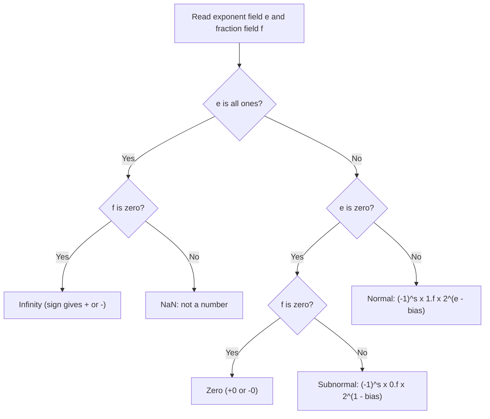

# Floating-Point Representation and IEEE 754

<!-- BEGIN HEADER (generated by tools/build.py from the front matter; edit the front matter, not this block) -->
> [Home](../../../../README.md) › [Part I — Computer Science Foundations](../../index.md) › [1. Computer Fundamentals](../index.md) › [Chapter 2: Number systems](index.md)

- **Difficulty:** Intermediate to advanced
- **Estimated time:** about 90 minutes
- **Prerequisites:** [Number-System Conversions](02-number-system-conversions.md) · [Signed Numbers and Two's Complement](04-signed-numbers-and-twos-complement.md)
- **Syllabus topics covered:** `01.02.09` Floating-point representation · `01.02.10` IEEE 754
- **Status:** Drafted (passes the automated checks; awaiting independent technical review). Last reviewed 2026-11-01.
<!-- END HEADER -->

## What you will learn

- Explain why computers approximate real numbers, and how a floating-point number is built from a sign, an exponent and a fraction.
- Encode and decode an IEEE 754 single- and double-precision number by hand, including special values.
- Explain rounding, machine epsilon and why `0.1 + 0.2 != 0.3`, using the conversion theorem from the previous lessons.
- Avoid the standard pitfalls: equality tests, absorption, cancellation and accumulated error.
- Choose between floating-point, fixed-point and decimal arithmetic for a given problem.

## Introduction

Integers are exact but limited: they cannot hold $0.5$, or $6.02 \times 10^{23}$, or $10^{-19}$. Scientific, graphical and financial programs all need numbers that are fractional and span an enormous range of sizes. **Floating-point** numbers solve this by storing a number the way scientists write it, in **scientific notation**: a few significant digits and a power that says where the point goes. $6.02 \times 10^{23}$ stores "602" and "23" separately.

The price is that a floating-point number holds only a fixed number of significant digits, so almost every real number must be **rounded**, and arithmetic on rounded values produces small errors that can accumulate or, worse, be magnified. A great many numerical bugs come from not understanding this. Fortunately the rules are precise. They were standardised as **IEEE 754** so that the same program gives the same answer on different machines. The standard was first published in 1985 and revised in 2008 and 2019; check the IEEE site for the current edition.

## Intuitive understanding

Imagine measuring everything with a ruler that has only 24 marks, but you may slide the ruler along a *scale* that says "marks are 1 unit apart", or "1000 units apart", or "a millionth apart". Near the scale you choose you can state positions to a precision of one mark. If you want a bigger range, you pay with coarser marks.

That is exactly floating point. The **fraction** field supplies the marks (a fixed number of significant bits), and the **exponent** field is the scale. The consequences follow directly:

- The *relative* precision is about the same everywhere (always about 24 significant bits in single precision), but the *absolute* gap between neighbouring numbers grows as the numbers grow.
- Between 1 and 2 there are $2^{23}$ evenly spaced single-precision numbers; between 2 and 4 there are again $2^{23}$, spaced twice as far apart; and so on.
- Large numbers cannot represent small differences: near $10^{16}$ in double precision, the neighbouring numbers are 2 apart, so adding 1 changes nothing.

## Technical foundations

### The structure of an IEEE 754 number

A binary floating-point number has three fields:

$$
(-1)^{s} \times 1.f \times 2^{\,e - \text{bias}}
$$

- **s**, the **sign bit** (0 positive, 1 negative). This is sign-magnitude, so there are two zeros, $+0$ and $-0$.
- **e**, the **exponent field**, stored as an unsigned number with a **bias** added so that negative exponents need no sign (this is the offset binary representation from the [previous lesson](04-signed-numbers-and-twos-complement.md)).
- **f**, the **fraction field**, the digits after the binary point of the *significand* $1.f$.

For a *normal* number, the leading digit of the significand is always 1, so it is **not stored**. This "hidden bit" gives one extra bit of precision for free.

| Format | Sign | Exponent | Fraction | Bias | Precision (bits) | About decimal digits | Largest finite value |
|---|---|---|---|---|---|---|---|
| binary16 (half) | 1 | 5 | 10 | 15 | 11 | 3.3 | 65,504 |
| bfloat16 (not IEEE) | 1 | 8 | 7 | 127 | 8 | 2.4 | about $3.4 \times 10^{38}$ |
| binary32 (single) | 1 | 8 | 23 | 127 | 24 | 7.2 | about $3.4 \times 10^{38}$ |
| binary64 (double) | 1 | 11 | 52 | 1023 | 53 | 15.95 | about $1.8 \times 10^{308}$ |

"Precision" counts the hidden bit; decimal digits are $\text{precision} \times \log_{10} 2$. The bfloat16 format keeps the *range* of single precision but gives up precision, which suits machine learning; it is a widely used industry format rather than part of IEEE 754.

### Decoding the exponent field



*Reading the diagram:* the two extreme exponent values are reserved. An all-ones exponent means infinity or NaN. An all-zeros exponent means zero or a **subnormal** number, which has no hidden bit and so fills in the gap between zero and the smallest normal number (gradual underflow). Every other value is a normal number.

### Worked example: encoding 6.5

1. Convert to binary: $6.5 = 110.1_2$.
2. Normalise to $1.\text{xxx} \times 2^e$: $110.1_2 = 1.101_2 \times 2^2$.
3. Sign: positive, so $s = 0$.
4. Exponent: $2 + 127 = 129 = 1000\,0001_2$.
5. Fraction: the digits after the leading 1 are `101`, padded with zeros to 23 bits.
6. Assemble: `0 10000001 10100000000000000000000`, which is `0x40D00000`.

Decoding is the reverse. For `0xBE200000`: the sign is 1, the exponent field is `0111 1100` $= 124$ so $e - 127 = -3$, the fraction is `01` followed by zeros, so the significand is $1.01_2 = 1.25$. The value is $-1.25 \times 2^{-3} = -0.15625$. The program below does this decomposition for a few values (Python 3.10 or newer).

<!-- run:python -->
```python
import struct


def fields32(x: float):
    """Return (hex, sign, exponent field, fraction field) of x stored as IEEE 754 binary32."""
    (bits,) = struct.unpack(">I", struct.pack(">f", x))
    return f"0x{bits:08x}", bits >> 31, (bits >> 23) & 0xFF, bits & 0x7FFFFF


for value in (6.5, -0.15625, 0.1, 0.0, -0.0, float("inf")):
    h, s, e, f = fields32(value)
    print(f"{value!r:>9} -> {h}  sign={s} exponent={e:>3} fraction={f:023b}")
```

<!-- expect -->
```text
      6.5 -> 0x40d00000  sign=0 exponent=129 fraction=10100000000000000000000
 -0.15625 -> 0xbe200000  sign=1 exponent=124 fraction=01000000000000000000000
      0.1 -> 0x3dcccccd  sign=0 exponent=123 fraction=10011001100110011001101
      0.0 -> 0x00000000  sign=0 exponent=  0 fraction=00000000000000000000000
     -0.0 -> 0x80000000  sign=1 exponent=  0 fraction=00000000000000000000000
      inf -> 0x7f800000  sign=0 exponent=255 fraction=00000000000000000000000
```

`struct.pack(">f", x)` converts a Python float to its 4-byte single-precision representation (rounding if necessary), and `unpack(">I", ...)` reads those four bytes as an unsigned integer, letting us slice out the fields. Notice what the third row shows: $0.1$ has exponent field 123 (that is $2^{-4}$) and a fraction `1001 1001 1001 ...` that is **cut off and rounded** at 23 bits (the last digit is 1, not 0, because of rounding up). The fraction is the repeating pattern from the [conversion lesson](02-number-system-conversions.md).

## Rounding and precision

When a real number is not exactly representable, IEEE 754 requires the result to be the **nearest** representable number, and if two are equally near, the one whose last bit is even ("round to nearest, ties to even"). Other modes (towards zero, towards $\pm\infty$) exist for special purposes. Because of rounding:

- The relative error of any single basic operation is at most the **unit roundoff** $u = 2^{-p}$, where $p$ is the precision in bits (53 for double).
- **Machine epsilon**, $\varepsilon = 2^{1-p}$, is the gap between 1.0 and the next larger number. For double precision it is $2^{-52} \approx 2.22 \times 10^{-16}$, and for single precision $2^{-23} \approx 1.19 \times 10^{-7}$.
- The gap between neighbours near $x$ is called a **unit in the last place** (ulp). If $2^k \le |x| < 2^{k+1}$ in double precision, the spacing is $2^{k-52}$.

### Why 0.1 + 0.2 is not 0.3

By the termination theorem, $0.1$, $0.2$ and $0.3$ have no finite binary expansion, so each is rounded when stored. Each stored value is slightly off, and the errors do not cancel when added.

<!-- run:python -->
```python
from decimal import Decimal

print(0.1 + 0.2)
print(0.1 + 0.2 == 0.3)
print(Decimal(0.1))
print(Decimal(0.2))
print(Decimal(0.3))
print(Decimal(0.1 + 0.2))
```

<!-- expect -->
```text
0.30000000000000004
False
0.1000000000000000055511151231257827021181583404541015625
0.200000000000000011102230246251565404236316680908203125
0.299999999999999988897769753748434595763683319091796875
0.3000000000000000444089209850062616169452667236328125
```

`Decimal(x)` shows the **exact** decimal value of the binary double `x`. The double nearest to $0.1$ is slightly *above* $0.1$, the one nearest $0.2$ is slightly above $0.2$, and the one nearest $0.3$ is slightly *below* $0.3$. Their sum, after its own rounding, lands on a different double from the one nearest $0.3$. Python prints the shortest decimal string that uniquely identifies the double, which is why `0.1` displays as `0.1` even though the stored value is not exactly one tenth.

The same facts in C, where you can also see the single-precision bits and the machine epsilons from `<float.h>`:

<!-- run:c -->
```c
#include <stdio.h>
#include <float.h>
#include <stdint.h>
#include <string.h>

int main(void) {
    float f = 0.1f;
    uint32_t bits;
    memcpy(&bits, &f, sizeof bits);                   /* read the float's bits safely */
    printf("0.1f bits = 0x%08X\n", (unsigned)bits);
    printf("0.1 + 0.2 = %.17g\n", 0.1 + 0.2);
    printf("0.1 + 0.2 == 0.3 ? %s\n", (0.1 + 0.2 == 0.3) ? "yes" : "no");
    printf("FLT_EPSILON = %g, DBL_EPSILON = %g\n", (double)FLT_EPSILON, DBL_EPSILON);
    return 0;
}
```

<!-- expect -->
```text
0.1f bits = 0x3DCCCCCD
0.1 + 0.2 = 0.30000000000000004
0.1 + 0.2 == 0.3 ? no
FLT_EPSILON = 1.19209e-07, DBL_EPSILON = 2.22045e-16
```

The `%.17g` format prints 17 significant digits, enough to distinguish any two doubles. The bit pattern `0x3DCCCCCD` matches what the Python program computed.

## Special values

The standard defines values for results that are not ordinary numbers, so that a computation can continue and report the problem afterwards instead of crashing.

| Value | Arises from | Behaviour |
|---|---|---|
| $\pm\infty$ | Overflow; dividing a nonzero number by zero (in languages that follow IEEE exactly) | Larger than every finite number |
| NaN ("not a number") | $0/0$, $\infty - \infty$, square root of a negative number | Any comparison with NaN is false, even `nan == nan` |
| $+0$, $-0$ | Underflow, or negating zero | They compare equal, but $1/{+0} = +\infty$ and $1/{-0} = -\infty$ |
| Subnormals | Results smaller than the smallest normal number | Lower precision, but no abrupt jump to zero |

The standard also defines five exception conditions (invalid operation, division by zero, overflow, underflow, inexact) that hardware can flag.

<!-- run:python -->
```python
import math
import sys

print(sys.float_info.max, sys.float_info.min, 5e-324)
print(float("inf") - float("inf"), float("nan") == float("nan"))
print(math.copysign(1.0, -0.0), -0.0 == 0.0)
print(math.isnan(float("nan")), math.isinf(float("-inf")))
print(2.0 ** 1023 * 2)
print(sys.float_info.min / 2 > 0, 5e-324 / 2)
```

<!-- expect -->
```text
1.7976931348623157e+308 2.2250738585072014e-308 5e-324
nan False
-1.0 True
True True
inf
True 0.0
```

Line by line: the largest finite double, the smallest *normal* double, and the smallest *subnormal* (about $4.9 \times 10^{-324}$). Infinity minus infinity is NaN, and NaN is not equal to itself, so **use `math.isnan` to test for it**. `copysign` reveals that `-0.0` really has its sign bit set although it equals `0.0`. Doubling $2^{1023}$ overflows to infinity. Half the smallest normal number is still positive (a subnormal), but half the smallest subnormal rounds to zero. (Python raises `ZeroDivisionError` for `1.0 / 0.0` and `OverflowError` for `2.0 ** 1024` instead of returning infinity; C and the hardware return infinity.)

## Step-by-step pitfalls and remedies

**1. Never compare computed floats with `==`.** Compare with a tolerance: `math.isclose(a, b)` uses a relative tolerance, and an absolute tolerance is needed when comparing against zero.

**2. Absorption and non-associativity.** When a large and a small number are added the small one can vanish, so $(a + b) + c$ need not equal $a + (b + c)$.

**3. Catastrophic cancellation.** Subtracting two nearly equal numbers loses most of the significant digits, because the leading digits cancel and what remains is mostly earlier rounding error. Rewrite the formula algebraically when you can.

**4. Accumulated error.** Adding many numbers one at a time accumulates error. Compensated (Kahan) summation carries the lost low-order part forward, and `math.fsum` computes a correctly rounded sum.

**5. Large integers.** A double has 53 bits of precision, so integers above $2^{53}$ cannot all be represented. This is also why JavaScript, whose only number type is a double, has a "maximum safe integer" of $2^{53} - 1$.

<!-- run:python -->
```python
import math
import sys

print(sys.float_info.epsilon)
print(1.0 + sys.float_info.epsilon == 1.0, 1.0 + sys.float_info.epsilon / 2 == 1.0)
print((1e16 + 1.0) - 1e16, (1e16 - 1e16) + 1.0)
print(math.isclose(0.1 + 0.2, 0.3), abs((0.1 + 0.2) - 0.3) < 1e-9)
print(float(2**53 + 1) == float(2**53), 2**53)
```

<!-- expect -->
```text
2.220446049250313e-16
False True
0.0 1.0
True True
True 9007199254740992
```

Reading it: adding $\varepsilon$ to 1.0 changes the value, but adding $\varepsilon/2$ lands exactly halfway between two doubles, and ties-to-even rounds back to 1.0. Near $10^{16}$ the spacing is 2, so $10^{16} + 1$ is a tie that rounds back to $10^{16}$: the first expression is `0.0` while the reordered one is `1.0`. Both tolerance tests report that $0.1 + 0.2$ is close to $0.3$. And $2^{53} + 1$ is not representable, so converting it gives $2^{53}$.

The following program compares naive summation with Kahan summation and demonstrates cancellation. It writes naive summation as an explicit loop on purpose: **starting with Python 3.12 the built-in `sum()` already uses compensated summation for floats**, so it would hide the effect, and earlier versions would not.

<!-- run:python -->
```python
import math


def naive_sum(values):
    total = 0.0
    for v in values:
        total += v
    return total


def kahan_sum(values):
    """Compensated summation: carry the rounding error of each addition forward."""
    total = compensation = 0.0
    for v in values:
        y = v - compensation
        t = total + y
        compensation = (t - total) - y     # what was lost when t was rounded
        total = t
    return total


print(naive_sum([0.1] * 10), kahan_sum([0.1] * 10), math.fsum([0.1] * 10))
data = [0.1] * 1_000_000
print(f"naive error : {abs(naive_sum(data) - 100000.0):.3e}")
print(f"kahan error : {abs(kahan_sum(data) - 100000.0):.3e}")

x = 1e-8
naive = (1 - math.cos(x)) / x**2
stable = 2 * math.sin(x / 2) ** 2 / x**2
print(naive, f"{stable:.6f}")
```

<!-- expect -->
```text
0.9999999999999999 1.0 1.0
naive error : 1.333e-06
kahan error : 0.000e+00
0.0 0.500000
```

Ten additions of 0.1 already fall short of 1.0, and a million additions drift by about $1.3 \times 10^{-6}$; Kahan's method removes the drift. In the last pair, $\cos(10^{-8})$ rounds to exactly 1.0, so $1 - \cos x$ is zero and the naive formula returns 0, although the true value of $(1 - \cos x)/x^2$ for tiny $x$ is $1/2$. The algebraically equivalent form $2\sin^2(x/2)/x^2$ avoids subtracting nearly equal numbers and gives 0.5.

## Fixed-point: the alternative

A **fixed-point** number is an ordinary integer with an *agreed* position of the binary (or decimal) point. In a "Q8" format a value $x$ is stored as the integer $x \cdot 2^{8}$. Addition is plain integer addition; multiplication needs a shift to restore the scale. Resolution is constant ($1/256$), and arithmetic is exact within that resolution and fast on hardware without a floating-point unit.

<!-- run:python -->
```python
FRACTION_BITS = 8                      # Q8: values are stored as integers scaled by 2**8


def to_q8(x: float) -> int:
    return round(x * (1 << FRACTION_BITS))


def q8_mul(a: int, b: int) -> int:
    return (a * b) >> FRACTION_BITS    # the product has 16 fraction bits; shift back to 8


def from_q8(a: int) -> float:
    return a / (1 << FRACTION_BITS)


a, b = to_q8(1.5), to_q8(2.25)
print(a, b, q8_mul(a, b), from_q8(q8_mul(a, b)))
print(sum(to_q8(0.125) for _ in range(8)) == to_q8(1.0))
cents = sum([10] * 10)                 # money kept as whole cents never drifts
print(cents, cents / 100)
```

<!-- expect -->
```text
384 576 864 3.375
True
100 1.0
```

$1.5$ and $2.25$ are stored as 384 and 576; their product $384 \cdot 576 = 221{,}184$ has 16 fraction bits, and shifting right by 8 gives 864, which is $3.375$ exactly. Fixed-point suits embedded and signal-processing code, and **money**: store whole cents (or use a decimal type) rather than binary fractions of a dollar.

## Real-world applications

- **Graphics and games** use single precision for speed and memory; a game world far from the origin shows jitter because the spacing between floats grows with distance.
- **Scientific computing** mostly uses double precision, and numerical analysts study error propagation carefully.
- **Machine learning** commonly trains with 16-bit formats (binary16 or bfloat16) for speed and memory, with accumulation in 32 bits, and recent accelerators support 8-bit floating-point formats such as E4M3 and E5M2 (4 or 5 exponent bits, 3 or 2 fraction bits). See [subjects 35 to 37](../../../../docs/09-artificial-intelligence-and-machine-learning/35-mathematics-for-machine-learning/index.md).
- **Finance** uses integers of the smallest currency unit, or decimal arithmetic (the IEEE standard also defines decimal formats, and Python's `decimal` module implements decimal arithmetic).
- **Two engineering failures illustrate the stakes.** A US Government Accountability Office report on the 1991 Patriot missile failure at Dhahran traced it to a small error in converting the system clock's count of tenths of a second, which grew to roughly a third of a second after about 100 hours of continuous operation. The Inquiry Board report on the Ariane 5 Flight 501 failure in 1996 identified an out-of-range conversion of a 64-bit floating-point value to a 16-bit signed integer in reused guidance software, which led to loss of the vehicle about 37 seconds after lift-off. Both are cited in the references below.

## Advanced concepts

- **Fused multiply-add (FMA)** computes $a \times b + c$ with a *single* rounding, which is more accurate and faster than a separate multiply and add; its availability can change the exact results of a program.
- **Subnormals can be slow** on some hardware, so performance-critical code sometimes enables a "flush to zero" mode, trading exactness near zero for speed.
- **Compiler flags matter.** Options such as `-ffast-math` allow the compiler to reorder floating-point operations and assume no NaNs, which changes results and can break code that relies on IEEE behaviour.
- **Reproducibility.** The same source can give different floating-point results across compilers, optimisation levels, processors, or parallel reduction orders, because addition is not associative. Bitwise reproducibility must be engineered deliberately.
- **Error analysis.** Numerical analysts distinguish *forward error* (how far the answer is from the truth) from *backward error* (how much the input would have to change for the answer to be exact), and study the *condition number* of a problem, which measures how much it magnifies input errors.

## Comparisons and trade-offs

| | Floating-point | Fixed-point | Decimal floating-point / `Decimal` | Arbitrary-precision rational |
|---|---|---|---|---|
| Range | Huge | Limited | Large | Unlimited |
| Resolution | Relative (varies with size) | Absolute (constant) | Relative, exact for decimal fractions | Exact |
| Exact for 0.1? | No | No (unless scaled in decimal) | Yes | Yes |
| Speed | Fast on hardware | Fast, integer-only | Slower | Slowest |
| Typical use | Science, graphics, ML | Embedded, DSP, money (as integers) | Finance, accounting | Symbolic and exact computation |

## Common mistakes

> **Common mistake:** *Using floating-point numbers for money.* Binary floats cannot represent most decimal fractions. Use integer cents or a decimal type.

- **Testing floats for equality** instead of using a tolerance.
- **Assuming addition is associative**, or that summing in a different order gives the same answer.
- **Subtracting nearly equal numbers** without reformulating.
- **Assuming a float can hold every integer.** Above $2^{53}$ (double) or $2^{24}$ (single) it cannot.
- **Forgetting NaN.** It poisons every computation it touches and compares unequal to everything, including itself.
- **Comparing against the printed value.** The shortest-digits output of `print` is not the stored value.
- **Believing precision means decimal places.** Precision is relative: about 16 significant decimal digits in double precision, wherever the point is.

## Exercises

**Beginner**

1. Decode `0x3F800000` and `0xC0000000` as single-precision numbers. What is `0x7F800000`?
2. Why does Python print `0.30000000000000004` for `0.1 + 0.2`?

**Intermediate**

3. Encode $-12.75$ as a single-precision number. (Hint: $12.75 = 1100.11_2$.)
4. What is the smallest positive normal single-precision number, and the largest finite one, in terms of the fields?

**Advanced**

5. The spacing of doubles near $10^{16}$ is 2. Derive that from $2^{k-52}$, and explain why $10^{16} + 1 = 10^{16}$ but $10^{16} + 3 \ne 10^{16}$.
6. Rewrite $\sqrt{x+1} - \sqrt{x}$ for large $x$ to avoid cancellation, and verify numerically for $x = 10^{12}$.

**Expert**

7. Implement `next_up(x)` for doubles by treating the bits as an integer and adding one (taking care with negatives and special values), and compare with `math.nextafter`.
8. Prove that for round-to-nearest, $|\,\mathrm{fl}(x) - x\,| \le u\,|x|$ with $u = 2^{-p}$ for a normal number $x$.

<details>
<summary>Solutions and hints</summary>

1. `0x3F800000`: sign 0, exponent $127$ so $2^0$, fraction 0, so $1.0$. `0xC0000000`: sign 1, exponent $128$ so $2^1$, fraction 0, so $-2.0$. `0x7F800000` is positive infinity.
2. The stored values of 0.1 and 0.2 are slightly above the true values; their sum rounds to the double just above the one nearest 0.3, and Python prints the shortest string that identifies it.
3. $12.75 = 1.10011_2 \times 2^3$. Exponent field $= 3 + 127 = 130 = 1000\,0010$. Fraction `10011` then zeros. Sign 1. Pattern `1 10000010 10011000000000000000000` $=$ `0xC14C0000`.
4. Smallest normal: exponent field 1, fraction 0, which is $2^{-126}$. Largest finite: exponent field 254, fraction all ones, which is $(2 - 2^{-23}) \times 2^{127}$.
5. $2^{53} \le 10^{16} < 2^{54}$, so $k = 53$ and the spacing is $2^{53-52} = 2$. $10^{16} + 1$ is exactly halfway between two doubles and ties-to-even picks $10^{16}$; $10^{16} + 3$ is nearer $10^{16} + 4$.
6. $\sqrt{x+1} - \sqrt{x} = \dfrac{1}{\sqrt{x+1} + \sqrt{x}}$, which involves no subtraction of nearly equal numbers.
7. Reinterpret via `struct`; for non-negative finite $x$, add 1 to the integer; for negative $x$, subtract 1; handle $\pm 0$, infinity and NaN specially.
8. $x$ lies between two adjacent representable numbers spaced $2^{k-p+1}$ apart (where $2^k \le |x| < 2^{k+1}$), and round-to-nearest picks the closer, so the error is at most half the spacing, $2^{k-p} \le 2^{-p}|x|$.

</details>

## Interview and practical questions

**Why is 0.1 + 0.2 not equal to 0.3?** Neither 0.1 nor 0.2 nor 0.3 has a finite binary expansion, so each is stored rounded; the errors in the sum differ from the error in the stored 0.3.

**How do you compare floating-point numbers?** With a tolerance appropriate to the scale: relative for general values, absolute near zero (`math.isclose`, or a custom epsilon). Never with `==` on computed values.

**What is machine epsilon?** The gap between 1.0 and the next representable number: $2^{-52} \approx 2.2 \times 10^{-16}$ for double precision.

**What is NaN and why is `nan != nan`?** NaN represents an invalid result; by design every comparison involving it is false so that errors cannot silently look "equal".

**How would you store a price?** As an integer count of the smallest currency unit, or with a decimal type; never as a binary float.

**Single versus double precision?** Single uses 32 bits and gives about 7 decimal digits; double uses 64 bits and gives about 16. Single is faster and smaller; double is safer for accumulation and wide-ranging data.

## Further reading

**Standards**

- IEEE Std 754 (revisions 1985, 2008 and 2019), *IEEE Standard for Floating-Point Arithmetic*: [IEEE Standards](https://standards.ieee.org/).

**Research and incident reports**

- David Goldberg, "What Every Computer Scientist Should Know About Floating-Point Arithmetic", *ACM Computing Surveys*, vol. 23, no. 1 (1991).
- William Kahan, "Further Remarks on Reducing Truncation Errors", *Communications of the ACM*, vol. 8, no. 1 (1965).
- U.S. General Accounting Office, *Patriot Missile Defense: Software Problem Led to System Failure at Dhahran, Saudi Arabia*, GAO/IMTEC-92-26 (1992).
- Inquiry Board, *ARIANE 5 Flight 501 Failure: Report by the Inquiry Board* (19 July 1996).

**Textbooks**

- Michael L. Overton, *Numerical Computing with IEEE Floating Point Arithmetic* (SIAM, 2001): a short, clear introduction.
- Jean-Michel Muller and others, *Handbook of Floating-Point Arithmetic* (Birkhäuser, 2nd edition, 2018): the comprehensive reference.

**Official documentation for the code used here**

- Python: [`struct`](https://docs.python.org/3/library/struct.html), [`decimal`](https://docs.python.org/3/library/decimal.html), [`math`](https://docs.python.org/3/library/math.html), [`sys.float_info`](https://docs.python.org/3/library/sys.html#sys.float_info) and the Python 3.12 "What's New" entry on `sum()`.
- C: `<float.h>` as specified in ISO/IEC 9899.

<!-- BEGIN FOOTER (generated by tools/build.py) -->
---

## Related topics

- [Binary Arithmetic](03-binary-arithmetic.md)

## Navigation

**Previous:** [Signed Numbers and Two's Complement](04-signed-numbers-and-twos-complement.md) · **Up:** [Chapter 2: Number systems](index.md) · **Next:** [subject index](../index.md)
<!-- END FOOTER -->
