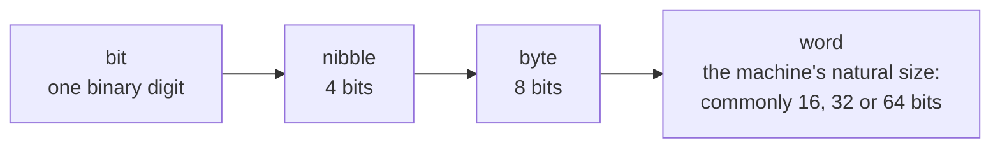
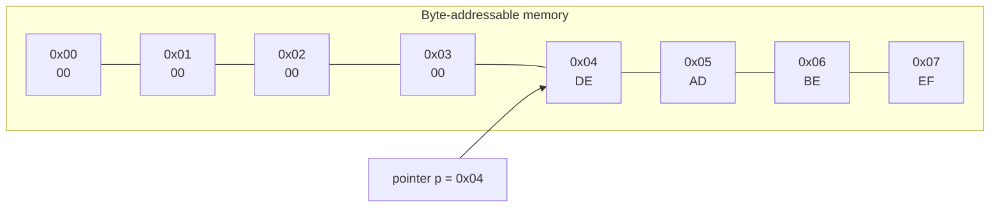

# Bits, Bytes, Words and Memory Addresses

<!-- BEGIN HEADER (generated by tools/build.py from the front matter; edit the front matter, not this block) -->
> [Home](../../../../README.md) › [Part I — Computer Science Foundations](../../index.md) › [1. Computer Fundamentals](../index.md) › [Chapter 3: Data representation](index.md)

- **Difficulty:** Absolute beginner to intermediate
- **Estimated time:** about 60 minutes
- **Prerequisites:** [Positional Number Systems](../02-number-systems/01-positional-number-systems.md)
- **Syllabus topics covered:** `01.03.01` Bits and bytes · `01.03.02` Nibbles, words and memory addresses
- **Status:** Drafted (passes the automated checks; awaiting independent technical review). Last reviewed 2026-11-01.
<!-- END HEADER -->

## What you will learn

- Define *bit*, *nibble*, *byte*, *octet* and *word*, and say how much each can hold.
- Convert between decimal units (kilobyte, megabyte, gigabyte) and binary units (kibibyte, mebibyte, gibibyte), and explain why a "1 TB" drive shows less capacity than advertised.
- Describe memory as a numbered row of byte-sized cells, and explain what an address and a pointer are.
- Explain alignment and padding, and predict why a data structure may be larger than the sum of its fields.

## Introduction

Chapter 2 treated numbers as abstract quantities written in different bases. A real machine stores them in physical devices that hold a very large number of **bits**. A single bit is too small to be useful by itself, and an undivided heap of bits has no structure, so computers organise bits into standard-sized groups and give each group a number so that it can be found again. These two ideas, **units** and **addresses**, are the vocabulary of every discussion about memory, files and networks.

## Intuitive understanding

Imagine a very long street of identical mailboxes, numbered from 0. Each mailbox holds exactly one **byte**, a number from 0 to 255. The box number is its **address**. To store something bigger, such as a 4-byte integer, you use four neighbouring boxes; to find it again you only need the number of the first box and to know how many boxes it spans. A **pointer** is a slip of paper with a box number written on it.



*Reading the diagram:* each unit is built from the previous one. The byte is the smallest unit that has an address, and the word is the largest chunk the processor typically handles in a single operation.

## Technical foundations

### Bit, nibble, byte and octet

- A **bit** is a binary digit, 0 or 1, the smallest unit of information.
- A **nibble** is 4 bits and corresponds to exactly one hexadecimal digit.
- A **byte** is, in practice, 8 bits. It can hold 256 distinct values: 0 to 255 as an unsigned number, $-128$ to $127$ as a two's-complement number, one ASCII character, or two hexadecimal digits.

The word *byte* was coined at IBM in the 1950s, and the 8-bit byte became the standard largely through IBM's System/360 in the 1960s. Because machines once used other sizes, Internet standards (the IETF's RFCs) say **octet** when they mean exactly 8 bits. In C, a "byte" is the type `char`, whose width `CHAR_BIT` is at least 8, and 8 on every mainstream platform.

### Size prefixes: decimal versus binary

Two systems of prefixes are in use, and they differ by a few percent per step.

| Prefix | Symbol | Value | Binary prefix | Symbol | Value |
|---|---|---|---|---|---|
| kilo | k | $10^3$ | kibi | Ki | $2^{10}$ |
| mega | M | $10^6$ | mebi | Mi | $2^{20}$ |
| giga | G | $10^9$ | gibi | Gi | $2^{30}$ |
| tera | T | $10^{12}$ | tebi | Ti | $2^{40}$ |

The decimal prefixes are the SI ones. The binary prefixes (kibi, mebi, gibi, tebi) were introduced by the IEC (International Electrotechnical Commission) to remove the ambiguity that arose because memory sizes are naturally powers of two while storage vendors and network engineers use powers of ten. Today you will see both used correctly and both used loosely, so always check the symbol: `GB` means $10^9$ bytes and `GiB` means $2^{30}$ bytes.

<!-- run:python -->
```python
for prefix, power in (("kilo/kibi", 1), ("mega/mebi", 2), ("giga/gibi", 3), ("tera/tebi", 4)):
    decimal, binary = 1000 ** power, 1024 ** power
    print(f"{prefix:<10} {decimal:>16,} {binary:>16,}  binary is {binary / decimal - 1:.2%} larger")
print(f"A '1 TB' drive holds {10**12 / 2**30:.2f} GiB")
```

<!-- expect -->
```text
kilo/kibi             1,000            1,024  binary is 2.40% larger
mega/mebi         1,000,000        1,048,576  binary is 4.86% larger
giga/gibi     1,000,000,000    1,073,741,824  binary is 7.37% larger
tera/tebi  1,000,000,000,000 1,099,511,627,776  binary is 9.95% larger
A '1 TB' drive holds 931.32 GiB
```

The gap grows with each step: it is 2.4% at kilo, but almost 10% at tera. That is why a drive sold as 1 TB (exactly $10^{12}$ bytes) appears as about 931 "GB" in an operating system that reports in binary units but labels them with the decimal symbol. Nothing is missing; two conventions are being compared.

> **Common mistake:** *Mixing bits and bytes.* Network speeds are quoted in **bits** per second (Mbit/s) and file sizes in **bytes**. A 100 Mbit/s link moves at most about 12.5 MB per second, because $100 / 8 = 12.5$.

### Words

A **word** is the natural unit of data for a particular processor: usually the width of its general-purpose registers, the size of the integers its arithmetic unit handles in one operation, and often the width of its addresses. Early microprocessors had 8-bit words; mainstream desktop and mobile processors today use 64-bit words. The term is slightly treacherous. In x86 assembly language and in some Windows programming interfaces a `WORD` is 16 bits for historical reasons, with `DWORD` for 32 and `QWORD` for 64. This library uses "word" for the *machine's* natural size unless it says otherwise.

### Memory as an array of bytes

Almost all modern computers are **byte-addressable**: each address names one byte. If addresses are $n$ bits wide there are $2^n$ distinct addresses, so a 32-bit address space covers $2^{32}$ bytes, which is 4 GiB, a limit that constrained many 32-bit systems. A 64-bit address could in principle name $2^{64}$ bytes (16 EiB), but real processors implement fewer address bits; 48-bit virtual addresses, which give 256 TiB, are common, and some processors support more. The relationship between the addresses a program sees and the physical memory chips is the topic of [operating systems](../../../../docs/01-computer-science-foundations/04-operating-systems/index.md).

Two consequences follow:

- A multi-byte value occupies **consecutive** addresses, and its own address is the address of its **first** byte. Which end of the number sits at that first byte is the question of byte order, covered in a [later lesson](05-integers-floats-and-endianness-in-memory.md).
- A **pointer** is just a variable that holds an address. Its size equals the address width: 4 bytes on a 32-bit system and 8 bytes on a 64-bit one. By convention address 0 is the *null pointer*, which is deliberately left unmapped so that using it by mistake causes an immediate error.



*Reading the diagram:* eight consecutive cells hold the bytes `DE AD BE EF` starting at address `0x04`. A pointer `p` holding the value `0x04` refers to the first of them. The same four cells could be read as one 4-byte integer, as four separate bytes, or as text; the memory itself does not say which.

The next program models memory with a `bytearray`, where the index plays the role of the address. It needs Python 3.10 or newer.

<!-- run:python -->
```python
memory = bytearray(16)                           # sixteen byte-sized cells, addresses 0 to 15
memory[4:8] = (0xDEADBEEF).to_bytes(4, "big")    # store a 4-byte word starting at address 4
print(memory.hex(" "))
print(hex(int.from_bytes(memory[4:8], "big")))   # read the same four cells back as one word
print(memory[4], hex(memory[4]))                 # or read a single byte: the cell at address 4
```

<!-- expect -->
```text
00 00 00 00 de ad be ef 00 00 00 00 00 00 00 00
0xdeadbeef
222 0xde
```

Slicing `memory[4:8]` selects addresses 4 to 7. The same bytes appear as one 32-bit number or as individual cells, depending on how you read them. The argument `"big"` says the most significant byte is stored at the lowest address; the [lesson on integers and endianness](05-integers-floats-and-endianness-in-memory.md) explains the alternative.

### Alignment and padding

Processors fetch memory in chunks, and they are fastest, and on some architectures only able to work, when a value of size $s$ starts at an address divisible by $s$. This is called **natural alignment**. A compiler therefore inserts unused **padding** bytes between the fields of a structure so that each field is aligned, and rounds the structure's total size up so that arrays of it stay aligned.

<!-- run:c -->
```c
#include <stdio.h>
#include <stddef.h>

struct padded {      /* members in a wasteful order */
    char a;          /* 1 byte                           */
    int b;           /* 4 bytes, wants 4-byte alignment  */
    char c;          /* 1 byte                           */
};

struct reordered {   /* the same members, largest first */
    int b;
    char a;
    char c;
};

int main(void) {
    printf("sizeof(int) = %zu\n", sizeof(int));
    printf("padded:    size %zu, offsets a=%zu b=%zu c=%zu\n", sizeof(struct padded),
           offsetof(struct padded, a), offsetof(struct padded, b), offsetof(struct padded, c));
    printf("reordered: size %zu, offsets b=%zu a=%zu c=%zu\n", sizeof(struct reordered),
           offsetof(struct reordered, b), offsetof(struct reordered, a), offsetof(struct reordered, c));
    return 0;
}
```

<!-- expect -->
```text
sizeof(int) = 4
padded:    size 12, offsets a=0 b=4 c=8
reordered: size 8, offsets b=0 a=4 c=5
```

Both structures hold the same six bytes of data, yet one occupies 12 bytes and the other 8. In `padded`, three padding bytes follow `a` so that `b` starts at offset 4, and three more follow `c` to round the size up to a multiple of 4. The exact numbers are the typical result on common 32- and 64-bit platforms; the C standard allows others, so use `sizeof` and `offsetof` instead of assuming.

## Real-world applications

- **Capacity planning.** Knowing the difference between GB and GiB, and between bits and bytes, avoids ordering the wrong amount of storage or bandwidth.
- **Memory-mapped hardware.** Embedded programs control devices by reading and writing specific addresses.
- **Data layout.** Games, databases and scientific codes arrange data to minimise padding and fit cache lines (commonly 64 bytes, see [subject 3](../../../../docs/01-computer-science-foundations/03-digital-logic-and-computer-organization/index.md)).
- **File formats and network protocols** define the exact size of every field, so that a reader on another machine decodes the same bytes the same way.

## Advanced concepts

- **Packed structures.** Compilers offer ways to remove padding (for example `#pragma pack` or an attribute), which saves space but can make each access slower or, on some processors, illegal.
- **Alignment and atomicity.** On many processors an aligned word is read or written in a single indivisible step, while a misaligned access may not be. Concurrent code must not rely on this unless the language guarantees it.
- **Array of structures versus structure of arrays.** Storing each field in its own array wastes no padding between fields and keeps data you scan together adjacent, which can be much faster. The exercises compute the saving.
- **Pointer arithmetic is scaled.** In C, adding 1 to an `int *` advances the address by `sizeof(int)` bytes, not by 1.

## Common mistakes

> **Common mistake:** *Assuming the size of a structure is the sum of its fields.* Padding means it is often larger, and it depends on the compiler and platform.

- **Confusing `kB` with `KiB`**, and `Mb` (megabits) with `MB` (megabytes).
- **Assuming "word" means 32 bits**, or that an `int` is 4 bytes everywhere. In C, `int` is at least 16 bits.
- **Treating addresses as small integers that can be negative or fractional.** They are unsigned and have a fixed width.
- **Writing a structure straight to a file or socket.** Padding, size and byte order all vary between machines.
- **Forgetting that a pointer is itself data** that occupies memory.

## Exercises

**Beginner**

1. How many distinct values can one byte hold? How many bytes are in 3 KiB, and in 3 kB?
2. How many hexadecimal digits are needed to write a 32-bit address?

**Intermediate**

3. How many bytes can a 36-bit address name? How many address bits are needed to address 8 GiB?
4. A photo is 12 MB (decimal). How long does it take to upload over a 20 Mbit/s link, ignoring overhead?

**Advanced**

5. On a platform where `double` needs 8-byte alignment, find the size and offsets of `struct { char a; double d; char c; }`, then reorder the fields to make it smaller.
6. Write a Python function that, given a list of `(size, alignment)` field pairs, returns the offsets and total size of the structure as a C compiler would lay it out.

**Expert**

7. One million records each hold a boolean (1 byte), a 64-bit integer and an 8-bit integer. Compare the memory needed by an array of structures (with padding) and by three separate arrays (a structure of arrays), and explain why the second can also be faster to scan.

<details>
<summary>Solutions and hints</summary>

1. 256 values. $3 \times 1024 = 3072$ bytes for 3 KiB; 3000 bytes for 3 kB.
2. A 32-bit address is 8 nibbles, so 8 hexadecimal digits.
3. $2^{36}$ bytes, which is 64 GiB. $8\ \text{GiB} = 2^{33}$ bytes, so 33 bits.
4. $12\ \text{MB} = 96\ \text{Mbit}$; at 20 Mbit/s that is $96 / 20 = 4.8$ seconds.
5. Offsets: `a` = 0, `d` = 8 (7 bytes of padding), `c` = 16, total rounded up to 24. Reordered as `double d; char a; char c;` the offsets are 0, 8 and 9 and the total is 16.
6. Keep a running offset; for each field, round it up to the next multiple of the field's alignment, place the field, then add its size. Finally round the total up to the largest alignment.
7. Array of structures: the boolean sits at offset 0, 7 bytes of padding, the 64-bit integer at 8, the 8-bit integer at 16, then 7 bytes of tail padding, giving 24 bytes per record and 24 MB in total. Separate arrays use $1 + 8 + 1 = 10$ bytes per record, 10 MB in total, about 2.4 times less. Scanning only one field then reads dense memory that fits more records in each cache line.

</details>

## Interview and practical questions

**What is the difference between a bit and a byte?** A bit is one binary digit; a byte is 8 bits and the smallest addressable unit of memory.

**How many bytes can a 32-bit address space address?** $2^{32}$ bytes, or 4 GiB.

**Why is a structure often larger than the sum of its fields?** The compiler inserts padding so that each field is aligned to its natural boundary and so that arrays of the structure remain aligned.

**What is a pointer?** A variable whose value is a memory address.

**Why does a "1 TB" drive show about 931 GB?** The vendor counts $10^{12}$ bytes while the operating system divides by $2^{30}$ and labels the result with a decimal-looking unit.

## Further reading

**Standards**

- ISO/IEC 9899 (the C standard), on `sizeof`, alignment and `CHAR_BIT`.
- IEC 80000-13, which defines the binary prefixes (kibi, mebi, gibi and others).

**Textbooks**

- Randal E. Bryant and David R. O'Hallaron, *Computer Systems: A Programmer's Perspective* (Pearson), chapter 2 on representing and manipulating information.
- Charles Petzold, *Code* (Microsoft Press), for a narrative introduction to bits, bytes and memory.

**Official documentation for the code used here**

- Python: [`bytearray` and `bytes`](https://docs.python.org/3/library/stdtypes.html#bytearray) and [`int.to_bytes`](https://docs.python.org/3/library/stdtypes.html#int.to_bytes).

<!-- BEGIN FOOTER (generated by tools/build.py) -->
---

## Related topics

- [Error Detection and Correction](02-error-detection-and-correction.md)

## Navigation

**Previous:** [Floating-Point Representation and IEEE 754](../02-number-systems/05-floating-point-and-ieee-754.md) · **Up:** [Chapter 3: Data representation](index.md) · **Next:** [Error Detection and Correction](02-error-detection-and-correction.md)
<!-- END FOOTER -->
