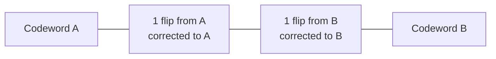
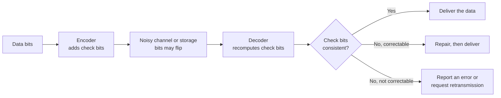

# Error Detection and Correction

<!-- BEGIN HEADER (generated by tools/build.py from the front matter; edit the front matter, not this block) -->
> [Home](../../../../README.md) › [Part I — Computer Science Foundations](../../index.md) › [1. Computer Fundamentals](../index.md) › [Chapter 3: Data representation](index.md)

- **Difficulty:** Intermediate
- **Estimated time:** about 80 minutes
- **Prerequisites:** [Bits, Bytes, Words and Memory Addresses](01-bits-bytes-words-and-addresses.md) · [Binary Arithmetic](../02-number-systems/03-binary-arithmetic.md)
- **Syllabus topics covered:** none from the source syllabus. This lesson introduces an addition: Error detection and correction codes (parity, checksums, CRC, Hamming codes)
- **Status:** Drafted (passes the automated checks; awaiting independent technical review). Last reviewed 2026-11-01.
<!-- END HEADER -->

> **Note:** this lesson is an *addition* to the source syllabus, which names no topic on error-detecting or error-correcting codes although storage, memory and networking all depend on them. See [proposed additions](../../../../curriculum/proposed-additions.md).

## What you will learn

- Explain why stored and transmitted bits get corrupted, and what *redundancy* is.
- Define Hamming distance and use it to say how many errors a code can detect and correct.
- Implement and use a parity bit, a checksum and CRC-32, and state what each can and cannot catch.
- Encode, damage and repair a Hamming(7,4) codeword, and explain how single-error-correcting, double-error-detecting (SECDED) codes protect memory.
- Choose between codes for a given problem, and explain why none of them defends against a deliberate attacker.

## Introduction

Bits are not perfectly reliable. Electrical noise disturbs signals on wires and radio links; a stray particle can flip a bit in a memory cell; flash memory wears out; a disk surface gets scratched; software has bugs. Each event is rare, but a modern system stores and moves trillions of bits, so rare events become routine.

The standard defence is **redundancy**: add extra bits, computed from the data by a fixed rule, so that damage makes the data and the extra bits *disagree*. Two goals are possible:

- **Error detection:** notice that something is wrong, then re-read, re-send or report it.
- **Error correction:** work out which bits are wrong and repair them without asking again. This is called *forward error correction* and is essential when re-sending is impossible or too slow, as with a spacecraft or a memory read.

## Intuitive understanding

You can spot the typo in "compuTer science" because not every string of letters is a valid word. Valid words are a sparse subset of all possible strings, so a corrupted word usually lands on an invalid string. If the valid words are far apart, a single wrong letter even points to the one valid word it is nearest to, which lets you *correct* it.

Error-correcting codes do the same with bit patterns. A **code** chooses a sparse set of valid patterns, the **codewords**, out of all possible patterns. The further apart the codewords are, the more damage you can notice, and the more you can repair.

## Technical foundations

### Hamming distance

The **Hamming distance** between two bit strings of equal length is the number of positions in which they differ. For `10110` and `11100` it is 2. The **minimum distance** $d$ of a code is the smallest distance between any two of its codewords. It determines the code's power:

- It can **detect** up to $d - 1$ bit errors, because that many flips cannot turn one codeword into another.
- It can **correct** up to $\lfloor (d-1)/2 \rfloor$ errors, because a damaged word is then still closer to the original codeword than to any other.



*Reading the diagram:* with minimum distance $d = 3$ there are two invalid words between any two codewords. A word one flip from A is nearer to A, so it is repaired to A. Two flips on A would land nearer to B and be repaired *wrongly*, which is why $d = 3$ corrects exactly one error but detects two.

### The general pipeline



Claude Shannon's 1948 paper showed that, for any noisy channel, reliable communication is possible at rates up to a limit called the channel capacity, and that the right codes can make the error rate as small as you like. The codes below are the simplest members of a large family.

### Parity

An **even parity bit** is appended so that the total number of 1 bits is even. A single flipped bit makes the count odd and is detected. But *any odd* number of flips is detected and *any even* number is missed, and parity cannot say *which* bit flipped. It is cheap (one bit) and appears in serial links and small caches.

### Checksums

A **checksum** summarises a block of data in a few bits, typically by adding the bytes or words modulo a power of two. It is cheap and catches many random errors, but it has blind spots: it is insensitive to the *order* of the data and can be fooled by errors that cancel. The Internet checksum used in IPv4, TCP and UDP headers (RFC 1071) adds 16-bit words using ones'-complement arithmetic; Fletcher and Adler checksums are stronger variants (Adler-32 is used by zlib).

### Cyclic redundancy checks (CRC)

A **CRC** treats the message as a polynomial with coefficients 0 and 1, divides it by a fixed *generator polynomial* using arithmetic in which addition and subtraction are both XOR (no carries), and appends the remainder. The receiver repeats the division. A CRC with an $n$-bit remainder, using a suitable generator, detects:

- every single-bit error,
- every **burst** of errors no longer than $n$ bits, and
- all but a fraction $2^{-n}$ of longer random corruption.

CRC-32, with the generator written `0x04C11DB7` (or `0xEDB88320` when bits are processed in reflected order), is used in Ethernet, ZIP, gzip and PNG. CRCs are fast in hardware and software, which is why networks and storage rely on them.

### Hamming codes

A **Hamming code** adds just enough parity bits to *locate* a single flipped bit. In **Hamming(7,4)**, 4 data bits are protected by 3 parity bits, giving 7-bit codewords with minimum distance 3. Number the bit positions 1 to 7. Positions that are powers of two (1, 2, 4) hold parity bits and the others (3, 5, 6, 7) hold data. Each parity bit checks the positions whose binary number contains its own bit:

| Parity bit | Position | Checks positions |
|---|---|---|
| $p_1$ | 1 (binary 001) | 1, 3, 5, 7 |
| $p_2$ | 2 (binary 010) | 2, 3, 6, 7 |
| $p_3$ | 4 (binary 100) | 4, 5, 6, 7 |

On receipt, recompute the three checks. Read together as a binary number $s_3 s_2 s_1$, the result, called the **syndrome**, is the position of the flipped bit (0 means no error). This is elegant: the column for position $j$ in the parity-check matrix $H$ is just $j$ written in binary, and the syndrome is $s = H\,r \bmod 2$ for the received word $r$.

The number of parity bits $r$ needed to correct one error in $m$ data bits must satisfy $2^r \ge m + r + 1$ (each of the $m + r$ bit positions, and "no error", needs its own syndrome). Hamming(7,4) is expensive (75% overhead), but the overhead shrinks rapidly: 4 parity bits protect 11 data bits, 5 protect 26, and 7 protect 120.

A **SECDED** code (single-error correcting, double-error detecting) adds one more overall parity bit, raising the minimum distance to 4. Then: if the syndrome is nonzero and the overall parity is wrong, one bit flipped and can be repaired; if the syndrome is nonzero but the overall parity is right, two bits flipped and the error is detected but cannot be located. ECC memory in servers commonly uses a SECDED code with 8 check bits for every 64 data bits (a (72,64) code).

## Step-by-step working in code

Python 3.9 or newer is needed (the examples use built-in generic type hints). The first program shows parity, the blind spot of checksums, and XOR parity across blocks, the idea behind RAID 5 disk arrays.

<!-- run:python -->
```python
def even_parity_bit(value: int) -> int:
    """Return the bit that makes the total number of 1 bits even."""
    return bin(value).count("1") % 2


def simple_checksum(data: bytes) -> int:
    """Sum of all bytes, modulo 256."""
    return sum(data) % 256


word = 0b1011001                       # four 1 bits
p = even_parity_bit(word)
sent = (word << 1) | p                 # append the parity bit
print(format(sent, "08b"), "parity bit =", p)

one_flip = sent ^ 0b00010000           # one bit flipped in transit
two_flips = sent ^ 0b00010100          # two bits flipped
print("one flip detected:", bin(one_flip).count("1") % 2 == 1)
print("two flips detected:", bin(two_flips).count("1") % 2 == 1)

message = b"PAY 100 TO ALICE"
tampered = b"PAY 001 TO ALICE"         # digits rearranged; a byte-sum cannot see it
print(simple_checksum(message), simple_checksum(tampered), message == tampered)

# XOR parity across blocks (the idea behind RAID 5): lose any one block and rebuild it
blocks = [b"ABCD", b"EFGH", b"IJKL"]
parity = bytes(a ^ b ^ c for a, b, c in zip(*blocks))
rebuilt = bytes(a ^ c ^ q for a, c, q in zip(blocks[0], blocks[2], parity))  # block 1 is lost
print(rebuilt)
```

<!-- expect -->
```text
10110010 parity bit = 0
one flip detected: True
two flips detected: False
220 220 False
b'EFGH'
```

Walking through it: the data `1011001` has four ones, so the parity bit is 0. One flipped bit makes the count odd and is caught; two flipped bits restore an even count and **slip through**. The byte-sum checksum gives 220 for both messages although they differ, because they contain the same bytes in a different order: an attacker (or a bug) that rearranges data defeats it. In the last part the parity block is the XOR of the three data blocks; XOR is its own inverse, so XORing the surviving blocks with the parity block regenerates the lost one.

The second program implements CRC-32 bit by bit and compares it with Python's library implementation. The known check value for the ASCII string `123456789` is `0xCBF43926`.

<!-- run:python -->
```python
import zlib


def crc32_bitwise(data: bytes) -> int:
    """CRC-32 (the polynomial used by Ethernet, ZIP and PNG), one bit at a time."""
    crc = 0xFFFFFFFF                          # start with all ones
    for byte in data:
        crc ^= byte                           # bring the next byte into the low 8 bits
        for _ in range(8):
            if crc & 1:
                crc = (crc >> 1) ^ 0xEDB88320  # shift, then subtract (XOR) the polynomial
            else:
                crc >>= 1
    return crc ^ 0xFFFFFFFF                   # final inversion


check = b"123456789"
print(hex(crc32_bitwise(check)), hex(zlib.crc32(check)))
print(crc32_bitwise(b"hello") == zlib.crc32(b"hello"))

original = bytearray(b"The quick brown fox")
damaged = bytearray(original)
damaged[5] ^= 0x04                            # flip a single bit
print(hex(zlib.crc32(original)), hex(zlib.crc32(damaged)), zlib.crc32(original) != zlib.crc32(damaged))
```

<!-- expect -->
```text
0xcbf43926 0xcbf43926
True
0xb74574de 0xaee9fbc5 True
```

The initial all-ones value and final inversion are conventions that make the CRC sensitive to leading zero bytes and to message length. Flipping one bit changes the CRC completely, so the damage is detected. The loop does eight shifts per byte; real implementations process a byte (or more) at a time with a lookup table, and many processors have dedicated CRC instructions.

The third program builds Hamming(7,4) and its SECDED extension, damages codewords on purpose, and checks that every single-bit error is repaired and every double-bit error is detected.

<!-- run:python -->
```python
def hamming74_encode(d1: int, d2: int, d3: int, d4: int) -> list[int]:
    """Return the 7-bit codeword [p1, p2, d1, p3, d2, d3, d4] (positions 1 to 7)."""
    p1 = d1 ^ d2 ^ d4            # covers positions 3, 5, 7
    p2 = d1 ^ d3 ^ d4            # covers positions 3, 6, 7
    p3 = d2 ^ d3 ^ d4            # covers positions 5, 6, 7
    return [p1, p2, d1, p3, d2, d3, d4]


def hamming74_decode(code: list[int]) -> tuple[list[int], int]:
    """Return (data bits, syndrome). A nonzero syndrome is the 1-based position repaired."""
    c = list(code)
    s1 = c[0] ^ c[2] ^ c[4] ^ c[6]       # recheck positions 1, 3, 5, 7
    s2 = c[1] ^ c[2] ^ c[5] ^ c[6]       # recheck positions 2, 3, 6, 7
    s3 = c[3] ^ c[4] ^ c[5] ^ c[6]       # recheck positions 4, 5, 6, 7
    syndrome = s1 + 2 * s2 + 4 * s3
    if syndrome:
        c[syndrome - 1] ^= 1             # flip the bit the syndrome points at
    return [c[2], c[4], c[5], c[6]], syndrome


def secded_encode(data: list[int]) -> list[int]:
    word = hamming74_encode(*data)
    return word + [sum(word) % 2]        # add an overall even-parity bit


def secded_check(word8: list[int]) -> str:
    syndrome = hamming74_decode(word8[:7])[1]
    overall_ok = sum(word8) % 2 == 0
    if syndrome == 0 and overall_ok:
        return "no error"
    if not overall_ok:
        return "single-bit error (correctable)"
    return "double-bit error (detected, not correctable)"


code = hamming74_encode(1, 0, 1, 1)
print(code)
damaged = list(code)
damaged[5] ^= 1                          # corrupt position 6
print(damaged, hamming74_decode(damaged))

fixed = clean = 0
for n in range(16):
    data = [(n >> 3) & 1, (n >> 2) & 1, (n >> 1) & 1, n & 1]
    word = hamming74_encode(*data)
    clean += hamming74_decode(word) == (data, 0)
    for pos in range(7):
        bad = list(word)
        bad[pos] ^= 1
        fixed += hamming74_decode(bad)[0] == data
print("clean words decoded unchanged:", clean, "of 16")
print("single-bit errors corrected:", fixed, "of 112")

word8 = secded_encode([1, 0, 1, 1])
one = list(word8)
one[2] ^= 1
two = list(word8)
two[2] ^= 1
two[5] ^= 1
print(secded_check(word8))
print(secded_check(one))
print(secded_check(two))
```

<!-- expect -->
```text
[0, 1, 1, 0, 0, 1, 1]
[0, 1, 1, 0, 0, 0, 1] ([1, 0, 1, 1], 6)
clean words decoded unchanged: 16 of 16
single-bit errors corrected: 112 of 112
no error
single-bit error (correctable)
double-bit error (detected, not correctable)
```

Execution walkthrough for the damaged word: the data bits `1011` encode to `0110011`. Corrupting position 6 makes the three checks give $s_1 = 0$, $s_2 = 1$, $s_3 = 1$, so the syndrome is $0 + 2 + 4 = 6$, exactly the damaged position, and flipping it back recovers `1011`. The exhaustive loop covers all 16 data words and all 7 error positions ($16 \times 7 = 112$), so the claim "corrects every single-bit error" is checked, not sampled. **Limitations:** two errors in a Hamming(7,4) word would be "repaired" to the *wrong* word without warning, which is exactly what the extra overall parity bit in SECDED prevents.

## Real-world applications

- **Memory.** Server DRAM uses ECC (a SECDED-style code) so that a single flipped bit is corrected and a double flip is reported rather than silently corrupting data. Ordinary consumer machines often have no ECC. See [Types of Computers](../01-introduction-to-computers/02-types-of-computers.md).
- **Networks.** Ethernet frames carry a CRC-32; IPv4, TCP and UDP carry 16-bit checksums. These catch corruption on a link, but they are not a substitute for end-to-end checks, because errors can also arise inside routers and software. This is the *end-to-end argument* in system design.
- **Storage.** Disks and flash devices store error-correcting codes with every sector; modern SSDs use powerful codes such as LDPC. File systems such as ZFS and Btrfs checksum the data they store so that silent corruption ("bit rot") is detected. RAID arrays use XOR parity or Reed-Solomon-style codes to survive disk failures.
- **Optical media and QR codes.** Reed-Solomon codes work on *symbols* (groups of bits) and are excellent against bursts of errors, such as a scratch on a disc. QR codes use them at four selectable strength levels, which recover roughly 7%, 15%, 25% or 30% of the data.
- **Space and wireless communication** use very strong codes (turbo, LDPC, Reed-Solomon combinations) because retransmission is slow or impossible.

## Comparisons and trade-offs

| Method | Overhead | Detects | Corrects | Typical use |
|---|---|---|---|---|
| Parity bit | 1 bit | Any odd number of flips | None | Serial links, small caches |
| Simple or Internet checksum | 8 to 16 bits | Many random errors; blind to reordering | None | IP, TCP and UDP headers |
| CRC-32 | 32 bits | All single-bit errors, all bursts up to 32 bits, nearly all other damage | None | Ethernet, ZIP, PNG, storage |
| Hamming(7,4) | 3 bits per 4 | Up to 2 errors | 1 | Teaching; basis of ECC |
| SECDED, e.g. (72,64) | 8 bits per 64 | 2 | 1 | ECC memory |
| Reed-Solomon | Configurable | Bursts of symbols | Several symbols | CDs, QR codes, storage |
| Cryptographic hash or MAC | 128 to 512 bits | Deliberate tampering | None | Integrity and authenticity |

Stronger protection always costs more bits and more computation. Choosing a code means estimating the *kind* of errors expected (isolated flips, bursts, whole-device failure), the cost of an undetected error, and whether retransmission is possible.

## Advanced concepts

- **Linear block codes.** Hamming codes are *linear*: codewords are the vectors $c$ with $H c^{T} = 0$ over arithmetic modulo 2. This algebraic structure gives efficient syndrome decoding, and underlies BCH and Reed-Solomon codes.
- **Perfect codes.** Hamming codes meet the *Hamming bound* with equality: every possible received word is within distance 1 of exactly one codeword, so no space is wasted.
- **Burst errors and interleaving.** Errors often come in bursts. Interleaving spreads consecutive data across many codewords so that a burst damages only a few bits of each one, which a modest code can then repair.
- **Modern capacity-approaching codes.** Turbo and LDPC codes come close to Shannon's limit and are used in Wi-Fi, mobile networks, satellite broadcasting and SSD controllers.
- **Undetected-error probability.** A $k$-bit check value misses roughly one random corruption in $2^k$, so a 16-bit checksum on a busy link will occasionally pass bad data; stronger checks are used where that matters.

## Common mistakes

> **Common mistake:** *Using a CRC or checksum as a security mechanism.* They detect accidental damage only. An attacker can modify the data and recompute the check, or craft a change that leaves it unchanged. Use a cryptographic hash or message authentication code for integrity against an adversary ([subject 31](../../../../docs/07-software-quality-and-cybersecurity/31-cybersecurity-and-software-security/index.md)).

- **Assuming parity catches everything.** It misses every even number of flips.
- **Confusing detection with correction.** A CRC tells you data is bad; it cannot say which bits to fix.
- **Checksumming the wrong bytes**, for example including the checksum field itself, or ignoring byte order when a checksum is computed over multi-byte words.
- **Trusting a lower layer.** A link-level CRC does not protect against corruption in memory or software; verify data end to end when it matters.
- **Believing ECC makes memory perfect.** SECDED corrects one bit per word and detects two; larger corruption can still pass or be reported as uncorrectable.

## Exercises

**Beginner**

1. Compute the even parity bit for `1101001`, and the Hamming distance between `10110` and `11100`.
2. A code has minimum distance 5. How many errors can it detect, and how many can it correct?

**Intermediate**

3. Decode the received Hamming(7,4) word `1 0 0 0 1 0 1`. Which position is wrong, and what were the data bits?
4. Show that the byte-sum checksum cannot distinguish `AB` from `BA`. Propose a checksum that can, and test it.

**Advanced**

5. Using $2^r \ge m + r + 1$, find the number of parity bits needed to correct one error in 64 data bits, and explain why ECC memory then stores 8 check bits per 64.
6. Extend the CRC program to use a 256-entry lookup table so that each byte needs one table lookup instead of eight shifts, and verify it against `zlib.crc32`.

**Expert**

7. Prove that a CRC whose generator polynomial has more than one term detects every single-bit error.
8. Design a scheme that stores a file across four disks so that any one disk can fail, then compute the storage overhead and compare it with mirroring everything.

<details>
<summary>Solutions and hints</summary>

1. `1101001` has four 1s, so the even parity bit is 0. The strings differ in positions 2 and 4, so the distance is 2.
2. It detects up to $d - 1 = 4$ errors and corrects up to $\lfloor (5-1)/2 \rfloor = 2$.
3. Syndrome: $s_1 = 1 \oplus 0 \oplus 1 \oplus 1 = 1$, $s_2 = 0 \oplus 0 \oplus 0 \oplus 1 = 1$, $s_3 = 0 \oplus 1 \oplus 0 \oplus 1 = 0$, so the syndrome is $1 + 2 = 3$. Position 3 is wrong. Flipping it gives `1 0 1 0 1 0 1`, whose data bits are `1 1 0 1`.
4. Both give the same sum because addition is commutative. A position-weighted sum such as Fletcher's checksum (two running sums, the second accumulating the first) distinguishes them.
5. $2^6 = 64 < 64 + 6 + 1 = 71$, but $2^7 = 128 \ge 72$, so 7 parity bits are needed. One extra overall parity bit turns this into SECDED, giving 8 check bits per 64 data bits.
6. Precompute `table[i]` as the CRC of the single byte `i` using the bitwise loop, then update with `crc = (crc >> 8) ^ table[(crc ^ byte) & 0xFF]` for each byte.
7. A single-bit error is the polynomial $x^i$. It is a multiple of $g(x)$ only if $g(x)$ divides $x^i$, which for $g$ with a nonzero constant term and at least two terms is impossible, since the only divisors of $x^i$ are powers of $x$. So the remainder is nonzero and the error is detected.
8. Use three data disks and one parity disk (XOR of the three). Any lost disk is rebuilt by XORing the other three. Overhead is 1 extra disk per 3, that is 33%, compared with 100% for mirroring.

</details>

## Interview and practical questions

**What is the difference between error detection and error correction?** Detection tells you the data is damaged; correction also identifies and repairs the damaged bits, which needs more redundancy.

**How does ECC memory work?** Each word stored in memory is accompanied by extra check bits from a SECDED code. On every read, the hardware recomputes the check; a single flipped bit is corrected on the fly and a double flip is reported.

**Why does Ethernet use a CRC instead of a plain checksum?** A CRC reliably detects bursts of errors up to its length and is cheap in hardware, whereas a simple sum is blind to reordering and to errors that cancel.

**Can a CRC protect against malicious tampering?** No. It is not a cryptographic function; an attacker can produce modified data with the same CRC.

**How does RAID 5 survive a disk failure?** It stores a parity block, the XOR of the data blocks, so a lost block is the XOR of all the surviving blocks.

## Further reading

**Research**

- Richard W. Hamming, "Error Detecting and Error Correcting Codes", *Bell System Technical Journal*, vol. 29, no. 2 (1950): the original paper.
- Claude E. Shannon, "A Mathematical Theory of Communication", *Bell System Technical Journal*, vol. 27 (1948).
- J. H. Saltzer, D. P. Reed and D. D. Clark, "End-to-End Arguments in System Design", *ACM Transactions on Computer Systems*, vol. 2, no. 4 (1984).

**Standards**

- IETF, *Computing the Internet Checksum*, RFC 1071: [rfc-editor.org](https://www.rfc-editor.org/rfc/rfc1071).

**Textbooks**

- Shu Lin and Daniel J. Costello Jr., *Error Control Coding* (Pearson): the standard textbook.

**Official documentation for the code used here**

- Python: [`zlib.crc32`](https://docs.python.org/3/library/zlib.html#zlib.crc32).

<!-- BEGIN FOOTER (generated by tools/build.py) -->
---

## Related topics

- [Types of Computers](../01-introduction-to-computers/02-types-of-computers.md)

## Navigation

**Previous:** [Bits, Bytes, Words and Memory Addresses](01-bits-bytes-words-and-addresses.md) · **Up:** [Chapter 3: Data representation](index.md) · **Next:** [Character Encoding and ASCII](03-character-encoding-and-ascii.md)
<!-- END FOOTER -->
