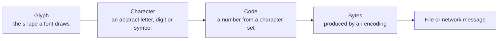

# Character Encoding and ASCII

<!-- BEGIN HEADER (generated by tools/build.py from the front matter; edit the front matter, not this block) -->
> [Home](../../../../README.md) › [Part I — Computer Science Foundations](../../index.md) › [1. Computer Fundamentals](../index.md) › [Chapter 3: Data representation](index.md)

- **Difficulty:** Beginner
- **Estimated time:** about 60 minutes
- **Prerequisites:** [Bits, Bytes, Words and Memory Addresses](01-bits-bytes-words-and-addresses.md)
- **Syllabus topics covered:** `01.03.03` Character encoding · `01.03.04` ASCII
- **Status:** Drafted (passes the automated checks; awaiting independent technical review). Last reviewed 2026-11-01.
<!-- END HEADER -->

## What you will learn

- Explain how text is stored as numbers, and distinguish a *character*, a *character set*, an *encoding* and a *glyph*.
- Describe the structure of ASCII, including its control characters, and use its patterns (digits, letters, case) in code.
- Explain why line endings differ between systems, and why text can become garbled when two programs disagree about the encoding.
- Handle encoding errors deliberately instead of by accident.

## Introduction

A computer stores numbers, not letters. To store the word "Hello" we must **agree** on a table that maps each letter to a number, and then on how to write each number as bytes. Everything in this lesson is a consequence of that agreement. When both sides use the same agreement, text just works. When they use different ones, you get the familiar symptoms: question marks, boxes, or sequences like `é` where an accented letter should be.

Four terms are often blurred together and must be kept apart:

| Term | Meaning | Example |
|---|---|---|
| **Character** | An abstract unit of writing: a letter, digit, punctuation mark or symbol | The capital letter A |
| **Character set** (or *repertoire*, with numbering) | A collection of characters, each assigned a number called a **code** or **code point** | ASCII assigns A the number 65 |
| **Encoding** | The rule for writing those numbers as bytes | In ASCII, 65 is stored as the single byte `0x41` |
| **Glyph** | The shape a font draws for a character | The picture of an A in a particular typeface |



*Reading the diagram:* writing text goes left to right through the chain after the glyph; reading it goes right to left. For simple character sets such as ASCII the code and the byte are the same number, which hides the distinction. It becomes essential with Unicode, covered in the [next lesson](04-unicode-utf-8-and-utf-16.md).

## Intuitive understanding

Think of a shared code book. Two people agree that 1 means A, 2 means B, and so on. They can now send each other messages as lists of numbers. If one of them uses a *different* book, the messages still arrive intact but read as nonsense. A text file contains no label saying which book was used; the reader must know or guess. That is why "which encoding?" is one of the most common questions in programming.

Historically the first codes served telegraphs and teleprinters (Morse code, then 5-bit Baudot codes). As computers spread, every manufacturer invented its own, and exchanging data between machines became painful. **ASCII**, the American Standard Code for Information Interchange, standardised in the United States in the 1960s (ANSI X3.4) and later described for network use in RFC 20, became the common foundation that almost every later encoding builds on.

## Technical foundations

### The structure of ASCII

ASCII is a **7-bit** code: it defines 128 characters numbered 0 to 127. It is usually stored one character per byte, with the top bit zero.

| Range (decimal) | Range (hex) | Contents |
|---|---|---|
| 0 to 31 | `0x00` to `0x1F` | Control characters (not printable) |
| 32 | `0x20` | Space |
| 33 to 47 | `0x21` to `0x2F` | Punctuation such as `! " # $ % & ' ( ) * + , - . /` |
| 48 to 57 | `0x30` to `0x39` | Digits `0` to `9` |
| 58 to 64 | `0x3A` to `0x40` | `: ; < = > ? @` |
| 65 to 90 | `0x41` to `0x5A` | Capital letters `A` to `Z` |
| 91 to 96 | `0x5B` to `0x60` | `[ \ ] ^ _` and the backtick |
| 97 to 122 | `0x61` to `0x7A` | Lower-case letters `a` to `z` |
| 123 to 126 | `0x7B` to `0x7E` | `{ \| } ~` |
| 127 | `0x7F` | DEL (a control character) |

The design contains useful patterns that you can exploit:

- **Digits** are consecutive from `0x30`, so the numeric value of a digit character is its code minus `0x30` (or minus the code of `'0'`).
- **Letters** are consecutive and in alphabetical order, so sorting by code sorts alphabetically within one case, and all capitals sort *before* all lower-case letters.
- **Upper and lower case differ by exactly one bit.** `A` is `0x41` (`0100 0001`) and `a` is `0x61` (`0110 0001`): the difference is the bit worth `0x20`. XORing a letter with `0x20` flips its case.

The program below prints the printable part of the table so you can see this layout for yourself (row = high hex digit, column = low hex digit; the entry for `0x20` is a space and `0x7F` is left blank).

<!-- run:python -->
```python
print("    " + " ".join(f"{col:X}" for col in range(16)))
for row in range(2, 8):
    cells = []
    for col in range(16):
        code = row * 16 + col
        cells.append(" " if code in (32, 127) else chr(code))
    print(f"{row:X}_  " + " ".join(cells))
```

<!-- expect -->
```text
    0 1 2 3 4 5 6 7 8 9 A B C D E F
2_    ! " # $ % & ' ( ) * + , - . /
3_  0 1 2 3 4 5 6 7 8 9 : ; < = > ?
4_  @ A B C D E F G H I J K L M N O
5_  P Q R S T U V W X Y Z [ \ ] ^ _
6_  ` a b c d e f g h i j k l m n o
7_  p q r s t u v w x y z { | } ~
```

### Control characters

The 33 control characters were designed for teleprinters and terminals and many still matter:

| Code | Name | Escape in many languages | Original meaning |
|---|---|---|---|
| 0 | NUL | `\0` | Null; marks the end of a string in C |
| 7 | BEL | `\a` | Ring the bell |
| 8 | BS | `\b` | Backspace |
| 9 | HT or TAB | `\t` | Horizontal tab |
| 10 | LF | `\n` | Line feed: move down one line |
| 13 | CR | `\r` | Carriage return: move to the start of the line |
| 27 | ESC | `\x1b` | Escape; begins terminal control sequences |
| 127 | DEL | | Delete |

### Line endings

On a typewriter or teleprinter, starting a new line took two separate actions: *carriage return* (back to the left margin) and *line feed* (advance the paper). Operating systems made different choices about which to store in a text file: **LF** alone on Unix, Linux and modern macOS, **CR LF** on Windows and in many Internet protocols (HTTP and email headers use CR LF), and **CR** alone on classic Mac OS. Code that splits text on `"\n"` only will leave a stray `\r` at the end of every line of a Windows file.

### Beyond 7 bits: extended encodings

Computers store data in 8-bit bytes, so the spare top bit allowed another 128 characters. Every vendor and region filled them differently, which produced many incompatible **code pages**. There is no single "extended ASCII". Important examples are ISO 8859-1 (Latin-1, Western European languages), the Windows-1252 variant, the original IBM PC code page 437, and the IBM mainframe encoding EBCDIC, which is not ASCII-compatible at all. The ISO 8859 and Windows families agree on ASCII below 128 and differ above it, so plain English text survives a mix-up while accented letters and punctuation are damaged.

### Why garbling happens (mojibake)

Garbled text, sometimes called **mojibake**, appears when bytes written under one encoding are read under another. The bytes are fine; the *interpretation* is wrong. The classic case is UTF-8 text decoded as Latin-1: the two bytes of `é` in UTF-8 are read as two separate Latin-1 characters.

## Step-by-step working in code

This Python program (3.10 or newer) uses codes as numbers, flips case with XOR, detects non-ASCII text, and demonstrates an encoding error and a mojibake.

<!-- run:python -->
```python
text = "Hello, World!"
print([ord(c) for c in text[:5]])
print(chr(72), chr(0x48), hex(ord("a")), hex(ord("A")))
print("".join(chr(ord(c) ^ 0x20) if c.isalpha() else c for c in text))   # flip case with one XOR
print(ord("7") - ord("0"))                                               # digit character to value
print(text.isascii(), "café".isascii())
print(text.encode("ascii"))
try:
    "café".encode("ascii")
except UnicodeEncodeError as err:
    print("error:", err.reason, "at position", err.start)
print("café".encode("ascii", errors="replace"))
print("café".encode("utf-8").decode("latin-1"))                          # the classic mojibake
```

<!-- expect -->
```text
[72, 101, 108, 108, 111]
H H 0x61 0x41
hELLO, wORLD!
7
True False
b'Hello, World!'
error: ordinal not in range(128) at position 3
b'caf?'
café
```

Walking through it: `ord` converts a character to its code and `chr` converts back. XOR with `0x20` flips the case of letters (and we leave other characters alone, because the same trick would corrupt digits and punctuation). `"café"` contains `é`, which has no ASCII code, so strict encoding raises an error at position 3 (the fourth character); `errors="replace"` substitutes `?` instead, which silently loses information. The last line encodes `café` as UTF-8 (`é` becomes two bytes, `C3 A9`) and then wrongly decodes them as Latin-1, where `0xC3` is `Ã` and `0xA9` is `©`.

The next program lists some control characters and shows the line-ending trap.

<!-- run:python -->
```python
controls = {0: "NUL", 7: "BEL", 8: "BS", 9: "TAB", 10: "LF", 13: "CR", 27: "ESC", 127: "DEL"}
for code, name in controls.items():
    print(f"{code:>3}  0x{code:02X}  {name:<3}  {chr(code).encode('unicode_escape').decode()}")

data = b"one\r\ntwo\nthree\r"
print(data.split(b"\n"))                   # naive: split on LF only
print(data.decode("ascii").splitlines())   # handles CRLF, LF and CR
```

<!-- expect -->
```text
  0  0x00  NUL  \x00
  7  0x07  BEL  \x07
  8  0x08  BS   \x08
  9  0x09  TAB  \t
 10  0x0A  LF   \n
 13  0x0D  CR   \r
 27  0x1B  ESC  \x1b
127  0x7F  DEL  \x7f
[b'one\r', b'two', b'three\r']
['one', 'two', 'three']
```

Splitting only on LF leaves `\r` attached to the first and last items; `splitlines()` knows all three conventions.

A related difference, between Latin-1 and Windows-1252, shows how subtle code-page mix-ups are:

<!-- run:python -->
```python
raw = bytes([0x93, 0x48, 0x69, 0x94])
print(raw.decode("cp1252"))
print(repr(raw.decode("latin-1")))
```

<!-- expect -->
```text
“Hi”
'\x93Hi\x94'
```

In Windows-1252 the bytes `0x93` and `0x94` are curly quotation marks. In Latin-1 the range `0x80` to `0x9F` holds invisible control characters, so the same bytes decode to something quite different.

In C, a character literal is simply a small integer, which makes the same ideas visible. This program needs a C11 compiler. It assumes an ASCII-compatible execution character set, which is true of mainstream platforms but not guaranteed by the C standard (EBCDIC systems exist).

<!-- run:c -->
```c
#include <stdio.h>
#include <ctype.h>

int main(void) {
    char c = 'A';
    printf("%c is %d (0x%02X); next is %c\n", c, c, (unsigned)c, c + 1);
    printf("'a' - 'A' = %d\n", 'a' - 'A');

    const char *word = "Hi5";
    for (const char *p = word; *p != '\0'; p++) {      /* a C string ends at the NUL byte */
        unsigned char u = (unsigned char)*p;           /* ctype functions need unsigned values */
        printf("%c: %s\n", *p, isdigit(u) ? "digit" : isupper(u) ? "upper" : "lower");
    }
    return 0;
}
```

<!-- expect -->
```text
A is 65 (0x41); next is B
'a' - 'A' = 32
H: upper
i: lower
5: digit
```

Note the cast to `unsigned char` before calling `isdigit` and friends. Plain `char` may be signed on some platforms, and passing a negative value to these functions is undefined behaviour, a classic bug when handling non-ASCII bytes.

## Real-world applications

- **Network protocols.** HTTP headers, SMTP, DNS names and many other formats are defined in terms of ASCII, which is why protocol specifications talk about "octets" and CR LF. Early email could carry only 7-bit text, which is why binary attachments are converted to ASCII text with Base64.
- **Programming languages and source files.** Keywords and identifiers are traditionally ASCII.
- **Configuration and log files.** A stray control character can corrupt a terminal (ESC sequences) or fool a log reader (a newline injected into a log entry can forge a log line), so untrusted text must be sanitised.
- **Legacy data.** Mainframes (EBCDIC), old databases and files from earlier decades use code pages that must be converted explicitly.

## Comparisons and trade-offs

| Encoding | Bits per character | Characters | Notes |
|---|---|---|---|
| ASCII | 7 (stored in 8) | 128 | English letters, digits, punctuation, controls |
| ISO 8859-1 (Latin-1) | 8 | 256 | Western European; ASCII plus accented letters |
| Windows-1252 | 8 | 256 | Like Latin-1 but printable characters in `0x80` to `0x9F` |
| EBCDIC | 8 | 256 | IBM mainframes; not ASCII-compatible |
| UTF-8 | 8 to 32 (variable) | All of Unicode | ASCII-compatible; the modern default ([next lesson](04-unicode-utf-8-and-utf-16.md)) |

The trade-off with single-byte code pages is simplicity against reach: every character fits in one byte, but each code page can serve only a handful of languages and none can mix them. Unicode removes that limit at the cost of variable-length encodings.

## Advanced concepts

- **ASCII compatibility is a design goal.** Most later encodings keep codes 0 to 127 identical to ASCII so that old software, protocol delimiters and file paths keep working. UTF-8 is the most successful example.
- **The `char` type is not "a character".** In C and C++ it is a byte with implementation-defined signedness. Treat it as a byte; text is more than bytes.
- **Locale dependence.** C library functions such as `toupper` depend on the current locale; do not assume they behave identically on all systems.
- **Collation.** Sorting by code puts `Z` before `a`. Human-expected ordering (alphabetical, language-aware) requires locale-aware collation.
- **Detecting an unknown encoding is guesswork.** Libraries use heuristics (statistics of byte patterns), which can be wrong. Prefer to *record* the encoding wherever data is stored or transmitted.

## Common mistakes

> **Common mistake:** *Assuming one character equals one byte.* This is true only for ASCII and single-byte code pages. It fails for UTF-8, which is why the next lesson matters.

- **Relying on a default encoding.** The default differs between operating systems, locales and tool versions. State the encoding explicitly whenever you read or write text.
- **Believing "extended ASCII" is a standard.** It is a loose name for many incompatible 8-bit encodings.
- **Splitting lines on `\n` only**, or writing `\n` where a protocol requires CR LF.
- **Silently replacing undecodable bytes** (`errors="replace"` or `"ignore"`), which hides data loss.
- **Case conversion by XOR outside ASCII letters.** It corrupts digits, punctuation and non-ASCII text.
- **Calling `isalpha` and similar functions with a signed `char`** in C.

## Exercises

**Beginner**

1. Write the word `Cat` as decimal and hexadecimal ASCII codes.
2. What character is `0x7A`? What is the code of `'0'`, and of `'9'`?

**Intermediate**

3. Write a function that converts a string of ASCII digits to an integer using only `ord`, subtraction and multiplication by 10.
4. Implement ROT13 (rotate each letter 13 places, leaving other characters unchanged) and show that applying it twice returns the original text.

**Advanced**

5. Explain, using the bit patterns, why XORing with `0x20` flips the case of a letter but corrupts the character `'1'`.
6. A file was saved as UTF-8 but opened as Windows-1252, and you see `“Helloâ€`. Explain what bytes are present and how to recover the text.

**Expert**

7. Write a function that reads bytes and decides whether they are valid ASCII, valid UTF-8, or neither, without using a library detector. State what you cannot tell about the single-byte code pages.

<details>
<summary>Solutions and hints</summary>

1. `C` = 67 (`0x43`), `a` = 97 (`0x61`), `t` = 116 (`0x74`).
2. `0x7A` is `z`. `'0'` is 48 and `'9'` is 57.
3. Start with `value = 0`; for each character, `value = value * 10 + (ord(ch) - ord("0"))`, after checking that the character is a digit.
4. For a letter `ch` with base `b = ord("A")` or `ord("a")`, the result is `chr((ord(ch) - b + 13) % 26 + b)`. Applying it twice adds 26, which is a full cycle.
5. `A` (`0100 0001`) and `a` (`0110 0001`) differ in the `0x20` bit, so flipping it swaps case. The digit `1` is `0x31` (`0011 0001`); flipping the `0x20` bit gives `0x11` (`0001 0001`), a control character.
6. The sequence is the UTF-8 bytes `E2 80 9C` for a left curly quotation mark, shown as three Windows-1252 characters. Re-encode the garbled text as Windows-1252 and decode it as UTF-8, or reopen the file as UTF-8.
7. ASCII validity is "every byte below 128". For UTF-8, check the lead and continuation byte patterns (covered in the next lesson). Single-byte code pages accept every byte value, so the data cannot be proven to be in any particular one.

</details>

## Interview and practical questions

**What is the difference between a character set and an encoding?** A character set assigns numbers to characters; an encoding says how to write those numbers as bytes. For ASCII they coincide, which hides the difference; for Unicode they are separate ideas.

**Why is `'A'` 65 and `'a'` 97?** ASCII places capitals at `0x41` and lower-case letters at `0x61`, exactly `0x20` apart, so case can be flipped with one bit.

**What are the common newline conventions?** LF on Unix-like systems, CR LF on Windows and in many Internet protocols, and CR alone on classic Mac OS.

**What causes mojibake and how do you prevent it?** A reader decoding bytes with a different encoding from the writer's. Prevent it by choosing one encoding, preferably UTF-8, and declaring it explicitly at every boundary.

## Further reading

**Standards**

- IETF, *ASCII format for Network Interchange*, RFC 20: [rfc-editor.org](https://www.rfc-editor.org/rfc/rfc20).
- ISO/IEC 8859-1, the Latin-1 character set, and ANSI X3.4, the original ASCII standard.

**Textbooks**

- Charles Petzold, *Code* (Microsoft Press), the chapter on ASCII and a "Bit by Bit" treatment of text.

**Official documentation for the code used here**

- Python: the [Unicode HOWTO](https://docs.python.org/3/howto/unicode.html), [`str.encode`](https://docs.python.org/3/library/stdtypes.html#str.encode) and the list of [standard encodings](https://docs.python.org/3/library/codecs.html#standard-encodings).

<!-- BEGIN FOOTER (generated by tools/build.py) -->
---

## Related topics

- [Positional Number Systems](../02-number-systems/01-positional-number-systems.md)

## Navigation

**Previous:** [Error Detection and Correction](02-error-detection-and-correction.md) · **Up:** [Chapter 3: Data representation](index.md) · **Next:** [Unicode, UTF-8 and UTF-16](04-unicode-utf-8-and-utf-16.md)
<!-- END FOOTER -->
