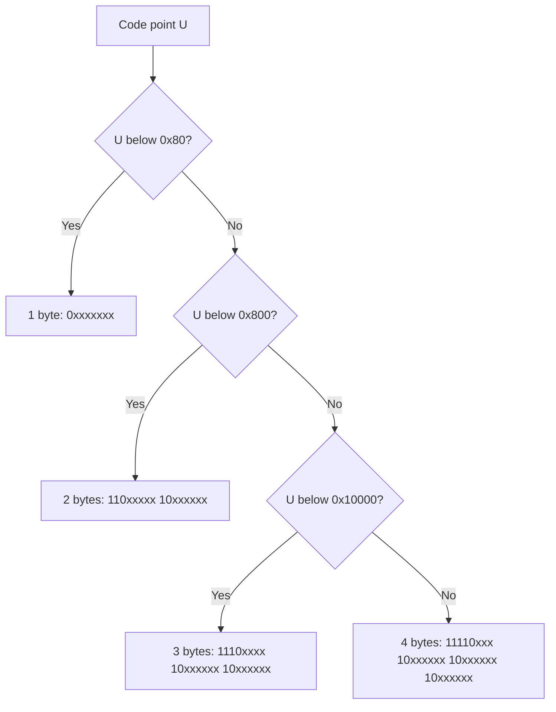

# Unicode, UTF-8 and UTF-16

<!-- BEGIN HEADER (generated by tools/build.py from the front matter; edit the front matter, not this block) -->
> [Home](../../../../README.md) › [Part I — Computer Science Foundations](../../index.md) › [1. Computer Fundamentals](../index.md) › [Chapter 3: Data representation](index.md)

- **Difficulty:** Intermediate
- **Estimated time:** about 80 minutes
- **Prerequisites:** [Character Encoding and ASCII](03-character-encoding-and-ascii.md)
- **Syllabus topics covered:** `01.03.05` Unicode · `01.03.06` UTF-8, UTF-16
- **Status:** Drafted (passes the automated checks; awaiting independent technical review). Last reviewed 2026-11-01.
<!-- END HEADER -->

## What you will learn

- Explain what Unicode is, what a *code point* is, and why Unicode and its encodings are different things.
- Encode and decode a character in UTF-8 and UTF-16 by hand, including surrogate pairs.
- Explain why UTF-8 became the dominant encoding on the web and in modern software.
- Distinguish code points, code units, bytes and user-perceived characters, and explain why `len()` can mean four different things.
- Avoid the standard bugs: wrong lengths, broken slices, mismatched encodings, unnormalised comparisons and the MySQL `utf8` trap.

## Introduction

The [previous lesson](03-character-encoding-and-ascii.md) ended with a problem: ASCII has 128 characters, and the 8-bit code pages each cover a few languages at best. A document in Hindi, Greek and Japanese could not be written in any one of them. **Unicode** solves this by giving **every character in every writing system a single, unique number**, and by separating that numbering from the question of how to store the numbers as bytes.

That separation is the key idea of this lesson. Unicode defines the **character set**: which characters exist and their numbers. **UTF-8**, **UTF-16** and **UTF-32** are three *encoding forms*, three different ways of turning those numbers into bytes. Most confusion about text in software comes from mixing these levels.

## Intuitive understanding

Think of Unicode as one enormous, permanent, shared phone book: each character gets a unique **code point**, written `U+` followed by hexadecimal digits, such as `U+0041` for A, `U+00E9` for é, `U+20AC` for the euro sign € and `U+1F600` for the emoji 😀. The code point says nothing about bytes.

An encoding is then a rule for *writing a code point down*. UTF-32 writes every code point as 4 bytes: simple, but wasteful for English. UTF-16 uses 2 bytes for most characters and 4 for the rest. UTF-8 uses 1 byte for ASCII and 2, 3 or 4 bytes for others, which keeps English text compact and, crucially, **byte-for-byte identical to ASCII**.

## Technical foundations

### The Unicode code space

Code points range from `U+0000` to `U+10FFFF`: 1,114,112 possible values, arranged in 17 **planes** of 65,536. Plane 0, the **Basic Multilingual Plane (BMP)**, covers `U+0000` to `U+FFFF` and holds most characters in everyday use. The range `U+D800` to `U+DFFF` (2,048 values) is permanently reserved as **surrogates**, used only by UTF-16 and never valid characters in their own right. That leaves 1,112,064 valid **scalar values**. Well over 150,000 of them are assigned to characters in recent versions of the standard, and new versions add more each year, so consult [unicode.org](https://www.unicode.org/) for the current count.

The first 128 code points are exactly ASCII, and `U+0080` to `U+00FF` are exactly ISO 8859-1 (Latin-1), which makes migration easier.

### UTF-8

UTF-8, designed by Ken Thompson and Rob Pike in 1992, encodes each code point as one to four bytes:

| Code point range | Bytes | Bit pattern (x = payload bits) |
|---|---|---|
| `U+0000` to `U+007F` | 1 | `0xxxxxxx` |
| `U+0080` to `U+07FF` | 2 | `110xxxxx 10xxxxxx` |
| `U+0800` to `U+FFFF` | 3 | `1110xxxx 10xxxxxx 10xxxxxx` |
| `U+10000` to `U+10FFFF` | 4 | `11110xxx 10xxxxxx 10xxxxxx 10xxxxxx` |



*Reading the diagram:* pick the shortest form that has enough payload bits for the code point, then fill the `x` positions with the code point's bits, high bits first.

*Worked example:* encode `€`, `U+20AC`.

1. The code point is `0x20AC`. It is above `0x7FF` and below `0x10000`, so it needs 3 bytes with 16 payload bits.
2. In binary, `0x20AC` is `0010 0000 1010 1100`.
3. Split into groups of 4, 6 and 6 bits to fill `1110xxxx 10xxxxxx 10xxxxxx`: `0010`, `000010`, `101100`.
4. Assemble: `1110 0010`, `10 000010`, `10 101100`, which is `E2 82 AC`.

The design has valuable properties:

- **ASCII-compatible.** Any valid ASCII text is already valid UTF-8, so old tools, file paths and protocol delimiters keep working.
- **Self-synchronising.** Continuation bytes always start with `10`, and lead bytes never do, so from any byte you can find the start of the next character, and a damaged byte corrupts only one character.
- **No byte-order problem.** The bytes of a character are always in the same order.
- **No zero bytes inside multi-byte characters**, so C-style strings that end at a zero byte still work.
- **Byte order equals code point order**, so sorting UTF-8 strings bytewise gives the same result as sorting by code point.
- **Strict rules.** *Overlong* encodings (using more bytes than needed), surrogate code points and values above `U+10FFFF` are invalid. Rejecting them is a security requirement, because lenient decoders have been used to smuggle forbidden characters past filters. The format is specified in RFC 3629.

A **byte order mark (BOM)**, the code point `U+FEFF` encoded as `EF BB BF`, is sometimes placed at the start of UTF-8 files, notably by some Windows tools. It is permitted but not recommended, and it breaks programs that expect the first bytes of a file to be real content (for example a script's first line).

### UTF-16

UTF-16 encodes each code point in one or two 16-bit **code units**. BMP characters use a single unit equal to the code point. Code points above `U+FFFF` use a **surrogate pair**:

1. Subtract `0x10000`, leaving a 20-bit number.
2. The high 10 bits plus `0xD800` form the first (high surrogate) unit.
3. The low 10 bits plus `0xDC00` form the second (low surrogate) unit.

For 😀, `U+1F600`: subtract `0x10000` to get `0xF600`; the high 10 bits are `0x3D`, giving `0xD83D`; the low 10 bits are `0x200`, giving `0xDE00`. So 😀 is `D83D DE00`.

Because each unit is two bytes, UTF-16 has a **byte order**: UTF-16BE writes the more significant byte first, UTF-16LE the less significant. A BOM (`FE FF` for big-endian, `FF FE` for little-endian) lets a reader tell them apart; byte order is covered in the [lesson on integers and endianness](05-integers-floats-and-endianness-in-memory.md). UTF-16 is the internal text type of Windows programming interfaces, Java, JavaScript, C# and many other platforms. It is described in RFC 2781. **UTF-32** uses a single 4-byte unit for every code point: it makes indexing by code point trivial, at four times the size of ASCII text.

### Four different "lengths"

A string has several lengths, and "the length" is ambiguous until you say which:

| What you count | Name | Example `"e\u0301😀"` |
|---|---|---|
| Bytes in an encoding | Size | UTF-8: 7 bytes |
| 16-bit units (UTF-16) | Code units | 4 |
| Unicode code points | Scalar values | 3 |
| What a reader perceives as characters | **Grapheme clusters** | 2 |

The example string is a letter `e`, followed by a **combining** acute accent `U+0301`, followed by an emoji. A reader sees two characters, é and 😀. Many languages report one of the other numbers, which is why `len` differs between languages: Python counts code points, JavaScript and Java count UTF-16 units (so 😀 has length 2 there), and Go counts bytes.

### Normalisation

The same visible character can have more than one code-point sequence. `é` can be the single code point `U+00E9` (composed) or `e` followed by `U+0301` (decomposed). They look identical but compare unequal. **Unicode normalisation** converts text to a canonical form: NFC (composed) or NFD (decomposed), with compatibility variants NFKC and NFKD. You should normalise text before comparing, searching, hashing or storing identifiers such as usernames.

## Step-by-step working in code

The first program shows how four characters are encoded. It needs Python 3.10 or newer.

<!-- run:python -->
```python
for ch in ("A", "é", "€", "😀"):
    cp = ord(ch)
    u8 = ch.encode("utf-8").hex(" ")
    u16 = ch.encode("utf-16-be").hex(" ")
    u32 = ch.encode("utf-32-be").hex(" ")
    print(f"{ch}  U+{cp:04X}  utf-8: {u8:<11}  utf-16: {u16:<11}  utf-32: {u32}")
```

<!-- expect -->
```text
A  U+0041  utf-8: 41           utf-16: 00 41        utf-32: 00 00 00 41
é  U+00E9  utf-8: c3 a9        utf-16: 00 e9        utf-32: 00 00 00 e9
€  U+20AC  utf-8: e2 82 ac     utf-16: 20 ac        utf-32: 00 00 20 ac
😀  U+1F600  utf-8: f0 9f 98 80  utf-16: d8 3d de 00  utf-32: 00 01 f6 00
```

The pattern is clear. ASCII costs 1 byte in UTF-8 but 2 in UTF-16 and 4 in UTF-32. The euro sign costs 3 bytes in UTF-8 (`E2 82 AC`, as in the worked example) but 2 in UTF-16. The emoji needs 4 bytes in UTF-8 and a surrogate pair (`D83D DE00`) in UTF-16.

The second program implements both encoders from the rules above, then **verifies them against Python's built-in codecs for every valid code point**, all 1,112,064 of them.

<!-- run:python -->
```python
def utf8_encode(cp: int) -> bytes:
    if cp < 0x80:
        return bytes([cp])
    if cp < 0x800:
        return bytes([0xC0 | (cp >> 6), 0x80 | (cp & 0x3F)])
    if cp < 0x10000:
        return bytes([0xE0 | (cp >> 12), 0x80 | ((cp >> 6) & 0x3F), 0x80 | (cp & 0x3F)])
    return bytes([0xF0 | (cp >> 18), 0x80 | ((cp >> 12) & 0x3F),
                  0x80 | ((cp >> 6) & 0x3F), 0x80 | (cp & 0x3F)])


def utf16_units(cp: int) -> list[int]:
    if cp < 0x10000:
        return [cp]
    cp -= 0x10000
    return [0xD800 | (cp >> 10), 0xDC00 | (cp & 0x3FF)]


print(utf8_encode(0x20AC).hex(" "), [hex(u) for u in utf16_units(0x1F600)])
checked = 0
for cp in range(0x110000):
    if 0xD800 <= cp <= 0xDFFF:           # surrogates are not characters
        continue
    ch = chr(cp)
    assert utf8_encode(cp) == ch.encode("utf-8")
    assert b"".join(u.to_bytes(2, "big") for u in utf16_units(cp)) == ch.encode("utf-16-be")
    checked += 1
print("code points verified:", checked)
```

<!-- expect -->
```text
e2 82 ac ['0xd83d', '0xde00']
code points verified: 1112064
```

The shifts and masks are the bit patterns from the table: `cp >> 6` drops the low 6 bits already placed in the last byte, `& 0x3F` keeps exactly 6 payload bits, and the `0x80`, `0xC0`, `0xE0` and `0xF0` constants add the marker bits. Because the input space is finite, the check is exhaustive: if no assertion fails, the encoders are correct for *every* valid input. Complexity is constant per character.

The third program shows the lengths and normalisation.

<!-- run:python -->
```python
import unicodedata

s = "e\u0301😀"      # 'e' + combining acute accent + an emoji
print(len(s), len(s.encode("utf-8")), len(s.encode("utf-16-le")) // 2)
print("\u00e9" == "e\u0301", unicodedata.normalize("NFC", "e\u0301") == "\u00e9")
print(unicodedata.name("\u0301"), unicodedata.category("\u0301"))
print("ß".upper(), "ß".casefold())
```

<!-- expect -->
```text
3 7 4
False True
COMBINING ACUTE ACCENT Mn
SS ss
```

Line 1 reports 3 code points, 7 UTF-8 bytes (1 + 2 + 4) and 4 UTF-16 units (1 + 1 + 2). Line 2 shows that the composed and decomposed forms of é are unequal until normalised. Line 3 asks the Unicode database about the accent. Line 4 shows that case conversion is not letter-for-letter: German `ß` upper-cases to `SS`, and `casefold` (the correct tool for case-insensitive comparison) maps it to `ss`.

The last program shows invalid and truncated input, which real software meets constantly.

<!-- run:python -->
```python
bad = b"caf\xe9"                      # Latin-1 bytes, not valid UTF-8
try:
    bad.decode("utf-8")
except UnicodeDecodeError as err:
    print("error at byte", err.start, ":", err.reason)
print(bad.decode("utf-8", errors="replace"))
print(bad.decode("latin-1"))

cut = "caf\u00e9".encode("utf-8")[:4]  # cut a two-byte character in half
print(cut)
try:
    cut.decode("utf-8")
except UnicodeDecodeError as err:
    print("truncated:", err.reason)
```

<!-- expect -->
```text
error at byte 3 : unexpected end of data
caf�
café
b'caf\xc3'
truncated: unexpected end of data
```

The byte `0xE9` is valid Latin-1 (`é`) but in UTF-8 it is the start of a three-byte sequence that never completes. Decoding with `errors="replace"` substitutes the replacement character `U+FFFD` (�), and decoding with the right encoding recovers the text. The second half shows the classic truncation bug: slicing bytes at a fixed count can cut a character in half. Always truncate by characters (or at a code-point boundary), never by raw bytes.

## Real-world applications

- **The web.** Pages declare their encoding with `<meta charset="utf-8">` or the HTTP `Content-Type` header. The WHATWG Encoding Standard describes UTF-8 as the most appropriate encoding for the interchange of Unicode, and it is the default recommendation for new web content. JSON exchanged between systems must be UTF-8 (RFC 8259).
- **Programming languages.** Python 3's `str` is a sequence of Unicode code points. Go strings are byte sequences conventionally holding UTF-8, with `rune` meaning a code point. Rust's `String` is UTF-8. Java, JavaScript and C# strings are sequences of UTF-16 code units. Swift's `Character` is a grapheme cluster.
- **Databases.** MySQL's historical `utf8` character set stores at most 3 bytes per character (it is an alias for `utf8mb3`), so it cannot store emoji or other characters beyond the BMP; use `utf8mb4` for full Unicode. Check the documentation of the version you use.
- **Security.** Identifiers that *look* identical can differ (Latin `a`, `U+0061`, versus Cyrillic `а`, `U+0430`), enabling spoofing; normalise and restrict identifiers, and reject invalid UTF-8 and overlong forms.

## Comparisons and trade-offs

| | UTF-8 | UTF-16 | UTF-32 |
|---|---|---|---|
| Bytes per character | 1 to 4 | 2 or 4 | 4 |
| ASCII text size | 1 byte per character | 2 | 4 |
| ASCII-compatible | Yes | No | No |
| Byte-order issue | None | Yes (BE or LE) | Yes |
| Random access by code point | No (variable width) | No (surrogates) | Yes |
| Typical use | Files, web, networks, Linux, Go, Rust | Windows APIs, Java, JavaScript, .NET | Rare; some internal processing |

For East Asian text UTF-16 can be more compact than UTF-8 (2 bytes versus 3 for most characters in the BMP), but in practice documents mix markup and text and compress well, so UTF-8 is the standard choice for storage and interchange.

## Advanced concepts

- **Grapheme segmentation.** The rules for deciding which code points form one user-perceived character (accents, emoji sequences joined with the zero-width joiner, flags made of two regional-indicator symbols) are defined in Unicode Standard Annex #29. The standard libraries of many languages do not implement it; use a Unicode library for text that people edit or truncate.
- **Case and locale.** Case mapping and sorting depend on language (the Turkish dotted and dotless i, for example), so use locale-aware or `casefold` operations rather than `lower()`/`upper()` when matching text.
- **Wrongly paired surrogates.** UTF-16 text can contain an unpaired surrogate; it is invalid Unicode, and converting it to UTF-8 must fail or substitute `U+FFFD`.
- **Private use and unassigned code points.** Some ranges are reserved for private agreements; software must not assume every valid code point has an assigned meaning.

## Common mistakes

> **Common mistake:** *Using the encoded size as the length,* or truncating a string at a fixed number of bytes. Either breaks multi-byte characters.

- **Treating Unicode as an encoding.** "Unicode" is the character set; UTF-8 and UTF-16 are encodings. "Save as Unicode" in some tools means UTF-16, which causes confusion.
- **Assuming one `char` is one character.** In UTF-16 languages a `char` is a code unit, and an emoji is two of them.
- **Comparing or hashing text without normalising.**
- **Mixing encodings at a boundary:** reading a file with the platform's default encoding instead of the one it was written in.
- **Leaving a BOM at the start of UTF-8 data** that a program expects to begin with real content.
- **Lenient decoding** that accepts overlong or surrogate sequences.
- **Using the wrong MySQL character set** and silently losing emoji or other non-BMP characters.

## Exercises

**Beginner**

1. How many bytes does UTF-8 use for `H`, `ñ` (`U+00F1`), `中` (`U+4E2D`) and `😀` (`U+1F600`)?
2. Is `U+1F600` in the Basic Multilingual Plane? Is `U+20AC`?

**Intermediate**

3. Encode `©` (`U+00A9`) in UTF-8 by hand, and decode the bytes `E2 82 AC` back to a code point.
4. Explain why `"é" == "é"` can be false even though both look the same, and how you would make the comparison reliable.

**Advanced**

5. Compute the UTF-16 surrogate pair for `U+10437`.
6. Write a UTF-8 *validator* that rejects overlong encodings, surrogate code points and values above `U+10FFFF`, and test it against Python's decoder on random byte strings.

**Expert**

7. Prove that UTF-8 is self-synchronising: given any byte position in a valid stream, how do you find the start of the character containing it, and why is that always possible?
8. Explain why sorting UTF-8 strings as bytes gives code point order, and why this is *not* the same as alphabetical order in any human language.

<details>
<summary>Solutions and hints</summary>

1. 1, 2, 3 and 4 bytes respectively.
2. `U+1F600` is above `U+FFFF`, so it is not in the BMP. `U+20AC` is in the BMP.
3. `U+00A9` is `1010 1001`; it needs 2 bytes: `110 00010`, `10 101001`, which is `C2 A9`. For `E2 82 AC`: payload bits `0010`, `000010`, `101100` give `0010 0000 1010 1100` = `0x20AC`, the euro sign.
4. One may be `U+00E9` and the other `e` plus `U+0301`. Normalise both to the same form (NFC) before comparing.
5. `0x10437 - 0x10000 = 0x0437`. High 10 bits: `0x0437 >> 10 = 1`, so `0xD800 + 1 = 0xD801`. Low 10 bits: `0x0437 & 0x3FF = 0x037`, so `0xDC00 + 0x37 = 0xDC37`. The pair is `D801 DC37`.
6. Check the lead byte to find the expected length; check that every continuation byte matches `10xxxxxx`; then reject if the decoded value is smaller than the minimum for that length (overlong), in `0xD800` to `0xDFFF`, or above `0x10FFFF`.
7. Continuation bytes match `10xxxxxx` and lead bytes never do. Step backwards over at most three continuation bytes; the first byte that is not a continuation byte is the lead byte of the character.
8. The lead bytes and payload layout are monotonic in the code point, so bytewise comparison equals code point comparison. Alphabetical order depends on language and uses accents and case rules (collation), which a code point order does not reflect.

</details>

## Interview and practical questions

**What is the difference between Unicode and UTF-8?** Unicode assigns numbers (code points) to characters; UTF-8 is one way of encoding those numbers as bytes.

**Why did UTF-8 win?** It is compatible with ASCII, compact for common text, has no byte-order problem, tolerates errors because it is self-synchronising, and is a safe default for files and protocols.

**Why does `len("😀")` give different answers in different languages?** Because they count different things: code points (1), UTF-16 code units (2) or UTF-8 bytes (4).

**What is a byte order mark?** The character `U+FEFF` placed at the start of a text so a reader can detect the byte order of UTF-16 or UTF-32, or the use of UTF-8. It is optional and often unwanted in UTF-8.

**What is normalisation and why does it matter?** It converts equivalent code-point sequences to a single canonical form so that text that looks the same compares and hashes the same.

## Further reading

**Standards and specifications**

- The Unicode Standard: [unicode.org](https://www.unicode.org/). Annexes #15 (Normalization Forms) and #29 (Text Segmentation) are the authoritative sources for those topics.
- IETF, *UTF-8, a transformation format of ISO 10646*, RFC 3629: [rfc-editor.org](https://www.rfc-editor.org/rfc/rfc3629).
- IETF, *UTF-16, an encoding of ISO 10646*, RFC 2781: [rfc-editor.org](https://www.rfc-editor.org/rfc/rfc2781).
- IETF, *The JavaScript Object Notation (JSON) Data Interchange Format*, RFC 8259: [rfc-editor.org](https://www.rfc-editor.org/rfc/rfc8259).
- WHATWG, *Encoding Standard*: [encoding.spec.whatwg.org](https://encoding.spec.whatwg.org/).

**Community resources**

- Joel Spolsky, "The Absolute Minimum Every Software Developer Absolutely, Positively Must Know About Unicode and Character Sets (No Excuses!)" (2003): a widely read, community-authored introduction.

**Official documentation for the code used here**

- Python: the [Unicode HOWTO](https://docs.python.org/3/howto/unicode.html) and [`unicodedata`](https://docs.python.org/3/library/unicodedata.html).

<!-- BEGIN FOOTER (generated by tools/build.py) -->
---

## Related topics

- [Positional Number Systems](../02-number-systems/01-positional-number-systems.md)

## Navigation

**Previous:** [Character Encoding and ASCII](03-character-encoding-and-ascii.md) · **Up:** [Chapter 3: Data representation](index.md) · **Next:** [Integers, Floating-Point Numbers and Endianness in Memory](05-integers-floats-and-endianness-in-memory.md)
<!-- END FOOTER -->
