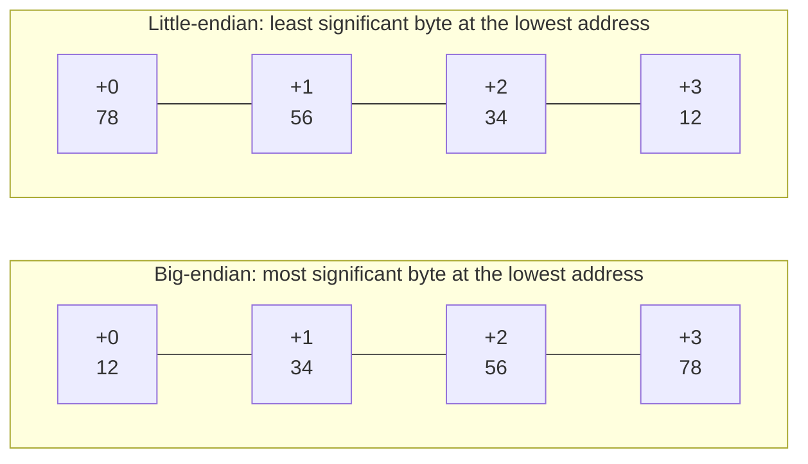

# Integers, Floating-Point Numbers and Endianness in Memory

<!-- BEGIN HEADER (generated by tools/build.py from the front matter; edit the front matter, not this block) -->
> [Home](../../../../README.md) › [Part I — Computer Science Foundations](../../index.md) › [1. Computer Fundamentals](../index.md) › [Chapter 3: Data representation](index.md)

- **Difficulty:** Intermediate
- **Estimated time:** about 70 minutes
- **Prerequisites:** [Bits, Bytes, Words and Memory Addresses](01-bits-bytes-words-and-addresses.md) · [Signed Numbers and Two's Complement](../02-number-systems/04-signed-numbers-and-twos-complement.md) · [Floating-Point Representation and IEEE 754](../02-number-systems/05-floating-point-and-ieee-754.md)
- **Syllabus topics covered:** `01.03.07` Integer and floating-point representation · `01.03.08` Endianness
- **Status:** Drafted (passes the automated checks; awaiting independent technical review). Last reviewed 2026-11-01.
<!-- END HEADER -->

## What you will learn

- State the real sizes of the common integer and floating-point types, and why `int` and `long` are not portable.
- Lay out a multi-byte value in memory in big-endian and little-endian order, and read a hexadecimal dump in either.
- Read and write binary data in a fixed byte order that works on every machine.
- Recognise where byte order matters: network protocols, file formats and shared memory.

## Introduction

[Chapter 2](../02-number-systems/index.md) explained how a pattern of bits can be interpreted as an unsigned integer, a two's-complement integer or an IEEE 754 floating-point number. This lesson answers the practical follow-up: *given a number that needs several bytes, which byte goes at which address?* A 32-bit integer occupies four consecutive byte addresses, and there are two sensible orders in which to put its bytes. Different machines, file formats and protocols chose differently, and a program that ignores the difference reads garbage.

## Intuitive understanding

Think of writing the number one hundred and twenty-three. In English you write the most significant digit first, `123`. A system that wrote the *least* significant digit first would write `321`, and it would be equally self-consistent. The two conventions only cause trouble when they meet: someone reading `321` as if it were written most-significant-first gets the wrong number.

Computer memory has the same choice for **bytes**. The 32-bit number `0x12345678` has four bytes, `12`, `34`, `56` and `78`, with `12` the most significant. Placing them in memory from the lowest address upward:



*Reading the diagram:* both rows hold the same number. In **big-endian** order the bytes appear in the order a person writes the number; in **little-endian** order they appear reversed. The names come from Jonathan Swift's *Gulliver's Travels*, where two nations fight over which end of a boiled egg to crack; Danny Cohen borrowed the joke in a 1981 essay arguing that the important thing is to choose one convention and state it.

## Technical foundations

### Integer sizes

Fixed-width types state their size in their name. Types such as C's `int` and `long` do not.

| Language | Fixed-width types | Types whose size varies |
|---|---|---|
| C and C++ (`<stdint.h>`) | `int8_t`, `uint8_t`, `int16_t`, `uint16_t`, `int32_t`, `uint32_t`, `int64_t`, `uint64_t` | `int` (at least 16 bits), `long`, `size_t`, pointers |
| Java | `byte` 8, `short` 16, `int` 32, `long` 64 (all signed) | none |
| Rust | `i8` to `i128`, `u8` to `u128` | `isize` and `usize` match the pointer width |
| Go | `int8` to `int64`, `uint8` to `uint64` | `int` and `uint` are 32 or 64 bits depending on the platform |
| Python | none: integers have unlimited size | n/a |

In C, three **data models** are common, and they disagree about `long`:

| Model | `int` | `long` | `long long` | pointer | Typical platform |
|---|---|---|---|---|---|
| ILP32 | 32 | 32 | 64 | 32 | 32-bit systems |
| LP64 | 32 | 64 | 64 | 64 | 64-bit Linux, macOS, BSD |
| LLP64 | 32 | 32 | 64 | 64 | 64-bit Windows |

So `long` is 64 bits on 64-bit Linux and 32 bits on 64-bit Windows. Use fixed-width types whenever the exact size matters, which includes any data written to disk or sent over a network.

### Floating-point types

A `float` is an IEEE 754 binary32 value (4 bytes) and a `double` is binary64 (8 bytes), as in the [floating-point lesson](../02-number-systems/05-floating-point-and-ieee-754.md). In memory they are treated as one unit, so byte order applies to the *whole* value: on a little-endian machine the sign bit lives in the byte at the highest address, because that is where the most significant byte goes.

### Byte order

- **Big-endian** stores the most significant byte first. Internet protocols specify it for multi-byte header fields, which is why it is called **network byte order**. Many older RISC machines and some file formats use it natively.
- **Little-endian** stores the least significant byte first. x86 and x86-64 processors use it, and so do almost all Arm systems as deployed today, so most computers you will meet are little-endian.
- **Bi-endian** processors (some Arm, PowerPC, MIPS and RISC-V configurations) can be set to either.

Byte order is invisible while a program only works with values in registers and ordinary variables, because the processor reads and writes them consistently. It shows up when bytes **cross a boundary**: written to a file, sent over a network, shared with another machine, or inspected as raw bytes (a memory dump, or a `char *` pointing into an integer).

| Format or protocol | Byte order |
|---|---|
| IP, TCP, UDP headers | Big-endian (network byte order) |
| PNG images | Big-endian |
| Java class files | Big-endian |
| BMP images, WAV audio, ZIP archives | Little-endian |
| TIFF images | Either: the file starts with `II` (little) or `MM` (big) |
| UTF-16 and UTF-32 text | Either: UTF-16LE or UTF-16BE, or a byte order mark |

## Step-by-step working in code

The Python `struct` module and `int.to_bytes` let you choose the byte order explicitly: `>` means big-endian, `<` little-endian. The last part reads the width and height from the start of a PNG file, whose fields are big-endian.

<!-- run:python -->
```python
import struct

n = 0x12345678
print(n.to_bytes(4, "big").hex(" "), "|", n.to_bytes(4, "little").hex(" "))
print(struct.pack(">I", n).hex(" "), "|", struct.pack("<I", n).hex(" "))
data = bytes([0x78, 0x56, 0x34, 0x12])
print(hex(int.from_bytes(data, "little")), hex(int.from_bytes(data, "big")))
print(struct.pack("<i", -2).hex(" "))
print(struct.pack("<f", 1.0).hex(" "), struct.pack(">d", 1.0).hex(" "))

# The first 24 bytes of a PNG file: signature, then the IHDR chunk header and its size fields
header = bytes.fromhex("89 50 4e 47 0d 0a 1a 0a 00 00 00 0d 49 48 44 52 00 00 02 80 00 00 01 e0")
width, height = struct.unpack(">II", header[16:24])   # two 4-byte big-endian unsigned integers
print(header[1:4], width, height)
```

<!-- expect -->
```text
12 34 56 78 | 78 56 34 12
12 34 56 78 | 78 56 34 12
0x12345678 0x78563412
fe ff ff ff
00 00 80 3f 3f f0 00 00 00 00 00 00
b'PNG' 640 480
```

Reading it: the same integer produces reversed byte sequences in the two orders. Decoding the same four bytes with the wrong order yields `0x78563412`, a completely different number, which is exactly what goes wrong when a program ignores byte order. `-2` in 32-bit two's complement is `0xFFFFFFFE`, stored little-endian as `fe ff ff ff`. The float `1.0` is `0x3F800000` and shows as `00 00 80 3f` in little-endian order, while the double `1.0`, `0x3FF0000000000000`, packed big-endian, begins with the bytes `3f f0`. In the PNG header the width `00 00 02 80` and height `00 00 01 e0` are big-endian, giving 640 and 480.

You can also *see* the byte order of the machine you are on. The next C program (C11) copies an integer's bytes into an array. Its output depends on the machine, so it is not compared with fixed text.

<!-- run:c -->
```c
#include <stdio.h>
#include <stdint.h>
#include <string.h>

int main(void) {
    uint32_t value = 0x12345678u;
    unsigned char bytes[sizeof value];
    memcpy(bytes, &value, sizeof value);     /* look at the bytes as they sit in memory */
    printf("bytes in memory:");
    for (size_t i = 0; i < sizeof value; i++) {
        printf(" %02x", bytes[i]);
    }
    printf("\nthis machine is %s-endian\n", bytes[0] == 0x78 ? "little" : "big");
    return 0;
}
```

Example output on an x86-64 machine (little-endian):

```text
bytes in memory: 78 56 34 12
this machine is little-endian
```

`memcpy` is the safe way to inspect an object's bytes. The tempting alternative, casting a `uint32_t *` to an `unsigned char *` is permitted for bytes, but casting a pointer to *another* multi-byte type, such as reading a `float` through a `uint32_t *`, breaks C's aliasing rules and is undefined behaviour. (C++20 provides `std::bit_cast` for this purpose.)

The robust way to read data in a *fixed* order, independent of the machine running the code, is to **build the value from bytes with shifts**. This program gives the same output on any machine, which is why its output is checked.

<!-- run:c -->
```c
#include <stdio.h>
#include <stdint.h>

static uint32_t read_be32(const uint8_t *b) {
    return ((uint32_t)b[0] << 24) | ((uint32_t)b[1] << 16) | ((uint32_t)b[2] << 8) | (uint32_t)b[3];
}

static uint32_t read_le32(const uint8_t *b) {
    return ((uint32_t)b[3] << 24) | ((uint32_t)b[2] << 16) | ((uint32_t)b[1] << 8) | (uint32_t)b[0];
}

static uint32_t swap32(uint32_t x) {
    return ((x & 0x000000FFu) << 24) | ((x & 0x0000FF00u) << 8) |
           ((x & 0x00FF0000u) >> 8)  | ((x & 0xFF000000u) >> 24);
}

int main(void) {
    const uint8_t bytes[4] = {0x12, 0x34, 0x56, 0x78};
    printf("big-endian read:    0x%08X\n", (unsigned)read_be32(bytes));
    printf("little-endian read: 0x%08X\n", (unsigned)read_le32(bytes));
    printf("swap32(0x12345678): 0x%08X\n", (unsigned)swap32(0x12345678u));
    return 0;
}
```

<!-- expect -->
```text
big-endian read:    0x12345678
little-endian read: 0x78563412
swap32(0x12345678): 0x78563412
```

The cast to `uint32_t` *before* shifting matters: shifting an `int`-promoted byte left by 24 can overflow a signed `int`. The functions describe the *layout of the data*, not of the machine, so they work unchanged on big- and little-endian hosts. Compilers recognise this pattern and turn it into a single load plus, where needed, a byte-swap instruction.

## Real-world applications

- **Networking.** Sockets code converts between host and network order (`htonl`, `ntohl` and relatives in the POSIX API) before sending integers, and the same applies when parsing a packet header.
- **File formats.** Image, audio, archive and database formats fix a byte order; a reader written for one platform must honour it on all.
- **Debugging.** A memory dump shows bytes in address order. On a little-endian machine the 32-bit value `0x12345678` appears as `78 56 34 12`, so you read integers in a dump *backwards* by byte.
- **Shared data.** Memory-mapped files and shared memory between machines or devices with different byte orders (a processor and a peripheral, say) need an agreed convention.

## Advanced concepts

- **Byte-swap instructions.** x86 has `BSWAP` and Arm has `REV`, so converting byte order is one cheap instruction. Compilers use them.
- **Bit order versus byte order.** The order of *bits* within a byte as they travel on a wire is a separate convention. UART serial links, for example, send the least significant bit first, and Ethernet transmits each byte least-significant bit first, even though its multi-byte fields are big-endian.
- **Bit-fields are not portable.** In C, how bit-fields in a structure are laid out is implementation-defined, so do not use them to describe a wire or file format.
- **Unaligned access.** Reading a multi-byte value from an address that is not a multiple of its size is slow on some processors and illegal on others, which is another reason to assemble values from bytes.
- **Signedness of `char`.** Plain `char` may be signed or unsigned depending on the platform; use `uint8_t` or `unsigned char` for raw bytes.

## Common mistakes

> **Common mistake:** *Writing a C structure or an integer array straight to a file or socket with `fwrite` or `send`.* Padding, field sizes and byte order all differ between platforms, so the receiver reads garbage. Serialise field by field in a documented format ([data serialization](07-data-serialization.md)).

- **Casting a byte buffer to `int *`** and dereferencing it: alignment and aliasing problems, plus the byte-order problem.
- **Assuming the host's order is the file's order.** Always decide and document the order of every multi-byte field.
- **Reading a hex dump in the wrong direction.**
- **Using `long` for a 64-bit quantity** (it is 32 bits on 64-bit Windows).
- **Treating a `char` as an unsigned byte** without checking the platform.
- **Forgetting that floating-point values also have a byte order.**

## Exercises

**Beginner**

1. Write `0xA1B2C3D4` as four bytes in big-endian order and in little-endian order.
2. A little-endian memory dump shows `E8 03 00 00` at the address of a 32-bit integer. What is its value?

**Intermediate**

3. Using `struct.pack`, store the number 1000 as a 16-bit big-endian and a 16-bit little-endian integer, and print the bytes.
4. Why is it safe to use `int` for loop counters but not for fields in a file format?

**Advanced**

5. Write a C function `write_be16(uint8_t *out, uint16_t v)` and `read_be16`, and test that they are inverses for all 65,536 values.
6. A network packet starts with the bytes `00 50 1F 90`. Interpret the first two bytes as a 16-bit big-endian source port and the next two as the destination port.

**Expert**

7. Explain why reading a `float` through a `uint32_t *` is undefined behaviour in C, and show two correct ways to obtain the bits of a float.
8. Design a binary file header with a magic number, a version and the byte order of the file's data, so that a reader on any machine can decode it. Which convention makes the magic number detect a wrong-order read?

<details>
<summary>Solutions and hints</summary>

1. Big-endian: `A1 B2 C3 D4`. Little-endian: `D4 C3 B2 A1`.
2. Reading little-endian: `0x000003E8`, which is 1000.
3. `struct.pack(">H", 1000)` gives `03 e8`; `struct.pack("<H", 1000)` gives `e8 03`.
4. A loop counter lives only in registers or ordinary variables within one program, whose compiler is consistent; a file format is read by other programs on other platforms, so its field sizes and byte order must be fixed.
5. `out[0] = v >> 8; out[1] = v & 0xFF;` and `return (uint16_t)((in[0] << 8) | in[1]);`. Loop over all values to confirm they invert.
6. `00 50` is 80 and `1F 90` is 8080: source port 80, destination port 8080.
7. The object has a declared type (`float`), and accessing it through an incompatible pointer type violates the aliasing rules, so the compiler may assume it does not happen. Use `memcpy` into a `uint32_t`, or (in C++20) `std::bit_cast`; in C, a `union` is also permitted for type punning.
8. Put a fixed magic number such as `0x1A2B3C4D` (or a 2-byte marker like TIFF's `II`/`MM`) at the start, followed by a field recording the byte order. A reader that sees the byte-swapped magic knows the file's order differs from its own. Choose a magic whose swapped form is clearly different from itself (not a palindrome).

</details>

## Interview and practical questions

**What is endianness?** The order in which the bytes of a multi-byte value are stored at increasing addresses: most significant byte first (big-endian) or least significant byte first (little-endian).

**Which is "network byte order"?** Big-endian.

**How do you determine the byte order of a machine in C?** Store a known multi-byte value, copy its bytes with `memcpy`, and look at the byte at the lowest address.

**Why use fixed-width integer types?** The size of `int` and `long` varies by platform, so code and data formats that depend on exact sizes must use `int32_t`, `uint64_t` and so on.

**How do you write portable code that reads a 32-bit big-endian integer?** Build it from the bytes with shifts and ORs, as in `read_be32`, instead of casting a pointer.

## Further reading

**Research**

- Danny Cohen, "On Holy Wars and a Plea for Peace", *IEEE Computer*, vol. 14, no. 10 (1981): the paper that named big-endian and little-endian.

**Standards and specifications**

- ISO/IEC 9899 (the C standard), on integer types, aliasing and `<stdint.h>`.
- W3C, *Portable Network Graphics (PNG) Specification*: the chunk layout and its big-endian fields.

**Textbooks**

- Randal E. Bryant and David R. O'Hallaron, *Computer Systems: A Programmer's Perspective* (Pearson), chapter 2 on byte ordering and integer representations.

**Official documentation for the code used here**

- Python: [`struct`](https://docs.python.org/3/library/struct.html) and [`int.to_bytes` / `int.from_bytes`](https://docs.python.org/3/library/stdtypes.html#int.to_bytes).

<!-- BEGIN FOOTER (generated by tools/build.py) -->
---

## Related topics

- [Unicode, UTF-8 and UTF-16](04-unicode-utf-8-and-utf-16.md)

## Navigation

**Previous:** [Unicode, UTF-8 and UTF-16](04-unicode-utf-8-and-utf-16.md) · **Up:** [Chapter 3: Data representation](index.md) · **Next:** [Image, Audio and Video Encoding](06-image-audio-and-video-encoding.md)
<!-- END FOOTER -->
