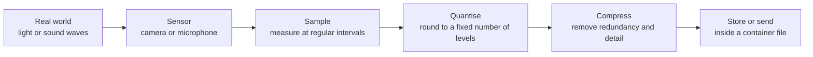

# Image, Audio and Video Encoding

<!-- BEGIN HEADER (generated by tools/build.py from the front matter; edit the front matter, not this block) -->
> [Home](../../../../README.md) › [Part I — Computer Science Foundations](../../index.md) › [1. Computer Fundamentals](../index.md) › [Chapter 3: Data representation](index.md)

- **Difficulty:** Intermediate
- **Estimated time:** about 80 minutes
- **Prerequisites:** [Integers, Floating-Point Numbers and Endianness in Memory](05-integers-floats-and-endianness-in-memory.md) · [Error Detection and Correction](02-error-detection-and-correction.md)
- **Syllabus topics covered:** `01.03.09` Image, audio and video encoding
- **Status:** Drafted (passes the automated checks; awaiting independent technical review). Last reviewed 2026-11-01.
<!-- END HEADER -->

## What you will learn

- Explain how a continuous signal (light or sound) becomes a list of numbers through **sampling** and **quantisation**.
- Calculate the raw size and data rate of images, audio and video, and see why compression is unavoidable.
- Distinguish lossless from lossy compression, and a *codec* from a *container*.
- Describe what is inside a PNG file and a WAV file, and read or write both with a short program.

## Introduction

Text is already discrete: each character is one of a finite set. Pictures and sound are not. A photograph has a continuous range of brightness and colour at every point; a sound is a pressure that varies smoothly with time. To store either in a computer we must **measure** the signal at a finite number of points, and **round** each measurement to one of a finite set of values. This is **digitisation**, and every file format for media is a way of writing down the resulting numbers, usually after squeezing them to save space.

## Intuitive understanding

Imagine tracing a hill's outline by measuring its height every metre and writing down each height to the nearest centimetre. Measuring more often (a finer spacing) captures narrower features; rounding to a finer unit (more levels) captures smaller differences. Those two choices are the **sampling rate** and the **bit depth**, and they are the only two ideas you need to understand uncompressed digital media.



*Reading the diagram:* the first four steps happen in the capture hardware and produce **raw** (also called *PCM* for audio) data; compression and packaging are done by software. Playback runs the pipeline backwards.

## Technical foundations

### Digital images

A raster image is a grid of **pixels**. Each pixel stores the colour at that point, most often as three numbers, the intensities of **red, green and blue** light. With 8 bits per channel there are $2^{24} = 16{,}777{,}216$ colours, and the image is called "24-bit". An optional fourth channel, **alpha**, records transparency. The raw size is simply

$$
\text{bytes} = \text{width} \times \text{height} \times \text{bytes per pixel}.
$$

A single 1920 by 1080 RGB frame is $1920 \times 1080 \times 3 = 6{,}220{,}800$ bytes, about 5.9 MiB. **Vector** images (such as SVG) take a different approach: they store shapes and curves, not pixels, so they scale to any size.

Image files record the pixels with some compression and wrap them in a format:

| Format | Compression | Typical use |
|---|---|---|
| BMP | None (usually) | Simple, uncompressed |
| PNG | Lossless (DEFLATE) | Screenshots, diagrams, images with sharp edges; supports transparency |
| JPEG | Lossy (discrete cosine transform) | Photographs |
| WebP, AVIF | Lossless or lossy | Web images, often smaller than PNG or JPEG |
| SVG | Not applicable (vector, text-based) | Icons and illustrations |

### Digital audio

Sound is sampled as a sequence of **amplitude** measurements taken at a fixed **sample rate**, measured in hertz. Each sample is stored with a given **bit depth**, and a recording may have several **channels** (two for stereo). The **Nyquist-Shannon sampling theorem** says that a signal containing no frequencies above $f_{max}$ can be reconstructed exactly if it is sampled at more than $2 f_{max}$. Human hearing extends to roughly 20 kHz, which is why audio compact discs use 44,100 samples per second: the highest frequency they can represent is 22,050 Hz. Sampling too slowly causes **aliasing**, where high frequencies masquerade as low ones.

Each extra bit of depth halves the step between levels and improves the signal-to-quantisation-noise ratio by about 6 dB. CD audio uses 16 bits (65,536 levels); studio work often uses 24.

### Digital video

Video is a sequence of images, **frames**, shown at a **frame rate** (commonly 24, 30 or 60 per second), plus audio. Its raw data rate is enormous, which makes compression essential.

<!-- run:python -->
```python
def raw_audio_bits_per_second(sample_rate: int, bit_depth: int, channels: int) -> int:
    return sample_rate * bit_depth * channels


def raw_image_bytes(width: int, height: int, bytes_per_pixel: int = 3) -> int:
    return width * height * bytes_per_pixel


print(raw_audio_bits_per_second(44_100, 16, 2))        # CD-quality stereo, bits per second
print(raw_image_bytes(1920, 1080))                     # one uncompressed 1080p RGB frame, bytes
print(raw_image_bytes(1920, 1080) * 30 * 8 / 1e9)      # raw 30 frames per second, gigabits per second
print(2 ** 24)                                         # colours with 8 bits per channel
```

<!-- expect -->
```text
1411200
6220800
1.492992
16777216
```

CD audio is therefore 1,411,200 bits per second, about 1.4 Mbit/s. Raw 1080p video at 30 frames per second would need almost **1.5 gigabits per second**, hundreds of times the few megabits per second used by a typical HD stream. Compression closes that gap.

### Compression

There are two kinds:

- **Lossless** compression removes *redundancy* and can be undone exactly. A pixel pattern that repeats, or a byte that is common, is described more briefly. **DEFLATE** (used in PNG, ZIP and gzip) combines a dictionary method (LZ77) with Huffman coding, which gives shorter codes to more frequent symbols. No lossless compressor can shrink *every* input: there are fewer short messages than long ones, so by a counting argument, some inputs must grow. Random data is incompressible.
- **Lossy** compression also discards information the audience is unlikely to notice. **JPEG** divides the picture into 8 by 8 blocks, transforms each into frequency components, rounds away the fine detail the eye is least sensitive to, and then compresses the result losslessly. **MP3 and AAC** use a *psychoacoustic* model that drops sounds masked by louder ones, and Opus combines speech and music techniques for low delay. Lossy compression gives much smaller files, but the discarded detail cannot be recovered, and repeated lossy re-encoding accumulates damage.

A further trick is **chroma subsampling**: the eye is more sensitive to brightness than to colour detail, so many formats store full-resolution brightness but colour at half the resolution in each direction (4:2:0). That halves the data before any other compression is applied.

**Video codecs** add *temporal* compression. Instead of storing every frame whole, they store occasional complete frames and, between them, only the *differences*: each block of a new frame is described as a moved copy of a block in an earlier frame (motion compensation) plus a small correction. Common codecs are H.264 (AVC), H.265 (HEVC), VP9 and AV1.

### Codec versus container

A **codec** (coder-decoder) is the algorithm that compresses and decompresses a stream. A **container** is the file format that packages one or more compressed streams, such as video, audio and subtitles, with timing information. MP4, MKV and WebM are containers; H.264 and AV1 are video codecs; AAC and Opus are audio codecs. Saying "an MP4 video" does not tell you which codec is inside.

## Step-by-step working in code

### A PNG file from scratch

A PNG file is a fixed 8-byte signature followed by a series of **chunks**. Each chunk is: a 4-byte big-endian length, a 4-byte type, the data, and a 4-byte **CRC-32** over the type and data, the same CRC from the [error-detection lesson](02-error-detection-and-correction.md). The essential chunks are `IHDR` (width, height, bit depth, colour type), `IDAT` (the compressed pixel data) and `IEND` (the end). Before compression each row of pixels is prefixed with a *filter type* byte; the program below uses filter 0 ("none"). It needs Python 3.10 or newer.

<!-- run:python -->
```python
import os
import struct
import zlib

PNG_SIGNATURE = b"\x89PNG\r\n\x1a\n"


def chunk(kind: bytes, payload: bytes) -> bytes:
    """A PNG chunk: length, type, payload, then a CRC-32 over the type and payload."""
    body = kind + payload
    return struct.pack(">I", len(payload)) + body + struct.pack(">I", zlib.crc32(body))


def make_png(width: int, height: int, pixels) -> tuple[bytes, bytes]:
    """pixels[y][x] is an (r, g, b) tuple. Returns (png bytes, raw scanline bytes)."""
    raw = b"".join(b"\x00" + b"".join(bytes(px) for px in row) for row in pixels)  # filter 0 per row
    ihdr = struct.pack(">IIBBBBB", width, height, 8, 2, 0, 0, 0)    # 8 bits per channel, colour type 2 = RGB
    png = PNG_SIGNATURE + chunk(b"IHDR", ihdr) + chunk(b"IDAT", zlib.compress(raw)) + chunk(b"IEND", b"")
    return png, raw


def read_png(data: bytes):
    """Check the signature and every chunk's CRC; return (chunk names, decompressed scanlines)."""
    assert data[:8] == PNG_SIGNATURE, "not a PNG"
    pos, names, idat = 8, [], b""
    while pos < len(data):
        (length,) = struct.unpack(">I", data[pos:pos + 4])
        kind = data[pos + 4:pos + 8]
        payload = data[pos + 8:pos + 8 + length]
        (crc,) = struct.unpack(">I", data[pos + 8 + length:pos + 12 + length])
        assert crc == zlib.crc32(kind + payload), "corrupt chunk " + kind.decode()
        names.append(kind.decode())
        if kind == b"IDAT":
            idat += payload
        pos += 12 + length
    return names, zlib.decompress(idat)


image = [[(255, 0, 0), (0, 255, 0), (0, 0, 255), (255, 255, 255)],
         [(0, 0, 0), (255, 255, 0), (0, 255, 255), (255, 0, 255)]]
png, raw = make_png(4, 2, image)
names, scanlines = read_png(png)
print(names)
print(len(raw), scanlines == raw)

damaged = bytearray(png)
damaged[png.index(b"IDAT") + 6] ^= 0xFF          # corrupt one byte inside the pixel data
try:
    read_png(bytes(damaged))
except AssertionError as err:
    print(err)

solid, solid_raw = make_png(200, 200, [[(30, 144, 255)] * 200 for _ in range(200)])
print(len(solid_raw), len(solid) * 20 < len(solid_raw))                # a flat colour compresses enormously
print(len(zlib.compress(os.urandom(10_000))) > 10_000)                 # random data does not compress
```

<!-- expect -->
```text
['IHDR', 'IDAT', 'IEND']
26 True
corrupt chunk IDAT
120200 True
True
```

Walking through the output: the 4 by 2 image has 2 rows of $1 + 4 \times 3 = 13$ bytes, so 26 raw bytes, and decompressing the `IDAT` chunk returns exactly those 26 bytes: the compression is lossless. Flipping one byte inside the compressed data makes the chunk's CRC fail, and the reader reports `corrupt chunk IDAT` before it even tries to decompress. A flat-coloured 200 by 200 image has 120,200 raw bytes but compresses to under a twentieth of that, because the repetition is extreme. Ten thousand random bytes cannot be compressed, and `zlib` returns something slightly *larger* than the input, which is the counting argument in action. (A real PNG encoder would also choose a filter per row, such as "difference from the pixel above", to make photographs compress better.)

### A WAV file from scratch

A WAV file stores raw audio samples after a 44-byte header, with multi-byte values in little-endian order. The program writes one second of a 440 Hz tone (the musical note A above middle C) as 16-bit mono at 8,000 samples per second, using Python's standard `wave` module.

<!-- run:python -->
```python
import math
import struct
import tempfile
import wave
from pathlib import Path

RATE, FREQUENCY = 8_000, 440
samples = [int(32767 * 0.5 * math.sin(2 * math.pi * FREQUENCY * n / RATE)) for n in range(RATE)]  # 1 second

with tempfile.TemporaryDirectory() as folder:
    path = Path(folder) / "tone.wav"
    with wave.open(str(path), "wb") as w:
        w.setnchannels(1)                                  # mono
        w.setsampwidth(2)                                  # 2 bytes: 16-bit samples
        w.setframerate(RATE)
        w.writeframes(struct.pack("<" + "h" * len(samples), *samples))   # little-endian signed 16-bit
    print("file size:", path.stat().st_size, "bytes")
    with wave.open(str(path), "rb") as r:
        print(r.getnchannels(), r.getsampwidth(), r.getframerate(), r.getnframes())
print(samples[0], max(samples) <= 16383, min(samples) >= -16383)
```

<!-- expect -->
```text
file size: 16044 bytes
1 2 8000 8000
0 True True
```

The file is 44 header bytes plus $8000 \times 2 = 16{,}000$ data bytes. Each sample is $\lfloor 32767 \times 0.5 \times \sin(2\pi \cdot 440\, n / 8000) \rfloor$: the `sin` is the *signal*, sampling evaluates it at 8,000 instants per second, and `int(...)` is the *quantisation*, which rounds each value to one of 65,536 integer levels. The amplitude is half of full scale, so every sample lies within $\pm 16383$. Note that 8 kHz can represent frequencies up to 4 kHz, so a 440 Hz tone is safely below the Nyquist limit.

## Real-world applications

- **Streaming services** store each title at several bit rates and switch between them as the viewer's bandwidth changes (*adaptive bitrate streaming*), choosing codecs by device support and licensing.
- **Photography and the web.** JPEG, WebP and AVIF trade file size against fidelity; PNG and lossless WebP are used where exactness matters, such as screenshots and diagrams.
- **Telephony and video conferencing** use codecs designed for low delay and speech, such as Opus for audio.
- **Medical, scientific and archival imaging** often use lossless formats, because a discarded detail could be a diagnosis.
- **Security.** Media parsers handle complex, untrusted input and have been a frequent source of vulnerabilities, which is why they are fuzz-tested and sandboxed.

## Comparisons and trade-offs

| | Lossless | Lossy |
|---|---|---|
| Recoverable exactly | Yes | No |
| Typical size reduction | Modest for photographs, far greater for graphics and flat colour | Large (often 10 times or more) |
| Examples | PNG, FLAC, ZIP | JPEG, MP3, AAC, H.264 |
| Repeated re-saving | No quality loss | Quality degrades each time |
| Best for | Graphics, text in images, archives, editing masters | Photos, music, video distribution |

Choosing an encoding is choosing where to spend a budget of bits, time (encoding is often much slower than decoding) and quality. Higher compression usually costs more processing power and, for video, more delay.

## Advanced concepts

- **Transform coding.** JPEG and video codecs exploit the fact that natural images have most of their energy in a few low-frequency components. The discrete cosine transform concentrates information so that rounding the small high-frequency coefficients to zero costs little visually.
- **Entropy coding.** After quantisation, symbols are encoded with Huffman or arithmetic coding, approaching the limit set by Shannon's source-coding theorem.
- **Rate-distortion trade-off.** Encoders search for the smallest file at a target quality, or the best quality at a target bit rate.
- **Colour spaces and gamma.** Pixel values are not linear in physical light intensity; formats such as sRGB apply a *gamma* curve that matches human vision. Doing arithmetic on gamma-encoded values (for example blending or resizing) without converting gives subtly wrong results.
- **Perceptual quality metrics.** Mean-squared error is a poor proxy for how good something *looks*, so encoders are tuned with perceptual metrics and human testing.

## Common mistakes

> **Common mistake:** *Confusing a container with a codec.* An MP4 or MKV file only says how streams are packaged; whether it plays depends on the codecs inside.

- **Mixing bits and bytes** in bit rates and sizes (Mbit/s versus MB/s).
- **Confusing sample rate with bit rate.** Sample rate is measurements per second; bit rate is bits per second after multiplying by depth and channels, and after compression.
- **Using JPEG for screenshots or text** (ringing artefacts) or PNG for photographs (very large files).
- **Re-saving a JPEG repeatedly**, which compounds loss; keep a lossless master.
- **Ignoring colour space and gamma** when resizing or blending.
- **Assuming a higher resolution always means more detail.** An upscaled image contains no new information.

## Exercises

**Beginner**

1. How many bytes are in one minute of CD-quality stereo audio (44,100 Hz, 16 bits, 2 channels), uncompressed?
2. What is the raw size of a 3840 by 2160 RGB frame?

**Intermediate**

3. With 4:2:0 chroma subsampling, each 2 by 2 block stores 4 brightness samples and one pair of colour samples. How many bytes does a 1920 by 1080 frame need at 8 bits per sample?
4. What is the highest frequency that 48 kHz sampling can represent, and what happens to a 30 kHz tone sampled at that rate?

**Advanced**

5. Modify the PNG program to add a second image of your own design, and implement the PNG "Sub" filter (each byte minus the byte one pixel to its left). Does a smooth gradient compress better with it?
6. Use the counting (pigeonhole) argument to prove that no lossless compressor can make every input file smaller.

**Expert**

7. Implement run-length encoding for bytes, show an input for which it makes the file larger, and compute the worst-case expansion.

<details>
<summary>Solutions and hints</summary>

1. $44{,}100 \times 2\ \text{bytes} \times 2\ \text{channels} \times 60\ \text{s} = 10{,}584{,}000$ bytes, about 10.1 MiB.
2. $3840 \times 2160 \times 3 = 24{,}883{,}200$ bytes, about 23.7 MiB.
3. Brightness: $1920 \times 1080 = 2{,}073{,}600$ bytes. Colour: one pair per 4 pixels, so $2{,}073{,}600 / 4 \times 2 = 1{,}036{,}800$ bytes. Total $3{,}110{,}400$ bytes, exactly half of the 6,220,800 bytes of full RGB.
4. 24 kHz. A 30 kHz tone is above the limit and is aliased: it appears as a 18 kHz tone ($48 - 30$).
5. Subtracting the left neighbour turns a smooth gradient into small, nearly constant differences, which DEFLATE compresses far better. Remember to prefix each row with filter type 1 and keep arithmetic modulo 256.
6. There are $2^n$ files of exactly $n$ bits but only $2^n - 1$ files of fewer than $n$ bits. A compressor that shrank every $n$-bit file would map $2^n$ inputs to at most $2^n - 1$ outputs, so two inputs would share an output and decompression could not tell them apart.
7. Encode each run as (count, byte). A file with no repeated bytes doubles in size, so the worst-case expansion is 2 times.

</details>

## Interview and practical questions

**What is the difference between lossless and lossy compression?** Lossless compression is exactly reversible; lossy compression discards information, giving smaller files at the cost of fidelity that cannot be recovered.

**What is the difference between a codec and a container?** A codec compresses a stream; a container packages one or more compressed streams, with timing information, into a file.

**What does the Nyquist-Shannon theorem say?** A signal limited to frequencies below $f_{max}$ can be reconstructed from samples taken at more than $2 f_{max}$. Below that rate, aliasing occurs.

**Why does chroma subsampling work?** Human vision resolves brightness detail better than colour detail, so colour can be stored at lower resolution with little visible loss.

**Why can't PNG compress photographs as well as JPEG?** PNG is lossless, so it must preserve every pixel's exact value, and the fine noise in a photograph is hard to compress; JPEG discards that noise.

## Further reading

**Standards and specifications**

- W3C, *Portable Network Graphics (PNG) Specification* (also published as ISO/IEC 15948): the chunk format and filters.
- IETF, *DEFLATE Compressed Data Format Specification*, RFC 1951, and *ZLIB Compressed Data Format Specification*, RFC 1950: [rfc-editor.org](https://www.rfc-editor.org/rfc/rfc1951).
- ITU-T Recommendation T.81 (ISO/IEC 10918-1), the JPEG standard.

**Textbooks**

- David Salomon, *Data Compression: The Complete Reference* (Springer).
- Alan V. Oppenheim and Ronald W. Schafer, *Discrete-Time Signal Processing* (Pearson), for sampling theory.

**Research**

- Claude E. Shannon, "A Mathematical Theory of Communication", *Bell System Technical Journal* (1948): the limits of lossless compression.

**Official documentation for the code used here**

- Python: [`wave`](https://docs.python.org/3/library/wave.html), [`zlib`](https://docs.python.org/3/library/zlib.html) and [`struct`](https://docs.python.org/3/library/struct.html).

<!-- BEGIN FOOTER (generated by tools/build.py) -->
---

## Related topics

- [Unicode, UTF-8 and UTF-16](04-unicode-utf-8-and-utf-16.md)

## Navigation

**Previous:** [Integers, Floating-Point Numbers and Endianness in Memory](05-integers-floats-and-endianness-in-memory.md) · **Up:** [Chapter 3: Data representation](index.md) · **Next:** [Data Serialization](07-data-serialization.md)
<!-- END FOOTER -->
