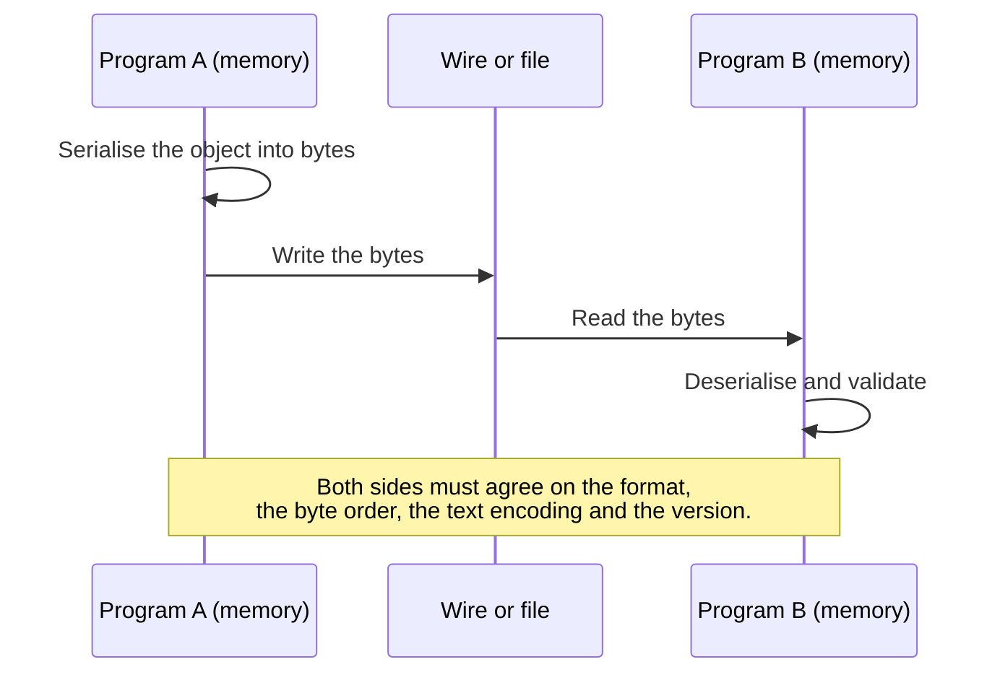

# Data Serialization

<!-- BEGIN HEADER (generated by tools/build.py from the front matter; edit the front matter, not this block) -->
> [Home](../../../../README.md) › [Part I — Computer Science Foundations](../../index.md) › [1. Computer Fundamentals](../index.md) › [Chapter 3: Data representation](index.md)

- **Difficulty:** Intermediate
- **Estimated time:** about 70 minutes
- **Prerequisites:** [Integers, Floating-Point Numbers and Endianness in Memory](05-integers-floats-and-endianness-in-memory.md) · [Unicode, UTF-8 and UTF-16](04-unicode-utf-8-and-utf-16.md)
- **Syllabus topics covered:** `01.03.10` Data serialization
- **Status:** Drafted (passes the automated checks; awaiting independent technical review). Last reviewed 2026-11-01.
<!-- END HEADER -->

## What you will learn

- Explain what serialization and deserialization are, and why raw memory cannot simply be copied between programs.
- Compare text formats (JSON, XML, CSV, YAML) with binary formats (Protocol Buffers, MessagePack, CBOR, Avro) and choose between them.
- Design a simple binary format that can evolve: length-prefixed, tagged fields that old and new readers can both handle.
- Recognise the main dangers: unsafe deserialization, untrusted lengths, and ambiguous or non-canonical encodings.

## Introduction

Inside a running program, data lives as objects in memory: structures with pointers to other structures, strings stored wherever the allocator put them, numbers in the machine's native layout. None of that can leave the program as it is. A pointer is an address that means something only in *this* process; padding and byte order depend on *this* machine and compiler. To save an object to disk, send it across a network, or hand it to a program written in another language, we must convert it into a **sequence of bytes with a documented layout**. That conversion is **serialization** (also called *marshalling* or *encoding*); the reverse is **deserialization** (*unmarshalling*, *decoding* or *parsing*).



*Reading the diagram:* the only thing that crosses the boundary is bytes. Everything the two programs need to agree on, which the previous lessons covered piece by piece (integer sizes, byte order, text encoding), must be fixed by the format.

## Intuitive understanding

Serialization is like flat-pack furniture. A built wardrobe cannot go through the door, so you take it apart into labelled pieces in a box, with instructions. The recipient follows the instructions to rebuild it. The format is the instruction sheet: if the sender and receiver follow different sheets, the wardrobe comes out wrong. A good format also survives change: if the manufacturer adds a shelf in a later model, owners of the old model should not be confused by the new sheet, and new owners should still be able to assemble an old model.

## Technical foundations

### Properties of a format

| Property | Question |
|---|---|
| **Human-readable** | Can a person read and edit it with a text editor? |
| **Schema** | Is the structure declared in advance (a *schema*), or is the data self-describing? |
| **Size and speed** | How many bytes does it take, and how fast is it to encode and decode? |
| **Portability** | Does it work across languages, platforms and byte orders? |
| **Evolvability** | Can the format change over time without breaking old readers or writers? |
| **Canonical form** | Is there exactly one valid encoding of a given value, which matters for signing and hashing? |

### Common formats

| Format | Kind | Notes |
|---|---|---|
| **JSON** (RFC 8259) | Text, self-describing | Ubiquitous on the web. Objects, arrays, strings, numbers, booleans and null. No binary type, no comments, no dates; numbers have no stated precision, and many JavaScript readers use 64-bit floats. UTF-8 for interchange. |
| **XML** | Text, self-describing | Verbose, with strong schema and namespace tooling; long used for documents and configuration. |
| **CSV** | Text, tabular | Very simple, but no standard types; quoting and encoding rules vary between tools. |
| **YAML** | Text | Human-friendly configuration, with a complex specification and unsafe loaders in some libraries. |
| **MessagePack, CBOR** (RFC 8949) | Binary, self-describing | JSON-like data model, but compact and with a binary-string type. |
| **Protocol Buffers, Thrift** | Binary, schema-driven | Fields identified by numbers declared in a schema file; compact and fast; designed for evolution. |
| **Avro** | Binary, schema-driven | The schema travels with the data or is looked up, and reader and writer schemas are reconciled. |
| **Language-native** (Python `pickle`, Java serialization) | Binary | Convenient but tied to one language, and **unsafe to load from untrusted sources**. |

There is no best format. Text formats are easy to debug and need no tooling; binary schema-driven formats are smaller, faster and better at evolution; native formats are the easiest to use and the hardest to secure.

### Delimiting data

A reader must know where each value ends. There are three standard answers:

- **Delimiters:** a special character ends the value (a comma in CSV, a quote in JSON strings). The data must be *escaped* whenever it contains the delimiter.
- **Length prefix:** the length is written first, then exactly that many bytes (as in most binary protocols). No escaping needed, but the length must be trusted carefully.
- **Tag-length-value (TLV):** each field is `tag, length, value`. A reader can *skip* a field whose tag it does not know, because the length tells it how far to jump. This is the basis of evolvable binary formats.

### Compatibility

Formats change, and two directions of compatibility matter:

- **Backward compatibility:** new code can read old data.
- **Forward compatibility:** old code can read new data (usually by ignoring what it does not understand).

Typical rules: add new *optional* fields and give them fresh tags; never reuse or change the meaning of an existing tag; never make a previously optional field required.

## Step-by-step working in code

### A text format: JSON

This program (Python 3.10 or newer) shows a JSON round trip, the data types JSON cannot hold, and the precision caveat for large integers.

<!-- run:python -->
```python
import json

record = {"id": 42, "name": "Ada", "tags": ["math", "code"], "score": 9.5, "active": True, "note": None}
text = json.dumps(record, sort_keys=True, separators=(",", ":"))
print(text)
print(json.loads(text) == record)
print(len(text.encode("utf-8")), "bytes as JSON")

for bad in (float("nan"), b"raw bytes", {1, 2, 3}):
    try:
        json.dumps(bad, allow_nan=False)
    except (ValueError, TypeError) as err:
        print(type(err).__name__)
print(json.dumps(2**53 + 1))
```

<!-- expect -->
```text
{"active":true,"id":42,"name":"Ada","note":null,"score":9.5,"tags":["math","code"]}
True
83 bytes as JSON
ValueError
TypeError
TypeError
9007199254740993
```

`sort_keys=True` and compact `separators` make the output *deterministic*, which matters if you hash or sign it: two logically equal objects should produce identical bytes, and JSON itself does not promise that. NaN is rejected (`ValueError`), and raw bytes and sets have no JSON representation (`TypeError`); binary data is normally converted to text with Base64 (RFC 4648). Python keeps the exact integer $2^{53} + 1$, but a JavaScript reader would parse it as a 64-bit float and silently round it, which is why systems that exchange large identifiers often send them as strings.

### A binary format with versions

The next program defines a tiny TLV format. Each field is a 1-byte tag, a 2-byte big-endian length and the value bytes. Version 1 of the format has an `id` and a `name`; version 2 adds a `score`. The decoder **skips tags it does not know**, so old and new programs can exchange data in both directions.

<!-- run:python -->
```python
import struct

TAG_ID, TAG_NAME, TAG_SCORE = 1, 2, 3          # tag 3 was added in version 2 of the format


def write_field(tag: int, value: bytes) -> bytes:
    """One field: tag (1 byte), length (2 bytes, big-endian), then the value bytes."""
    return struct.pack(">BH", tag, len(value)) + value


def encode_v2(record_id: int, name: str, score: float) -> bytes:
    return (write_field(TAG_ID, struct.pack(">I", record_id))
            + write_field(TAG_NAME, name.encode("utf-8"))
            + write_field(TAG_SCORE, struct.pack(">d", score)))


def encode_v1(record_id: int, name: str) -> bytes:
    return (write_field(TAG_ID, struct.pack(">I", record_id))
            + write_field(TAG_NAME, name.encode("utf-8")))


def decode(data: bytes, known_tags: set[int]) -> dict:
    """Read fields until the data ends; skip any tag this reader does not know."""
    result, pos = {}, 0
    while pos < len(data):
        tag, length = struct.unpack(">BH", data[pos:pos + 3])
        value = data[pos + 3:pos + 3 + length]
        if len(value) != length:
            raise ValueError("truncated field")        # never trust a length without checking it
        pos += 3 + length
        if tag not in known_tags:
            continue                                    # forward compatibility: ignore unknown fields
        if tag == TAG_ID:
            result["id"] = struct.unpack(">I", value)[0]
        elif tag == TAG_NAME:
            result["name"] = value.decode("utf-8")
        elif tag == TAG_SCORE:
            result["score"] = struct.unpack(">d", value)[0]
    return result


new = encode_v2(42, "Ada", 9.5)
old = encode_v1(42, "Ada")
print(new.hex(" "))
print(decode(new, {TAG_ID, TAG_NAME, TAG_SCORE}))     # a version-2 reader reads version-2 data
print(decode(new, {TAG_ID, TAG_NAME}))                # a version-1 reader skips the unknown score field
print(decode(old, {TAG_ID, TAG_NAME, TAG_SCORE}))     # a version-2 reader reads old data: score is absent
print(len(new), "bytes in this format")
try:
    decode(new[:-3], {TAG_ID, TAG_NAME, TAG_SCORE})   # the data was cut short in transit
except ValueError as err:
    print("rejected:", err)
```

<!-- expect -->
```text
01 00 04 00 00 00 2a 02 00 03 41 64 61 03 00 08 40 23 00 00 00 00 00 00
{'id': 42, 'name': 'Ada', 'score': 9.5}
{'id': 42, 'name': 'Ada'}
{'id': 42, 'name': 'Ada'}
24 bytes in this format
rejected: truncated field
```

Reading the hex: `01 00 04 00 00 00 2a` is tag 1, length 4, the big-endian integer `0x2A` = 42; `02 00 03 41 64 61` is tag 2, length 3, the UTF-8 bytes of "Ada"; `03 00 08 40 23 00 ...` is tag 3, length 8, the big-endian double `0x4023000000000000` = 9.5. The whole record takes 24 bytes against 83 for the JSON version, at the price of not being readable without the format definition. The second and third decodings show the compatibility rules in action: a v1 reader copes with v2 data by skipping the field it does not know (**forward compatible**), and a v2 reader copes with v1 data (**backward compatible**). The final case shows the defensive check: a length field is **untrusted input**, so the decoder verifies that the bytes really exist before using them. Production formats such as Protocol Buffers work on the same principle with a more compact encoding of tags and lengths and a schema language to generate the code.

### Why you must not load untrusted native serialization

Python's `pickle` format can reconstruct arbitrary objects, which means loading it can run code of the sender's choosing. The demonstration below only prints a message, but it could do anything the process is allowed to do.

<!-- run:python -->
```python
import pickle


class Evil:
    def __reduce__(self):                       # tells pickle how to rebuild this object
        return (print, ("code ran during loading",))


print(pickle.loads(pickle.dumps(Evil())))
```

<!-- expect -->
```text
code ran during loading
None
```

`pickle.loads` called `print` as part of *rebuilding* the object, and returned its result, `None`. The Python documentation warns that you should never unpickle data from an untrusted source; the same is true of many native serialization mechanisms, including Java's. Prefer a data-only format such as JSON or a schema-driven binary format for anything that crosses a trust boundary.

## Real-world applications

- **Web APIs** exchange JSON over HTTP ([client-server](../01-introduction-to-computers/03-client-server-and-remote-computing.md)); high-volume internal services often use Protocol Buffers or similar for size and speed.
- **Databases and message queues** store and move records in defined binary or text encodings, and schema evolution is a day-to-day concern as applications change.
- **Configuration files** use YAML, JSON, TOML or XML, with the readability trade-offs above.
- **Files on disk** (images, documents, saved games) are serialized formats whose version fields let new programs open old files.
- **Logs and events** are increasingly written as structured JSON so that they can be searched and analysed.

## Advanced concepts

- **Schema evolution in practice.** Systems that store data for years need rules for compatibility, a schema registry and tests that read old data with new code. Protocol Buffers' guidance (never reuse a field number) is a good model.
- **Canonicalisation.** To sign or hash structured data you need a *canonical* serialization with one valid byte sequence per value; formats such as CBOR define deterministic encodings, and JSON has canonicalisation schemes layered on top.
- **Zero-copy formats.** Some formats (FlatBuffers, Cap'n Proto) lay out data so that it can be used directly from the received buffer without parsing, trading flexibility for speed.
- **Variable-length integers.** Many binary formats encode small integers in fewer bytes (a *varint*, using 7 bits of payload per byte), which makes common values compact.
- **Cyclic and shared references.** An object graph may contain cycles or shared sub-objects; plain tree formats like JSON cannot represent them without a convention such as identifiers.

## Comparisons and trade-offs

| | JSON | XML | Protocol Buffers | pickle |
|---|---|---|---|---|
| Human-readable | Yes | Yes | No | No |
| Schema | Optional (JSON Schema) | Optional (XSD) | Required | None |
| Size | Larger | Largest | Small | Medium |
| Cross-language | Yes | Yes | Yes | No (Python only) |
| Safe for untrusted input | Yes (data only) | Mostly, with care for entity expansion | Yes (data only) | **No** |
| Evolution support | By convention | By convention | Built in | Fragile |

## Common mistakes

> **Common mistake:** *Writing a C structure or an in-memory object straight to a file or socket.* Padding, field sizes, byte order and pointers make the result meaningless on another machine or compiler.

- **Deserializing untrusted native formats** (`pickle`, Java object streams, unsafe YAML loaders).
- **Trusting length fields and counts.** A claimed length of four gigabytes can exhaust memory; check against the actual data and sensible limits.
- **Forgetting the text encoding and byte order** of each field.
- **Changing the meaning of an existing field**, or reusing a tag or field number.
- **Relying on JSON number precision**, key order or duplicate-key behaviour, which differ between implementations.
- **Hashing or signing JSON without a canonical form**, so equal data produces different bytes.
- **Having no version field**, which makes later evolution painful.

## Exercises

**Beginner**

1. Write the JSON for a person with a name, an age and a list of two hobbies. Is `{'name': 'Ada'}` (single quotes) valid JSON?
2. List three things that cannot be sent through JSON directly and how you would encode each.

**Intermediate**

3. Extend the TLV program with a `TAG_EMAIL` field, and show that a reader that does not know it still decodes `id` and `name`.
4. Encode the record `{"id": 7, "name": "Zoë"}` in the TLV format by hand, noting the length of the name in *bytes*.

**Advanced**

5. Make the decoder reject a duplicate tag and a length larger than a configurable maximum, and add tests.
6. Implement a variable-length integer (7 payload bits per byte, high bit set on all bytes but the last), and use it for the length field.

**Expert**

7. Explain why two different JSON texts can represent the same object, and design a canonical form that is safe to sign. Which JSON features must your scheme pin down?

<details>
<summary>Solutions and hints</summary>

1. `{"name":"Ada","age":36,"hobbies":["chess","maths"]}`. No: JSON requires double-quoted strings.
2. Binary data (Base64 text), dates (an ISO 8601 string, or an integer timestamp with a documented epoch), and large integers or exact decimals (strings).
3. Choose an unused tag such as 4, encode the email as UTF-8, and decode with `known_tags = {TAG_ID, TAG_NAME}`: the loop skips tag 4 using its length.
4. `ë` is two bytes in UTF-8, so `Zoë` is 4 bytes: `01 00 04 00 00 00 07 02 00 04 5a 6f c3 ab`.
5. Track the tags already seen in a set and raise `ValueError` on a repeat; compare `length` with the limit *before* slicing.
6. Emit `value & 0x7F`, setting `0x80` while more bits remain; decode by accumulating 7 bits per byte until a byte with the high bit clear.
7. JSON allows differing whitespace, key order, number spellings (`1`, `1.0`, `1e0`), escape forms and Unicode normalisation. A canonical scheme fixes whitespace, sorts keys, specifies number formatting, and requires a particular string encoding and escaping. (RFC 8785 defines one such scheme.)

</details>

## Interview and practical questions

**What is serialization, and why is it needed?** Converting in-memory data into a byte sequence that can be stored or sent, because memory layouts, pointers and byte orders are specific to one process and machine.

**JSON or Protocol Buffers?** JSON for readability, debugging and public APIs; Protocol Buffers for compactness, speed, strict schemas and managed evolution between internal services.

**What is the difference between backward and forward compatibility?** Backward: new code reads old data. Forward: old code reads new data.

**Why is `pickle.loads` dangerous on untrusted input?** It can instantiate arbitrary objects and call arbitrary functions while rebuilding them, which means arbitrary code execution.

**How do you add a field to a binary format safely?** Give it a new, never-before-used tag or field number, make it optional, and make readers skip unknown fields.

## Further reading

**Standards and specifications**

- IETF, *The JavaScript Object Notation (JSON) Data Interchange Format*, RFC 8259: [rfc-editor.org](https://www.rfc-editor.org/rfc/rfc8259).
- IETF, *Concise Binary Object Representation (CBOR)*, RFC 8949: [rfc-editor.org](https://www.rfc-editor.org/rfc/rfc8949).
- IETF, *The Base16, Base32, and Base64 Data Encodings*, RFC 4648: [rfc-editor.org](https://www.rfc-editor.org/rfc/rfc4648).

**Textbooks**

- Martin Kleppmann, *Designing Data-Intensive Applications* (O'Reilly), the chapter on encoding and evolution.

**Official documentation**

- Protocol Buffers: [protobuf.dev](https://protobuf.dev/).
- Python: [`json`](https://docs.python.org/3/library/json.html), [`struct`](https://docs.python.org/3/library/struct.html) and [`pickle`](https://docs.python.org/3/library/pickle.html), including its security warning.

<!-- BEGIN FOOTER (generated by tools/build.py) -->
---

## Related topics

- [Client-Server and Remote Computing](../01-introduction-to-computers/03-client-server-and-remote-computing.md)

## Navigation

**Previous:** [Image, Audio and Video Encoding](06-image-audio-and-video-encoding.md) · **Up:** [Chapter 3: Data representation](index.md) · **Next:** [Logic Gates and Truth Tables](../04-boolean-logic/01-logic-gates-and-truth-tables.md)
<!-- END FOOTER -->
