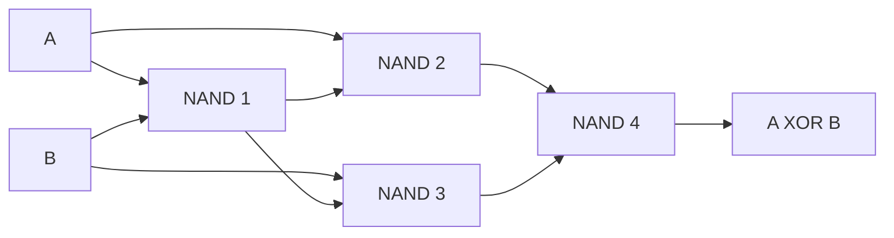

# Logic Gates and Truth Tables

<!-- BEGIN HEADER (generated by tools/build.py from the front matter; edit the front matter, not this block) -->
> [Home](../../../../README.md) › [Part I — Computer Science Foundations](../../index.md) › [1. Computer Fundamentals](../index.md) › [Chapter 4: Boolean logic](index.md)

- **Difficulty:** Beginner
- **Estimated time:** about 70 minutes
- **Prerequisites:** [Positional Number Systems](../02-number-systems/01-positional-number-systems.md) · [Binary Arithmetic](../02-number-systems/03-binary-arithmetic.md)
- **Syllabus topics covered:** `01.04.01` AND, OR, NOT · `01.04.02` NAND, NOR, XOR, XNOR · `01.04.03` Truth tables
- **Status:** Drafted (passes the automated checks; awaiting independent technical review). Last reviewed 2026-11-01.
<!-- END HEADER -->

## What you will learn

- Define the seven standard logic gates, and write the truth table of each.
- Read a truth table as a complete specification of a function, and say how many functions of $n$ inputs exist.
- Explain why NAND (or NOR) alone is enough to build any logic circuit, and demonstrate it.
- Connect gates to programming operators (`&&`, `&`, `^`) and to the adders from the [binary arithmetic lesson](../02-number-systems/03-binary-arithmetic.md).

## Introduction

A **logic gate** is a circuit that takes one or more binary inputs and produces a binary output determined entirely by those inputs. Gates are the atoms of digital hardware: a processor is billions of them wired together. The mathematics describing them is **Boolean logic**, named after the English mathematician George Boole, who in the 1840s and 1850s showed that reasoning about true and false could be written as algebra (*The Laws of Thought*, 1854). The decisive link to machines came in 1937, when Claude Shannon showed in his master's thesis (published in 1938) that Boolean algebra exactly describes networks of electrical switches, which is why we can design circuits on paper and be sure they will work.

Inside a chip a gate is built from transistors: an input voltage above a threshold counts as `1` (true), below it as `0` (false), and the gate's output is driven high or low according to its rule. You do not need electronics to use gates; you need only their truth tables.

## Intuitive understanding

Think of switches controlling a light.

- **AND**: two switches **in series**. Current flows, and the light is on, only if *both* are closed.
- **OR**: two switches **in parallel**. The light is on if *either* (or both) is closed.
- **NOT**: a switch that is closed when the input is off: it **inverts**.
- **XOR** (exclusive or): the **staircase light**, with a switch at the bottom and a switch at the top. Flipping *either* switch toggles the light, so it is on when exactly one switch is up.

A **truth table** simply lists the output for every possible combination of inputs. With $n$ inputs there are $2^n$ rows, and the table is a complete, unambiguous description of what the gate does.

## Technical foundations

### The standard gates

Values are `0` or `1`. In Boolean notation AND is written $A \cdot B$ or $AB$, OR is $A + B$, NOT is $\overline{A}$ or $A'$, and XOR is $A \oplus B$.

| A | B | AND | OR | NAND | NOR | XOR | XNOR |
|---|---|---|---|---|---|---|---|
| 0 | 0 | 0 | 0 | 1 | 1 | 0 | 1 |
| 0 | 1 | 0 | 1 | 1 | 0 | 1 | 0 |
| 1 | 0 | 0 | 1 | 1 | 0 | 1 | 0 |
| 1 | 1 | 1 | 1 | 0 | 0 | 0 | 1 |

| Gate | Output is 1 when | Plain English |
|---|---|---|
| NOT | the input is 0 | Inverts |
| AND | both inputs are 1 | "Both" |
| OR | at least one input is 1 | "Either or both" |
| NAND | not both inputs are 1 | "Not both" (AND followed by NOT) |
| NOR | neither input is 1 | "Neither" (OR followed by NOT) |
| XOR | the inputs differ | "Exactly one"; addition of two bits without a carry |
| XNOR | the inputs are equal | "Same"; the equality test for one bit |

The program below builds each gate and prints the combined table. It needs Python 3.10 or newer.

<!-- run:python -->
```python
def AND(a, b): return a & b
def OR(a, b): return a | b
def NOT(a): return a ^ 1
def NAND(a, b): return NOT(AND(a, b))
def NOR(a, b): return NOT(OR(a, b))
def XOR(a, b): return a ^ b
def XNOR(a, b): return NOT(XOR(a, b))


GATES = {"AND": AND, "OR": OR, "NAND": NAND, "NOR": NOR, "XOR": XOR, "XNOR": XNOR}
print("A B | " + " ".join(GATES))
for a in (0, 1):
    for b in (0, 1):
        print(f"{a} {b} | " + " ".join(f"{g(a, b):^{len(name)}}" for name, g in GATES.items()))
print("NOT:", NOT(0), NOT(1))
```

<!-- expect -->
```text
A B | AND OR NAND NOR XOR XNOR
0 0 |  0  0   1    1   0   1
0 1 |  0  1   1    0   1   0
1 0 |  0  1   1    0   1   0
1 1 |  1  1   0    0   0   1
NOT: 1 0
```

### Truth tables describe every function

A truth table for $n$ inputs has $2^n$ rows, and each row's output can independently be 0 or 1, so there are $2^{2^n}$ different functions of $n$ inputs. For two inputs that is 16. The program lists all 16, naming the ones that have names. Each row of the output shows the four outputs for the inputs $(A,B) = 00, 01, 10, 11$.

<!-- run:python -->
```python
NAMES = {
    "0000": "constant 0", "0001": "AND", "0010": "A AND NOT B", "0011": "A",
    "0100": "NOT A AND B", "0101": "B", "0110": "XOR", "0111": "OR",
    "1000": "NOR", "1001": "XNOR", "1010": "NOT B", "1011": "B IMPLIES A",
    "1100": "NOT A", "1101": "A IMPLIES B", "1110": "NAND", "1111": "constant 1",
}
print("outputs for (A,B) = 00 01 10 11")
for pattern in range(16):
    bits = format(pattern, "04b")
    print(bits, NAMES[bits])
print(2 ** (2 ** 2), 2 ** (2 ** 3), 2 ** (2 ** 4), 2 ** (2 ** 5))
```

<!-- expect -->
```text
outputs for (A,B) = 00 01 10 11
0000 constant 0
0001 AND
0010 A AND NOT B
0011 A
0100 NOT A AND B
0101 B
0110 XOR
0111 OR
1000 NOR
1001 XNOR
1010 NOT B
1011 B IMPLIES A
1100 NOT A
1101 A IMPLIES B
1110 NAND
1111 constant 1
16 256 65536 4294967296
```

The last line shows how fast the count grows: 16 functions of two inputs, 256 of three, 65,536 of four, and over four billion of five. That explosion is why designers do not enumerate functions; they build them from small, understood pieces.

### Combinational logic

A circuit whose output depends **only on its current inputs** is **combinational**. (Circuits with memory, where the output also depends on history, are *sequential* and use flip-flops; they are covered in [subject 3](../../../../docs/01-computer-science-foundations/03-digital-logic-and-computer-organization/index.md).) Gates are *not evaluated one after another* like lines of code: all gates operate at once, and a change at an input ripples through the circuit after a short **propagation delay**. Unlike the `&&` operator of most languages, a hardware AND gate has no short-circuit; it always examines both inputs.

### Universal gates

A set of gates is **functionally complete** if every Boolean function can be built from it. **NAND alone is complete**, and so is NOR alone. With NAND:

- NOT: $\overline{A} = A \text{ NAND } A$ (1 gate).
- AND: NAND followed by NOT (2 gates).
- OR: $A + B = \overline{\overline{A}\cdot\overline{B}} = (\text{NOT } A) \text{ NAND } (\text{NOT } B)$ (3 gates).
- XOR: four NAND gates, wired as below.



*Reading the diagram:* gate 1 computes the NAND of the inputs; gates 2 and 3 each combine one input with gate 1's output; gate 4 combines gates 2 and 3. Tracing the four input cases, or running the check below, shows that the output is 0 when A and B are equal and 1 when they differ. This is also why NAND is important in practice: a CMOS NAND gate needs only four transistors, whereas an AND gate is a NAND plus an inverter and needs six, so designs are often expressed, and manufactured, in NAND-heavy form.

<!-- run:python -->
```python
from itertools import product


def nand(a, b): return 1 - (a & b)
def not_(a): return nand(a, a)                  # 1 NAND gate
def and_(a, b): return not_(nand(a, b))         # 2 NAND gates
def or_(a, b): return nand(not_(a), not_(b))    # 3 NAND gates
def xor_(a, b):                                 # 4 NAND gates
    n = nand(a, b)
    return nand(nand(a, n), nand(b, n))


ok = all(
    not_(a) == 1 - a and and_(a, b) == (a & b) and or_(a, b) == (a | b) and xor_(a, b) == (a ^ b)
    for a, b in product((0, 1), repeat=2)
)
print("gates built only from NAND match the real ones:", ok)


def half_adder(a, b): return xor_(a, b), and_(a, b)


def full_adder(a, b, cin):
    s1, c1 = half_adder(a, b)
    s2, c2 = half_adder(s1, cin)
    return s2, or_(c1, c2)


print("A B Cin | Sum Cout")
for a, b, cin in product((0, 1), repeat=3):
    s, cout = full_adder(a, b, cin)
    print(f"{a} {b}  {cin}  |  {s}    {cout}")
```

<!-- expect -->
```text
gates built only from NAND match the real ones: True
A B Cin | Sum Cout
0 0  0  |  0    0
0 0  1  |  1    0
0 1  0  |  1    0
0 1  1  |  0    1
1 0  0  |  1    0
1 0  1  |  0    1
1 1  0  |  0    1
1 1  1  |  1    1
```

Because there are only four input combinations for two inputs, the first line is an **exhaustive proof**, not a sample: every gate built from NAND matches the real gate on every input. The second part builds the adders from the [binary arithmetic lesson](../02-number-systems/03-binary-arithmetic.md) out of those NAND-built gates. A **half adder** is an XOR (the sum bit) and an AND (the carry). A **full adder** chains two half adders and an OR. The printed table is exactly the "column sum" table from that lesson: for example $1 + 1 + 1$ gives sum 1 and carry 1. With a ripple of 64 full adders you have the adder of a 64-bit processor, and that is built from nothing but NAND gates.

## Real-world applications

- **Every digital chip.** Processors, memories and controllers are described as networks of gates (or higher-level blocks that synthesise into them) by hardware description languages.
- **FPGAs and lookup tables.** A small programmable logic cell stores a *truth table* in memory and looks the output up from the inputs, so a 4-input cell can implement any of the 65,536 four-input functions.
- **Programming.** Conditions in `if` statements are Boolean expressions. Bitwise operators apply a gate to every bit of a word at once: `a & b` is 32 or 64 AND gates in parallel, and `a ^ b` is XOR. `&&`, `||` and `!` work on whole truth values and *short-circuit*, which gates do not.
- **Error detection.** XOR computes parity and checksums ([error detection](../03-data-representation/02-error-detection-and-correction.md)).
- **Security and cryptography.** XOR with a key stream is the core of stream ciphers.

## Comparisons and trade-offs

| Operator family | Python | C | Works on | Short-circuits? |
|---|---|---|---|---|
| Logical | `and`, `or`, `not` | `&&`, `\|\|`, `!` | Whole truth values | Yes |
| Bitwise | `&`, `\|`, `^`, `~` | `&`, `\|`, `^`, `~` | Every bit of an integer | No |

The two families give different results on non-Boolean values: in Python, `not 5` is `False` but `~5` is `-6`, and in C, `2 && 1` is `1` while `2 & 1` is `0`. Hardware design also trades gate count against speed: a circuit may be made smaller by sharing gates, or faster by duplicating logic so that signals travel through fewer gates in sequence. The [simplification lesson](03-logic-simplification.md) shows how.

## Advanced concepts

- **Propagation delay and hazards.** Gates take time, and if two paths with different delays reconverge, the output can briefly glitch (a *hazard*) before settling. Designers add redundant logic or synchronise with clocks to make glitches harmless.
- **Fan-in and fan-out.** A real gate can accept only a limited number of inputs (*fan-in*) and drive a limited number of other gates (*fan-out*), so wide gates are built as trees of smaller ones.
- **CMOS implementation.** In CMOS technology each gate has a pull-up network and a pull-down network of transistors that are never both conducting, so (apart from switching) the gate draws almost no power, which is why chips can contain billions of gates.
- **Multi-valued and reversible logic.** Ternary logic and reversible gates (such as the Toffoli gate, which reappears in quantum computing, [subject 54](../../../../docs/10-specialized-software-engineering-domains/54-quantum-computing/index.md)) are research alternatives; ordinary hardware is binary and irreversible.

## Common mistakes

> **Common mistake:** *Confusing logical and bitwise operators.* `if (flags & MASK)` tests bits; `if (a && b)` tests truth values. In C, `a & b` where you meant `a && b` can be 0 even when both are non-zero.

- **Reading XOR as "or".** XOR is 0 when both inputs are 1.
- **Forgetting that NAND and NOR are not associative**: $(A \text{ NAND } B) \text{ NAND } C$ is not the same as $A \text{ NAND } (B \text{ NAND } C)$. Draw the circuit.
- **Assuming gates run in sequence** like statements.
- **Writing a truth table that skips rows.** For $n$ inputs there are exactly $2^n$ rows.
- **Confusing the symbol $+$** (OR) with arithmetic addition in Boolean algebra, where $1 + 1 = 1$.

## Exercises

**Beginner**

1. Write the truth table for $A \cdot \overline{B}$.
2. A gate outputs 1 only when its two inputs differ. Which gate is it? What about the gate that outputs 0 only when both inputs are 0?

**Intermediate**

3. Build XNOR from NAND gates and count the gates needed. (Hint: XNOR is NOT XOR.)
4. How many different Boolean functions are there of three inputs? How many have exactly one row with output 1?

**Advanced**

5. Design a three-input **majority** gate (output 1 when at least two inputs are 1). Write its truth table and a sum-of-products expression.
6. Extend the full adder to a 4-bit ripple adder from the NAND-built gates and check it against ordinary addition for all inputs.

**Expert**

7. Show that $\{\text{AND}, \text{OR}\}$ is **not** functionally complete.
8. Build a 2-input multiplexer (output $A$ if $S=0$, $B$ if $S=1$) from NAND gates and count the gates.

<details>
<summary>Solutions and hints</summary>

1. Output 1 only for $(A,B) = (1,0)$: rows `00`, `01`, `10`, `11` give `0`, `0`, `1`, `0`.
2. XOR. The second is OR.
3. XOR takes 4 NAND gates and the final NOT is one more (`NAND(x, x)`), so 5 gates.
4. $2^{2^3} = 256$ functions. Exactly one 1 among eight rows gives 8 functions.
5. Output is 1 for rows `011`, `101`, `110`, `111`. A sum of products is $A'BC + AB'C + ABC' + ABC$, which simplifies to $AB + AC + BC$ (the next lessons show how).
6. Chain four full adders passing the carry; loop over all $16 \times 16$ input pairs and compare with `(x + y) & 0xF` and `(x + y) >> 4`.
7. If every input is 0, any circuit made only of AND and OR gates outputs 0 (AND of zeros and OR of zeros are zeros, by induction on the circuit). So no AND/OR circuit can compute NOT, which outputs 1 when its input is 0.
8. $\text{MUX} = (A \cdot \overline{S}) + (B \cdot S)$. In NAND form: NAND(NAND(A, NOT S), NAND(B, S)), with $\overline{S}$ itself one more NAND, so 3 NAND gates for the core plus 1 for the inverter, 4 in total.

</details>

## Interview and practical questions

**What is a universal gate?** One that can build every other gate. NAND and NOR are universal.

**What is the difference between `&` and `&&`?** `&` is bitwise and works on every bit of integers; `&&` is logical, works on truth values and stops evaluating once the result is known.

**What does an XOR gate do?** It outputs 1 when exactly one input is 1: it is addition without carry and the one-bit inequality test. It is its own inverse, so XOR twice with the same value restores the original.

**How many truth-table rows does a gate with $n$ inputs have?** $2^n$.

**What is combinational logic?** Logic whose output depends only on the present inputs, with no memory.

## Further reading

**Research**

- George Boole, *An Investigation of the Laws of Thought* (1854).
- Claude E. Shannon, "A Symbolic Analysis of Relay and Switching Circuits", *Transactions of the American Institute of Electrical Engineers* (1938).

**Textbooks**

- Noam Nisan and Shimon Schocken, *The Elements of Computing Systems* (MIT Press), chapter 1: you build a computer's logic gates starting from NAND.
- Sarah L. Harris and David Harris, *Digital Design and Computer Architecture* (Morgan Kaufmann).
- David A. Patterson and John L. Hennessy, *Computer Organization and Design* (Morgan Kaufmann), the appendix on the basics of logic design.

**Official documentation for the code used here**

- Python: [boolean operations](https://docs.python.org/3/library/stdtypes.html#boolean-operations-and-or-not) and [`itertools.product`](https://docs.python.org/3/library/itertools.html#itertools.product).

<!-- BEGIN FOOTER (generated by tools/build.py) -->
---

## Related topics

- [Error Detection and Correction](../03-data-representation/02-error-detection-and-correction.md)

## Navigation

**Previous:** [Data Serialization](../03-data-representation/07-data-serialization.md) · **Up:** [Chapter 4: Boolean logic](index.md) · **Next:** [Boolean Algebra and De Morgan's Laws](02-boolean-algebra-and-de-morgans-laws.md)
<!-- END FOOTER -->
