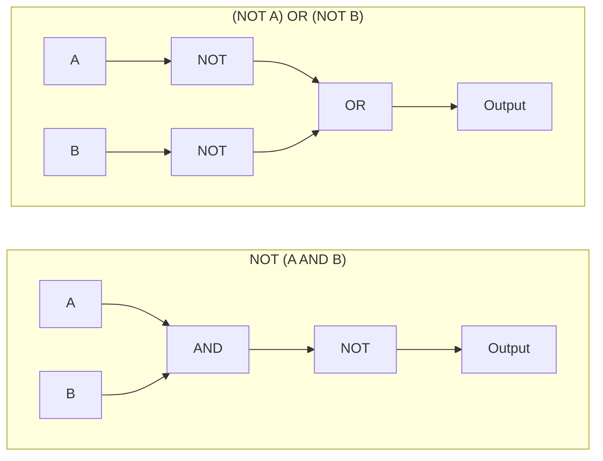

# Boolean Algebra and De Morgan's Laws

<!-- BEGIN HEADER (generated by tools/build.py from the front matter; edit the front matter, not this block) -->
> [Home](../../../../README.md) › [Part I — Computer Science Foundations](../../index.md) › [1. Computer Fundamentals](../index.md) › [Chapter 4: Boolean logic](index.md)

- **Difficulty:** Beginner to intermediate
- **Estimated time:** about 70 minutes
- **Prerequisites:** [Logic Gates and Truth Tables](01-logic-gates-and-truth-tables.md)
- **Syllabus topics covered:** `01.04.04` Boolean algebra · `01.04.05` De Morgan's laws
- **Status:** Drafted (passes the automated checks; awaiting independent technical review). Last reviewed 2026-11-01.
<!-- END HEADER -->

## What you will learn

- State the laws of Boolean algebra and use them to rewrite an expression without changing its meaning.
- State and apply De Morgan's laws, in logic circuits and in program conditions.
- Prove two expressions equivalent, both by truth table (exhaustively) and algebraically.
- Write any function as a sum of products (or product of sums) directly from its truth table.
- Recognise where the textbook rules need care in real code: short-circuiting, NaN and SQL's NULL.

## Introduction

The [previous lesson](01-logic-gates-and-truth-tables.md) described *what* gates compute. **Boolean algebra** gives the rules for reasoning about *expressions* made of them: which rewritings are safe, and which are not. It is ordinary algebra with unusual rules, because the variables take only the values 0 and 1. Its practical value is that you can transform a circuit or a condition into a cheaper, clearer or differently structured one, **and be certain** it still computes the same function.

Notation: AND is written as a product ($A \cdot B$ or $AB$), OR as a sum ($A + B$), and NOT as a prime ($A'$) or overline. Precedence mirrors arithmetic: NOT binds tightest, then AND, then OR, so $A + BC'$ means $A + (B \cdot (C'))$. In this algebra $1 + 1 = 1$.

## Intuitive understanding

A helpful picture is a Venn diagram: AND is the **overlap** of two sets, OR is their **union**, and NOT is everything **outside** a set. Every law below can be seen as a statement about shaded regions.

De Morgan's laws capture something you already do in language. "It is **not** the case that it is both raining **and** cold" means the same as "it is **not** raining, **or** it is **not** cold". Negating a combination turns *and* into *or* (and the reverse) and negates each part.

## Technical foundations

### The laws

Each law has an AND form and an OR form. The OR form is obtained by swapping AND with OR and 0 with 1; this is the **duality principle**: from any valid identity you get another valid one for free.

| Law | AND form | OR form |
|---|---|---|
| Identity | $A \cdot 1 = A$ | $A + 0 = A$ |
| Null (domination) | $A \cdot 0 = 0$ | $A + 1 = 1$ |
| Idempotent | $A \cdot A = A$ | $A + A = A$ |
| Complement | $A \cdot A' = 0$ | $A + A' = 1$ |
| Double negation | $(A')' = A$ | |
| Commutative | $AB = BA$ | $A + B = B + A$ |
| Associative | $(AB)C = A(BC)$ | $(A+B)+C = A+(B+C)$ |
| Distributive | $A(B + C) = AB + AC$ | $A + BC = (A+B)(A+C)$ |
| Absorption | $A(A + B) = A$ | $A + AB = A$ |
| De Morgan | $(AB)' = A' + B'$ | $(A + B)' = A'B'$ |
| Consensus | $(A+B)(A'+C)(B+C) = (A+B)(A'+C)$ | $AB + A'C + BC = AB + A'C$ |

The second distributive law, $A + BC = (A+B)(A+C)$, has no counterpart in ordinary arithmetic and is the one beginners overlook.

### De Morgan's laws

Named after the British mathematician Augustus De Morgan (who presented them in his *Formal Logic*, 1847), the laws say:

$$
\overline{A \cdot B} = \overline{A} + \overline{B}, \qquad \overline{A + B} = \overline{A} \cdot \overline{B}
$$

They extend to any number of terms: the complement of an AND of $n$ terms is the OR of their complements. A truth table proves them:

| A | B | $\overline{AB}$ | $\overline{A} + \overline{B}$ | $\overline{A+B}$ | $\overline{A}\,\overline{B}$ |
|---|---|---|---|---|---|
| 0 | 0 | 1 | 1 | 1 | 1 |
| 0 | 1 | 1 | 1 | 0 | 0 |
| 1 | 0 | 1 | 1 | 0 | 0 |
| 1 | 1 | 0 | 0 | 0 | 0 |

In circuit terms a NAND gate is an OR gate with inverted inputs, and a NOR gate is an AND gate with inverted inputs. Moving an inverter from the output of a gate to its inputs while switching AND and OR is called **bubble pushing**.



*Reading the diagram:* the two circuits compute exactly the same function. The left one is a NAND gate; the right one needs two inverters, which is why designers prefer the NAND form.

### Proving equivalence

There are two methods:

1. **Perfect induction** (truth table): check all $2^n$ input combinations. It is mechanical and always works, but the cost doubles with every variable.
2. **Algebraic derivation**: transform one side into the other using the laws. For example, to show $A + A'B = A + B$:

$$
A + A'B = (A + A')(A + B) = 1 \cdot (A + B) = A + B
$$

using the second distributive law, then the complement and identity laws. Another: $AB + AB' = A(B + B') = A \cdot 1 = A$ (the *combining* law).

The program checks every law above by perfect induction, and confirms that a tempting *wrong* rewriting is caught. It needs Python 3.10 or newer.

<!-- run:python -->
```python
from itertools import product


def equivalent(f, g, n):
    """True if f and g agree on every one of the 2**n input combinations."""
    return all(f(*v) == g(*v) for v in product((0, 1), repeat=n))


NOT = lambda a: 1 - a
LAWS = {
    "identity":           (lambda a: a | 0, lambda a: a, 1),
    "null (domination)":  (lambda a: a | 1, lambda a: 1, 1),
    "idempotent":         (lambda a: a & a, lambda a: a, 1),
    "complement":         (lambda a: a | NOT(a), lambda a: 1, 1),
    "double negation":    (lambda a: NOT(NOT(a)), lambda a: a, 1),
    "commutative":        (lambda a, b: a & b, lambda a, b: b & a, 2),
    "associative":        (lambda a, b, c: (a | b) | c, lambda a, b, c: a | (b | c), 3),
    "distributive (and over or)": (lambda a, b, c: a & (b | c), lambda a, b, c: (a & b) | (a & c), 3),
    "distributive (or over and)": (lambda a, b, c: a | (b & c), lambda a, b, c: (a | b) & (a | c), 3),
    "absorption":         (lambda a, b: a | (a & b), lambda a, b: a, 2),
    "De Morgan (and)":    (lambda a, b: NOT(a & b), lambda a, b: NOT(a) | NOT(b), 2),
    "De Morgan (or)":     (lambda a, b: NOT(a | b), lambda a, b: NOT(a) & NOT(b), 2),
    "consensus":          (lambda a, b, c: (a & b) | (NOT(a) & c) | (b & c),
                           lambda a, b, c: (a & b) | (NOT(a) & c), 3),
    "absorb the negation": (lambda a, b: a | (NOT(a) & b), lambda a, b: a | b, 2),
}
for name, (f, g, n) in LAWS.items():
    print(f"{name:<28} {equivalent(f, g, n)}")
print("NOT(a AND b) == NOT(a) AND NOT(b)?", equivalent(lambda a, b: NOT(a & b), lambda a, b: NOT(a) & NOT(b), 2))
print("bitwise De Morgan holds for every pair of bytes:", all(~(a & b) == (~a | ~b) for a in range(256) for b in range(256)))
```

<!-- expect -->
```text
identity                     True
null (domination)            True
idempotent                   True
complement                   True
double negation              True
commutative                  True
associative                  True
distributive (and over or)   True
distributive (or over and)   True
absorption                   True
De Morgan (and)              True
De Morgan (or)               True
consensus                    True
absorb the negation          True
NOT(a AND b) == NOT(a) AND NOT(b)? False
bitwise De Morgan holds for every pair of bytes: True
```

Every law holds on every input. The next-to-last line shows the most common wrong rewriting, "distributing" a NOT over an AND without flipping it to an OR. It is **not** equivalent, and the exhaustive check says so. The last line confirms that De Morgan's law also works bit by bit on whole integers. Because the input space is finite, these are proofs, not tests: the number of cases is $2^n$, which is trivial for $n = 3$ but impossible by brute force for, say, $n = 64$, where algebra or specialised solvers are needed.

### Normal forms: from truth table to expression

Any function can be written directly from its truth table:

- A **minterm** is an AND of every variable (or its complement) that is 1 for exactly one row. The **canonical sum of products** (SOP) ORs the minterms of all rows where the output is 1. For XOR: $A'B + AB'$.
- A **maxterm** is an OR of every variable (or complement) that is 0 for exactly one row. The **product of sums** (POS) ANDs the maxterms of all rows where the output is 0. For XOR: $(A + B)(A' + B')$.

<!-- run:python -->
```python
from itertools import product


def canonical_sop(f, names):
    """Sum of minterms: one product term for each input row where f is 1."""
    terms = []
    for values in product((0, 1), repeat=len(names)):
        if f(*values):
            terms.append("".join(n if v else n + "'" for n, v in zip(names, values)))
    return " + ".join(terms) if terms else "0"


print(canonical_sop(lambda a, b: a ^ b, "AB"))
print(canonical_sop(lambda a, b, c: (a + b + c) >= 2, "ABC"))     # three-input majority

# Transforming a program condition with De Morgan's law, and proving the result equivalent
original = lambda a, b, c: not (a or (b and not c))
rewritten = lambda a, b, c: (not a) and ((not b) or c)
print(all(original(*v) == rewritten(*v) for v in product((False, True), repeat=3)))

# With comparisons, NaN breaks the "obvious" rewrite not (x > 0) == (x <= 0)
x = float("nan")
print("NaN:  not (x > 0) ->", not (x > 0), "  x <= 0 ->", x <= 0)
y = 5.0
print("5.0:  not (y > 0) ->", not (y > 0), "  y <= 0 ->", y <= 0)
```

<!-- expect -->
```text
A'B + AB'
A'BC + AB'C + ABC' + ABC
True
NaN:  not (x > 0) -> True   x <= 0 -> False
5.0:  not (y > 0) -> False   y <= 0 -> False
```

The first two lines are the canonical SOPs of XOR and of the three-input majority function (output 1 when at least two inputs are 1). They are *correct* but not *minimal*: the majority function can be written $AB + AC + BC$, which the [next lesson](03-logic-simplification.md) derives. The third line proves the De Morgan rewriting $\lnot(a \lor (b \land \lnot c)) = \lnot a \land (\lnot b \lor c)$ of a program condition. The last two lines show the important caveat: the Boolean rules assume values that are *true or false*. For floating-point numbers, comparisons with NaN are all false (see the [floating-point lesson](../02-number-systems/05-floating-point-and-ieee-754.md)), so `not (x > 0)` and `x <= 0` differ for NaN even though they agree for every ordinary number.

### Two-level NAND circuits

Because a NAND gate is an OR of inverted inputs, De Morgan's law gives a standard construction: **any sum of products can be built from NAND gates in two levels**. For $AB + CD$:

$$
AB + CD = \overline{\overline{AB} \cdot \overline{CD}} = \text{NAND}\bigl(\text{NAND}(A,B),\ \text{NAND}(C,D)\bigr)
$$

The first level of NANDs plays the role of the AND gates, and the final NAND does the OR. This is the reason programmable logic and many standard-cell designs favour NAND-NAND structures.

## Real-world applications

- **Compilers and query optimisers** apply Boolean identities (De Morgan, absorption, constant folding) to simplify conditions and predicates, for instance rewriting `NOT (a AND b)` into a form an index can use.
- **Hardware synthesis tools** take a function described in a hardware description language and transform it algebraically into gates, then check that the optimised circuit is equivalent to the original.
- **Software conditions and permissions.** Complex rules for feature flags, access control and validation are Boolean expressions; simplifying and *proving* them equivalent prevents mistakes.
- **Formal verification and SAT solving.** Whether a Boolean formula can ever be true (the *satisfiability* problem, SAT) is the heart of automated reasoning, and modern SAT solvers handle formulas with millions of variables ([subject 64](../../../../docs/12-professional-engineering-practices/64-research-and-advanced-computer-science/index.md)).

## Advanced concepts

- **Short-circuit evaluation and side effects.** The algebra says nothing about *order*. In `x != 0 and 10 / x > 2`, the left operand guards the right one. A "simplified" rewriting that evaluates `10 / x` first would crash. De Morgan transformations preserve the value, not necessarily the evaluation order or the side effects.
- **Three-valued logic in SQL.** With `NULL`, a condition can be true, false or unknown. De Morgan's laws still hold, but the **law of excluded middle does not**: `x = 1 OR NOT (x = 1)` is unknown, not true, when `x` is `NULL`, so a query using it can silently drop rows.
- **Binary decision diagrams.** A BDD (introduced for this purpose by Randal Bryant in 1986) is a canonical graph representation of a Boolean function, so two functions are equivalent exactly when they produce the same diagram. It scales to far larger circuits than truth tables, though it can still blow up on some functions.
- **Complexity.** Checking whether two Boolean expressions are equivalent is, in general, a hard problem (it contains the tautology problem, which is co-NP-complete), which is why there is no simple formula for "the" minimal circuit.
- **Abstract view.** Boolean algebra is the algebra of any set with union, intersection and complement; the same laws hold for sets, for propositions and for bit patterns.

## Comparisons and trade-offs

| Technique | Strength | Weakness |
|---|---|---|
| Truth table (perfect induction) | Always correct; easy to automate | $2^n$ rows; hopeless for large $n$ |
| Algebraic derivation | Works for any number of variables; gives insight | Needs skill; a wrong step is easy to make |
| Sum of products | Direct from a truth table; maps to two-level logic | Often far from minimal |
| Product of sums | Natural when few outputs are 0 | Same |
| BDDs and SAT solvers | Scale to very large functions | Heavier machinery; worst cases exist |

## Common mistakes

> **Common mistake:** *Applying NOT without flipping the operator.* $\overline{A \cdot B}$ is $\overline{A} + \overline{B}$, never $\overline{A} \cdot \overline{B}$. The exhaustive check above shows the difference.

- **Forgetting the second distributive law**, and so missing simplifications such as $(A+B)(A+C) = A + BC$.
- **Treating $+$ as arithmetic addition.** In Boolean algebra $A + A = A$.
- **Mis-parsing precedence.** $A + BC$ is not $(A + B)C$.
- **Rewriting program conditions without considering short-circuiting, NaN, or NULL.**
- **Trusting a rewriting that was only tried on a few inputs.** Prove it, by exhaustive check or algebra.

## Exercises

**Beginner**

1. Apply De Morgan's law to $\overline{A \cdot \overline{B}}$ and to $\overline{A + B + C}$.
2. Negate the condition `x > 3 or y == 0` and write it with `and`. (Assume no NaN.)

**Intermediate**

3. Prove the absorption law $A + AB = A$ algebraically.
4. Simplify $(A + B)(A + B')$ using the second distributive law.

**Advanced**

5. Write $\overline{AB + CD}$ as a product of sums, and give a two-level NAND circuit for $AB + CD$.
6. Prove the consensus theorem $AB + A'C + BC = AB + A'C$ algebraically, and explain why the term $BC$ is redundant.

**Expert**

7. Use the duality principle to derive the OR form of the absorption law from the AND form, and explain why duality is valid (hint: what happens to a truth table when all inputs and the output are inverted?).
8. The consensus term $BC$ is logically redundant. Explain why a circuit designer might keep it anyway.

<details>
<summary>Solutions and hints</summary>

1. $\overline{A \cdot \overline{B}} = \overline{A} + B$ and $\overline{A + B + C} = \overline{A}\,\overline{B}\,\overline{C}$.
2. `x <= 3 and y != 0`, valid when $x$ is not NaN.
3. $A + AB = A \cdot 1 + A \cdot B = A(1 + B) = A \cdot 1 = A$.
4. $(A + B)(A + B') = A + BB' = A + 0 = A$.
5. $\overline{AB + CD} = \overline{AB}\cdot\overline{CD} = (A' + B')(C' + D')$. NAND form: $\text{NAND}(\text{NAND}(A,B), \text{NAND}(C,D))$.
6. $BC = BC(A + A') = ABC + A'BC$. The term $ABC$ is absorbed by $AB$, and $A'BC$ is absorbed by $A'C$. So $BC$ adds nothing: whenever $BC$ is 1, either $A = 1$ (so $AB = 1$) or $A = 0$ (so $A'C = 1$).
7. From $A(A + B) = A$ swap AND and OR to get $A + AB = A$. Duality works because inverting every input and the output of a function turns each AND into an OR and vice versa, mapping a valid identity to another valid identity.
8. When $A$ switches while $B = C = 1$, the two product terms $AB$ and $A'C$ can both be momentarily 0 because of unequal gate delays, causing a brief false 0 (a *static hazard*). The redundant term $BC$ stays 1 throughout and covers the gap.

</details>

## Interview and practical questions

**State De Morgan's laws.** The complement of a conjunction is the disjunction of the complements, and the complement of a disjunction is the conjunction of the complements.

**How would you simplify `!(a && !b)`?** `!a || b`, by De Morgan and double negation.

**How can you prove two Boolean expressions are equivalent?** Check every input combination (truth table), or transform one into the other with the algebraic laws.

**What is a sum of products?** An OR of AND terms; any truth table can be written this way with one minterm per row where the output is 1.

**Why is NAND-NAND logic equivalent to AND-OR logic?** By De Morgan, an OR of inverted terms is the NAND of the terms, so the two NAND levels together compute a sum of products.

## Further reading

**Research and classic texts**

- George Boole, *An Investigation of the Laws of Thought* (1854).
- Augustus De Morgan, *Formal Logic: or, The Calculus of Inference, Necessary and Probable* (1847).
- Randal E. Bryant, "Graph-Based Algorithms for Boolean Function Manipulation", *IEEE Transactions on Computers* (1986).

**Textbooks**

- Donald E. Knuth, *The Art of Computer Programming, Volume 4A* (Addison-Wesley), section 7.1 on Boolean functions.
- Sarah L. Harris and David Harris, *Digital Design and Computer Architecture* (Morgan Kaufmann), the chapter on combinational logic design.

**Official documentation for the code used here**

- Python: [`itertools.product`](https://docs.python.org/3/library/itertools.html#itertools.product) and [comparison operators](https://docs.python.org/3/reference/expressions.html#comparisons).

<!-- BEGIN FOOTER (generated by tools/build.py) -->
---

## Related topics

- [Floating-Point Representation and IEEE 754](../02-number-systems/05-floating-point-and-ieee-754.md)

## Navigation

**Previous:** [Logic Gates and Truth Tables](01-logic-gates-and-truth-tables.md) · **Up:** [Chapter 4: Boolean logic](index.md) · **Next:** [Logic Simplification](03-logic-simplification.md)
<!-- END FOOTER -->
