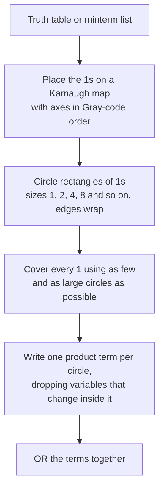

# Logic Simplification

<!-- BEGIN HEADER (generated by tools/build.py from the front matter; edit the front matter, not this block) -->
> [Home](../../../../README.md) › [Part I — Computer Science Foundations](../../index.md) › [1. Computer Fundamentals](../index.md) › [Chapter 4: Boolean logic](index.md)

- **Difficulty:** Intermediate
- **Estimated time:** about 80 minutes
- **Prerequisites:** [Boolean Algebra and De Morgan's Laws](02-boolean-algebra-and-de-morgans-laws.md) · [Positional Number Systems](../02-number-systems/01-positional-number-systems.md)
- **Syllabus topics covered:** `01.04.06` Logic simplification
- **Status:** Drafted (passes the automated checks; awaiting independent technical review). Last reviewed 2026-11-01.
<!-- END HEADER -->

## What you will learn

- Explain why a smaller Boolean expression matters, in hardware and in software.
- Use the vocabulary of minimisation: minterm, implicant, prime implicant, essential prime implicant and don't-care condition.
- Simplify a function by hand with a Karnaugh map, and explain why the map uses Gray-code ordering.
- Run and read the Quine-McCluskey algorithm, and use don't-care conditions to get a smaller result.
- Recognise the limits: minimal forms need not be unique, and the general problem is computationally hard.

## Introduction

The [previous lesson](02-boolean-algebra-and-de-morgans-laws.md) showed that a function written straight from its truth table, the canonical sum of products, is correct but wasteful. The three-input majority function needs four terms of three variables each (12 literals), yet it can be written $AB + AC + BC$ with 6. **Simplification** (or *minimisation*) finds an equivalent expression that is as small as possible.

Why it matters:

- **Hardware.** Every gate costs silicon area, power and delay. A smaller expression means a cheaper, cooler and often faster circuit.
- **Software.** A simpler condition is easier to read, test and get right, and compilers and database optimisers use the same ideas to simplify predicates.
- **Understanding.** Reducing a rule to its essential terms often reveals what it really says.

Three tools are in common use: the laws of Boolean algebra (flexible but ad hoc), **Karnaugh maps** (a visual method for up to about four or five variables), and **algorithms** such as Quine-McCluskey (systematic, and the basis of tools that handle larger problems).

## Intuitive understanding

The central trick is the **combining law**: $AB + AB' = A$. Two product terms that are identical except for one variable, which appears true in one and false in the other, merge into a single, smaller term in which that variable has disappeared. Simplification is the art of finding such pairs, then pairs of pairs, as widely as possible.

A Karnaugh map arranges the truth table on a grid so that cells which can be combined are *physically adjacent*. You then draw boxes around neighbouring 1s and read off the result.

## Technical foundations

### Vocabulary

| Term | Meaning |
|---|---|
| **Minterm** | A product that contains every variable (true or complemented) and is 1 for exactly one input row |
| **Implicant** | A product term that implies the function: whenever it is 1, so is the function. A group of adjacent 1s |
| **Prime implicant** | An implicant that cannot be made smaller by removing a variable: a group of 1s that cannot be enlarged |
| **Essential prime implicant** | A prime implicant that alone covers some minterm, so every minimal solution must include it |
| **Don't care** | An input combination whose output does not matter, because it never occurs or the result is not used |

A minimal sum of products consists of prime implicants that together cover every required 1. We measure cost in **literals** (appearances of a variable) or in **terms** (products).

### Karnaugh maps

A **Karnaugh map** (K-map; Maurice Karnaugh, 1953, building on a similar chart by Edward Veitch) is a truth table laid out in a grid. The key rule: **the row and column labels follow Gray-code order** (`00, 01, 11, 10`, not `00, 01, 10, 11`; see the [Gray code](../02-number-systems/01-positional-number-systems.md) in the number-systems lesson). In Gray order neighbouring labels differ in one variable, so adjacent cells are minterms that differ in exactly one variable, precisely the pairs that the combining law can merge. The edges **wrap around**: the top row is adjacent to the bottom row and the left column to the right column.

The three-variable **majority** function (1 when at least two of $A, B, C$ are 1) has minterms 3, 5, 6 and 7:

| $A \backslash BC$ | 00 | 01 | 11 | 10 |
|---|---|---|---|---|
| 0 | 0 | 0 | 1 | 0 |
| 1 | 0 | 1 | 1 | 1 |

Draw boxes around groups of 1s. Each group must be a rectangle whose size is a power of two (1, 2, 4, 8, ...), and bigger groups are better. Here the groups are:

- the column $BC = 11$ (cells 3 and 7): $A$ changes inside the group, so it drops out, leaving $BC$;
- the bottom row's cells $BC = 01, 11$ (cells 5 and 7): $B$ changes, leaving $AC$;
- the bottom row's cells $BC = 11, 10$ (cells 7 and 6): $C$ changes, leaving $AB$.

The result is $AB + AC + BC$. The rule for reading a group: **a variable that takes both values inside the group disappears; a variable that stays constant stays, true if it is 1 and complemented if it is 0.**



### Don't cares

Sometimes some input combinations can never happen. A decimal digit stored in 4 bits (**BCD**) uses only the codes 0 to 9, so inputs 10 to 15 never occur. Whatever the circuit outputs for them is irrelevant, so we may treat each as 0 *or* 1, whichever helps most. In a K-map, a don't care is written `X` and may be included in a group, but need not be covered.

Consider "is this BCD digit 5 or more?" with $A$ the most significant bit. The 1s are digits 5 to 9, and 10 to 15 are don't cares:

| $AB \backslash CD$ | 00 | 01 | 11 | 10 |
|---|---|---|---|---|
| 00 | 0 | 0 | 0 | 0 |
| 01 | 0 | 1 | 1 | 1 |
| 11 | X | X | X | X |
| 10 | 1 | 1 | X | X |

Three large groups, each using don't cares freely, cover every 1:

- the bottom two rows (all eight cells with $A = 1$): just $A$;
- the $2 \times 2$ block with $B = 1$ and $C = 1$: $BC$;
- the $2 \times 2$ block with $B = 1$ and $D = 1$: $BD$.

The result is $A + BC + BD$: five literals. Without don't cares the same 1s need much more logic, as the code below shows.

### The Quine-McCluskey algorithm

K-maps are visual, so they stop working beyond about five variables. The **Quine-McCluskey** method (W. V. Quine, 1952, and Edward J. McCluskey, 1956) is the same idea as a procedure a computer can run:

1. List every minterm (and don't care) as a binary number.
2. Repeatedly **merge** any two implicants that differ in exactly one bit, replacing that bit with a dash. Implicants that cannot be merged any further are the **prime implicants**.
3. Choose a smallest set of prime implicants that **covers every required minterm** (the don't cares need no cover). Essential prime implicants must be included; the rest is a covering problem.

For the majority function: merging 3 (`011`) with 7 (`111`) gives `-11` ($BC$), 5 (`101`) with 7 gives `1-1` ($AC$), and 6 (`110`) with 7 gives `11-` ($AB$). Nothing merges further, so these three primes are the answer, and all three are essential.

## Step-by-step working in code

The program implements Quine-McCluskey. An implicant is a pair `(value, mask)`: the `mask` bits are the dashes (variables that have been eliminated), and the `value` bits give the remaining variables. The `simplify` function finds the cover with the fewest terms and then the fewest literals, and **checks its own answer against the specification** for every input. It needs Python 3.10 or newer.

<!-- run:python -->
```python
from itertools import combinations


def combine(a, b):
    """Merge two implicants (value, mask) that differ in exactly one specified bit."""
    (va, ma), (vb, mb) = a, b
    diff = va ^ vb
    if ma == mb and diff and diff & (diff - 1) == 0 and not diff & ma:
        return (va & vb, ma | diff)       # that bit becomes a "don't care" (a dash)
    return None


def prime_implicants(minterms, dont_cares):
    current = {(m, 0) for m in set(minterms) | set(dont_cares)}
    primes = set()
    while current:
        used, merged = set(), set()
        for a, b in combinations(sorted(current), 2):
            c = combine(a, b)
            if c:
                merged.add(c)
                used.update((a, b))
        primes |= current - used          # implicants that could not be merged any further
        current = merged
    return primes


def covers(implicant, m):
    value, mask = implicant
    return (m & ~mask) == value


def term(implicant, names):
    value, mask = implicant
    n = len(names)
    out = []
    for i, name in enumerate(names):
        bit = 1 << (n - 1 - i)
        if not mask & bit:
            out.append(name if value & bit else name + "'")
    return "".join(out) or "1"


def literals(implicant, n):
    return n - bin(implicant[1]).count("1")


def simplify(minterms, names, dont_cares=()):
    """Minimal sum of products: fewest terms, then fewest literals."""
    n = len(names)
    primes = sorted(prime_implicants(minterms, dont_cares))
    best = None
    for r in range(1, len(primes) + 1):
        for subset in combinations(primes, r):
            if all(any(covers(p, m) for p in subset) for m in minterms):
                cost = sum(literals(p, n) for p in subset)
                if best is None or cost < best[0]:
                    best = (cost, subset)
        if best:
            break
    cover = best[1]
    for m in range(2 ** n):               # verify against the specification
        if m not in dont_cares:
            assert any(covers(p, m) for p in cover) == (m in minterms)
    return " + ".join(sorted(term(p, names) for p in cover)), best[0]


def show(label, minterms, names, dont_cares=()):
    expression, literal_count = simplify(minterms, names, dont_cares)
    print(f"{label:<38} {expression}   ({literal_count} literals)")


show("majority of three", [3, 5, 6, 7], "ABC")
show("XOR", [1, 2], "AB")
show("A OR B", [1, 2, 3], "AB")
show("digit is 5 or more (BCD)", [5, 6, 7, 8, 9], "ABCD", dont_cares=[10, 11, 12, 13, 14, 15])
show("same, ignoring the don't cares", [5, 6, 7, 8, 9], "ABCD")
show("minterms 0,1,2,5,6,7,8,9,10,14", [0, 1, 2, 5, 6, 7, 8, 9, 10, 14], "ABCD")
print("canonical majority uses", 4 * 3, "literals; the minimal form uses", simplify([3, 5, 6, 7], "ABC")[1])
```

<!-- expect -->
```text
majority of three                      AB + AC + BC   (6 literals)
XOR                                    A'B + AB'   (4 literals)
A OR B                                 A + B   (2 literals)
digit is 5 or more (BCD)               A + BC + BD   (5 literals)
same, ignoring the don't cares         A'BC + A'BD + AB'C'   (9 literals)
minterms 0,1,2,5,6,7,8,9,10,14         A'BD + B'C' + CD'   (7 literals)
canonical majority uses 12 literals; the minimal form uses 6
```

Walking through it: for the majority function the merging step produces exactly the three primes found by hand, and the output halves the literal count from 12 to 6. XOR cannot be simplified at all: its two minterms differ in *two* variables, so no pair merges, and the answer is the canonical form. For $A + B$ the minterms 1, 2, 3 merge into the two single-variable primes. The BCD example is the instructive one. **With the don't cares, the function is $A + BC + BD$ (5 literals); without them it needs 9.** Declaring that inputs 10 to 15 cannot occur removed almost two thirds of the logic. The last line is a four-variable function whose map you can check by hand: the cell groups $B'C'$ (minterms 0, 1, 8, 9), $CD'$ (2, 6, 10, 14) and $A'BD$ (5, 7) cover all ten minterms and nothing else.

**How it works and its cost.** Merging repeats until nothing combines; with $n$ variables there are at most $2^n$ minterms, and the number of prime implicants can grow exponentially, so the algorithm is practical for roughly ten or fewer variables. The cover step here is an exhaustive search over subsets of the primes, which is fine for small examples but exponential in the worst case; real tools use smarter covering methods. **Edge cases:** an empty list of minterms is the constant 0 (not handled by this teaching code), and a function that is 1 everywhere simplifies to the single term `1`.

## Real-world applications

- **Hardware synthesis.** Tools turn a hardware description into gates. Classic two-level minimisers such as **Espresso** (developed at the University of California, Berkeley, in the 1980s) use heuristics instead of exhaustive search so that they scale to large functions, and modern flows also optimise multi-level logic and map it onto the target technology.
- **FPGAs.** A programmable logic cell stores a function's truth table in a small memory (a lookup table), so minimisation matters less *inside* a cell than in how the design is partitioned across cells.
- **Software.** Compilers simplify conditions, query optimisers simplify predicates, and decision tables in business rules are minimised the same way. For a hand-written condition with a handful of variables, writing the truth table and simplifying it is a reliable way to remove a tangle of nested `if` statements, and the exhaustive check from the previous lesson then proves nothing changed.
- **Verification.** After optimisation, equivalence checking confirms that the simplified circuit matches the original.

## Comparisons and trade-offs

| Method | Variables it suits | Strengths | Weaknesses |
|---|---|---|---|
| Algebraic laws | Any, in principle | Flexible; explains *why* | No guarantee of minimality; needs skill |
| Karnaugh map | Up to about 4 or 5 | Fast and visual by hand | Does not scale; easy to miss a wrap-around group |
| Quine-McCluskey | About 10 or fewer | Systematic; guarantees a minimal cover | Exponential time and memory |
| Heuristic tools (Espresso and similar) | Hundreds or more | Scale to real designs | May not find the true minimum |

A smaller expression is not always the best circuit. Sharing sub-expressions between outputs can cost fewer gates in total than minimising each output alone. **Factoring** ($AB + AC = A(B + C)$) reduces literals but adds a level of logic, so it saves area and costs delay; and a redundant term such as the consensus term can be worth *keeping* to avoid a timing glitch.

## Advanced concepts

- **Non-unique answers.** A function can have several different minimal expressions of equal cost (see exercise 7), so "the" minimal form is a slight misnomer.
- **Computational hardness.** Finding a minimum sum of products is computationally hard in general; the covering step is a set-cover problem. That is why large-scale tools settle for good, not provably optimal, results.
- **Multi-output and multi-level logic.** Real circuits have many outputs sharing logic, and many levels. Tools such as ABC and Yosys optimise whole networks.
- **Product-of-sums minimisation.** Mapping the 0s instead of the 1s, and complementing, yields a minimal product of sums, which can be smaller when few outputs are 0.
- **Static and dynamic hazards.** As noted in the previous lesson, removing every redundancy can create a glitch when one input changes; careful design adds back selected redundant terms.

## Common mistakes

> **Common mistake:** *Using ordinary binary order on a K-map's axes.* Labels must follow Gray code (`00, 01, 11, 10`). With binary order, adjacent cells may differ in two variables and the grouping rule silently fails.

- **Groups whose size is not a power of two**, or groups that are not rectangles (diagonals do not count).
- **Forgetting that the edges wrap around**, and so missing the largest groups.
- **Making groups too small.** A bigger group means fewer literals; always enlarge a group until it cannot grow.
- **Treating don't cares as required.** Include them in groups to enlarge them, but do not insist on covering them.
- **Stopping at the canonical form**, or assuming that the first simplification found is minimal.
- **Simplifying a condition in code without checking it exhaustively**, especially when the original had short-circuit order or side effects.

## Exercises

**Beginner**

1. Simplify $f(A,B) = A'B + AB$ using the combining law.
2. Draw the K-map for $f(A,B,C) = \Sigma m(0,1,2,3,6)$ and simplify it.

**Intermediate**

3. Explain why the K-map's column labels must be `00, 01, 11, 10`, using the Gray code.
4. Why does the BCD "5 or more" example have so many fewer literals with don't cares?

**Advanced**

5. Use the program to find the minimal sum of products of $\Sigma m(0,2,3,4,5,6)$ and confirm it by hand.
6. Modify `simplify` so that it also tries to *reduce literals first* rather than terms, and compare the two policies on the examples.

**Expert**

7. Show that $f = \Sigma m(0,1,2,5,6,7)$ has two different minimal sums of products. (Hint: list its six prime implicants.)
8. Show that the exhaustive covering search is exponential, and describe how you would reduce it (essential primes first, then dominance).

<details>
<summary>Solutions and hints</summary>

1. $A'B + AB = (A' + A)B = B$.
2. The 1s are minterms 0, 1, 2, 3 (all of row $A = 0$) and 6. The first four give $A'$; minterm 6 ($110$) combines with minterm 2 ($010$) to give $BC'$. The result is $A' + BC'$ (3 literals).
3. Neighbouring labels must differ in exactly one variable so that adjacent cells are minterms that can be merged by the combining law. Binary order would put `01` next to `10`, which differ in two variables.
4. Inputs 10 to 15 never occur, so they can be treated as 1 wherever that enlarges a group. Larger groups eliminate more variables.
5. The program gives $A'B + AB' + C'$ (5 literals). By hand: the four cells with $C = 0$ (minterms 0, 2, 4, 6) give $C'$. Minterm 3 pairs with minterm 2 to give $A'B$, and minterm 5 pairs with minterm 4 to give $AB'$.
6. Compute the cost first and break ties by term count; for most small functions both policies agree, and they differ where a cover with more terms has fewer literals in total.
7. The prime implicants are $A'B'$, $A'C'$, $B'C$, $BC'$, $AC$ and $AB$. The covers $A'B' + BC' + AC$ and $A'C' + B'C + AB$ each use three terms and six literals and each cover exactly $\{0,1,2,5,6,7\}$.
8. With $p$ primes there are $2^p$ subsets. Take the essential primes first (they must be in every cover), delete the minterms they cover, and discard dominated primes and columns; the remainder is often small enough to search.

</details>

## Interview and practical questions

**What is a Karnaugh map?** A grid arrangement of a truth table, with Gray-code axes, in which groups of adjacent 1s correspond to simplified product terms.

**What are don't cares and why are they useful?** Inputs whose output is irrelevant; treating them as 0 or 1 as convenient lets groups grow larger, which gives smaller circuits.

**What is a prime implicant?** A product term that implies the function and cannot be shrunk by removing a variable.

**Why not always use Quine-McCluskey?** The number of prime implicants and the covering problem grow exponentially, so large designs use heuristic minimisers.

**Is the minimal expression unique?** Not necessarily; different covers can have the same cost.

## Further reading

**Research**

- Maurice Karnaugh, "The Map Method for Synthesis of Combinational Logic Circuits", *Transactions of the American Institute of Electrical Engineers* (1953).
- W. V. Quine, "The Problem of Simplifying Truth Functions", *The American Mathematical Monthly* (1952).
- E. J. McCluskey, "Minimization of Boolean Functions", *Bell System Technical Journal* (1956).
- Robert K. Brayton, Gary D. Hachtel, Curtis T. McMullen and Alberto L. Sangiovanni-Vincentelli, *Logic Minimization Algorithms for VLSI Synthesis* (Kluwer, 1984): the Espresso minimiser.

**Textbooks**

- Sarah L. Harris and David Harris, *Digital Design and Computer Architecture* (Morgan Kaufmann).
- Donald E. Knuth, *The Art of Computer Programming, Volume 4A* (Addison-Wesley), section 7.1.

**Official documentation for the code used here**

- Python: [`itertools.combinations`](https://docs.python.org/3/library/itertools.html#itertools.combinations).

<!-- BEGIN FOOTER (generated by tools/build.py) -->
---

## Related topics

- [Logic Gates and Truth Tables](01-logic-gates-and-truth-tables.md)

## Navigation

**Previous:** [Boolean Algebra and De Morgan's Laws](02-boolean-algebra-and-de-morgans-laws.md) · **Up:** [Chapter 4: Boolean logic](index.md) · **Next:** [subject index](../index.md)
<!-- END FOOTER -->
