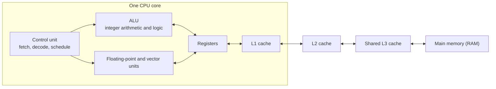
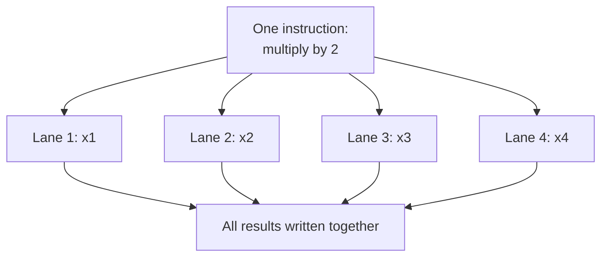

# The CPU and the GPU

<!-- BEGIN HEADER (generated by tools/build.py from the front matter; edit the front matter, not this block) -->
> [Home](../../../../README.md) › [Part I — Computer Science Foundations](../../index.md) › [1. Computer Fundamentals](../index.md) › [Chapter 5: Computer components](index.md)

- **Difficulty:** Beginner to intermediate
- **Estimated time:** about 75 minutes
- **Prerequisites:** [What Is a Computer?](../01-introduction-to-computers/01-what-is-a-computer.md) · [Binary Arithmetic](../02-number-systems/03-binary-arithmetic.md)
- **Syllabus topics covered:** `01.05.01` CPU · `01.05.02` GPU
- **Status:** Drafted (passes the automated checks; awaiting independent technical review). Last reviewed 2026-11-01.
<!-- END HEADER -->

## What you will learn

- Name the main parts of a CPU core (control unit, arithmetic logic unit, registers, caches) and say what each does.
- Use the processor performance equation, and explain why clock speed alone is a poor measure of speed.
- Distinguish cores, hardware threads and logical CPUs, and explain Amdahl's law, which limits what extra cores can achieve.
- Explain how a GPU differs from a CPU, and which kinds of work suit each.

## Introduction

The **central processing unit (CPU)** executes the instructions of programs. It is the part of the computer that decides what to do next and does the arithmetic, comparisons and data movement that make up every program. The **graphics processing unit (GPU)** began as a specialised chip for drawing images and has become a general engine for work that can be spread across thousands of simple calculations at once, such as rendering, scientific simulation and training neural networks.

The two are built on opposite design choices. A CPU is optimised to finish **one task quickly**, however irregular it is. A GPU is optimised to finish **a huge number of similar tasks per second**, even if each one is slow. Understanding the difference explains why a computer usually has both.

## Intuitive understanding

Imagine a restaurant kitchen. The CPU is a handful of **expert chefs**: each can cook any dish, make quick decisions and juggle several steps, but there are only a few of them. The GPU is a **huge brigade of line cooks** who each do one simple, identical step, such as flipping a burger, but there are thousands of them working in unison. To cook one elaborate meal as fast as possible you want the expert chefs. To serve ten thousand identical burgers you want the brigade.

Both analogies break down at the edges, as always: real CPUs also have vector hardware that does the same operation on several values at once, and real GPUs can run varied code, just less efficiently.

## Technical foundations

### Inside a CPU core



*Reading the diagram:* the control unit fetches instructions and directs the other parts. The **arithmetic logic unit (ALU)** performs the integer arithmetic and bitwise operations of [chapter 2](../02-number-systems/index.md) and [chapter 4](../04-boolean-logic/index.md); a separate floating-point unit and vector units handle real numbers and data-parallel operations. **Registers** are the processor's own tiny, extremely fast storage, holding the values currently in use. Between the core and main memory sits a hierarchy of **caches** (covered in the [next lesson](02-memory-and-storage.md)), because main memory is far slower than the core.

Other components found in a modern core include the **program counter** (the address of the next instruction), the instruction decoder, a **branch predictor** that guesses which way a conditional jump will go so the pipeline stays full, and a **memory management unit** that translates program addresses to physical addresses ([operating systems](../../../../docs/01-computer-science-foundations/04-operating-systems/index.md)). How these cooperate to run one instruction is the subject of [chapter 6](../index.md#chapter-6-how-computers-execute-instructions).

### Clock rate is not performance

A CPU is driven by a **clock**, a steady signal whose frequency, measured in hertz (cycles per second), sets the pace. A 3 GHz clock ticks three billion times a second. But the useful measure is how long a *program* takes, given by the **processor performance equation**:

$$
\text{CPU time} = \frac{\text{instruction count} \times \text{cycles per instruction (CPI)}}{\text{clock rate}}
$$

Three things therefore determine speed: how many instructions the program needs (a matter of the compiler and instruction set), how many cycles each takes on average (a matter of the processor's design), and the clock rate. A processor with a lower clock but a lower CPI can beat one with a higher clock. This is why comparing gigahertz between different designs, or between CPU families, is misleading.

Clock rates stopped rising quickly in the mid-2000s because of **power**. The dynamic power a chip uses is roughly proportional to $C V^2 f$ (capacitance, voltage squared, frequency), and raising the frequency also usually requires raising the voltage, so power and heat rise much faster than speed. Since then designers have mostly spent extra transistors on **more cores**, larger caches and smarter control rather than on higher frequency, and typical desktop clock rates have stayed in the same range of a few gigahertz for many years.

### Cores, threads and logical CPUs

- A **core** is a complete processing unit. A **multi-core** CPU has several on one chip, each running its own instruction stream, typically sharing the last-level cache and the connection to memory.
- **Simultaneous multithreading** (SMT; Intel calls its version Hyper-Threading) lets one core hold two or more *hardware threads*, interleaving them so that when one stalls, waiting for memory, the other can use the idle units.
- The operating system sees each hardware thread as a **logical CPU**. An 8-core processor with two threads per core appears as 16 logical CPUs, which is the number `os.cpu_count()` reported in [Types of Computers](../01-introduction-to-computers/02-types-of-computers.md). Sixteen logical CPUs do not give sixteen times the throughput of one: the two threads on a core share its resources.
- Many chips now combine **different kinds of cores**: fast, power-hungry *performance* cores and slower, frugal *efficiency* cores (Arm's big.LITTLE and similar designs), with the scheduler placing work on whichever suits it.

### Amdahl's law

Adding processors helps only the part of a program that can run in parallel. If a fraction $p$ of the work can be spread across $n$ processors and the rest $(1 - p)$ must run serially, the best possible speed-up is

$$
S(n) = \frac{1}{(1 - p) + p/n}.
$$

This is **Amdahl's law**, after the computer architect Gene Amdahl (1967). Its message is sobering: if 10% of a job is serial, then even with unlimited processors the speed-up can never exceed $1/(1-p) = 10$.

<!-- run:python -->
```python
def cpu_time_seconds(instructions: float, cpi: float, clock_hz: float) -> float:
    """The processor performance equation: time = instructions x cycles per instruction / clock rate."""
    return instructions * cpi / clock_hz


def amdahl_speedup(parallel_fraction: float, processors: float) -> float:
    """Best possible speed-up when only part of the work can be spread over several processors."""
    return 1 / ((1 - parallel_fraction) + parallel_fraction / processors)


print(f"{cpu_time_seconds(2e9, 1.5, 3e9):.3f} s  (2 billion instructions, CPI 1.5, 3 GHz)")
print(f"{cpu_time_seconds(2e9, 1.0, 3e9):.3f} s  (fewer cycles per instruction)")
print(f"{cpu_time_seconds(2e9, 1.5, 4e9):.3f} s  (a higher clock rate)")
for n in (2, 4, 8, 64, 1_000_000):
    print(f"{n:>9} processors: speed-up {amdahl_speedup(0.9, n):6.3f}")
print(f"limit with unlimited processors: {1 / (1 - 0.9):.1f}")
```

<!-- expect -->
```text
1.000 s  (2 billion instructions, CPI 1.5, 3 GHz)
0.667 s  (fewer cycles per instruction)
0.750 s  (a higher clock rate)
        2 processors: speed-up  1.818
        4 processors: speed-up  3.077
        8 processors: speed-up  4.706
       64 processors: speed-up  8.767
  1000000 processors: speed-up 10.000
limit with unlimited processors: 10.0
```

The first three lines show that reducing cycles per instruction (0.667 s) beat raising the clock by a third (0.750 s) in this example. The table shows the diminishing returns of Amdahl's law for a job that is 90% parallel: the first doubling of processors gains 82%, but going from 64 to a million processors gains almost nothing, because the 10% serial part dominates. Amdahl's law is covered with other performance models in [high-performance computing](../../../../docs/10-specialized-software-engineering-domains/53-high-performance-computing/index.md).

### The GPU

A GPU contains **thousands of simple arithmetic units**, grouped into blocks that each execute the **same instruction on many data elements at once**, a model often called *SIMT* (single instruction, multiple threads) and related to the *SIMD* (single instruction, multiple data) vector instructions found in CPUs (such as SSE and AVX on x86 and NEON on Arm).



*Reading the diagram:* one decoded instruction drives several lanes in lockstep, so the cost of fetching and decoding is shared across all the data. A GPU does this with groups of threads (called *warps* or *wavefronts*, commonly 32 or 64 threads wide) on a vast scale.

Key properties:

- **Throughput over latency.** An individual GPU thread is slower than a CPU thread, but tens of thousands run at once, and the hardware switches instantly between groups to hide memory delays.
- **Very high memory bandwidth.** GPUs use specialised, wide memory so that all those threads can be fed.
- **Divergence is costly.** If threads in one group take different branches, the group runs *both* paths one after the other, with some threads idle each time.
- **Data must be moved.** A separate (discrete) GPU has its own memory, so data travels over the PCI Express bus; if the transfer takes longer than the computation saves, the GPU loses. Integrated GPUs and unified-memory designs on a single chip reduce the cost.
- **Programming models:** CUDA (NVIDIA), OpenCL, Vulkan compute, Metal (Apple) and SYCL let programs launch *kernels* (functions run by thousands of threads).

Related **accelerators**, such as neural-network processing units, go further by hard-wiring the operations (matrix multiplication) that a field needs.

## Step-by-step working: splitting work across cores

Data-parallel work follows a pattern: **split** the data, **compute** partial results independently, **combine** them. This program does that on the CPU with four processes (Python 3.10 or newer), summing the squares of the first million integers. The `if __name__ == "__main__"` guard is required on some platforms so that child processes can import the file safely.

<!-- run:python -->
```python
from concurrent.futures import ProcessPoolExecutor


def sum_of_squares(bounds):
    low, high = bounds
    return sum(i * i for i in range(low, high))


if __name__ == "__main__":
    n = 1_000_000
    chunks = [(i * n // 4, (i + 1) * n // 4) for i in range(4)]    # split the work into four slices
    with ProcessPoolExecutor(max_workers=4) as pool:
        partial_sums = list(pool.map(sum_of_squares, chunks))        # each slice runs in its own process
    total = sum(partial_sums)                                        # combine the partial results
    print(len(partial_sums), "partial sums")
    print(total == sum(i * i for i in range(n)), total)
```

<!-- expect -->
```text
4 partial sums
True 333332833333500000
```

The combined answer equals the serial answer, which is the correctness check for any parallel version. The *speed* gained depends on how many cores are really available and on the overhead of starting processes and passing data, which is why parallelising a small job can make it slower. The pattern is exactly what a GPU applies at far larger scale: the "slices" are individual elements and the "combine" step is a *reduction*.

## Real-world applications

- **Web servers and databases** handle many independent requests, so they scale with the number of cores; per-request speed depends on single-thread performance and caches.
- **Compilers and most desktop software** have limited parallelism, so Amdahl's law applies and fast single cores still matter.
- **Graphics, video and scientific simulation** are naturally data-parallel and run on GPUs; **machine-learning training and inference** are dominated by matrix multiplications that suit GPUs and dedicated accelerators ([subject 37](../../../../docs/09-artificial-intelligence-and-machine-learning/37-deep-learning/index.md)).
- **Cryptography** uses special CPU instructions (such as AES instructions on x86) to speed up common operations.
- **Mobile devices** combine efficiency and performance cores, a GPU and other accelerators on one chip to balance battery life against speed.

## Comparisons and trade-offs

| | CPU | GPU |
|---|---|---|
| Design goal | Low latency for one task | High throughput for many similar tasks |
| Cores | A few to a few dozen complex ones | Thousands of simple ones |
| Control logic | Large: branch prediction, out-of-order execution, big caches | Small per unit; many units |
| Handles branchy, irregular code | Well | Poorly (divergence) |
| Memory | Large, relatively low bandwidth | Smaller, very high bandwidth |
| Best for | Operating systems, general programs, databases, sequential logic | Graphics, matrix and vector maths, simulation, deep learning |
| Programming | Any language | Specialised models (CUDA, OpenCL, shaders) |

## Advanced concepts

- **Pipelining, out-of-order execution and speculation.** CPUs overlap the stages of many instructions and may execute them in a different order than written, or guess the outcome of branches and run ahead. This raises speed but, as the **Spectre** and **Meltdown** vulnerabilities disclosed in 2018 showed, can leak information through side effects that speculation leaves behind. See [subject 3](../../../../docs/01-computer-science-foundations/03-digital-logic-and-computer-organization/index.md).
- **Heterogeneous systems.** Real products combine CPU cores, a GPU, media encoders and AI accelerators, and software must decide where each task runs.
- **Chiplets.** Large processors are increasingly assembled from several smaller dies in one package, which improves manufacturing yield.
- **Thermal throttling.** A CPU or GPU that overheats lowers its clock to stay within limits, so sustained performance can be well below peak.

## Common mistakes

> **Common mistake:** *Comparing processors by gigahertz alone.* Compare measured performance on workloads like yours; clock rate is only one factor in the performance equation.

- **Assuming twice the cores gives twice the speed.** Amdahl's law, memory bandwidth, locks and communication costs all limit it.
- **Counting logical CPUs as physical cores.** Two hardware threads on one core do not equal two cores.
- **Assuming the GPU is always faster.** Small problems, branchy code and expensive data transfers favour the CPU.
- **Ignoring memory.** Many programs wait for memory, not for arithmetic, so a faster ALU changes little.
- **Believing "64-bit" describes speed.** It describes register and address width.

## Exercises

**Beginner**

1. A program executes $6 \times 10^9$ instructions at an average of 2 cycles each on a 3 GHz CPU. How long does it take?
2. A processor has 8 cores with 2 hardware threads each. How many logical CPUs will the operating system report?

**Intermediate**

3. For a program that is 95% parallelisable, what is the best speed-up on 16 processors, and what is the limit with unlimited processors?
4. Give two reasons why a higher clock rate might not make a particular program faster.

**Advanced**

5. If raising the clock frequency by 20% requires raising the voltage by 10%, estimate the increase in dynamic power using $P \propto V^2 f$.
6. A GPU kernel computes in 1 ms but moving the data over the bus takes 6 ms in each direction. When is it worth using the GPU?

**Expert**

7. In a group of 32 GPU threads, 8 take one branch and 24 take the other, and each path takes the same time. How efficient is the group compared with no divergence, and why?
8. Modify the process-pool program to use 1, 2 and 4 workers and think about what you would need to measure, and what could mislead you, to claim a speed-up.

<details>
<summary>Solutions and hints</summary>

1. $6 \times 10^9 \times 2 / (3 \times 10^9) = 4$ seconds.
2. 16 logical CPUs.
3. $1/(0.05 + 0.95/16) = 1/0.109375 \approx 9.14$. The limit is $1/0.05 = 20$.
4. For example: the program waits on memory, disk or the network rather than computing; the faster clock needs a higher CPI because of more cache misses; the work is serial; or the chip throttles because of heat.
5. $1.1^2 \times 1.2 = 1.452$, so about 45% more power for 20% more frequency.
6. When the computation saved is larger than the transfer cost. Here 1 ms of compute plus 12 ms of transfer is worse than a CPU that takes, say, 10 ms. It becomes worthwhile when the same data is reused for many kernels, or the CPU version is much slower than the transfer time.
7. The group executes both paths one after the other. In the first pass only 8 of 32 threads do useful work, and in the second only 24 of 32. The average utilisation is $(8 + 24)/(2 \times 32) = 50\%$.
8. Measure wall-clock time with repetition on an otherwise idle machine; check how many physical cores exist; account for process start-up and data-transfer overhead and for the dependence on the problem size. A one-core virtual machine will show no speed-up at all.

</details>

## Interview and practical questions

**What is the difference between a CPU and a GPU?** A CPU has a few complex cores optimised for low latency on varied, branchy code; a GPU has thousands of simple cores optimised for throughput on data-parallel work.

**What is the difference between a core and a thread?** A core is a physical execution unit; a hardware thread is one of the instruction streams a core can interleave. The OS counts each hardware thread as a logical CPU.

**Why did clock speeds stop increasing?** Power and heat grow much faster than frequency, so designers turned to multiple cores and better design instead.

**What does Amdahl's law say?** The speed-up from parallelism is limited by the fraction of the work that stays serial.

**When would you not use a GPU?** For small problems, irregular branching code, or when moving data to and from the GPU costs more than the computation saves.

## Further reading

**Research**

- Gene M. Amdahl, "Validity of the single processor approach to achieving large scale computing capabilities", *AFIPS Spring Joint Computer Conference* (1967).
- Paul Kocher and others, "Spectre Attacks: Exploiting Speculative Execution", *IEEE Symposium on Security and Privacy* (2019), and Moritz Lipp and others, "Meltdown: Reading Kernel Memory from User Space", *USENIX Security Symposium* (2018).

**Textbooks**

- David A. Patterson and John L. Hennessy, *Computer Organization and Design* (Morgan Kaufmann), chapters 1 and 4, and *Computer Architecture: A Quantitative Approach* (Morgan Kaufmann) for the full treatment.
- David B. Kirk and Wen-mei W. Hwu, *Programming Massively Parallel Processors* (Morgan Kaufmann): a standard text on GPU programming.

**Official documentation for the code used here**

- Python: [`concurrent.futures`](https://docs.python.org/3/library/concurrent.futures.html) and [`os.cpu_count`](https://docs.python.org/3/library/os.html#os.cpu_count).

<!-- BEGIN FOOTER (generated by tools/build.py) -->
---

## Related topics

- [Types of Computers](../01-introduction-to-computers/02-types-of-computers.md)

## Navigation

**Previous:** [Logic Simplification](../04-boolean-logic/03-logic-simplification.md) · **Up:** [Chapter 5: Computer components](index.md) · **Next:** [Memory and Storage: RAM, ROM, Cache, SSD and HDD](02-memory-and-storage.md)
<!-- END FOOTER -->
