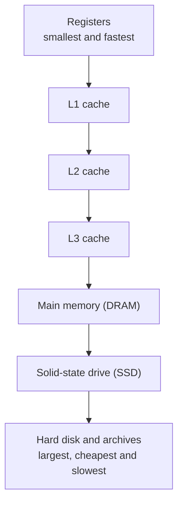
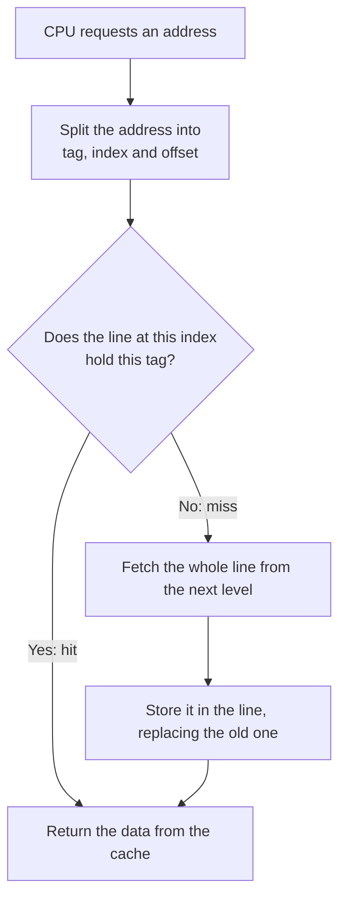

# Memory and Storage: RAM, ROM, Cache, SSD and HDD

<!-- BEGIN HEADER (generated by tools/build.py from the front matter; edit the front matter, not this block) -->
> [Home](../../../../README.md) › [Part I — Computer Science Foundations](../../index.md) › [1. Computer Fundamentals](../index.md) › [Chapter 5: Computer components](index.md)

- **Difficulty:** Beginner to intermediate
- **Estimated time:** about 90 minutes
- **Prerequisites:** [The CPU and the GPU](01-cpu-and-gpu.md) · [Bits, Bytes, Words and Memory Addresses](../03-data-representation/01-bits-bytes-words-and-addresses.md)
- **Syllabus topics covered:** `01.05.03` RAM · `01.05.04` ROM · `01.05.05` Cache · `01.05.06` SSD and HDD
- **Status:** Drafted (passes the automated checks; awaiting independent technical review). Last reviewed 2026-11-01.
<!-- END HEADER -->

## What you will learn

- Explain the memory hierarchy and why no single technology can replace it.
- Distinguish SRAM, DRAM, ROM and flash, and say what each is used for.
- Explain locality, cache hits and misses, and compute the average memory access time.
- Describe how a direct-mapped cache works, and see why the *order* in which a program touches data changes its speed.
- Compare solid-state drives and hard disks, and predict the time taken by different access patterns.

## Introduction

Every computer faces a dilemma. **Fast** storage technology is **small and expensive**; **large, cheap** technology is **slow**. No material is fast, large and cheap at once. Instead of choosing, computers use **all of them in layers**, arranged so that the data a program needs most is in the fastest layer, and the rest is further away. This arrangement is the **memory hierarchy**, and it is one of the most important ideas in computer architecture: the speed of almost every program is determined less by how fast the processor computes than by how well the hierarchy serves it.

## Intuitive understanding

Picture working on a project in a house. The page you are reading is **on your desk**. The books you are using this week are **on the shelf** in the room. Everything else is in a **library across town**, and some archives are in another country. Walking to the shelf takes a few seconds, the library takes an afternoon. A sensible worker keeps the things they use most on the desk and swaps items in and out as the work changes. A computer does the same, and it works because programs reuse recent data and touch nearby data (a property called *locality*, explained below).

To feel the ratios, imagine an access to the fastest cache took **one second**. On the same scale, main memory would take about a minute and a half, a solid-state drive about a day, and a spinning hard disk about three months.



*Reading the diagram:* moving down, each level is larger, cheaper per byte and slower. The top four levels are on or next to the processor chip; the lower levels are separate devices.

## Technical foundations

### The hierarchy in numbers

These figures are **orders of magnitude** for typical current hardware, not specifications. The ratios between levels matter far more than any single number, and they have stayed broadly similar for decades.

| Level | Typical size | Typical access time | Technology | Keeps data without power? |
|---|---|---|---|---|
| Registers | Hundreds of bytes | Under 1 ns (within a cycle) | Flip-flops | No |
| L1 cache | Tens of KiB per core | About 1 ns | SRAM | No |
| L2 cache | Hundreds of KiB to a few MiB per core | A few ns | SRAM | No |
| L3 cache | Several MiB to hundreds of MiB, shared | Roughly 10 to 20 ns | SRAM | No |
| Main memory | Gigabytes | Roughly 50 to 100 ns | DRAM | No |
| SSD | Hundreds of GB to several TB | Tens of microseconds | NAND flash | Yes |
| Hard disk | Terabytes | Milliseconds (about 5 to 10) | Magnetic platters | Yes |

### RAM: DRAM and SRAM

**Random-access memory** can read or write any location in about the same time, regardless of position (unlike a tape). It comes in two main kinds:

- **DRAM (dynamic RAM)** stores each bit as charge on a tiny **capacitor**, switched by a **transistor**. It is simple, so it is dense and cheap, which is why gigabytes of it make up main memory. But a capacitor leaks, so every row must be **refreshed** (read and rewritten) many times per second, and a read disturbs the stored charge so it must be restored. Modern main memory is **DDR** (double data rate) DRAM in modules, in generations such as DDR4 and DDR5. Memory is organised into several *channels* that work in parallel, and its **bandwidth** (gigabytes per second) matters as much as its **latency** (nanoseconds). Server memory often adds ECC, the error-correcting code from the [error detection lesson](../03-data-representation/02-error-detection-and-correction.md).
- **SRAM (static RAM)** stores each bit in a small circuit of about six transistors (a latch) that holds its value as long as power is on, with no refresh. It is much faster but larger and more expensive per bit, so it is used for **caches** and registers.

Both are **volatile**: they lose their contents when power is removed.

### ROM and flash

**Read-only memory (ROM)** keeps its contents without power. The original types were written once: *mask ROM* is fixed during manufacturing and *PROM* is programmable once. *EPROM* could be erased with ultraviolet light, and *EEPROM* electrically, which led to **flash memory**, an EEPROM that is erased in blocks. Today, when a computer manual says "ROM" or "BIOS", it normally means a **flash chip holding firmware**: the first code the processor runs when power is applied. At reset the processor begins executing from a fixed address that is mapped to that chip, and that code (UEFI or BIOS on a PC, a bootloader on a microcontroller) initialises the hardware and then loads the operating system from storage.

### Cache

A **cache** is a small, fast memory that holds copies of recently used data from a larger, slower one. Caches work because of **locality of reference**:

- **Temporal locality:** data used recently is likely to be used again soon (a loop counter, a hot function).
- **Spatial locality:** data near recently used data is likely to be used next (the next array element, the next instruction).

Caches exploit spatial locality by fetching a whole **cache line** at a time, typically **64 bytes**, rather than a single byte. If the requested data is in the cache it is a **hit**; otherwise it is a **miss** and the line must be fetched from the next level, which costs the **miss penalty**. The average memory access time is

$$
\text{AMAT} = \text{hit time} + \text{miss rate} \times \text{miss penalty}.
$$



*Reading the diagram:* in a **direct-mapped** cache each memory block may live in exactly one line. With 64-byte lines and 64 lines, the address is split as follows: the low 6 bits are the **offset** within the line, the next 6 bits are the **index** selecting the line, and the remaining high bits are the **tag** that identifies which block currently occupies that line. For address `0x2A40` (decimal 10,816): the block number is $10816 \div 64 = 169$, the index is $169 \bmod 64 = 41$, the tag is $\lfloor 169 / 64 \rfloor = 2$ and the offset is 0.

Real caches are usually **set-associative**: a block may go in any of $k$ lines of a *set* (called $k$-way), which reduces conflicts at the cost of more comparisons, and a replacement policy such as least-recently-used decides which line to evict. When the processor *writes*, a **write-through** cache updates memory immediately, while a **write-back** cache marks the line *dirty* and writes it out only when it is evicted. Misses are classed as **compulsory** (first touch), **capacity** (the working set does not fit) and **conflict** (too many blocks compete for one line).

### Solid-state drives and hard disks

**Hard disk drive (HDD).** Data is stored magnetically on one or more **platters** spinning at a constant speed (commonly 5,400 or 7,200 revolutions per minute), read and written by a **head** on a moving arm. To read a sector the drive must first **seek** (move the arm to the right track) and then wait for the sector to rotate under the head. At 7,200 rpm one revolution takes $60/7200 \approx 8.3$ ms, so the average rotational delay is about 4.2 ms, and a seek adds a few milliseconds more. Once positioned, the drive can stream data at roughly 100 to 250 MB/s. So a hard disk is slow at **random** access (on the order of 100 to 200 operations per second) but acceptable for **sequential** reading, and it offers the lowest cost per terabyte.

**Solid-state drive (SSD).** An SSD stores data in **NAND flash** cells, with no moving parts. Reading a page takes tens of microseconds regardless of location, so random access is thousands of times faster than a hard disk. But flash has characteristic constraints:

- It is written in **pages** (a few KiB) but erased only in **blocks** (hundreds of pages), so an overwrite cannot happen in place. The drive's **controller** writes updated data elsewhere, tracks the mapping, and later reclaims space by *garbage collection*, which causes **write amplification** (more data written internally than the host asked for).
- Each cell survives a limited number of **program/erase cycles**, so the controller does **wear levelling** to spread writes evenly. Storing more bits per cell (SLC one bit, MLC two, TLC three, QLC four) makes drives cheaper and denser but slower and less durable.
- The controller also applies strong error correction (see the [error-correction lesson](../03-data-representation/02-error-detection-and-correction.md)).
- Interfaces matter: **SATA** SSDs are limited to roughly 550 MB/s, while **NVMe** drives attach directly to the PCI Express bus and reach several gigabytes per second.

> **Important:** neither kind of drive is a backup. Both fail. Keep copies elsewhere.

## Step-by-step working in code

The first program computes the average access time for three miss rates, then simulates a small **direct-mapped cache** (64 lines of 64 bytes, 4 KiB) and a larger one (256 lines, 16 KiB) while a program walks a 64 by 64 array of 4-byte integers (16 KiB) stored row by row. It counts the hit rate for three access orders. It needs Python 3.10 or newer.

<!-- run:python -->
```python
def amat(hit_time_ns: float, miss_rate: float, miss_penalty_ns: float) -> float:
    """Average memory access time = hit time + miss rate x miss penalty."""
    return hit_time_ns + miss_rate * miss_penalty_ns


for miss_rate in (0.05, 0.01, 0.0):
    print(f"miss rate {miss_rate:4.0%}: average access time {amat(1, miss_rate, 80):.2f} ns")


class DirectMappedCache:
    """A tiny direct-mapped cache that counts hits and misses."""

    def __init__(self, lines: int, line_size: int):
        self.lines, self.line_size = lines, line_size
        self.tags = [None] * lines
        self.hits = self.misses = 0

    def access(self, address: int) -> None:
        block = address // self.line_size       # which memory block holds this byte
        index = block % self.lines              # the one cache line that block may use
        tag = block // self.lines               # identifies which block is in that line
        if self.tags[index] == tag:
            self.hits += 1
        else:
            self.misses += 1
            self.tags[index] = tag              # fetch the block, evicting whatever was there

    def hit_rate(self) -> float:
        return self.hits / (self.hits + self.misses)


def run(addresses, lines=64, line_size=64):
    cache = DirectMappedCache(lines, line_size)  # 64 lines x 64 bytes = 4 KiB
    for a in addresses:
        cache.access(a)
    return cache.hit_rate()


INT = 4                                          # bytes per integer
N = 64                                           # a 64 x 64 array of integers (16 KiB), stored row by row
by_rows = [(r * N + c) * INT for r in range(N) for c in range(N)]
by_columns = [(r * N + c) * INT for c in range(N) for r in range(N)]
state, scattered = 12345, []
for _ in range(N * N):                           # a pseudo-random order (linear congruential generator)
    state = (1103515245 * state + 12345) % 2**31
    scattered.append((state % (N * N)) * INT)

print(f"4 KiB cache, row by row:       {run(by_rows):.4f}")
print(f"4 KiB cache, column by column: {run(by_columns):.4f}")
print(f"4 KiB cache, scattered:        {run(scattered):.4f}")
print(f"16 KiB cache, row by row:       {run(by_rows, lines=256):.4f}")
print(f"16 KiB cache, column by column: {run(by_columns, lines=256):.4f}")
```

<!-- expect -->
```text
miss rate   5%: average access time 5.00 ns
miss rate   1%: average access time 1.80 ns
miss rate   0%: average access time 1.00 ns
4 KiB cache, row by row:       0.9375
4 KiB cache, column by column: 0.0000
4 KiB cache, scattered:        0.2415
16 KiB cache, row by row:       0.9375
16 KiB cache, column by column: 0.9375
```

Walking through the results:

1. **The AMAT lines** show how sensitive performance is to the miss rate: with a 1 ns cache and an 80 ns miss penalty, going from a 5% to a 1% miss rate cuts the average access time by almost two thirds.
2. **Row by row** touches memory in the order it is stored. Each 64-byte line holds 16 integers, so the first access to a line misses and the next 15 hit: $15/16 = 0.9375$. This is spatial locality at work.
3. **Column by column** jumps 256 bytes between accesses, so each access lands in a different line. Those lines map to only 16 distinct cache positions, so they keep evicting each other (*conflict and capacity misses*), and by the time the next column revisits a line it has already been replaced. The hit rate is **zero**, although the program touches exactly the same data.
4. **Scattered** (pseudo-random) access gets a hit rate of about a quarter, roughly the fraction of the 16 KiB array that fits in the 4 KiB cache.
5. **With a 16 KiB cache** the whole array fits, so both orders only suffer the compulsory first-touch misses ($256$ lines out of $4096$ accesses), giving $0.9375$ for both.

The lesson for programmers: **the same algorithm can run many times slower purely because of the order it visits data.** The usual remedies are to traverse in storage order, to restructure data so that fields used together are adjacent, and to *block* (tile) loops so that a working set fits in cache.

The second program models how long a series of reads takes on each kind of drive. The latency and throughput figures are **assumed round numbers**, chosen to illustrate the shape of the difference, not measurements of any product.

<!-- run:python -->
```python
def read_time_seconds(requests: int, bytes_per_request: int, latency_s: float, throughput_bytes_per_s: float) -> float:
    """Time for a series of reads, each paying one access latency plus its transfer time."""
    return requests * (latency_s + bytes_per_request / throughput_bytes_per_s)


MB = 10**6
hdd = dict(latency_s=0.008, throughput_bytes_per_s=150 * MB)     # assumed: 8 ms seek and rotation, 150 MB/s
ssd = dict(latency_s=0.0001, throughput_bytes_per_s=2000 * MB)   # assumed: 0.1 ms latency, 2000 MB/s

print("1,000 random 4 KiB reads")
print(f"  HDD {read_time_seconds(1000, 4096, **hdd):8.3f} s")
print(f"  SSD {read_time_seconds(1000, 4096, **ssd):8.3f} s")
print("one sequential 4 MiB read (about the same amount of data)")
print(f"  HDD {read_time_seconds(1, 4 * 1024 * 1024, **hdd):8.3f} s")
print(f"  SSD {read_time_seconds(1, 4 * 1024 * 1024, **ssd):8.3f} s")
```

<!-- expect -->
```text
1,000 random 4 KiB reads
  HDD    8.027 s
  SSD    0.102 s
one sequential 4 MiB read (about the same amount of data)
  HDD    0.036 s
  SSD    0.002 s
```

Reading the same four megabytes costs **8 seconds** on the hard disk when it is requested as 1,000 scattered pieces, but **36 milliseconds** as one sequential read, about 220 times faster, because the 8 ms positioning cost is paid 1,000 times instead of once. The SSD barely cares about the pattern (0.1 s versus 2 ms). This is why databases and file systems work hard to turn random accesses into sequential ones, and why replacing a hard disk with an SSD helps random-access workloads far more than sequential ones.

## Real-world applications

- **Operating systems** use otherwise unused RAM as a **page cache** for files, so the second read of a file is served from memory ([operating systems](../../../../docs/01-computer-science-foundations/04-operating-systems/index.md)).
- **Databases** keep hot pages in a memory buffer pool and use index structures such as B-trees that minimise the number of disk reads per lookup ([subject 15](../../../../docs/04-building-software-products/15-database-management-systems/index.md)).
- **The same caching idea recurs everywhere:** browser caches, DNS caches, content delivery networks and application caches all keep copies of data nearby. The hard part, as the folk saying goes, is *invalidation*: knowing when a copy is stale.
- **Cloud storage tiers** (hot, cool and archive) apply the hierarchy at data-centre scale, trading cost against access latency.
- **Embedded systems** keep code in flash and variables in a small SRAM, and have no cache at all, so their timing is predictable.

## Comparisons and trade-offs

| | SRAM | DRAM | NAND flash (SSD) | Hard disk |
|---|---|---|---|---|
| Cell | About 6 transistors | 1 transistor and 1 capacitor | Charge in a floating cell | Magnetised region |
| Speed | Fastest | Fast | Moderate | Slowest |
| Cost per bit | Highest | Moderate | Low | Lowest |
| Density | Low | High | Very high | Highest |
| Persistent | No | No | Yes | Yes |
| Wears out | No | No | Yes (program/erase cycles) | Mechanical wear |
| Used for | Registers, caches | Main memory | Drives, phones, firmware | Bulk and archive storage |

| | SSD | Hard disk |
|---|---|---|
| Random access | Excellent | Poor |
| Sequential throughput | High (hundreds of MB/s to several GB/s) | Moderate (about 100 to 250 MB/s) |
| Shock resistance | Good | Poor |
| Cost per terabyte | Higher | Lower |
| Failure mode | Wear and controller failure | Mechanical failure |

## Advanced concepts

- **Prefetching.** Hardware detects regular access patterns and fetches lines before they are requested; software can add hints. Prefetching hides latency but wastes bandwidth when it guesses wrongly.
- **NUMA.** In multi-socket servers, memory attached to the other processor is reachable but slower (*non-uniform memory access*), so placement of threads and data matters.
- **Cache coherence and false sharing.** In a multi-core processor each core has its own caches, and a coherence protocol keeps copies consistent. If two cores repeatedly write *different* variables that share one cache line, the line ping-pongs between them, slowing both: *false sharing*.
- **DRAM disturbance.** Repeatedly activating one row of DRAM can flip bits in neighbouring rows (the **Row Hammer** effect, demonstrated in research in 2014), a reminder that physical effects reach software security.
- **High-bandwidth memory.** GPUs and AI accelerators use stacked DRAM (HBM) placed next to the processor to supply vast bandwidth, and new interconnects such as CXL are being used to attach larger, shared pools of memory.
- **SSD internals.** Over-provisioning, TRIM (the operating system telling the drive which blocks are free) and garbage collection determine sustained write performance and lifetime.

## Common mistakes

> **Common mistake:** *Assuming memory access costs the same wherever the data is.* A cache miss can cost over a hundred times a hit, so identical code can run at wildly different speeds depending on the order and layout of its data.

- **Confusing cache with RAM**, and RAM with storage (see the [first lesson](../01-introduction-to-computers/01-what-is-a-computer.md)).
- **Thinking a bigger cache always helps.** Larger caches are slower, and if the working set already fits, extra size adds nothing.
- **Defragmenting an SSD.** It gives no benefit (there is no seek penalty) and adds wear; the operating system should instead use TRIM.
- **Benchmarking with a warm cache.** The first run reads from disk; later runs read from memory, so measure what you intend to measure.
- **Treating an SSD as permanent.** Flash cells wear out and controllers fail.
- **Ignoring the access pattern** when choosing between storage devices.

## Exercises

**Beginner**

1. Classify each as volatile or non-volatile: SRAM, DRAM, flash, hard disk, ROM.
2. With a hit time of 2 ns, a miss rate of 10% and a miss penalty of 100 ns, what is the average access time?

**Intermediate**

3. For the cache in this lesson (64 lines of 64 bytes), find the offset, index and tag of address `0x2A40`, then of `0x2A41` and `0x3A40`.
4. What is the average rotational latency of a 7,200 rpm disk and of a 5,400 rpm disk?

**Advanced**

5. Explain why the column-by-column traversal had a 0% hit rate in the 4 KiB cache but 93.75% in the 16 KiB cache, and describe two ways to speed up the loop without buying more cache.
6. Extend `DirectMappedCache` to a 2-way set-associative cache with LRU replacement and compare its results on the three access patterns.

**Expert**

7. A flash block holds 64 pages of 4 KiB. The drive has 63 valid pages in a block and the host overwrites one. Describe what a naive controller must do, and the resulting write amplification. How do real controllers avoid this?
8. Design an experiment to measure the cache-line size of your own computer by timing strided access to a large array. What will the graph look like, and what can distort it?

<details>
<summary>Solutions and hints</summary>

1. Volatile: SRAM and DRAM. Non-volatile: flash, hard disk, ROM.
2. $2 + 0.10 \times 100 = 12$ ns.
3. `0x2A40` = 10,816: block 169, offset 0, index 41, tag 2. `0x2A41` has the same block, so the same index and tag with offset 1. `0x3A40` = 14,912: block 233, index $233 \bmod 64 = 41$, tag 3. It maps to the **same line** as `0x2A40` with a different tag, so the two evict each other: a conflict.
4. Half a revolution: $4.17$ ms at 7,200 rpm ($60/7200/2$) and $5.56$ ms at 5,400 rpm.
5. A column pass touches 64 blocks that map onto only 16 distinct lines of the 64-line cache, so they replace one another before the next column can reuse them; with 256 lines the entire array stays resident. Remedies: loop interchange so the inner loop runs along a row, or *tile* the loops (process $16 \times 16$ sub-blocks) so each tile fits in the cache.
6. Keep two tags per set and a recently-used bit; on a miss, replace the least recently used way. The column pattern improves because two conflicting lines can coexist.
7. The drive cannot erase a single page, so it must copy the 63 valid pages and the new page to a fresh block (64 page writes for 1 requested write: amplification of 64) and later erase the old block. Real controllers instead write the new page into already-erased space, mark the old page invalid, and garbage-collect blocks that are mostly invalid, which keeps the amplification to a small multiple.
8. Read an array with strides of 1, 2, 4, 8, 16, 32, 64, 128 bytes. The time per access rises until the stride reaches the line size, after which each access touches a new line and the time plateaus. Prefetchers, TLB effects and compiler optimisation can distort the result.

</details>

## Interview and practical questions

**What is the difference between SRAM and DRAM?** SRAM holds each bit in a latch of about six transistors, needs no refresh and is fast but large and costly, so it is used for caches. DRAM uses one transistor and one capacitor per bit, needs periodic refresh, and is dense and cheap, so it is used for main memory.

**Why do caches work?** Programs exhibit temporal and spatial locality, so a small amount of recently used data satisfies most accesses.

**What is the difference between write-through and write-back?** Write-through updates memory on every write; write-back updates only the cache and writes the line out when it is evicted.

**Why is random access so slow on a hard disk?** Each access requires moving the head and waiting for the platter to rotate, costing milliseconds, whereas sequential reads pay that cost once.

**Why does an SSD wear out?** Flash cells tolerate only a limited number of program/erase cycles, and writes require erasing whole blocks, so controllers level the wear across cells.

## Further reading

**Textbooks**

- David A. Patterson and John L. Hennessy, *Computer Organization and Design* (Morgan Kaufmann), the chapter on exploiting the memory hierarchy, and Hennessy and Patterson, *Computer Architecture: A Quantitative Approach* (Morgan Kaufmann), for caches in depth.
- Randal E. Bryant and David R. O'Hallaron, *Computer Systems: A Programmer's Perspective* (Pearson), the chapter on the memory hierarchy.

**Research and engineering articles**

- Ulrich Drepper, "What Every Programmer Should Know About Memory" (2007): a detailed account of caches, DRAM and NUMA from a programmer's view.
- Yoongu Kim and others, "Flipping Bits in Memory Without Accessing Them: An Experimental Study of DRAM Disturbance Errors", *International Symposium on Computer Architecture* (2014).

**Standards and specifications**

- JEDEC (the standards body for DRAM), specifications for DDR memory: [jedec.org](https://www.jedec.org/).
- NVM Express, the NVMe specification: [nvmexpress.org](https://nvmexpress.org/).

<!-- BEGIN FOOTER (generated by tools/build.py) -->
---

## Related topics

- [Error Detection and Correction](../03-data-representation/02-error-detection-and-correction.md)

## Navigation

**Previous:** [The CPU and the GPU](01-cpu-and-gpu.md) · **Up:** [Chapter 5: Computer components](index.md) · **Next:** [Motherboard, Power Supply, Network Interface and Peripherals](03-motherboard-power-nic-and-peripherals.md)
<!-- END FOOTER -->
