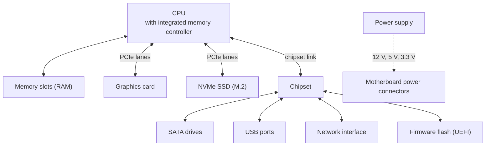
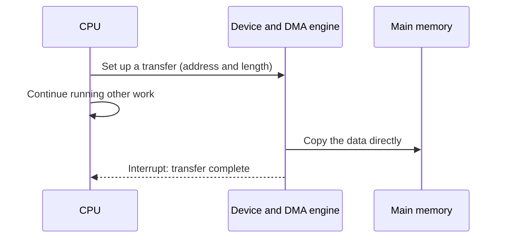

# Motherboard, Power Supply, Network Interface and Peripherals

<!-- BEGIN HEADER (generated by tools/build.py from the front matter; edit the front matter, not this block) -->
> [Home](../../../../README.md) › [Part I — Computer Science Foundations](../../index.md) › [1. Computer Fundamentals](../index.md) › [Chapter 5: Computer components](index.md)

- **Difficulty:** Beginner
- **Estimated time:** about 75 minutes
- **Prerequisites:** [Memory and Storage: RAM, ROM, Cache, SSD and HDD](02-memory-and-storage.md) · [The CPU and the GPU](01-cpu-and-gpu.md)
- **Syllabus topics covered:** `01.05.07` Motherboard · `01.05.08` Power supply · `01.05.09` Network interface card · `01.05.10` Peripheral devices
- **Status:** Drafted (passes the automated checks; awaiting independent technical review). Last reviewed 2026-11-01.
<!-- END HEADER -->

## What you will learn

- Describe what a motherboard does and how its buses and slots connect the components.
- Explain what a power supply converts, why efficiency matters, and how to budget power.
- Explain what a network interface card does, what a MAC address is and how to read one.
- Describe how peripherals attach to a computer and how the processor communicates with them (memory-mapped I/O, interrupts and DMA).

## Introduction

A processor, memory and storage are of no use until they are connected, powered and given a way to reach the outside world. This lesson covers the parts that do those jobs: the **motherboard**, which carries signals between components; the **power supply**, which feeds them; the **network interface**, which connects the machine to other computers; and **peripherals**, the devices through which people and the physical world interact with it. They are less glamorous than the CPU, but most real hardware faults, performance limits and compatibility problems occur here.

## Intuitive understanding

Think of a city. The CPU, memory and drives are buildings. The **motherboard** is the road network and the zoning plan: it decides which buildings can be reached from which, and how fast traffic can flow on each road. The **power supply** is the power station and the grid, converting high-voltage mains electricity into the safe, steady low voltages every building needs. The **network interface** is the city's gateway to other cities. **Peripherals** are the shops, post offices and traffic lights at the edge, where the city meets its residents.

## Technical foundations

### The motherboard

The **motherboard** is the main printed circuit board. It physically holds the CPU in a **socket**, the memory in **DIMM slots**, and expansion cards in **PCI Express (PCIe) slots**, and it provides connectors for storage (SATA and M.2), USB, audio and network ports, fans and power. It also carries:

- a **chipset** (or platform controller hub) that adds input/output connections beyond what the CPU provides directly. In modern designs the **memory controller** and many PCIe lanes are part of the CPU package itself, and the chipset connects to the CPU over a dedicated link and supplies further lanes, SATA, USB and so on;
- **voltage regulator modules (VRMs)** that convert the power supply's 12 V into the low, precisely controlled voltage (around one volt) the CPU needs;
- a **firmware flash chip** holding UEFI or BIOS, and a small **battery** that keeps the real-time clock running when the machine is off;
- the **traces and connectors** that carry signals, designed so that high-speed signals arrive intact.

Boards come in standard sizes (form factors) such as ATX, micro-ATX and mini-ITX, so that cases and power supplies fit. In laptops, phones and tablets the board is far more integrated: processor, memory and radios may be soldered or combined in a single **system on a chip (SoC)**.



*Reading the diagram:* the fastest devices (memory, the graphics card, an NVMe drive) connect to the CPU directly; slower ones share the chipset's link to the CPU. Power arrives separately from the supply. The exact arrangement varies between boards, but the principle, that bandwidth is allocated by *who is attached where*, is universal.

### Buses and PCI Express

A **bus** is a set of wires over which components exchange data. Older buses were *shared*: every device used the same wires in turn, so adding devices slowed everyone. **PCI Express** replaced them with **point-to-point serial links** made of **lanes**; each lane carries data in both directions at once, and a link combines 1, 4, 8 or 16 lanes (written x1, x4, x8, x16). Each PCIe generation roughly doubles the per-lane rate. The program below computes the theoretical one-direction bandwidth: PCIe 3.0 and later transmit 128 payload bits in every 130 bits on the wire, so the usable rate is the raw transfer rate $\times$ lanes $\times 128/130$, divided by 8 to convert bits to bytes. It needs Python 3.10 or newer.

<!-- run:python -->
```python
ENCODING = 128 / 130          # PCIe 3.0 and later send 128 payload bits in every 130 bits on the wire
for generation, gigatransfers in ((3, 8), (4, 16), (5, 32)):
    for lanes in (1, 4, 16):
        gb_per_s = gigatransfers * lanes * ENCODING / 8
        print(f"PCIe {generation}.0 x{lanes:<2} {gb_per_s:6.2f} GB/s per direction")
```

<!-- expect -->
```text
PCIe 3.0 x1    0.98 GB/s per direction
PCIe 3.0 x4    3.94 GB/s per direction
PCIe 3.0 x16  15.75 GB/s per direction
PCIe 4.0 x1    1.97 GB/s per direction
PCIe 4.0 x4    7.88 GB/s per direction
PCIe 4.0 x16  31.51 GB/s per direction
PCIe 5.0 x1    3.94 GB/s per direction
PCIe 5.0 x4   15.75 GB/s per direction
PCIe 5.0 x16  63.02 GB/s per direction
```

These are theoretical ceilings; real transfers are somewhat lower because of protocol overhead. The table explains common board layouts: a graphics card gets an x16 link because it moves the most data, an NVMe drive gets x4, and a network card or sound card may need only x1. It also explains why an SSD in a slot that provides fewer lanes, or an older PCIe generation, runs slower than its specification.

### The power supply

A computer's chips run on low-voltage direct current (DC), but the wall socket supplies high-voltage alternating current (AC). The **power supply unit (PSU)** converts and **regulates** it. A desktop PSU is a *switched-mode* supply: it rapidly switches the current through a transformer, which is far more efficient and compact than the older heavy transformers. It delivers several DC rails, mainly **+12 V** (for the CPU, graphics card and drives' motors), **+5 V** and **+3.3 V**.

Electrical power is voltage times current ($P = V \times I$), measured in watts. A 12 V rail supplying 20 A delivers 240 W. Three practical ideas follow:

- **Efficiency.** A supply is not perfectly efficient: some power is lost as heat. A supply that is 90% efficient and delivers 400 W to the computer draws about 444 W from the wall and wastes 44 W. Efficiency certifications such as *80 PLUS* grade supplies by this, and supplies are usually most efficient at moderate load (roughly half their rating).
- **Power budgeting.** Add up the maximum power of the components, then add headroom (commonly 20 to 30%) for peaks and for ageing. Too small a supply risks instability or shutdowns; a vastly oversized one runs inefficiently at low load and costs more.
- **Heat.** Every watt consumed is eventually released as heat, so power and cooling are two sides of one constraint, in a laptop, a server or a data centre.

<!-- run:python -->
```python
def wall_power_watts(dc_load_watts: float, efficiency: float) -> float:
    """Power drawn from the wall to deliver a given DC load, for a supply with the given efficiency."""
    return dc_load_watts / efficiency


parts = {"CPU": 125, "graphics card": 220, "motherboard and memory": 60, "drives": 15, "fans and USB devices": 20}
load = sum(parts.values())
print("DC load:", load, "W")
for efficiency in (0.80, 0.90):
    wall = wall_power_watts(load, efficiency)
    print(f"efficiency {efficiency:.0%}: draws {wall:6.1f} W from the wall, wastes {wall - load:5.1f} W as heat")
print("suggested supply rating with 30% headroom:", round(load * 1.3), "W")
```

<!-- expect -->
```text
DC load: 440 W
efficiency 80%: draws  550.0 W from the wall, wastes 110.0 W as heat
efficiency 90%: draws  488.9 W from the wall, wastes  48.9 W as heat
suggested supply rating with 30% headroom: 572 W
```

For a 440 W load, an 80%-efficient supply wastes 110 W as heat while a 90%-efficient one wastes only 49 W, so the more efficient supply saves electricity *and* reduces the cooling needed. The wattage figures for the components here are illustrative maxima, not measurements; real budgets use the manufacturers' figures. The headroom rule suggests a supply of roughly 570 W, which in practice means buying the next standard size up.

> **Important:** *never open a power supply.* Its capacitors can hold a dangerous charge even when it is unplugged. Replace the whole unit instead, and use surge protection (and, for important systems, an **uninterruptible power supply**, a battery that bridges short outages) to protect against the mains.

At data-centre scale the ratio of the energy a facility uses in total to the energy delivered to the computers themselves is called the *power usage effectiveness* (PUE). A value of 1.0 would mean no overhead at all; the excess is cooling, power conversion and lighting.

### The network interface

A **network interface card (NIC)**, or *network interface controller*, connects a computer to a network. It may be a card in a slot, a chip on the motherboard, or a wireless module (Wi-Fi, Bluetooth) that is part of the SoC. A wired Ethernet NIC:

- has a **MAC address**: a 48-bit (6-byte) hardware identifier, written as six hexadecimal bytes such as `00:00:5e:00:53:01`. For a manufacturer-assigned (globally unique) address, the first three bytes are the **organisationally unique identifier (OUI)**, assigned to the manufacturer by the IEEE, and the manufacturer chooses the rest. Two bits of the *first* byte have special meanings: the least significant bit marks a **group (multicast or broadcast)** address, and the next bit marks a **locally administered** address, one assigned by software or an administrator, not the manufacturer;
- sends and receives **frames** (the unit of data on Ethernet). Each frame ends with a 32-bit CRC, the same cyclic redundancy check from the [error detection lesson](../03-data-representation/02-error-detection-and-correction.md), and the NIC silently discards frames that fail it;
- usually moves frames to and from memory by **direct memory access (DMA)**, discussed below, and interrupts the processor when frames arrive;
- negotiates a link speed with its neighbour, such as 100 Mbit/s, 1 Gbit/s or 10 Gbit/s, and offloads work from the CPU such as checksum calculation.

The standard Ethernet payload is at most 1500 bytes. The next program decodes the special bits in some example MAC addresses and calculates the time to transmit 1500 bytes at three link speeds. The first address is from the range `00:00:5e:00:53:00` to `00:00:5e:00:53:ff`, which the IETF reserves for documentation examples (RFC 9542, which replaced RFC 7042), so it cannot clash with a real device.

<!-- run:python -->
```python
def describe_mac(text: str) -> str:
    octets = bytes(int(part, 16) for part in text.split(":"))
    assert len(octets) == 6, "a MAC address has six bytes"
    first = octets[0]
    kind = "multicast or broadcast" if first & 0x01 else "unicast"
    scope = "locally administered" if first & 0x02 else "globally unique"
    return f"{text}: {kind}, {scope}, first three bytes {octets[:3].hex(':')}"


for mac in ("00:00:5e:00:53:01", "02:00:5e:10:00:01", "01:00:5e:00:00:fb", "ff:ff:ff:ff:ff:ff"):
    print(describe_mac(mac))

frame_bits = 1500 * 8
for name, bits_per_second in (("100 Mbit/s", 100e6), ("1 Gbit/s", 1e9), ("10 Gbit/s", 10e9)):
    print(f"1500 bytes take {frame_bits / bits_per_second * 1e6:7.2f} microseconds at {name}")
```

<!-- expect -->
```text
00:00:5e:00:53:01: unicast, globally unique, first three bytes 00:00:5e
02:00:5e:10:00:01: unicast, locally administered, first three bytes 02:00:5e
01:00:5e:00:00:fb: multicast or broadcast, globally unique, first three bytes 01:00:5e
ff:ff:ff:ff:ff:ff: multicast or broadcast, locally administered, first three bytes ff:ff:ff
1500 bytes take  120.00 microseconds at 100 Mbit/s
1500 bytes take   12.00 microseconds at 1 Gbit/s
1500 bytes take    1.20 microseconds at 10 Gbit/s
```

Reading the output: the first byte `00` has neither special bit set, so the first address is an ordinary unicast, globally administered one. In `02` the second-lowest bit is set, so the second address is locally administered. In `01` the lowest bit is set, so the third address is a group address (it is the Ethernet address that IPv4 multicast DNS, mDNS, uses for service discovery). The last, all ones, is the **broadcast** address that every NIC on the local network accepts; it also happens to have both bits set. The timing lines are simply $12{,}000\ \text{bits} / \text{rate}$: 120 microseconds at 100 Mbit/s, falling tenfold with each tenfold speed increase. (They ignore frame headers, the gap between frames and waiting time.) Note that 120 microseconds is already comparable to the time an SSD takes to read a block, a reminder that network delays are never negligible. How these frames carry the messages of the client-server model is the subject of [subject 5](../../../../docs/01-computer-science-foundations/05-computer-networking/index.md) and the [client-server lesson](../01-introduction-to-computers/03-client-server-and-remote-computing.md).

### Peripherals

A **peripheral** is any device attached to the computer to provide input, output, storage or communication.

| Kind | Examples |
|---|---|
| Input | Keyboard, mouse, touchpad, touchscreen, scanner, microphone, camera, game controller |
| Output | Display, speakers, printer |
| Storage | USB flash drive, external drive |
| Communication | Bluetooth adapter, modem, Wi-Fi adapter |
| Sensors and actuators | Temperature sensors, motors (especially in embedded systems) |

Peripherals attach through standard interfaces:

- **USB (Universal Serial Bus)** is the common wired interface. It is *hot-pluggable* (devices can be attached while the computer runs) and the computer's **host controller** *enumerates* each new device, asking it what it is, and loads a matching driver. Devices declare a *class* (for example human interface devices such as keyboards, or mass storage), so many work with generic drivers. Speeds range from 480 Mbit/s for USB 2.0 to 5 and 10 Gbit/s and beyond for later versions, up to 40 Gbit/s for USB4 (with a faster option in USB4 version 2.0). The **USB-C** connector, in contrast, is only a *shape*: a USB-C port may support anything from basic USB 2.0 up to USB4 and Thunderbolt, and very different amounts of power, so check the specification of the port and the cable.
- **Bluetooth and Wi-Fi** are wireless links for low-power peripherals and for networking.
- **HDMI and DisplayPort** carry video and audio to displays.
- **PCIe** itself hosts internal cards.

### How the CPU talks to a device

A device has a small **controller** with **registers** for commands, status and data. The CPU reaches them in one of two ways: with **memory-mapped I/O**, where the registers appear at ordinary physical addresses and the CPU uses normal loads and stores (the "addresses" of the [first chapter 3 lesson](../03-data-representation/01-bits-bytes-words-and-addresses.md) include device registers), or, on x86, with separate **port** instructions. Data then moves in one of three ways:

1. **Polling.** The CPU repeatedly reads a status register to ask "are you ready?". It is simple but wastes processor time.
2. **Interrupts.** The device signals the CPU when it needs attention, and the CPU runs a handler. The CPU is free in between, but each interrupt has overhead ([Interrupts and System Calls](../06-how-computers-execute-instructions/02-interrupts-and-system-calls.md)).
3. **Direct memory access (DMA).** For bulk data, a DMA engine copies data between the device and memory *without the CPU touching each byte*. The CPU only sets up the transfer and is interrupted once at the end.



*Reading the diagram:* the CPU starts the transfer and goes on with other work. The device and its DMA engine move the data, then raise an interrupt. This is how disks, network cards and graphics cards move gigabytes without occupying the processor.

Finally, the operating system needs software for each device, a **driver**, which knows the device's registers and protocol and presents a uniform interface to programs. Drivers run with high privilege, which is why a faulty or malicious driver can crash or compromise the whole system.

## Real-world applications

- **Choosing a system.** The motherboard determines which CPUs, how much and what kind of memory, how many drives and how many expansion cards a machine can ever have, so it sets the upgrade path.
- **Troubleshooting.** Many "slow" or "dead" machines are explained by power (an undersized or failing supply), a drive on a slow link, a loose cable or a wrongly seated memory module.
- **Servers and data centres** worry about power more than almost anything else, because electricity and cooling dominate running cost; redundant supplies and efficiency ratings are standard.
- **Networking equipment** uses MAC addresses to deliver frames within a local network, and NIC features such as offload and multiple queues to reach high speeds.
- **Embedded and mobile systems** integrate most of this onto one chip, with peripherals as on-chip blocks reached through memory-mapped registers.

## Comparisons and trade-offs

| Method of moving data | CPU involvement | Latency | Typical use |
|---|---|---|---|
| Polling | Constant | Lowest for a busy device | Very fast or very simple devices, some high-speed networking |
| Interrupts | One per event | Moderate | Keyboards, mice, small transfers |
| DMA | Setup and one completion interrupt | Higher start-up, best for bulk | Disks, network cards, graphics |

A shared bus is simple and cheap but its bandwidth is divided among devices; point-to-point links such as PCIe give each device its own bandwidth at the cost of more wiring. A larger power supply gives headroom and expandability but wastes money and efficiency at low load. Integrating components (an SoC) saves space, power and cost, but removes the ability to upgrade or repair individual parts.

## Advanced concepts

- **Signal integrity.** At gigahertz speeds a trace behaves like a transmission line; boards are designed with controlled impedance, matched lengths and careful layer stacks so that signals arrive cleanly.
- **IOMMU.** A memory-management unit for devices restricts which memory a DMA-capable device may reach, protecting against faulty or malicious hardware and enabling safe device sharing with virtual machines.
- **Interrupt moderation and polling in networking.** At very high packet rates, taking an interrupt for every frame would swamp the CPU, so NICs batch interrupts, and high-performance software sometimes polls instead.
- **Smart NICs and DPUs.** Some network adapters contain their own processors that run networking, security and storage functions, taking work away from the host CPU.
- **Power delivery and management.** Processors constantly adjust voltage and frequency, and USB Power Delivery negotiates the voltage and current a device may draw, from a few watts to hundreds, which is why charger and cable compatibility matter.

## Common mistakes

> **Common mistake:** *Assuming a USB-C port or cable supports a given speed or power level.* The connector says nothing about the protocol or the power; read the specification.

- **Choosing a supply by wattage alone.** Quality, efficiency, the available connectors and the rails matter too.
- **Ignoring PCIe lanes.** Putting several fast devices on a board that shares or limits lanes can make them slower than expected.
- **Treating a MAC address as secret or permanent.** It is visible on the local network and can be changed by software.
- **Confusing MAC and IP addresses.** A MAC address identifies an interface on the local link; an IP address identifies a host on the network and can change.
- **Forgetting that devices have registers.** Reading a status register can change the device's state, so a debugger that merely "looks" at device memory can disturb it.
- **Opening a power supply**, or working inside a machine that is plugged in.

## Exercises

**Beginner**

1. Name four peripherals and classify each as input, output, storage or communication.
2. A power supply delivers 300 W at 90% efficiency. How much power does it draw from the wall?

**Intermediate**

3. For `a4:83:e7:12:34:56`, is the address unicast or multicast, and globally unique or locally administered? What are its first three bytes called?
4. Calculate the transmission time of a 9,000-byte jumbo frame at 10 Gbit/s, ignoring overhead.

**Advanced**

5. What is the theoretical bandwidth of a PCIe 4.0 x8 link? Would one lane of PCIe 5.0 be enough for a drive that streams 3 GB/s?
6. A device produces 10,000 events per second. Compare the CPU overhead of polling and of interrupts if each poll takes 200 ns, polling happens every 10 microseconds, and each interrupt costs 2 microseconds.

**Expert**

7. Explain why DMA needs an IOMMU to be safe, and what could go wrong without one.
8. Design an experiment to measure the actual efficiency of a power supply, listing the equipment you would need and the sources of error.

<details>
<summary>Solutions and hints</summary>

1. For example: keyboard (input), printer (output), USB drive (storage), Bluetooth adapter (communication).
2. $300 / 0.9 \approx 333$ W.
3. The first byte is `a4` = `1010 0100`: the lowest bit is 0 (unicast) and the next bit is 0 (globally unique). The first three bytes, `a4:83:e7`, would be the OUI assigned to the manufacturer.
4. $9000 \times 8 / (10 \times 10^9) = 7.2$ microseconds.
5. PCIe 4.0 is about 1.97 GB/s per lane, so x8 gives about 15.75 GB/s per direction. A single PCIe 5.0 lane gives about 3.94 GB/s, which is enough for 3 GB/s in theory, leaving a small margin.
6. Polling every 10 microseconds is 100,000 polls per second at 200 ns each, which is 20 ms of CPU time per second (2% of a core). Interrupts cost $10{,}000 \times 2\ \mu\text{s} = 20$ ms per second (also 2%). They are equal here; polling wins at very high event rates and interrupts win when events are rare, because polling cost does not depend on the events.
7. A DMA-capable device can read and write memory directly. Without address translation and permission checks for devices, a buggy or malicious device (or a compromised driver or virtual machine) could read secrets from or overwrite any memory, including the kernel.
8. Measure the DC power delivered and the AC power drawn with a power meter at several loads, using a controllable load. Sources of error include meter accuracy, power factor and waveform distortion, temperature and warm-up, and load stability.

</details>

## Interview and practical questions

**What does a motherboard do?** It physically holds and electrically connects the CPU, memory, storage and expansion cards, supplies regulated power to them, and carries the chipset, firmware and ports.

**What is a MAC address?** A 48-bit identifier of a network interface on a local network, usually assigned by the manufacturer, whose first three bytes identify the manufacturer.

**What is DMA and why is it used?** Direct memory access lets a device transfer data to or from memory without the CPU copying each byte, freeing the CPU for other work.

**What is the difference between polling and interrupts?** Polling repeatedly asks a device if it is ready; an interrupt is the device telling the CPU when it is ready.

**How would you size a power supply?** Sum the maximum power of the components, add headroom of about 20 to 30%, and prefer a supply whose efficient range matches the typical load.

## Further reading

**Standards and specifications**

- PCI-SIG, the PCI Express specifications: [pcisig.com](https://pcisig.com/).
- USB Implementers Forum, USB specifications: [usb.org](https://www.usb.org/).
- IETF, *IANA Considerations and IETF Protocol and Documentation Usage for IEEE 802 Parameters*, RFC 9542 (which replaced RFC 7042): [rfc-editor.org](https://www.rfc-editor.org/rfc/rfc9542).
- IEEE 802.3, the Ethernet standard: [IEEE Standards](https://standards.ieee.org/).

**Textbooks**

- David A. Patterson and John L. Hennessy, *Computer Organization and Design* (Morgan Kaufmann), the sections on input/output and buses.
- Andrew S. Tanenbaum and Todd Austin, *Structured Computer Organization* (Pearson), the chapters on input/output.

**Official documentation for the code used here**

- Python: [`bytes.hex`](https://docs.python.org/3/library/stdtypes.html#bytes.hex) and [formatted string literals](https://docs.python.org/3/reference/lexical_analysis.html#f-strings).

<!-- BEGIN FOOTER (generated by tools/build.py) -->
---

## Related topics

- [Error Detection and Correction](../03-data-representation/02-error-detection-and-correction.md)
- [Client-Server and Remote Computing](../01-introduction-to-computers/03-client-server-and-remote-computing.md)

## Navigation

**Previous:** [Memory and Storage: RAM, ROM, Cache, SSD and HDD](02-memory-and-storage.md) · **Up:** [Chapter 5: Computer components](index.md) · **Next:** [The Fetch-Decode-Execute Cycle](../06-how-computers-execute-instructions/01-the-fetch-decode-execute-cycle.md)
<!-- END FOOTER -->
