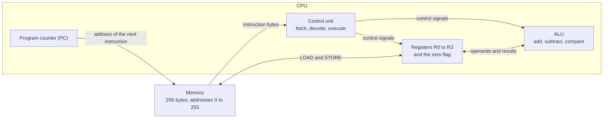
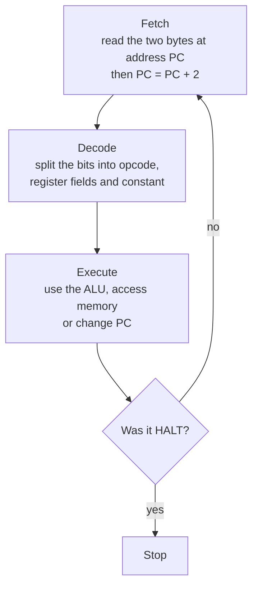
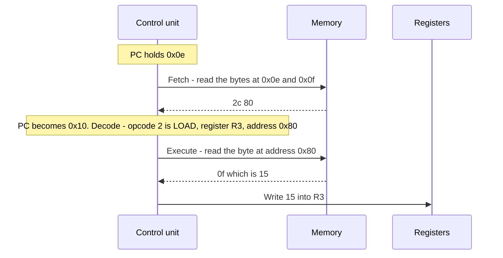
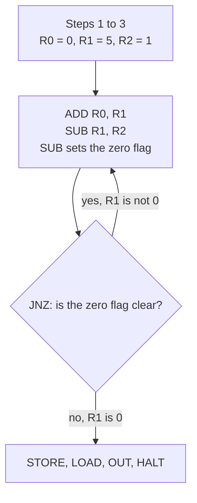

# The Fetch-Decode-Execute Cycle

<!-- BEGIN HEADER (generated by tools/build.py from the front matter; edit the front matter, not this block) -->
> [Home](../../../../README.md) › [Part I — Computer Science Foundations](../../index.md) › [1. Computer Fundamentals](../index.md) › [Chapter 6: How computers execute instructions](index.md)

- **Difficulty:** Beginner to intermediate
- **Estimated time:** about 90 minutes
- **Prerequisites:** [Bits, Bytes, Words and Memory Addresses](../03-data-representation/01-bits-bytes-words-and-addresses.md) · [Binary Arithmetic](../02-number-systems/03-binary-arithmetic.md) · [The CPU and the GPU](../05-computer-components/01-cpu-and-gpu.md)
- **Syllabus topics covered:** `01.06.01` Fetch-decode-execute cycle · `01.06.02` Machine instructions · `01.06.03` Registers · `01.06.04` Memory access · `01.06.06` Instruction execution
- **Status:** Drafted (passes the automated checks; awaiting independent technical review). Last reviewed 2026-11-14.
<!-- END HEADER -->

## What you will learn

- Describe the three steps of the fetch-decode-execute cycle and say what the program counter does in each.
- Read and write the binary encoding of a machine instruction, with its opcode, register fields and constant, for a small instruction set.
- Explain what registers are, why a processor needs them as well as memory, and how `LOAD` and `STORE` move data between the two.
- Trace a loop through a processor instruction by instruction, including the zero flag and a conditional jump.
- Run, read and extend a working simulator and assembler for a tiny 8-bit computer written in Python.

## Introduction

Every program you have ever run, whatever language it was written in, is carried out by the same loop. The processor **fetches** an instruction from memory, **decodes** it to see what it asks for, **executes** it, and then moves on to the next one. That is all a CPU does, billions of times a second. A web browser, a game and an operating system all emerge from enormous numbers of these tiny steps.

This lesson explains the loop on a computer small enough to hold in your head and simple enough to build in about a hundred lines of Python. It covers five syllabus topics: the fetch-decode-execute cycle, machine instructions, registers, memory access and instruction execution. Real processors add many speed tricks, and later chapters and [Subject 3](../../03-digital-logic-and-computer-organization/index.md) return to them, but what a program *means* is defined by this loop.

The next lesson, [Interrupts and System Calls](02-interrupts-and-system-calls.md), shows how the loop is interrupted by the outside world and how programs ask the operating system for help.

## Intuitive understanding

Think of following a recipe card, a numbered list of steps. Your finger rests on the current step: that is the **program counter**. You read the step (**fetch**), work out what it is asking for (**decode**) and do it (**execute**), using the ingredients on your worktop, which are the **registers**, and the ones in the cupboard, which is **memory**. Then your finger moves to the next step, unless the step says "go back to step 4 until the dough is smooth". That moves your finger somewhere else. It is a **jump**, and it is how loops and decisions work.

The analogy has limits. A cook understands what "knead" means; a processor understands nothing and only matches bit patterns to actions that are wired into it. And a real processor does not do one step at a time: it overlaps many steps of the recipe like an assembly line, while giving the same results as if it had done them one by one.

## Technical foundations

### The stored-program idea

A program is a list of instructions, and the instructions are kept in memory as numbers, in the same memory as the data they work on. This **stored-program** idea was written down in the 1945 report *First Draft of a Report on the EDVAC* by John von Neumann, drawing on discussions with the EDVAC design team at the University of Pennsylvania's Moore School; because others also contributed to the idea, the credit for it is disputed. A design that keeps instructions and data in one memory is called a **von Neumann architecture**. The alternative keeps them in two separate memories and is called a **Harvard architecture**; it is common in small microcontrollers. Modern processors give programs a single memory, but inside the chip the first-level cache is usually split into one part for instructions and one for data; the cache levels are described in [Memory and Storage](../05-computer-components/02-memory-and-storage.md#cache).

Because instructions are just bytes in memory, the processor needs one extra piece of state to know where it is in the program. The **program counter (PC)** holds the address of the next instruction. The whole behaviour of a computer follows from one rule, repeated: use the PC to fetch an instruction, move the PC on, and do what the instruction says.

### The parts of our tiny computer

The computer built in this lesson has six parts, shown in the diagram and listed in the table.



*Reading the diagram:* the program counter supplies the address of the next instruction. Memory returns the instruction's bytes to the control unit, which steers the registers and the ALU. Registers also exchange data with memory directly, but only when an instruction asks for it with `LOAD` or `STORE`.

| Part | In the simulator | What it does |
| --- | --- | --- |
| Memory | `memory`, 256 bytes | Holds the program and its data. Addresses 0 to 255 fit in one byte. |
| Registers | `reg`, R0 to R3, 8 bits each | Fast working storage inside the CPU. |
| Program counter | `pc` | Address of the next instruction to fetch. |
| Zero flag | `zero` | Records whether the last arithmetic result was zero. |
| ALU | `alu()` | Adds, subtracts and compares 8-bit numbers. |
| Control unit | `step()` | Runs the fetch-decode-execute cycle. |

Everything is 8 bits wide, so values run from 0 to 255 and arithmetic wraps around at 256, as described in [Binary Arithmetic](../02-number-systems/03-binary-arithmetic.md#overflow-wraparound-and-saturation). In hardware the ALU is built from gates, as shown in [How hardware adds](../02-number-systems/03-binary-arithmetic.md#how-hardware-adds), and the registers and the PC are built from flip-flops, circuits that remember a bit.

### Machine instructions and how they are encoded

A **machine instruction** is a bit pattern that tells the processor to do one small thing: copy a number, add two numbers, jump to another place. Our computer uses instructions that are 16 bits (two bytes) long, laid out like this:

| Field | Bits | Meaning |
| --- | --- | --- |
| `oooo` | 4 | The **opcode**, which says what to do |
| `aa` | 2 | The first register: R0, R1, R2 or R3 |
| `bb` | 2 | The second register |
| `iiiiiiii` | 8 | A constant, or the address of a memory byte |

Four bits allow 16 opcodes, and this machine uses 11 of them:

| Opcode | Instruction | Meaning | Sets the zero flag? |
| --- | --- | --- | --- |
| 0 | `HALT` | Stop the machine | No |
| 1 | `LOADI Ra, c` | Ra ← the constant c | No |
| 2 | `LOAD Ra, [m]` | Ra ← the memory byte at address m | No |
| 3 | `STORE Ra, [m]` | The memory byte at address m ← Ra | No |
| 4 | `ADD Ra, Rb` | Ra ← Ra + Rb (8 bits, wrapping) | Yes |
| 5 | `SUB Ra, Rb` | Ra ← Ra − Rb (8 bits, wrapping) | Yes |
| 6 | `CMP Ra, Rb` | Work out Ra − Rb and keep only the flag | Yes |
| 7 | `JMP t` | PC ← t | No |
| 8 | `JZ t` | If the zero flag is set, PC ← t | No |
| 9 | `JNZ t` | If the zero flag is clear, PC ← t | No |
| 10 (0xA) | `OUT Ra` | Append Ra to the program's output | No |

Three words are used throughout. A **mnemonic** is the short name of an instruction, such as `ADD`. An **operand** is a value an instruction works on: here a register, a constant or an address. An **immediate** is an operand written inside the instruction itself, like the 5 in `LOADI R1, 5`.

To see the layout in action, take `ADD R0, R1`. The opcode is 4 (`0100`), the first register is R0 (`00`) and the second is R1 (`01`), so the first byte is `0100 0001`, which is `0x41`. The constant byte is unused and is 0. The program below packs and unpacks instructions with the shifts and masks from [Binary Arithmetic](../02-number-systems/03-binary-arithmetic.md#bitwise-operations-and-shifts); in hardware the same job is done by wiring, because the opcode bits simply run to the circuit that selects the operation.

<!-- run:python -->
```python
# One instruction is 16 bits:  oooo aabb iiiiiiii
#   oooo = opcode (4 bits), aa and bb = register numbers (2 bits each),
#   iiiiiiii = a constant or a memory address (8 bits)
ADD, LOADI = 4, 1                                  # two opcode numbers from the table above


def encode(opcode, a=0, b=0, constant=0):
    first_byte = (opcode << 4) | (a << 2) | b      # pack oooo, aa and bb into one byte
    return bytes([first_byte, constant])


def decode(first_byte, constant):
    return first_byte >> 4, (first_byte >> 2) & 0b11, first_byte & 0b11, constant


for label, word in [("ADD R0, R1", encode(ADD, a=0, b=1)),
                    ("LOADI R2, 42", encode(LOADI, a=2, constant=42))]:
    print(f"{label:<13} -> {word.hex(' ')}  =  {word[0]:08b} {word[1]:08b}")
    print("   decoded (opcode, a, b, constant):", decode(*word))
```

<!-- expect -->
```text
ADD R0, R1    -> 41 00  =  01000001 00000000
   decoded (opcode, a, b, constant): (4, 0, 1, 0)
LOADI R2, 42  -> 18 2a  =  00011000 00101010
   decoded (opcode, a, b, constant): (1, 2, 0, 42)
```

Writing bits by hand is slow and easy to get wrong, so people write **assembly language**, in which each instruction is a mnemonic followed by its operands, and use an **assembler** to translate it into machine code. The translation is one to one, unlike a compiler, which turns each line of a high-level language into many instructions. An assembler also lets you write a **label** such as `loop:` to name an address, so that jumps do not need hard-coded numbers. A complete assembler is part of the program in the next section.

The set of instructions a processor understands, together with its registers, its encoding and the way it addresses memory, is its **instruction set architecture (ISA)**. x86-64 (Intel and AMD), Arm and RISC-V are ISAs. A program built for one ISA cannot run on another unless an emulator pretends to be the other processor. The simulator in this lesson is a small emulator of an invented ISA.

### The cycle: fetch, decode, execute

The processor repeats three steps until it is told to stop.

1. **Fetch.** Read the instruction from memory at the address in the PC. In our computer that means reading two bytes. Then add 2 to the PC, so that it already points at the *next* instruction.
2. **Decode.** Split the instruction into its fields: opcode, register numbers and constant. The opcode decides what happens next.
3. **Execute.** Carry out the operation: do arithmetic in the ALU, read or write memory, or change the PC. Arithmetic also updates the zero flag.



*Reading the diagram:* the cycle is a loop with a single exit, the `HALT` instruction. Everything a computer does, from drawing a window to compressing a video, is a path around this loop.

The PC is advanced during the fetch, not at the end, because a jump simply overwrites it. If a jump is taken, the new address replaces the already-advanced one; if it is not taken, execution falls through to the next instruction with no extra work.

The sequence diagram below follows one instruction in detail: a `LOAD` that reads a byte from memory into R3. It touches memory twice, once to fetch the instruction itself and once to fetch the data the instruction asks for.



*Reading the diagram:* the numbers are those of the `LOAD R3, [0x80]` instruction in the program later in this lesson. Real processors follow the same logic, but they split each phase into smaller stages and overlap the phases of different instructions; the [Advanced concepts](#advanced-concepts) section returns to this.

### Registers

A **register** is a small storage location inside the CPU that the ALU can use directly. Our computer has four, R0 to R3, each holding 8 bits. Registers exist for three reasons.

- **Speed.** A register is read within the processor's own clock cycle, while main memory takes far longer. [Memory and Storage](../05-computer-components/02-memory-and-storage.md#the-hierarchy-in-numbers) puts numbers on the gap.
- **Short instructions.** Naming one of four registers takes 2 bits, while naming one of 256 memory addresses takes 8. Real processors have more registers and so spend more bits per operand, but the saving is the same in kind.
- **Parallel access.** An ALU can read two registers at the same moment and write its result back to one of them. A memory has far fewer access ports.

Besides general-purpose registers like R0 to R3, processors have special ones: the program counter, the **stack pointer**, which tracks the call stack (our machine has none), and a **flags** or **status register**, which holds single-bit results of earlier operations. Our machine has just one flag, the zero flag. Real flag registers hold more, typically a zero flag, a sign (negative) flag, a carry flag and an overflow flag, and conditional jumps test them.

How many registers do real processors have? An x86-64 processor has 16 general-purpose 64-bit registers. A 64-bit Arm processor (AArch64) has 31 general-purpose registers, plus a stack pointer and a register that always reads as zero. RISC-V has 32 integer registers, x0 to x31, of which x0 always reads as zero. Compilers work hard to keep the values a program is using in registers, because running out of them forces slow trips to memory.

### Memory access: LOAD and STORE

Memory, as described in [Bits, Bytes, Words and Memory Addresses](../03-data-representation/01-bits-bytes-words-and-addresses.md#memory-as-an-array-of-bytes), is an array of bytes, each with an address. Our computer reaches it in exactly three ways. The fetch step reads the instruction. `LOAD` copies a byte from memory into a register. `STORE` copies a register into a memory byte. Every other instruction works only on registers and constants.

A design in which only loads and stores touch memory is called a **load/store architecture**. Arm and RISC-V are load/store architectures. x86 is not: many of its instructions can take a memory operand directly, for example by adding a value in memory to a register. Load/store designs keep the hardware simple and make the cost of memory access visible in the code, while x86 trades a more complex decoder for code that is typically denser.

The address in our `LOAD` and `STORE` is written in the instruction itself, so an instruction can reach only the one address it names. This is called **absolute addressing**. Real instruction sets add other **addressing modes**: the address held in a register (so one instruction can walk through an array), a register plus an offset (to reach a field of a structure), and an address relative to the PC (so code works wherever it is loaded). Our machine's lack of a register-based mode is a real limitation, and exercise 9 shows what it takes to get around it.

Memory access also dominates real-world speed. Every instruction costs at least one memory read, to fetch it, and `LOAD` and `STORE` cost more. That is why the caches described in [Memory and Storage](../05-computer-components/02-memory-and-storage.md#cache) matter so much. A related technique, **memory-mapped I/O**, lets a program control a device by storing to special addresses; [Motherboard, Power Supply, Network Interface and Peripherals](../05-computer-components/03-motherboard-power-nic-and-peripherals.md#how-the-cpu-talks-to-a-device) shows how.

### Instruction execution: flags, jumps and loops

Left alone, the PC moves through the program in order. **Control-flow instructions** change that. `JMP` always jumps. `JZ` and `JNZ` are **conditional jumps**: they look at the zero flag, which the most recent arithmetic or comparison set. In our machine only `ADD`, `SUB` and `CMP` change the flag; `LOADI`, `LOAD`, `STORE`, the jumps and `OUT` leave it alone. That detail matters in the next lesson.

Two patterns cover most of programming.

- **A decision.** Compare two values with `CMP Ra, Rb`, which sets the flag if they are equal, then use `JZ` to jump to the code for the "equal" case.
- **A loop.** Count a register down to zero with `SUB`, then use `JNZ` to jump back to the top of the loop while the counter is not zero. This is exactly how the demo program in the next section adds up the numbers 5, 4, 3, 2 and 1.

The same computation in a high-level language is a `while` loop. A compiler's job is to turn loops like this into instructions like those of our machine.

<!-- run:python -->
```python
total = 0
counter = 5
while counter != 0:        # JNZ: go round again while the counter is not zero
    total += counter       # ADD R0, R1
    counter -= 1           # SUB R1, R2
print(total)
```

<!-- expect -->
```text
15
```

## Step-by-step working: running a program

The program below adds 5 + 4 + 3 + 2 + 1 with the loop pattern, stores the answer in memory, reads it back and outputs it. Its control flow looks like this.



The code that follows is the complete computer. It has an assembler, a function that writes decoded instructions back out as text, and the `CPU` class, whose `step()` method is the fetch-decode-execute cycle itself. It needs Python 3.8 or newer. The driver at the end assembles the program, prints the machine code, then runs it one step at a time and prints a trace.

<!-- run:python -->
```python
"""A tiny 8-bit computer: four registers, a zero flag and 256 bytes of memory."""

# Instruction format (16 bits):   oooo aabb iiiiiiii
#   oooo = opcode, aa = first register, bb = second register,
#   iiiiiiii = an 8-bit constant or memory address
OPCODES = {"HALT": 0, "LOADI": 1, "LOAD": 2, "STORE": 3, "ADD": 4, "SUB": 5,
           "CMP": 6, "JMP": 7, "JZ": 8, "JNZ": 9, "OUT": 10}
NAME = {code: name for name, code in OPCODES.items()}
# Operands of each instruction: r = register, c = constant,
# m = memory address written [0x80], t = jump target (an address or a label)
SHAPE = {"HALT": "", "LOADI": "rc", "LOAD": "rm", "STORE": "rm", "ADD": "rr",
         "SUB": "rr", "CMP": "rr", "JMP": "t", "JZ": "t", "JNZ": "t", "OUT": "r"}


def assemble(source):
    """Turn assembly text into machine code. Pass 1 finds the labels, pass 2 encodes."""
    instructions, labels = [], {}
    for line in source.splitlines():
        line = line.split(";")[0].strip()                  # remove comments
        while ":" in line:                                 # "name:" labels the next instruction
            label, line = line.split(":", 1)
            labels[label.strip()] = 2 * len(instructions)  # each instruction is 2 bytes long
            line = line.strip()
        if line:
            instructions.append(line)
    code = bytearray()
    for line in instructions:
        mnemonic, *operands = line.replace(",", " ").split()
        mnemonic = mnemonic.upper()
        if mnemonic not in OPCODES or len(operands) != len(SHAPE[mnemonic]):
            raise ValueError(f"cannot assemble: {line!r}")
        registers, value = [], 0
        for shape, token in zip(SHAPE[mnemonic], operands):
            if shape == "r":
                registers.append(int(token[1:]))           # "R2" -> 2
            elif shape == "t" and token in labels:
                value = labels[token]                      # a label -> its address
            else:
                value = int(token.strip("[]"), 0)          # 5, 0x80 or [0x80]
        a, b = (registers + [0, 0])[:2]
        if not (0 <= a < 4 and 0 <= b < 4 and 0 <= value < 256):
            raise ValueError(f"operand out of range: {line!r}")
        code += bytes([(OPCODES[mnemonic] << 4) | (a << 2) | b, value])
    return bytes(code)


def show(first, constant):
    """Write a decoded instruction back out as assembly text."""
    name = NAME[first >> 4]
    registers = iter([(first >> 2) & 3, first & 3])        # the two register fields
    parts = []
    for shape in SHAPE[name]:
        if shape == "r":
            parts.append(f"R{next(registers)}")
        elif shape == "c":
            parts.append(str(constant))
        elif shape == "m":
            parts.append(f"[{constant:#04x}]")
        else:
            parts.append(f"{constant:#04x}")
    return name + (" " + ", ".join(parts) if parts else "")


class CPU:
    def __init__(self, program):
        self.memory = bytearray(256)                       # addresses 0..255
        self.memory[:len(program)] = program               # the program starts at address 0
        self.reg = [0, 0, 0, 0]                            # R0..R3, one byte each
        self.pc = 0                                        # program counter
        self.zero = False                                  # the zero flag
        self.output, self.steps, self.halted = [], 0, False

    def alu(self, result):
        result &= 0xFF                                     # keep 8 bits: 255 + 1 wraps to 0
        self.zero = result == 0                            # remember whether the result was 0
        return result

    def step(self):
        """Run one fetch-decode-execute cycle; return (address, instruction text)."""
        address = self.pc
        # 1. FETCH: read the two bytes at PC, then point PC at the next instruction
        first, constant = self.memory[address], self.memory[(address + 1) % 256]
        self.pc = (address + 2) % 256
        # 2. DECODE: split the 16 bits into their fields
        op, a, b = first >> 4, (first >> 2) & 3, first & 3
        if op not in NAME:
            raise RuntimeError(f"illegal instruction {first:#04x} at {address:#04x}")
        name, reg = NAME[op], self.reg
        # 3. EXECUTE
        if name == "HALT":
            self.halted = True
        elif name == "LOADI":
            reg[a] = constant
        elif name == "LOAD":
            reg[a] = self.memory[constant]
        elif name == "STORE":
            self.memory[constant] = reg[a]
        elif name == "ADD":
            reg[a] = self.alu(reg[a] + reg[b])
        elif name == "SUB":
            reg[a] = self.alu(reg[a] - reg[b])
        elif name == "CMP":
            self.alu(reg[a] - reg[b])                      # set the flag, discard the result
        elif name == "JMP":
            self.pc = constant
        elif name == "JZ" and self.zero:
            self.pc = constant
        elif name == "JNZ" and not self.zero:
            self.pc = constant
        elif name == "OUT":
            self.output.append(reg[a])
        self.steps += 1
        return address, show(first, constant)

    def run(self, max_steps=10_000):
        while not self.halted and self.steps < max_steps:
            self.step()
        return self


PROGRAM = """
        LOADI R0, 0        ; sum = 0
        LOADI R1, 5        ; counter = 5
        LOADI R2, 1        ; the constant 1, used to count down
loop:   ADD   R0, R1       ; sum = sum + counter
        SUB   R1, R2       ; counter = counter - 1 (sets the zero flag when it reaches 0)
        JNZ   loop         ; if the counter is not zero, go round again
        STORE R0, [0x80]   ; write the sum to memory address 0x80
        LOAD  R3, [0x80]   ; read it back into R3
        OUT   R3           ; output R3
        HALT
"""

if __name__ == "__main__":
    code = assemble(PROGRAM)
    print("machine code:", code.hex(" "))
    cpu = CPU(code)
    print("step  pc    instruction        R0  R1  R2  R3  Z")
    while not cpu.halted:
        address, text = cpu.step()
        r = cpu.reg
        print(f"{cpu.steps:>4}  {address:#04x}  {text:<17}{r[0]:>4}{r[1]:>4}{r[2]:>4}{r[3]:>4}  {int(cpu.zero)}")
    print("output:", cpu.output, "after", cpu.steps, "steps")
    print("memory[0x80] =", cpu.memory[0x80])
```

<!-- expect -->
```text
machine code: 10 00 14 05 18 01 41 00 56 00 90 06 30 80 2c 80 ac 00 00 00
step  pc    instruction        R0  R1  R2  R3  Z
   1  0x00  LOADI R0, 0         0   0   0   0  0
   2  0x02  LOADI R1, 5         0   5   0   0  0
   3  0x04  LOADI R2, 1         0   5   1   0  0
   4  0x06  ADD R0, R1          5   5   1   0  0
   5  0x08  SUB R1, R2          5   4   1   0  0
   6  0x0a  JNZ 0x06            5   4   1   0  0
   7  0x06  ADD R0, R1          9   4   1   0  0
   8  0x08  SUB R1, R2          9   3   1   0  0
   9  0x0a  JNZ 0x06            9   3   1   0  0
  10  0x06  ADD R0, R1         12   3   1   0  0
  11  0x08  SUB R1, R2         12   2   1   0  0
  12  0x0a  JNZ 0x06           12   2   1   0  0
  13  0x06  ADD R0, R1         14   2   1   0  0
  14  0x08  SUB R1, R2         14   1   1   0  0
  15  0x0a  JNZ 0x06           14   1   1   0  0
  16  0x06  ADD R0, R1         15   1   1   0  0
  17  0x08  SUB R1, R2         15   0   1   0  1
  18  0x0a  JNZ 0x06           15   0   1   0  1
  19  0x0c  STORE R0, [0x80]   15   0   1   0  1
  20  0x0e  LOAD R3, [0x80]    15   0   1  15  1
  21  0x10  OUT R3             15   0   1  15  1
  22  0x12  HALT               15   0   1  15  1
output: [15] after 22 steps
memory[0x80] = 15
```

*Reading the code.* `assemble()` works in two passes. The first pass strips comments and records the address of every label; the second encodes each instruction with the bit layout from the previous section, looking label names up in the table the first pass built. `show()` is the reverse of encoding and is used only to print the trace. In `CPU.step()` the comments `FETCH`, `DECODE` and `EXECUTE` mark the three phases: fetch reads two bytes and advances the PC by 2, decode splits the first byte with shifts and masks, and execute is a chain of `if` statements, one per instruction. `alu()` is the only place that sets the zero flag, which makes it easy to see which instructions affect it. `run()` repeats `step()` until the machine halts or reaches a step limit, which protects against a program that never ends. An unknown opcode raises an error, the simulated version of the *illegal instruction* exception on real hardware.

*Reading the trace.* Each line is one pass around the cycle and shows the registers and the zero flag after the instruction has run.

- Steps 1 to 3 set R0 to 0, R1 to 5 and R2 to 1.
- Steps 4 to 6 are the first trip round the loop. `ADD` makes R0 equal to 5, `SUB` lowers R1 to 4, and `JNZ` jumps, so the `pc` column goes from `0x0a` back to `0x06`.
- The loop body runs five times. At step 17, `SUB` makes R1 equal to 0 and sets the zero flag, so the last column becomes 1. At step 18, `JNZ` sees the flag set and does not jump, so execution falls through to the next instruction at `0x0c`.
- At step 19, `STORE` writes R0 (15) to memory address `0x80`. At step 20, `LOAD` reads it back into R3. Step 21 outputs it and step 22 halts the machine.

The step count is 3 set-up instructions, 5 passes of 3 loop instructions, and 4 finishing instructions: 3 + 15 + 4 = 22.

Here are some experiments to try: change the 5 to a different number, delete the `STORE` and `LOAD` lines and change `OUT R3` to `OUT R0`, or add a second `OUT`. The exercises below build on them.

## Real-world applications

- **Reading compiler output and debuggers.** Tools such as `objdump -d` on Linux and the disassembly views in debuggers show the instructions a program was compiled into. This is how performance engineers and security researchers see what the processor really runs. Everything in this lesson applies: addresses, mnemonics, registers and jumps.
- **Emulators and virtual machines.** An emulator such as QEMU runs a program built for one ISA on a processor of another by doing in software what `CPU.step()` does here. Language runtimes work in a similar way: the main loop of the Python interpreter, and the interpreter inside the Java Virtual Machine, each fetch, decode and execute bytecode instructions.
- **Embedded systems.** The firmware in appliances, vehicles and sensors runs on microcontrollers whose cycle is close to the one you have just seen, with a handful of registers and a few kilobytes of memory.
- **Processor design and teaching.** Courses and books build exactly this kind of machine, first in a simulator and then in hardware, to explain how computers work. *The Elements of Computing Systems* is a well-known example.
- **Security.** Many attacks aim to make the program counter point at instructions chosen by the attacker. Knowing that the PC and the instructions are just values in a machine is the first step to understanding how such attacks work and how they are prevented.

## Comparisons and trade-offs

The table compares our toy computer with two real ISAs.

| Feature | Our computer | RISC-V (base 32-bit ISA) | x86-64 |
| --- | --- | --- | --- |
| Instruction length | Fixed, 2 bytes | Fixed, 4 bytes (2 bytes with the optional compressed extension) | Variable, 1 to 15 bytes |
| General-purpose registers | 4 | 31, plus a register that always reads 0 | 16 |
| Memory operands | Only in `LOAD` and `STORE` | Only in loads and stores | Allowed in many instructions |
| Flags | One zero flag | None: branches compare registers directly | A flags register (zero, sign, carry, overflow and more) |
| Decoding | A few shifts and masks | Regular and simple | Complex, built up over decades |

The style of the first two columns is called **RISC** (reduced instruction set computer) and the style of the last is called **CISC** (complex instruction set computer). RISC designs offer a small set of simple, regular instructions that are easy to decode and to run quickly in a pipeline. CISC designs offer more complex instructions and compact encodings. The line is blurred today: modern x86 processors translate their instructions into simpler internal operations, called **micro-operations**, and run those with machinery much like a RISC processor's. [Subject 3](../../03-digital-logic-and-computer-organization/index.md) compares the styles in detail.

Another axis is where operands live. Our machine, and most real processors, are **register machines**. A **stack machine** instead takes its operands from a stack, which makes instructions shorter because they name no registers. The Java Virtual Machine, WebAssembly and Python's bytecode are all designed this way, and an interpreter or JIT compiler maps them onto the registers of the real processor.

## Advanced concepts

- **Pipelining.** Instead of finishing one instruction before starting the next, a pipelined processor fetches one instruction while decoding a second and executing a third, like an assembly line. A taken jump makes the instructions already fetched wrong, so processors predict the outcome of branches and sometimes guess wrong. [Subject 3](../../03-digital-logic-and-computer-organization/index.md) covers pipelining and branch prediction.
- **Superscalar and out-of-order execution.** A modern core starts several instructions in the same clock cycle and may run them in a different order from the program, as long as the results are the same as if they had run one by one. This is where the cycles-per-instruction figure discussed in [The CPU and the GPU](../05-computer-components/01-cpu-and-gpu.md) comes from.
- **Microcode and micro-operations.** Many complex instructions are carried out as sequences of simpler internal steps, either read from a small memory called microcode or produced by the decoder.
- **Programs that write programs.** Because instructions are bytes in memory, a program can create or change instructions. A just-in-time (JIT) compiler does this on purpose, producing machine code at run time and then jumping to it. Because accidental or malicious self-modification is dangerous, operating systems usually let a page of memory be writable or executable but not both at once, a policy often called W^X. Exercise 9 shows the idea on our machine, where nothing prevents it.
- **Halting.** Real processors do not stop at the end of a program. When there is nothing to run, the operating system executes an idle instruction (`HLT` on x86, `WFI` on Arm and RISC-V) that pauses the core until an interrupt arrives. The next lesson shows what an interrupt is.

## Common mistakes

> **Common mistake:** *Thinking the processor reads your source code.* It executes only machine code. Compilers, assemblers and interpreters exist to produce it or to imitate its effect.

- **Mixing up the constant and the memory forms.** `LOADI R1, 5` puts the number 5 in R1, but `LOAD R1, [5]` puts the contents of memory address 5 there.
- **Forgetting that the PC is already ahead.** While an instruction executes, the PC points at the next instruction, not the current one. Many instruction sets work this way, which matters for relative jumps and for reading return addresses.
- **Treating a jump target as a line number.** It is a byte address. With 2-byte instructions the third instruction is at address 4, not 3. Labels exist to prevent exactly this error.
- **Forgetting 8-bit wraparound.** In an 8-bit register 255 + 1 is 0, and it sets the zero flag. Exercises 4 and 6 depend on this.
- **Reading the operands backwards.** In our assembler, as in Intel syntax for x86, the destination comes first, so `SUB R1, R2` means R1 = R1 − R2. AT&T syntax, the default in some GNU tools, writes the source first.
- **Writing a loop with no way out.** If nothing changes the value that a conditional jump tests, the program never ends. That is why `run()` has a step limit.

## Exercises

**Beginner**

1. Encode `SUB R2, R3` as two bytes, written in hexadecimal.
2. Decode the two instructions `18 2a` and `4e 00`.
3. After the demo program in this lesson halts, what do R0, R1, R2, R3 and memory address `0x80` contain?

**Intermediate**

4. The program below prints 15, the sum of 5 down to 1, and takes 20 steps. A careless edit deletes the line `SUB R1, R2`. Before running anything, predict whether the program still stops, what it prints, and how many instructions it executes.

```text
        LOADI R0, 0
        LOADI R1, 5
        LOADI R2, 1
loop:   ADD   R0, R1
        SUB   R1, R2
        JNZ   loop
        OUT   R0
        HALT
```

5. Write a program for this machine that works out 6 × 7 by repeated addition and outputs the answer. Assemble it and count the steps.
6. In the demo program change `LOADI R1, 5` to `LOADI R1, 100`. The true sum of 100 down to 1 is 5050. What does the machine print, and why?

**Advanced**

7. Why does the fetch step advance the PC before the instruction executes, instead of after?
8. The opcode field has 4 bits and 11 opcodes are in use. How many more instructions can be added without changing the encoding, and what could you do if you needed more?

**Expert**

9. `LOAD` and `STORE` name a fixed address, so no instruction reads "the byte whose address is in a register". Using only the 11 instructions, write a program that sums four bytes stored at addresses `0x80` to `0x83`. Hint: instructions are bytes in memory too.

<details>
<summary>Solutions and hints</summary>

1. Opcode 5 is `0101`, R2 is `10` and R3 is `11`, so the first byte is `0101 1011`, which is `0x5b`. The constant byte is 0, so the instruction is `5b 00`.
2. In `18 2a` the first byte `0001 1000` has opcode 1 (`LOADI`) and register field `10`, which is R2, and the constant `0x2a` is 42, so it is `LOADI R2, 42`. In `4e 00` the first byte `0100 1110` has opcode 4 (`ADD`), first register `11` (R3) and second register `10` (R2), so it is `ADD R3, R2`.
3. R0 = 15 (the sum), R1 = 0 (the counter), R2 = 1 (the constant), R3 = 15 (the value loaded back), and memory address `0x80` holds 15. The program at the end of this section prints these values.
4. The program does stop, but only after a long detour. R1 is never changed, so the loop test no longer depends on a counter. Only `ADD` can set the zero flag now, and it does so when R0 becomes 0, which happens when the running total wraps around the 8-bit range. The total takes the values 5, 10, 15 and so on, and the first multiple of 5 that is also a multiple of 256 is $5 \times 256 = 1280$, so the loop runs 256 times and the program prints 0. It executes $3 + 256 \times 2 + 2 = 517$ instructions, compared with 20 for the correct version. The program at the end of this section confirms both figures.
5. Add 6 to a running total seven times. The listing is below. It prints 42 after $4 + 7 \times 3 + 2 = 27$ steps, and its machine code is `10 00 14 07 18 01 1c 06 43 00 56 00 90 08 a0 00 00 00`. Other correct solutions exist.
6. The machine prints 186. The true total, 5050, does not fit in 8 bits, and each addition is done modulo 256, as described in [Binary Arithmetic](../02-number-systems/03-binary-arithmetic.md#overflow-wraparound-and-saturation). Since $5050 = 19 \times 256 + 186$, the register wraps around 19 times and keeps the remainder, 186. The run takes $3 + 100 \times 3 + 4 = 307$ steps.
7. A jump works by overwriting the PC. If the PC were advanced after execution, a taken jump would be followed by an extra increment that pushes the PC past its target, unless the hardware suppressed the increment for jumps. Advancing the PC during the fetch means every instruction finds the PC already pointing at its successor: a taken jump simply replaces that value, and an untaken one needs no work. It also lets the hardware work out the next address while the current instruction is being decoded.
8. There are $16 - 11 = 5$ unused opcodes (11 to 15, which are `0xB` to `0xF`). If you needed more, you could widen the opcode field, which makes every instruction longer; take spare bits from the other fields for instructions that need fewer operands, which is called an *extended opcode*; or make instructions variable in length. Real ISAs use all three techniques. The next lesson uses three of the five spare opcodes.
9. Because instructions are bytes in memory, the program can change the address byte of its own `LOAD` instruction. In each pass the loop adds the element that the `LOAD` reads, then reads that `LOAD`'s address byte into a register with a second `LOAD`, adds 1 to it, and stores it back into the instruction, so the next pass reads the next element. The listing below does this and prints 100 after 41 steps. Nothing on this machine prevents self-modifying code, but operating systems normally make memory writable or executable, not both, and real instruction sets avoid the problem with register-indirect addressing, where the address comes from a register that a loop simply increments.

The listing for solution 5:

```text
        LOADI R0, 0        ; product
        LOADI R1, 7        ; how many times to add
        LOADI R2, 1        ; the constant 1
        LOADI R3, 6        ; the number to add
loop:   ADD   R0, R3
        SUB   R1, R2
        JNZ   loop
        OUT   R0
        HALT
```

The listing for solution 9, in which the `LOAD` at address `0x16` rewrites its own address byte at `0x17`:

```text
        LOADI R0, 10       ; store the array 10, 20, 30, 40 at 0x80..0x83
        STORE R0, [0x80]
        LOADI R0, 20
        STORE R0, [0x81]
        LOADI R0, 30
        STORE R0, [0x82]
        LOADI R0, 40
        STORE R0, [0x83]
        LOADI R0, 0        ; sum
        LOADI R1, 4        ; elements left
        LOADI R2, 1        ; the constant 1
next:   LOAD  R3, [0x80]   ; the address byte of THIS instruction is rewritten below
        ADD   R0, R3
        LOAD  R3, [0x17]   ; read that address byte (the LOAD sits at 0x16)
        ADD   R3, R2       ; point it at the next element
        STORE R3, [0x17]   ; write it back into the instruction
        SUB   R1, R2
        JNZ   next
        OUT   R0
        HALT
```

To check every solution, run the program below. It contains a complete copy of the simulator so that it runs on its own, and its `report()` function assembles and runs each program. You can add programs of your own.

<!-- run:python -->
```python
"""A tiny 8-bit computer: four registers, a zero flag and 256 bytes of memory."""

# Instruction format (16 bits):   oooo aabb iiiiiiii
#   oooo = opcode, aa = first register, bb = second register,
#   iiiiiiii = an 8-bit constant or memory address
OPCODES = {"HALT": 0, "LOADI": 1, "LOAD": 2, "STORE": 3, "ADD": 4, "SUB": 5,
           "CMP": 6, "JMP": 7, "JZ": 8, "JNZ": 9, "OUT": 10}
NAME = {code: name for name, code in OPCODES.items()}
# Operands of each instruction: r = register, c = constant,
# m = memory address written [0x80], t = jump target (an address or a label)
SHAPE = {"HALT": "", "LOADI": "rc", "LOAD": "rm", "STORE": "rm", "ADD": "rr",
         "SUB": "rr", "CMP": "rr", "JMP": "t", "JZ": "t", "JNZ": "t", "OUT": "r"}


def assemble(source):
    """Turn assembly text into machine code. Pass 1 finds the labels, pass 2 encodes."""
    instructions, labels = [], {}
    for line in source.splitlines():
        line = line.split(";")[0].strip()                  # remove comments
        while ":" in line:                                 # "name:" labels the next instruction
            label, line = line.split(":", 1)
            labels[label.strip()] = 2 * len(instructions)  # each instruction is 2 bytes long
            line = line.strip()
        if line:
            instructions.append(line)
    code = bytearray()
    for line in instructions:
        mnemonic, *operands = line.replace(",", " ").split()
        mnemonic = mnemonic.upper()
        if mnemonic not in OPCODES or len(operands) != len(SHAPE[mnemonic]):
            raise ValueError(f"cannot assemble: {line!r}")
        registers, value = [], 0
        for shape, token in zip(SHAPE[mnemonic], operands):
            if shape == "r":
                registers.append(int(token[1:]))           # "R2" -> 2
            elif shape == "t" and token in labels:
                value = labels[token]                      # a label -> its address
            else:
                value = int(token.strip("[]"), 0)          # 5, 0x80 or [0x80]
        a, b = (registers + [0, 0])[:2]
        if not (0 <= a < 4 and 0 <= b < 4 and 0 <= value < 256):
            raise ValueError(f"operand out of range: {line!r}")
        code += bytes([(OPCODES[mnemonic] << 4) | (a << 2) | b, value])
    return bytes(code)


def show(first, constant):
    """Write a decoded instruction back out as assembly text."""
    name = NAME[first >> 4]
    registers = iter([(first >> 2) & 3, first & 3])        # the two register fields
    parts = []
    for shape in SHAPE[name]:
        if shape == "r":
            parts.append(f"R{next(registers)}")
        elif shape == "c":
            parts.append(str(constant))
        elif shape == "m":
            parts.append(f"[{constant:#04x}]")
        else:
            parts.append(f"{constant:#04x}")
    return name + (" " + ", ".join(parts) if parts else "")


class CPU:
    def __init__(self, program):
        self.memory = bytearray(256)                       # addresses 0..255
        self.memory[:len(program)] = program               # the program starts at address 0
        self.reg = [0, 0, 0, 0]                            # R0..R3, one byte each
        self.pc = 0                                        # program counter
        self.zero = False                                  # the zero flag
        self.output, self.steps, self.halted = [], 0, False

    def alu(self, result):
        result &= 0xFF                                     # keep 8 bits: 255 + 1 wraps to 0
        self.zero = result == 0                            # remember whether the result was 0
        return result

    def step(self):
        """Run one fetch-decode-execute cycle; return (address, instruction text)."""
        address = self.pc
        # 1. FETCH: read the two bytes at PC, then point PC at the next instruction
        first, constant = self.memory[address], self.memory[(address + 1) % 256]
        self.pc = (address + 2) % 256
        # 2. DECODE: split the 16 bits into their fields
        op, a, b = first >> 4, (first >> 2) & 3, first & 3
        if op not in NAME:
            raise RuntimeError(f"illegal instruction {first:#04x} at {address:#04x}")
        name, reg = NAME[op], self.reg
        # 3. EXECUTE
        if name == "HALT":
            self.halted = True
        elif name == "LOADI":
            reg[a] = constant
        elif name == "LOAD":
            reg[a] = self.memory[constant]
        elif name == "STORE":
            self.memory[constant] = reg[a]
        elif name == "ADD":
            reg[a] = self.alu(reg[a] + reg[b])
        elif name == "SUB":
            reg[a] = self.alu(reg[a] - reg[b])
        elif name == "CMP":
            self.alu(reg[a] - reg[b])                      # set the flag, discard the result
        elif name == "JMP":
            self.pc = constant
        elif name == "JZ" and self.zero:
            self.pc = constant
        elif name == "JNZ" and not self.zero:
            self.pc = constant
        elif name == "OUT":
            self.output.append(reg[a])
        self.steps += 1
        return address, show(first, constant)

    def run(self, max_steps=10_000):
        while not self.halted and self.steps < max_steps:
            self.step()
        return self


DEMO = """
        LOADI R0, 0
        LOADI R1, 5
        LOADI R2, 1
loop:   ADD   R0, R1
        SUB   R1, R2
        JNZ   loop
        STORE R0, [0x80]
        LOAD  R3, [0x80]
        OUT   R3
        HALT
"""

EXERCISE_4_CORRECT = """
        LOADI R0, 0
        LOADI R1, 5
        LOADI R2, 1
loop:   ADD   R0, R1
        SUB   R1, R2
        JNZ   loop
        OUT   R0
        HALT
"""

EXERCISE_4_BROKEN = """
        LOADI R0, 0
        LOADI R1, 5
        LOADI R2, 1
loop:   ADD   R0, R1
        JNZ   loop         ; the SUB line has been deleted
        OUT   R0
        HALT
"""

EXERCISE_5 = """
        LOADI R0, 0        ; product
        LOADI R1, 7        ; how many times to add
        LOADI R2, 1        ; the constant 1
        LOADI R3, 6        ; the number to add
loop:   ADD   R0, R3
        SUB   R1, R2
        JNZ   loop
        OUT   R0
        HALT
"""

EXERCISE_9 = """
        LOADI R0, 10       ; store the array 10, 20, 30, 40 at 0x80..0x83
        STORE R0, [0x80]
        LOADI R0, 20
        STORE R0, [0x81]
        LOADI R0, 30
        STORE R0, [0x82]
        LOADI R0, 40
        STORE R0, [0x83]
        LOADI R0, 0        ; sum
        LOADI R1, 4        ; elements left
        LOADI R2, 1        ; the constant 1
next:   LOAD  R3, [0x80]   ; the address byte of THIS instruction is rewritten below
        ADD   R0, R3
        LOAD  R3, [0x17]   ; read that address byte (the LOAD sits at 0x16)
        ADD   R3, R2       ; point it at the next element
        STORE R3, [0x17]   ; write it back into the instruction
        SUB   R1, R2
        JNZ   next
        OUT   R0
        HALT
"""


def report(name, source):
    code = assemble(source)
    cpu = CPU(code).run()
    print(f"{name:<26}output={cpu.output!s:<7}steps={cpu.steps:<5}R0-R3={cpu.reg}")
    return code, cpu


_, cpu = report("demo program", DEMO)
print("   memory[0x80] =", cpu.memory[0x80])
report("exercise 4, correct", EXERCISE_4_CORRECT)
report("exercise 4, SUB deleted", EXERCISE_4_BROKEN)
code, _ = report("exercise 5, 6 x 7", EXERCISE_5)
print("   machine code:", code.hex(" "))
report("exercise 6, start at 100", DEMO.replace("LOADI R1, 5", "LOADI R1, 100"))
code, _ = report("exercise 9, array sum", EXERCISE_9)
assert code[0x16:0x18] == bytes([(OPCODES["LOAD"] << 4) | (3 << 2), 0x80])   # the LOAD that rewrites itself
```

<!-- expect -->
```text
demo program              output=[15]   steps=22   R0-R3=[15, 0, 1, 15]
   memory[0x80] = 15
exercise 4, correct       output=[15]   steps=20   R0-R3=[15, 0, 1, 0]
exercise 4, SUB deleted   output=[0]    steps=517  R0-R3=[0, 5, 1, 0]
exercise 5, 6 x 7         output=[42]   steps=27   R0-R3=[42, 0, 1, 6]
   machine code: 10 00 14 07 18 01 1c 06 43 00 56 00 90 08 a0 00 00 00
exercise 6, start at 100  output=[186]  steps=307  R0-R3=[186, 0, 1, 186]
exercise 9, array sum     output=[100]  steps=41   R0-R3=[100, 0, 1, 132]
```

</details>

## Interview and practical questions

**Walk through what happens when a processor executes `ADD R0, R1`.** The control unit fetches the instruction's bytes from the address in the PC and advances the PC. It decodes the opcode and the register fields. The ALU adds R1 to R0, the result is written back to R0, and the zero flag is set if the result is zero.

**What is the program counter?** A register that holds the address of the next instruction to fetch. Jumps and calls work by changing it.

**What is the difference between assembly language and machine code?** Machine code is the binary encoding that the processor executes. Assembly language is a readable text form of it, translated one to one by an assembler.

**Why do processors have registers when they have memory?** Registers are far faster, need fewer bits to name in an instruction, and can be read by the ALU in parallel. Memory is large but slow.

**What is a load/store architecture?** One in which only load and store instructions access memory and all other instructions work on registers. Arm and RISC-V are examples. x86 allows memory operands in many instructions.

## Further reading

**Research**

- John von Neumann, *First Draft of a Report on the EDVAC* (Moore School of Electrical Engineering, University of Pennsylvania, 30 June 1945).

**Textbooks**

- David A. Patterson and John L. Hennessy, *Computer Organization and Design* (Morgan Kaufmann), the chapters on instructions and on the processor.
- Randal E. Bryant and David R. O'Hallaron, *Computer Systems: A Programmer's Perspective* (Pearson), the chapters on machine-level programs and on processor architecture.
- Noam Nisan and Shimon Schocken, *The Elements of Computing Systems* (MIT Press): builds a complete computer from logic gates up.
- Sarah L. Harris and David Harris, *Digital Design and Computer Architecture* (Morgan Kaufmann).

**Official documentation**

- The instruction sets named in this lesson are defined by *The RISC-V Instruction Set Manual, Volume I: Unprivileged Architecture* (RISC-V International), the *Intel 64 and IA-32 Architectures Software Developer's Manual* (Intel), and the *Arm Architecture Reference Manual for A-profile architecture* (Arm).
- Python: [`bytes.hex`](https://docs.python.org/3/library/stdtypes.html#bytes.hex) and the [format specification mini-language](https://docs.python.org/3/library/string.html#format-specification-mini-language) used for the trace.

<!-- BEGIN FOOTER (generated by tools/build.py) -->
---

## Related topics

- [Logic Gates and Truth Tables](../04-boolean-logic/01-logic-gates-and-truth-tables.md)
- [Memory and Storage: RAM, ROM, Cache, SSD and HDD](../05-computer-components/02-memory-and-storage.md)

## Navigation

**Previous:** [Motherboard, Power Supply, Network Interface and Peripherals](../05-computer-components/03-motherboard-power-nic-and-peripherals.md) · **Up:** [Chapter 6: How computers execute instructions](index.md) · **Next:** [Interrupts and System Calls](02-interrupts-and-system-calls.md)
<!-- END FOOTER -->
