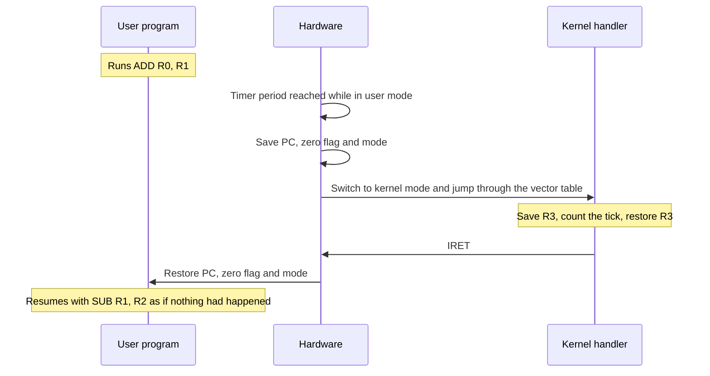
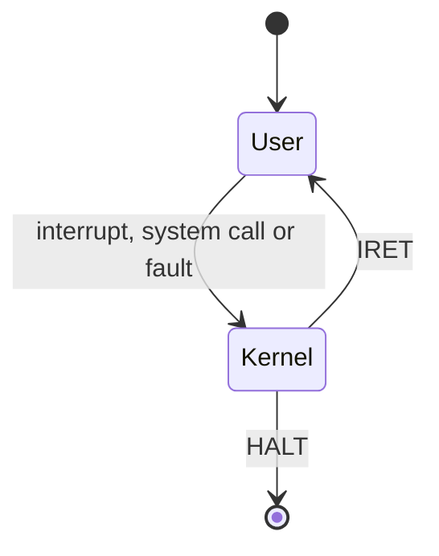
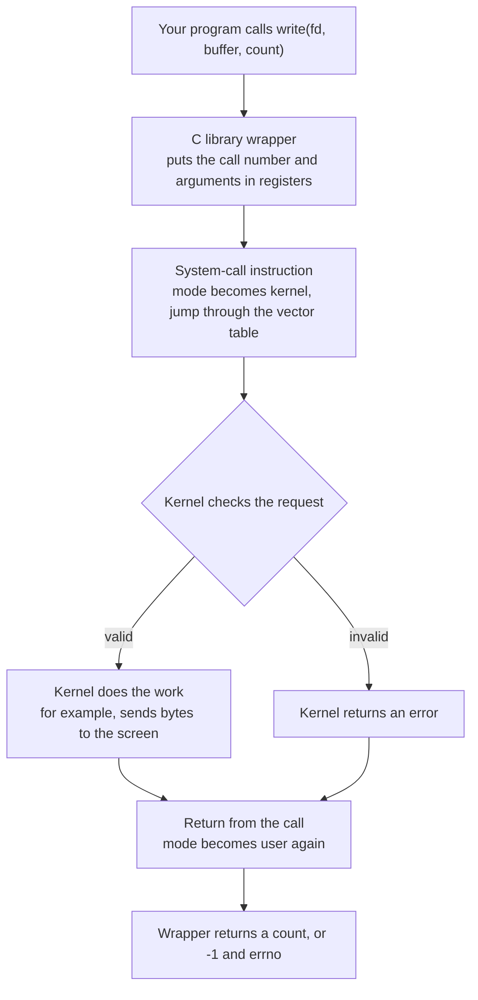

# Interrupts and System Calls

<!-- BEGIN HEADER (generated by tools/build.py from the front matter; edit the front matter, not this block) -->
> [Home](../../../../README.md) › [Part I — Computer Science Foundations](../../index.md) › [1. Computer Fundamentals](../index.md) › [Chapter 6: How computers execute instructions](index.md)

- **Difficulty:** Intermediate
- **Estimated time:** about 90 minutes
- **Prerequisites:** [The Fetch-Decode-Execute Cycle](01-the-fetch-decode-execute-cycle.md) · [Motherboard, Power Supply, Network Interface and Peripherals](../05-computer-components/03-motherboard-power-nic-and-peripherals.md)
- **Syllabus topics covered:** `01.06.05` Interrupts · `01.06.07` System calls
- **Status:** Drafted (passes the automated checks; awaiting independent technical review). Last reviewed 2026-11-14.
<!-- END HEADER -->

## What you will learn

- Distinguish interrupts, faults and system calls by their cause and by whether they are synchronous with the program.
- Describe what the hardware does when an interrupt or system call occurs, and what a handler must do before it returns.
- Explain user mode, kernel mode, privileged instructions and memory protection, and why a system call is not an ordinary function call.
- Predict the effect of a timer interrupt on a program, including the cost of each tick and the bugs caused by a handler that does not save state.
- Use the C `write()` function and explain which part of the work happens in user mode and which in the kernel.

## Introduction

The cycle in the previous lesson assumes that the program is in charge. In a real computer two kinds of event must be able to break into a running program. The first comes from outside: a key is pressed, a network packet arrives, a timer expires. The processor cannot predict when, and the program should not have to keep checking for it (**polling**), because checking wastes time. The second comes from the program itself. It wants to read a file, draw something on the screen or start another program, but it may not touch devices directly, because a mistake or a malicious program could damage everything else running on the machine. So it must ask the operating system to do the job.

One mechanism serves both needs. The processor stops what it is doing, saves just enough to resume later, switches to a more privileged mode and runs a piece of operating-system code. The code ends with a special instruction that restores the saved state, and the program carries on as if nothing had happened. When the cause is an external event, this is an **interrupt**. When the program asks for it on purpose, it is a **system call**. When the instruction itself cannot be carried out, it is an **exception** or **fault**.

This lesson adds that mechanism to the machine from [The Fetch-Decode-Execute Cycle](01-the-fetch-decode-execute-cycle.md): three new instructions, two privilege modes, a protected kernel and a timer. It covers two syllabus topics, interrupts and system calls. [Subject 3](../../03-digital-logic-and-computer-organization/index.md) returns to interrupt handling in hardware detail, and [Subject 4](../../04-operating-systems/index.md) returns to both topics from the operating system's side.

## Intuitive understanding

You are reading a book and your phone rings. You put a bookmark in the page so that you can find your place, and you make a note of anything you will need to remember, such as that you were halfway through a sentence. You answer the call, then use the bookmark and the note to carry on. The bookmark is the saved program counter, the note is the saved state, and the call is the interrupt. Nobody asked you to look at the phone every few seconds: it interrupted you.

A system call is different. Picture a bank. Customers wait in the public area and only staff may enter the vault. A customer who wants cash fills in a request slip and hands it to a teller, who fetches the money from the vault or refuses the request. The customer cannot walk into the vault and can only use the counter, which offers a fixed list of services. The public area is user mode, the staff area is kernel mode, the slip is the system call number and its arguments, and the counter is the single controlled entry point.

These analogies have limits. A person chooses to answer the phone, but a processor is *forced* to, between two instructions. And the bank's rules are enforced by people who could be fooled, while a processor enforces its rules in hardware, on every instruction.

## Technical foundations

### Three causes, one mechanism

| | Interrupt | Fault (exception) | System call |
| --- | --- | --- | --- |
| Cause | An event outside the running instruction: a timer, keyboard, disk or network card | The instruction cannot be carried out: division by zero, an illegal instruction, a page fault, a protection violation | The program deliberately executes a special instruction |
| Synchronous with the program? | No: it can arrive between any two instructions | Yes: one particular instruction causes it | Yes: the instruction is the call |
| Example | The timer reaches its period | A user program executes a privileged instruction | A request to write to the screen |
| Where does the program resume? | At the next instruction | Depends: the same instruction again (after a page fault), or never (the program is ended) | At the next instruction |

Architectures use these words differently. Intel's manuals speak of *interrupts and exceptions* and call the instruction `int n` a software interrupt. Arm uses *exception* for the whole family and divides it into synchronous exceptions, which include the one raised by the `svc` instruction, and asynchronous ones such as interrupts. RISC-V uses *trap* for the whole family. This lesson uses *interrupt* for events from outside, *fault* for an instruction that cannot be carried out and *system call* for the deliberate request. The hardware mechanism is almost the same for all three.

### What the hardware does

When an interrupt, fault or system call occurs, the processor does the following.

1. **Finish or abandon the current instruction.** An interrupt is taken at an instruction boundary, so the program is in a clean, well-defined state when the handler starts. A fault abandons the offending instruction before it has any effect.
2. **Save the minimum state.** The processor remembers the **return address** (the PC), the flags and the current mode, in a place the handler cannot lose them. Our machine uses one fixed save slot. Real processors push them onto a stack or keep them in special registers.
3. **Switch to kernel mode.**
4. **Find the handler.** A **vector table** in memory holds the address of the handler for each kind of event. The kernel fills it in. User code cannot change it.
5. **Run the handler,** which ends with a *return-from-interrupt* instruction (`IRET` in our machine) that restores the saved PC, flags and mode in one step, so the program resumes exactly where it was.



*Reading the diagram:* the user program never sees the interrupt. The hardware and the handler look after saving and restoring, and the program resumes at the instruction after the one it had just completed. Real pipelined processors run many instructions at once and work hard to keep up this illusion, which architects call *precise* exceptions.

The hardware saves only what it needs to get back. **Everything else is the handler's responsibility.** If the handler uses a register, it must put the old value back before returning, or the interrupted program will find its data changed with no explanation. The step-by-step section shows what happens when that goes wrong.

### Kernel mode, user mode and protection

Processors run code in at least two **privilege levels**. The core of the operating system, the **kernel**, runs in **kernel mode** (also called supervisor mode) with full access to the hardware. Everything else runs in **user mode**, where three rules apply.

- **Privileged instructions are forbidden.** These are the instructions that control the machine itself: talking to devices, changing memory protection, enabling or disabling interrupts, halting the processor. In our machine they are `HALT`, `OUT` and `IRET`.
- **Protected memory may not be read, written or executed.** In our machine everything from address `0x40` upward belongs to the kernel.
- **The only way into the kernel is through the vector table.** The kernel set up its entries, and the hardware changes mode and jumps in a single indivisible step.

Breaking a rule does not corrupt anything. It raises a *fault* and the kernel decides what to do, usually ending the program. Because user code cannot write the vector table (it is in protected memory) and cannot choose where the kernel is entered, it cannot run its own instructions with kernel privileges, provided the kernel's own code is sound. That is the core of the security argument for operating systems. Real kernels are large and do contain bugs, which is why attacks on them exist.



The memory map of the machine in this lesson is:

| Addresses | Contents | May user mode touch it? |
| --- | --- | --- |
| `0x00` to `0x3f` | The user program and its data | Yes |
| `0x40` to `0x8f` | Kernel code (the three handlers occupy the first 36 bytes) | No |
| `0x90` to `0x9f` | Kernel data (this lesson uses four bytes: the tick counter, the fault counter and two save slots) | No |
| `0xf0` to `0xf2` | The vector table: handler addresses for the timer, system calls and faults | No |

Three new instructions extend the 11 from the previous lesson. They use three of the five spare opcodes.

| Opcode | Instruction | Meaning | Privileged? |
| --- | --- | --- | --- |
| 11 (0xB) | `ADDI Ra, c` | Ra ← Ra + c (8 bits, wrapping); sets the zero flag | No |
| 12 (0xC) | `IRET` | Return from interrupt: restore the saved PC, zero flag and mode | Yes |
| 13 (0xD) | `SYSCALL` | Enter the kernel through the system-call vector; the saved PC is the next instruction | No |

A program from the previous lesson, run in user mode, would be stopped by a fault: its `OUT` and `HALT` are privileged and its address `0x80` is kernel memory. That is the point. The kernel exists to carry out such operations on the program's behalf.

### System calls

A **system call** is a request from a user program to the kernel. The program puts a call number and its arguments where the kernel expects them, then executes a special instruction: `SYSCALL` in our machine, `syscall` on x86-64, `svc` on 64-bit Arm and `ecall` on RISC-V. The hardware enters the kernel through the vector table, the kernel checks the request, carries it out, leaves the result where the program can read it and returns. In our machine the call number goes in R3 (1 means "write the value in R0", 0 means "exit").

Why is this not an ordinary function call? A function call jumps to wherever the caller says and does not change the privilege level. If it did, any program could jump into the middle of kernel code with kernel privileges. A system-call instruction enters the kernel at exactly one place, chosen by the kernel, in the same indivisible step as the change of mode, and it checks every request before acting on it.

Programs rarely execute the system-call instruction themselves. A library function does it for them: C's `write()`, Python's `os.write` and the lower layers of `print` and `printf` all end in a call like this. Because every kernel entry costs time, libraries usually collect data in a buffer in user space and make one call for many bytes.



*Reading the diagram:* the only step that runs with kernel privileges is the middle one. The request is checked before it is acted on, and a bad request is turned into an error code instead of damage.

### Timer interrupts and multitasking

Some programs never ask the kernel for anything, and a program with a bug might never finish. If the kernel only ran when a program called it, one such program could keep the whole machine for ever. The cure is a hardware **timer** that interrupts the processor at regular intervals, whatever the program is doing. The kernel's timer handler can then decide that it is time to run a different program. This is **preemptive multitasking**, and it is how one processor appears to run many programs at once. A real timer handler saves all of the interrupted program's registers, picks another program, loads *its* registers and returns into it; Subject 4 covers context switching. Ours only counts ticks, which is enough to show the mechanism and its costs.

## Step-by-step working: a machine with a kernel

The machine in this lesson is self-contained: it repeats the assembler and the cycle from the previous lesson with the changes needed for modes, interrupts and system calls. It has three pieces of software: a kernel with three handlers, a user program that adds the numbers 20 down to 1, and two user programs that misbehave. Each is shown in assembly first, then the whole machine follows in one runnable program.

### The kernel

The kernel code is loaded at address `0x40`, and its three handlers are listed in the vector table at `0xf0` to `0xf2`. Names in square brackets, such as `[TICKS]`, are the kernel's data addresses from the memory map.

```text
on_timer:   STORE R3, [SAVE_R3]  ; save R3, the one register this handler borrows
            LOAD  R3, [TICKS]    ; ticks = ticks + 1
            ADDI  R3, 1
            STORE R3, [TICKS]
            LOAD  R3, [SAVE_R3]  ; restore R3
            IRET                 ; resume the interrupted program

on_syscall: STORE R2, [SAVE_R2]  ; R3 holds the call number: 1 = write(R0), 0 = exit
            LOADI R2, 1
            CMP   R3, R2
            JZ    do_write
            HALT                 ; exit: stop the machine
do_write:   OUT   R0             ; only the kernel may use OUT
            LOAD  R2, [SAVE_R2]  ; restore R2
            IRET

on_fault:   LOAD  R3, [FAULTS]   ; faults = faults + 1, then end the offending program
            ADDI  R3, 1
            STORE R3, [FAULTS]
            HALT
```

The **timer handler** (`on_timer`) needs one register to do its work, so it first saves R3 in a kernel memory slot, adds 1 to the tick counter, restores R3 and executes `IRET`. It is six instructions long, so each timer interrupt costs six steps. The **system-call handler** (`on_syscall`) borrows R2 in the same way. It compares the call number in R3 with 1: if it matches, `do_write` outputs R0, which only kernel mode may do, restores R2 and returns. For any other number, which means call 0 (exit), it executes `HALT` and stops the machine. The **fault handler** (`on_fault`) increments a fault counter and halts, since this machine has only one program to end.

### The user programs

The main program is the loop from the previous lesson, with `OUT` replaced by a system call. It cannot print the result itself, so it asks the kernel to.

```text
        LOADI R0, 0          ; sum = 0
        LOADI R1, 20         ; counter = 20
        LOADI R2, 1          ; the constant 1
loop:   ADD   R0, R1         ; sum = sum + counter
        SUB   R1, R2         ; counter = counter - 1
        JNZ   loop           ; repeat until the counter reaches 0
        LOADI R3, 1          ; system call 1: write the value in R0
        SYSCALL
        LOADI R3, 0          ; system call 0: exit
        SYSCALL
```

The other two programs each break a rule: one executes `OUT` and the other stores to kernel memory.

```text
        LOADI R0, 7
        OUT   R0             ; OUT is privileged, so this is a protection fault
```

```text
        LOADI R0, 99
        STORE R0, [0x40]     ; address 0x40 is kernel memory: a protection fault
```

### Running everything

The complete program follows. Its `Machine` class is the `CPU` of the previous lesson with a mode, a save slot for the hardware, a timer and the protection checks. The driver runs seven scenarios and then prints two short traces of the same timer interrupt: one on a machine that saves the zero flag and one on a machine that does not. A trace line shows the step number, the mode, the address and text of the instruction, then the value of R1 and the zero flag after it has run.

<!-- run:python -->
```python
"""An 8-bit computer with a kernel: privilege, interrupts and system calls."""

# The instruction format is unchanged: oooo aabb iiiiiiii.  Three opcodes are new.
OPCODES = {"HALT": 0, "LOADI": 1, "LOAD": 2, "STORE": 3, "ADD": 4, "SUB": 5, "CMP": 6,
           "JMP": 7, "JZ": 8, "JNZ": 9, "OUT": 10,
           "ADDI": 11, "IRET": 12, "SYSCALL": 13}              # new in this lesson
NAME = {code: name for name, code in OPCODES.items()}
SHAPE = {"HALT": "", "LOADI": "rc", "LOAD": "rm", "STORE": "rm", "ADD": "rr", "SUB": "rr",
         "CMP": "rr", "JMP": "t", "JZ": "t", "JNZ": "t", "OUT": "r",
         "ADDI": "rc", "IRET": "", "SYSCALL": ""}
PRIVILEGED = {"HALT", "OUT", "IRET"}      # user programs may not execute these

# Memory map.  Addresses below KERNEL belong to the user program; everything
# from KERNEL upward (kernel code, kernel data, the vector table) is off limits in user mode.
KERNEL = 0x40
SYMBOLS = {"TICKS": 0x90, "FAULTS": 0x91, "SAVE_R3": 0x92, "SAVE_R2": 0x93}   # kernel data
VECTORS = {"timer": 0xF0, "syscall": 0xF1, "fault": 0xF2}                      # the vector table

KERNEL_SOURCE = """
on_timer:   STORE R3, [SAVE_R3]  ; save R3, the one register this handler borrows
            LOAD  R3, [TICKS]    ; ticks = ticks + 1
            ADDI  R3, 1
            STORE R3, [TICKS]
            LOAD  R3, [SAVE_R3]  ; restore R3
            IRET                 ; resume the interrupted program

on_syscall: STORE R2, [SAVE_R2]  ; R3 holds the call number: 1 = write(R0), 0 = exit
            LOADI R2, 1
            CMP   R3, R2
            JZ    do_write
            HALT                 ; exit: stop the machine
do_write:   OUT   R0             ; only the kernel may use OUT
            LOAD  R2, [SAVE_R2]  ; restore R2
            IRET

on_fault:   LOAD  R3, [FAULTS]   ; faults = faults + 1, then end the offending program
            ADDI  R3, 1
            STORE R3, [FAULTS]
            HALT
"""
SUM_PROGRAM = """
        LOADI R0, 0          ; sum = 0
        LOADI R1, 20         ; counter = 20
        LOADI R2, 1          ; the constant 1
loop:   ADD   R0, R1         ; sum = sum + counter
        SUB   R1, R2         ; counter = counter - 1
        JNZ   loop           ; repeat until the counter reaches 0
        LOADI R3, 1          ; system call 1: write the value in R0
        SYSCALL
        LOADI R3, 0          ; system call 0: exit
        SYSCALL
"""
OUT_PROGRAM = """
        LOADI R0, 7
        OUT   R0             ; OUT is privileged, so this is a protection fault
"""
STORE_PROGRAM = """
        LOADI R0, 99
        STORE R0, [0x40]     ; address 0x40 is kernel memory: a protection fault
"""


def assemble(source, origin=0):
    """Assemble text into machine code at address `origin`.
    Returns (code, labels, listing); the listing maps each address to its instruction text."""
    lines, labels = [], {}
    for line in source.splitlines():
        line = line.split(";")[0].strip()
        while ":" in line:
            label, line = line.split(":", 1)
            labels[label.strip()] = origin + 2 * len(lines)
            line = line.strip()
        if line:
            lines.append(line)
    code, listing = bytearray(), {}
    for n, line in enumerate(lines):
        mnemonic, *operands = line.replace(",", " ").split()
        mnemonic = mnemonic.upper()
        registers, value = [], 0
        for shape, token in zip(SHAPE[mnemonic], operands):
            name = token.strip("[]")
            if shape == "r":
                registers.append(int(name[1:]))
            elif name in labels:
                value = labels[name]
            elif name in SYMBOLS:
                value = SYMBOLS[name]
            else:
                value = int(name, 0)
        a, b = (registers + [0, 0])[:2]
        code += bytes([(OPCODES[mnemonic] << 4) | (a << 2) | b, value & 0xFF])
        listing[origin + 2 * n] = mnemonic + (" " + ", ".join(operands) if operands else "")
    return bytes(code), labels, listing


class Machine:
    def __init__(self, memory, listing, timer_period=0, save_flags=True, record=False):
        self.memory, self.listing = bytearray(memory), listing
        self.reg = [0, 0, 0, 0]
        self.pc, self.zero = 0, False
        self.mode = "user"                    # the machine starts in user mode
        self.saved = None                     # what the hardware saves when it enters the kernel
        self.timer_period = timer_period      # an interrupt every this many steps; 0 = no timer
        self.save_flags = save_flags          # False models a CPU that does not save the zero flag
        self.record, self.log = record, []
        self.output, self.steps, self.halted, self.timer_interrupts = [], 0, False, 0

    def note(self, text):
        if self.record:
            self.log.append((self.steps, "      -- " + text))

    def enter_kernel(self, vector, return_pc):
        """What the hardware does for an interrupt, a system call or a fault."""
        flag = self.zero if self.save_flags else None
        self.saved = (return_pc, flag, self.mode)           # 1. save the PC, the flag and the mode
        self.mode = "kernel"                                 # 2. switch to kernel mode
        self.pc = self.memory[VECTORS[vector]]               # 3. jump to the handler in the vector table
        zero = f"zero={int(self.zero)}" if self.save_flags else "zero flag NOT saved"
        self.note(f"{vector}: hardware saves pc={return_pc:#04x}, {zero}, mode=user; jumps to {self.pc:#04x}")

    def alu(self, result):
        result &= 0xFF
        self.zero = result == 0
        return result

    def step(self):
        pc = self.pc
        first, constant = self.memory[pc], self.memory[pc + 1]
        name, a, b = NAME[first >> 4], (first >> 2) & 3, first & 3
        reg = self.reg
        if self.mode == "user":                              # the protection checks
            touches = constant if name in ("LOAD", "STORE") else 0
            if pc >= KERNEL or name in PRIVILEGED or touches >= KERNEL:
                self.note(f"{self.listing.get(pc, name)} is not allowed in user mode")
                return self.enter_kernel("fault", pc)        # the instruction does not complete
        self.steps += 1
        self.pc = pc + 2
        mode, entry = self.mode, [self.steps, ""]
        if self.record:
            self.log.append(entry)                           # events during this step are logged after it
        if name == "HALT":
            self.halted = True
        elif name == "LOADI":
            reg[a] = constant
        elif name == "LOAD":
            reg[a] = self.memory[constant]
        elif name == "STORE":
            self.memory[constant] = reg[a]
        elif name == "ADD":
            reg[a] = self.alu(reg[a] + reg[b])
        elif name == "SUB":
            reg[a] = self.alu(reg[a] - reg[b])
        elif name == "CMP":
            self.alu(reg[a] - reg[b])
        elif name == "ADDI":
            reg[a] = self.alu(reg[a] + constant)
        elif name == "JMP":
            self.pc = constant
        elif name == "JZ" and self.zero:
            self.pc = constant
        elif name == "JNZ" and not self.zero:
            self.pc = constant
        elif name == "OUT":
            self.output.append(reg[a])
        elif name == "SYSCALL":
            self.enter_kernel("syscall", self.pc)            # the saved PC is the next instruction
        elif name == "IRET":
            self.pc, flag, self.mode = self.saved
            if flag is not None:
                self.zero = flag
            self.note(f"return: hardware restores pc={self.pc:#04x}, zero={int(self.zero)}, mode={self.mode}")
        if self.record:
            entry[1] = (f"{self.steps:>4}  {mode:<6}  {pc:#04x}  {self.listing[pc]:<20}"
                        f"  {reg[1]:>3}  {int(self.zero)}")

    def run(self, max_steps=5000):
        while not self.halted and self.steps < max_steps:
            # The timer fires when the step count is a multiple of its period, but it
            # can only interrupt user code: in kernel mode it is ignored (simplification).
            if (self.timer_period and self.mode == "user"
                    and self.steps and self.steps % self.timer_period == 0):
                self.timer_interrupts += 1
                self.enter_kernel("timer", self.pc)
            self.step()
        return self


def boot(user_source, **options):
    """Put the kernel and a user program into a fresh machine."""
    memory = bytearray(256)
    kernel, labels, kernel_listing = assemble(KERNEL_SOURCE, KERNEL)
    program, _, user_listing = assemble(user_source)
    memory[KERNEL:KERNEL + len(kernel)] = kernel
    memory[:len(program)] = program
    for vector, address in VECTORS.items():                  # fill in the vector table
        memory[address] = labels["on_" + vector]
    return Machine(memory, {**user_listing, **kernel_listing}, **options)


SCENARIOS = [
    ("no timer",                          SUM_PROGRAM,   {}),
    ("timer every 50 steps",              SUM_PROGRAM,   {"timer_period": 50}),
    ("timer every 13 steps",              SUM_PROGRAM,   {"timer_period": 13}),
    ("every 13, zero flag not saved",     SUM_PROGRAM,   {"timer_period": 13, "save_flags": False}),
    ("timer every 3 steps",               SUM_PROGRAM,   {"timer_period": 3}),
    ("user program executes OUT",         OUT_PROGRAM,   {}),
    ("user program writes kernel memory", STORE_PROGRAM, {}),
]

print(f"{'scenario':<36}{'output':<8}{'steps':>6}{'timer interrupts':>18}{'faults':>8}  outcome")
for name, source, options in SCENARIOS:
    m = boot(source, **options).run()
    outcome = "halted" if m.halted else "still running at the 5000-step limit"
    print(f"{name:<36}{str(m.output):<8}{m.steps:>6}{m.timer_interrupts:>18}{m.memory[SYMBOLS['FAULTS']]:>8}  {outcome}")
print("kernel's one-byte tick counter after the timer-every-3 run:",
      boot(SUM_PROGRAM, timer_period=3).run().memory[SYMBOLS["TICKS"]])
print(f"byte at 0x40 after the attempted write: {m.memory[KERNEL]:#04x} (the first byte of the timer handler)")


def window(machine, first, last):
    print("step  mode    pc    instruction           R1  zero")
    for step, text in machine.log:
        if first <= step <= last:
            print(text)


print()
print("Timer every 13 steps, steps 103 to 112, zero flag saved:")
window(boot(SUM_PROGRAM, timer_period=13, record=True).run(), 103, 112)
print()
print("The same moment when the hardware does not save the zero flag:")
window(boot(SUM_PROGRAM, timer_period=13, save_flags=False, record=True).run(), 103, 112)
```

<!-- expect -->
```text
scenario                            output   steps  timer interrupts  faults  outcome
no timer                            [210]       79                 0       0  halted
timer every 50 steps                [210]       85                 1       0  halted
timer every 13 steps                [210]      127                 8       0  halted
every 13, zero flag not saved       [82]      1555               118       0  halted
timer every 3 steps                 []        5000               833       0  still running at the 5000-step limit
user program executes OUT           []           5                 0       1  halted
user program writes kernel memory   []           5                 0       1  halted
kernel's one-byte tick counter after the timer-every-3 run: 65
byte at 0x40 after the attempted write: 0x3c (the first byte of the timer handler)

Timer every 13 steps, steps 103 to 112, zero flag saved:
step  mode    pc    instruction           R1  zero
 103  user    0x06  ADD R0, R1              1  0
 104  user    0x08  SUB R1, R2              0  1
      -- timer: hardware saves pc=0x0a, zero=1, mode=user; jumps to 0x40
 105  kernel  0x40  STORE R3, [SAVE_R3]     0  1
 106  kernel  0x42  LOAD R3, [TICKS]        0  1
 107  kernel  0x44  ADDI R3, 1              0  0
 108  kernel  0x46  STORE R3, [TICKS]       0  0
 109  kernel  0x48  LOAD R3, [SAVE_R3]      0  0
 110  kernel  0x4a  IRET                    0  1
      -- return: hardware restores pc=0x0a, zero=1, mode=user
 111  user    0x0a  JNZ loop                0  1
 112  user    0x0c  LOADI R3, 1             0  1

The same moment when the hardware does not save the zero flag:
step  mode    pc    instruction           R1  zero
 103  user    0x06  ADD R0, R1              1  0
 104  user    0x08  SUB R1, R2              0  1
      -- timer: hardware saves pc=0x0a, zero flag NOT saved, mode=user; jumps to 0x40
 105  kernel  0x40  STORE R3, [SAVE_R3]     0  1
 106  kernel  0x42  LOAD R3, [TICKS]        0  1
 107  kernel  0x44  ADDI R3, 1              0  0
 108  kernel  0x46  STORE R3, [TICKS]       0  0
 109  kernel  0x48  LOAD R3, [SAVE_R3]      0  0
 110  kernel  0x4a  IRET                    0  0
      -- return: hardware restores pc=0x0a, zero=0, mode=user
 111  user    0x0a  JNZ loop                0  0
 112  user    0x06  ADD R0, R1              0  0
```

### Reading the results

**No timer.** The 79 steps are 3 set-up instructions, 60 for the 20 passes round the loop, 9 for the write call (the `LOADI`, the `SYSCALL` and 7 kernel instructions up to and including `IRET`) and 7 for the exit call (the `LOADI`, the `SYSCALL` and 5 kernel instructions ending in `HALT`). The program printed 210 although it never executes `OUT`: it asked the kernel to.

**Timer every 50 steps and every 13 steps.** The output is still 210. The interrupts are invisible to the program, and that is the purpose of saving and restoring state. Their cost is not invisible: each tick costs the handler's 6 instructions, so 85 = 79 + 1 × 6 and 127 = 79 + 8 × 6. With a period of 13, 48 of the 127 steps, more than a third, are spent in the handler.

**The first trace.** At step 104 `SUB` sets R1 to 0 and the zero flag to 1: the loop is over. The timer fires before `JNZ` can test the flag. The hardware saves the PC (`0x0a`, the `JNZ`), the flag and the mode, and the handler runs. At step 107 the handler's `ADDI` sets the flag to 0, because the tick count it just produced is not zero. At step 110 `IRET` restores the saved flag, 1, so at step 111 `JNZ` sees the right value, does not jump and the program carries on to its system call.

**The second trace and the wrong answer.** The second trace shows the same moment on a processor that does not save the flag. `IRET` returns with the flag the handler left, 0, so `JNZ` at step 111 jumps back into the loop with R1 equal to 0. The next `SUB` makes R1 wrap around to 255, and the loop runs 256 more times, adding 0 + 255 + 254 + ... + 1 = 32,640 to the total. That is 128 modulo 256, and 210 + 128 = 338 wraps around to 82, which is what the program prints. There is no error message, and the bug appears only when a tick lands between the instruction that sets the flag and the jump that tests it. The count agrees: 79 + 3 × 256 = 847 instructions outside the handler, plus 118 timer interrupts of 6 steps each, makes 1,555 steps. A bug that depends on timing is hard to find because stepping through the program in a debugger changes the timing.

**Timer every 3 steps.** The handler is six instructions long, and in this machine the timer fires whenever the step count is a multiple of its period. Six is a multiple of three, so when the handler returns, the next tick is already due and the program never runs another instruction. After its first three, the processor does nothing but handle ticks. This is an **interrupt storm**, a case of *livelock*: the machine is busy but makes no progress. The run stops at the 5,000-step limit with no output, having taken 833 interrupts. The kernel's own counter is a single byte, so it holds 833 mod 256 = 65, the wraparound of chapter 2 appearing again.

**Faults.** A user program that executes `OUT` prints nothing. The processor refuses the instruction, which never completes, and enters the kernel through the fault vector. The handler adds 1 to the fault counter and halts. The count of 5 steps is the `LOADI`, which completed, plus the 4 instructions of the fault handler; the refused `OUT` is not counted because it never completed. The last row shows memory protection working in the same way: the write to address `0x40` is refused and the byte there still holds `0x3c`, the first byte of the timer handler. A real kernel would end the offending process and carry on with the others.

### What this machine leaves out

Several simplifications keep the program short. A real system differs in these ways.

- **One program on one CPU.** The kernel never switches to another program. A real timer handler would.
- **No stack.** The handlers save registers in fixed memory slots, so they cannot call functions or be interrupted themselves. Real kernels use a stack for each thread and can nest interrupts.
- **A timer that forgets.** Our timer interrupts only user code, and a tick that falls due while the CPU is in the kernel is lost. Real interrupt controllers remember a pending interrupt and deliver it when the processor is ready.
- **One save slot.** The hardware keeps the return state in one fixed place. Real processors push it onto a stack or keep it in special registers.
- **A tiny system-call interface.** There is one argument and two calls.

### The same mechanism on a real system: C's `write()`

On a real system the story is the same with larger numbers. A C program calls `write(fd, buffer, count)`. That is an ordinary function in the C library: it puts the call number and the three arguments in the registers the architecture prescribes, executes the system-call instruction and, when the kernel returns, turns the outcome into its return value or into `-1` with the error code in `errno`.

The program below uses `write` directly rather than `printf`, so every byte of output comes from a system call. It follows the rules for `write` in the POSIX standard: a call may transfer fewer bytes than requested, so `write_all` repeats until everything is written, and a call that fails returns −1 and sets `errno`. The second call is deliberately wrong. −1 is not an open file, so the kernel refuses, and the program receives the error `EBADF` instead of crashing. As in our toy kernel, a bad request becomes a reported error and not damage. The program uses POSIX functions, so it runs on Linux and macOS but not on Windows without changes.

<!-- run:c -->
```c
#define _POSIX_C_SOURCE 200809L
#include <errno.h>
#include <stdio.h>
#include <unistd.h>

/* write() may transfer fewer bytes than asked for, so repeat until all are written. */
static int write_all(int fd, const char *buffer, size_t length) {
    while (length > 0) {
        ssize_t n = write(fd, buffer, length);   /* the C library's wrapper around the system call */
        if (n < 0) {
            if (errno == EINTR) {                /* interrupted before anything was written: retry */
                continue;
            }
            return -1;                           /* a real error: errno says which one */
        }
        buffer += n;
        length -= (size_t)n;
    }
    return 0;
}

int main(void) {
    const char message[] = "hello from user mode\n";
    write_all(STDOUT_FILENO, message, sizeof message - 1);

    ssize_t result = write(-1, "x", 1);          /* -1 is not an open file, so the kernel refuses */
    int error = errno;                           /* save errno before any other call can change it */

    char line[80];
    int length = snprintf(line, sizeof line, "write(-1, ...) returned %zd, errno %s EBADF\n",
                          result, error == EBADF ? "==" : "!=");
    write_all(STDOUT_FILENO, line, (size_t)length);
    return 0;
}
```

<!-- expect -->
```text
hello from user mode
write(-1, ...) returned -1, errno == EBADF
```

On Linux, the `strace` tool lists the system calls a program makes. For this program it prints lines of the following form (typical output, not run for this lesson).

```text
write(1, "hello from user mode\n", 21) = 21
write(-1, "x", 1) = -1 EBADF (Bad file descriptor)
```

Linux on three architectures uses the conventions below for the same request. The registers are those in the `syscall(2)` manual page and the call numbers come from the kernel's system-call tables. On x86-64, the first three arguments of `write` go in `rdi`, `rsi` and `rdx`.

| Architecture | Instruction | Call number goes in | Result comes back in | Number of `write` |
| --- | --- | --- | --- | --- |
| x86-64 | `syscall` | `rax` | `rax` | 1 |
| 64-bit Arm | `svc #0` | `x8` | `x0` | 64 |
| RISC-V | `ecall` | `a7` | `a0` | 64 |

Other operating systems use different numbers and conventions, which is one reason programs call library functions instead of making system calls themselves.

## Real-world applications

- **Every file, network and screen operation.** `open`, `read`, `write`, `socket` and their relatives are system calls. Library functions such as `printf`, Python's `print` and Java's streams collect data in a buffer in user space and make a system call only when the buffer fills or is flushed, because each call has a cost.
- **Preemptive multitasking.** An operating system programs a hardware timer to interrupt every few milliseconds, and the scheduler's decision to run a different program is made inside that handler. A Linux kernel is typically configured for 100, 250, 300 or 1000 ticks a second, and it can stop the tick on idle processors to save power.
- **Device interrupts.** A keystroke, an arriving network packet and a finished disk transfer each raise an interrupt. The driver does the urgent part in the handler and defers the rest. Network drivers can switch from interrupts to polling when packets arrive faster than interrupts can be handled, which is the remedy for the storm you saw above. Linux's NAPI is an example.
- **Faults that are not errors.** A page fault occurs when a program touches memory that the operating system has not loaded or has moved out; the operating system repairs the cause and the *same instruction runs again*. Demand paging and copy-on-write depend on this, and Subject 4 covers them.
- **Debuggers.** A breakpoint replaces an instruction with one that raises an exception, such as `int3` on x86. The kernel then passes control to the debugger.
- **Security.** The user/kernel boundary is the foundation of operating-system security. Attacks that cross it, such as Meltdown, which read kernel memory from user mode, and the defences against them, such as keeping kernel memory out of the user page tables, matter for this reason. Those defences can make kernel entries slower on some processors.

## Comparisons and trade-offs

**Polling, interrupts and DMA.** [Motherboard, Power Supply, Network Interface and Peripherals](../05-computer-components/03-motherboard-power-nic-and-peripherals.md#how-the-cpu-talks-to-a-device) introduced three ways for a processor to deal with a device. This lesson adds the costs.

| Method | How it works | Good when | Costs |
| --- | --- | --- | --- |
| Polling | The CPU repeatedly reads a device's status | Events are very frequent or predictable and latency must be tiny | Wastes CPU time while nothing happens |
| Interrupts | The device signals the CPU when it needs attention | Events are infrequent or unpredictable | Each event costs a handler (6 steps in our toy); too many events can starve programs |
| DMA with a completion interrupt | A controller moves a whole block of data, then interrupts once | Bulk transfers | Needs controller hardware and care with caches |

**Ways into the kernel.** On x86, the first systems used a software interrupt, `int 0x80` on 32-bit Linux, which goes through the interrupt descriptor table. Later x86 processors added dedicated fast system-call instructions, `sysenter` and `syscall`, that skip the table lookup, and 64-bit Linux uses `syscall`. The table compares the three architectures named in this lesson.

| | x86-64 | 64-bit Arm | RISC-V |
| --- | --- | --- | --- |
| Table of handlers | The interrupt descriptor table: up to 256 entries, each a descriptor that holds a handler's address, found through the IDTR register | A table of 16 slots that each hold instructions, found through the `VBAR_ELn` registers | One trap-vector base register per privilege level, such as `stvec`, which may point at a table |
| System-call instruction | `syscall` | `svc` | `ecall` |
| Return instruction | `sysret` for `syscall`, `iret` for interrupts | `eret` | `sret` |
| Where the return address is kept | In `rcx` for `syscall` | In an exception link register, `ELR_ELn` | In `sepc` |

Our toy machine's vector table is closest to the x86 one: a table of handler addresses indexed by the kind of event.

## Advanced concepts

- **Interrupt controllers, masking and priorities.** A real system has many interrupt sources. A controller collects them (the APIC on x86, the GIC on Arm, the PLIC on RISC-V), lets the operating system mask some, ranks them by priority and routes each to a core. The processor also has an interrupt-enable bit, and kernels switch interrupts off briefly while they update data that an interrupt handler also uses. Our machine simply ignores the timer while it is in the kernel.
- **Short handlers and deferred work.** A long handler delays everything else, so drivers do the urgent part in the handler and leave the rest to a later stage that can itself be interrupted. Linux calls these the top half and the bottom half.
- **Context switches.** A real timer handler saves all the registers of the running program in a structure that belongs to it, chooses another program, loads that program's registers and returns into it. The return goes to a different program from the one that was interrupted, which is how one processor appears to run many.
- **Precise exceptions.** A pipelined, out-of-order processor runs many instructions at once, but when an interrupt or fault occurs it must look as though every earlier instruction finished and no later one started, so that the saved PC means something. Keeping up that illusion is a major cost in the design of fast processors.
- **Avoiding the system call.** Entering the kernel costs time, so systems reduce the number of calls. Libraries buffer. Linux maps a small piece of kernel-supplied code into every process, the vDSO, so that reading the clock needs no kernel entry. Some interfaces let a program submit many operations in one call.
- **Return addresses differ.** On x86-64, `syscall` leaves the address of the *next* instruction in `rcx`. On RISC-V, `ecall` records the address of the `ecall` *itself*, so the kernel must add 4 before returning or the program would execute the same `ecall` for ever. Our `SYSCALL` follows the x86 convention.

## Common mistakes

> **Common mistake:** *Writing an interrupt handler that does not save and restore everything it changes.* It must preserve every register it uses and, unless the hardware does it, the flags. The result is wrong answers that appear only when an interrupt lands at an unlucky moment, as in the run that printed 82.

- **Doing too much work in a handler.** Everything else waits while a handler runs. Do the urgent part and defer the rest.
- **Treating a system call like a function call.** It is far slower, and it can fail. Always check the result.
- **Ignoring the result of `write`.** It can transfer fewer bytes than you asked for, so loop until all are written, and it can fail, so check `errno`.
- **Confusing kernel mode with being root.** Kernel mode is a state of the processor. *Root* is an identity that the operating system recognises. A program running as root still runs in user mode and still needs system calls.
- **Believing `printf` is a system call.** It formats text into a buffer in your program's memory. A `write` system call happens later, when the buffer is flushed.
- **Thinking only devices cause interrupts.** Faults and system calls use the same mechanism, which is why one vector table serves all three.

## Exercises

**Beginner**

1. Classify each event as an interrupt, a fault or a system call: (a) a key is pressed; (b) a program divides by zero; (c) a program asks to write to a file; (d) the timer reaches its period; (e) a program reads memory it has no permission to read.
2. Why must `OUT` be a privileged instruction? Why must `IRET`?

**Intermediate**

3. With a timer every 50 steps the program took 85 steps instead of 79. Where do the extra steps come from?
4. In the run with a timer every 13 steps, what fraction of all the steps was spent in the timer handler?
5. In the run with a timer every 3 steps, the simulator took 833 interrupts, but the kernel's tick counter holds 65. Explain the difference.

**Advanced**

6. Show why the program prints 82 when the zero flag is not saved, and why the step count is 1,555.
7. Suppose the protected region began at `0x90` instead of `0x40`, so that user programs could read and write the kernel's code at `0x40`. Describe how a user program could take control of the machine.

**Expert**

8. Explain exactly why a timer period of 3 starves the program, and name two ways a real system avoids this.
9. A program prints one million short lines. Compare calling `printf` for each line with calling `write` for each line. Which makes more system calls, and why? How could you count them on Linux?

<details>
<summary>Solutions and hints</summary>

1. (a) An interrupt: the keyboard is a device. (b) A fault: the dividing instruction cannot be carried out. (c) A system call: the program asks on purpose. (d) An interrupt, from the timer. (e) A fault: a protection violation caused by that instruction.
2. `OUT` drives a device. If any program could use it, any program could write to the screen or a disk and ignore the operating system's rules for sharing them. `IRET` sets the PC and the mode from saved values. A user program able to execute it could try to return to kernel mode at an address of its choosing. The equivalent return instructions on real processors (`sysret`, `eret` and `sret`) are likewise restricted to privileged code.
3. A timer interrupt happened once, and each timer interrupt costs the handler's 6 instructions (`STORE`, `LOAD`, `ADDI`, `STORE`, `LOAD`, `IRET`). So 85 = 79 + 6.
4. There were 8 interrupts of 6 steps each, so 48 of the 127 steps were handler steps: $48 / 127 \approx 0.378$, about 38%.
5. The simulator counts every interrupt exactly, but the kernel's counter is one byte and wraps around at 256. Since $833 = 3 \times 256 + 65$, the counter holds 65.
6. The tick falls between the last `SUB` (which sets R1 to 0 and the flag to 1) and the `JNZ` that tests the flag. The handler's `ADDI` leaves the flag at 0 and, without a saved copy to restore, `JNZ` jumps back into the loop with R1 equal to 0. R1 then wraps around to 255 and the loop runs 256 more times, adding $0 + 255 + 254 + \dots + 1 = 255 \times 256 / 2 = 32{,}640$ to the total. Since $32{,}640 = 127 \times 256 + 128$, that is 128 modulo 256, and $210 + 128 = 338 \equiv 82 \pmod{256}$. The extra loop passes execute $256 \times 3 = 768$ more instructions, so there are $79 + 768 = 847$ steps outside the handler, and with 118 interrupts of 6 steps each, $847 + 118 \times 6 = 1555$.
7. The program overwrites the first instructions of a handler, for example the timer handler at `0x40`, with instructions of its own. At the next timer interrupt the hardware enters kernel mode and jumps to `0x40`, so the program's instructions run in kernel mode, where `OUT`, `HALT` and `IRET` are allowed and nothing is protected. That is why all kernel memory, code as well as data, must be off limits to user mode, and why the boundary in this lesson is at `0x40`.
8. The handler is 6 instructions long, and the timer fires whenever the step count is a multiple of 3. Because 6 is a multiple of 3, the next tick is already due when `IRET` returns, so the program never gets to run. Real systems avoid it by choosing a period far longer than the handler; by limiting the rate of interrupts or combining several events into one (interrupt coalescing); by switching from interrupts to polling when events arrive faster than they can be handled; and by keeping handlers short and deferring the work.
9. With `printf` the C library collects text in a buffer and calls `write` only when the buffer is full (or at the end of each line if the output is a terminal), so far fewer than a million system calls are needed. Calling `write` for each line makes a million system calls, each paying the cost of entering and leaving the kernel. On Linux, `strace -c ./program` prints a summary of the calls it made.

</details>

## Interview and practical questions

**What is the difference between an interrupt, an exception and a system call?** An interrupt comes from outside the instruction stream (a device or a timer) and can arrive between any two instructions. An exception, or fault, is caused by the instruction itself, such as division by zero or a protection violation. A system call is an exception raised deliberately by a special instruction to request a service from the kernel.

**What happens, step by step, when an interrupt arrives?** The processor finishes the current instruction, saves the return address, the flags and the mode, switches to kernel mode and jumps to the handler listed in the vector table. The handler runs, saving and restoring anything it changes, and ends with a return-from-interrupt instruction that restores the saved state so that the program resumes where it stopped.

**Why must a handler save and restore the registers it uses?** Because the interrupted program does not know it was interrupted and expects its registers unchanged. A handler that changes one without restoring it corrupts the program in a way that depends on timing and is very hard to debug.

**Why can't a user program simply call a kernel function?** A function call neither changes the privilege level nor restricts where it jumps. A system-call instruction enters the kernel at one place chosen by the kernel and raises the privilege level in the same indivisible step, so user code cannot run its own instructions with kernel privileges.

**What is an interrupt storm?** A situation in which interrupts arrive so fast that the processor spends all its time in handlers and the programs make no progress. Systems avoid it with longer periods, short handlers, interrupt coalescing and polling under heavy load.

## Further reading

**Research**

- Edsger W. Dijkstra, "The structure of the 'THE'-multiprogramming system", *Communications of the ACM* 11(5), 1968.
- Moritz Lipp and others, "Meltdown: Reading Kernel Memory from User Space", *USENIX Security Symposium* (2018).

**Textbooks and free books**

- Remzi H. Arpaci-Dusseau and Andrea C. Arpaci-Dusseau, *Operating Systems: Three Easy Pieces*, free online at <https://pages.cs.wisc.edu/~remzi/OSTEP/>. Chapter 6, "Mechanism: Limited Direct Execution", treats system calls, the trap table and timer interrupts in the same way as this lesson.
- Randal E. Bryant and David R. O'Hallaron, *Computer Systems: A Programmer's Perspective* (Pearson), the chapter on exceptional control flow.
- Michael Kerrisk, *The Linux Programming Interface* (No Starch Press).
- Abraham Silberschatz, Peter B. Galvin and Greg Gagne, *Operating System Concepts* (Wiley).

**Official documentation**

- The *Intel 64 and IA-32 Architectures Software Developer's Manual* (Intel), the chapter on interrupt and exception handling; *The RISC-V Instruction Set Manual, Volume II: Privileged Architecture* (RISC-V International); and the *Arm Architecture Reference Manual for A-profile architecture* (Arm), for the exception model.
- The Linux manual pages `write(2)` and `syscall(2)`, from the [Linux man-pages project](https://www.kernel.org/doc/man-pages/), and the specification of `write()` in POSIX (The Open Group Base Specifications).
- The Linux kernel documentation "NO_HZ: Reducing Scheduling-Clock Ticks", on the timer tick.
- Python: [`os.write`](https://docs.python.org/3/library/os.html#os.write), a thin wrapper around the `write` system call on POSIX systems.

<!-- BEGIN FOOTER (generated by tools/build.py) -->
---

## Related topics

- [The CPU and the GPU](../05-computer-components/01-cpu-and-gpu.md)
- [Binary Arithmetic](../02-number-systems/03-binary-arithmetic.md)

## Navigation

**Previous:** [The Fetch-Decode-Execute Cycle](01-the-fetch-decode-execute-cycle.md) · **Up:** [Chapter 6: How computers execute instructions](index.md) · **Next:** [subject index](../index.md)
<!-- END FOOTER -->
