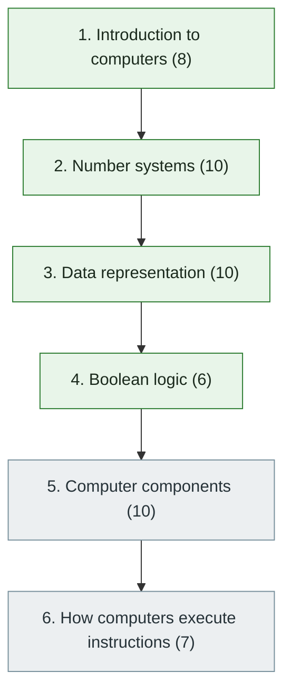

# 1. Computer Fundamentals

> [Home](../../../README.md) › [Part I — Computer Science Foundations](../index.md) › Subject 1

- **Status:** In progress (34 of 51 syllabus topics have a drafted lesson)
- **Source tags:** Start here · Beginner → Advanced
- **Syllabus size:** 6 chapters, 51 topics

## Introduction

What a computer is, how numbers, text and media are represented as bits, how Boolean logic underlies computation, what each hardware component does, and how a processor executes instructions. Every later subject uses this vocabulary.

## Learning outcomes

After working through this subject you should be able to:

- Explain the input, processing, output and storage model and the hardware/software boundary
- Convert between binary, octal, decimal and hexadecimal and do two's-complement arithmetic by hand
- Explain IEEE 754 and why 0.1 + 0.2 is not exactly 0.3, and how text is encoded in ASCII and Unicode
- Trace one instruction through the fetch-decode-execute cycle

## Prerequisites

None. This subject can be started without knowledge of another subject in this library.

## Beginner-to-advanced progression

The chapters below follow the order of the source syllabus, which moves from foundational to advanced material. Colour shows documentation status (grey = not started, amber = in progress, green = drafted or better).

## Chapters and topics

### Chapter 1: Introduction to computers

8 topics · status: **Drafted**

Chapter index: [Chapter 1](01-introduction-to-computers/index.md)

- [What Is a Computer?](01-introduction-to-computers/01-what-is-a-computer.md) — What a computer is, how hardware, firmware and software differ, and the input, processing, output and storage cycle every computer follows. *(Drafted)*
- [Types of Computers](01-introduction-to-computers/02-types-of-computers.md) — How computers are classified by purpose and scale, what distinguishes desktops, laptops, workstations, servers and supercomputers, and what makes a computer embedded. *(Drafted)*
- [Client-Server and Remote Computing](01-introduction-to-computers/03-client-server-and-remote-computing.md) — The client and server roles, how request-response communication works, and the trade-offs between computing locally and remotely, including the physical limit on latency. *(Drafted)*

Syllabus topics in this chapter (8)

- `01.01.01` What is a computer? — [What Is a Computer?](01-introduction-to-computers/01-what-is-a-computer.md)
- `01.01.02` Hardware vs software — [What Is a Computer?](01-introduction-to-computers/01-what-is-a-computer.md)
- `01.01.03` Input, processing, output and storage — [What Is a Computer?](01-introduction-to-computers/01-what-is-a-computer.md)
- `01.01.04` Types of computers — [Types of Computers](01-introduction-to-computers/02-types-of-computers.md)
- `01.01.05` Desktop, laptop, workstation, server, supercomputer — [Types of Computers](01-introduction-to-computers/02-types-of-computers.md)
- `01.01.06` Embedded computers — [Types of Computers](01-introduction-to-computers/02-types-of-computers.md)
- `01.01.07` Client vs server — [Client-Server and Remote Computing](01-introduction-to-computers/03-client-server-and-remote-computing.md)
- `01.01.08` Local vs remote computing — [Client-Server and Remote Computing](01-introduction-to-computers/03-client-server-and-remote-computing.md)

### Chapter 2: Number systems

10 topics · status: **Drafted**

Chapter index: [Chapter 2](02-number-systems/index.md)

- [Positional Number Systems](02-number-systems/01-positional-number-systems.md) — How positional notation works, why computers use binary, and how decimal, binary, octal and hexadecimal relate, plus two special binary codes: BCD and Gray code. *(Drafted)*
- [Number-System Conversions](02-number-systems/02-number-system-conversions.md) — Algorithms for converting integers and fractions between bases, why they work, and why some decimal fractions can never be written exactly in binary. *(Drafted)*
- [Binary Arithmetic](02-number-systems/03-binary-arithmetic.md) — Adding, subtracting, multiplying and dividing binary numbers, how adders are built from logic gates, bitwise operators and shifts, and what overflow, wraparound and saturation mean. *(Drafted)*
- [Signed Numbers and Two's Complement](02-number-systems/04-signed-numbers-and-twos-complement.md) — How computers represent negative integers, why two's complement won, how to negate, extend and compare signed values, and how to detect signed overflow. *(Drafted)*
- [Floating-Point Representation and IEEE 754](02-number-systems/05-floating-point-and-ieee-754.md) — How real numbers are approximated with sign, exponent and fraction fields, what IEEE 754 specifies, why 0.1 + 0.2 is not 0.3, and how to compute reliably despite rounding. *(Drafted)*

Syllabus topics in this chapter (10)

- `01.02.01` Decimal — [Positional Number Systems](02-number-systems/01-positional-number-systems.md)
- `01.02.02` Binary — [Positional Number Systems](02-number-systems/01-positional-number-systems.md)
- `01.02.03` Octal — [Positional Number Systems](02-number-systems/01-positional-number-systems.md)
- `01.02.04` Hexadecimal — [Positional Number Systems](02-number-systems/01-positional-number-systems.md)
- `01.02.05` Number-system conversions — [Number-System Conversions](02-number-systems/02-number-system-conversions.md)
- `01.02.06` Binary arithmetic — [Binary Arithmetic](02-number-systems/03-binary-arithmetic.md)
- `01.02.07` Signed and unsigned numbers — [Signed Numbers and Two's Complement](02-number-systems/04-signed-numbers-and-twos-complement.md)
- `01.02.08` Two's complement — [Signed Numbers and Two's Complement](02-number-systems/04-signed-numbers-and-twos-complement.md)
- `01.02.09` Floating-point representation — [Floating-Point Representation and IEEE 754](02-number-systems/05-floating-point-and-ieee-754.md)
- `01.02.10` IEEE 754 — [Floating-Point Representation and IEEE 754](02-number-systems/05-floating-point-and-ieee-754.md)

### Chapter 3: Data representation

10 topics · status: **Drafted**

Chapter index: [Chapter 3](03-data-representation/index.md)

- [Bits, Bytes, Words and Memory Addresses](03-data-representation/01-bits-bytes-words-and-addresses.md) — The units of data (bit, nibble, byte, word), decimal versus binary size prefixes, how memory is an array of addressed bytes, and why alignment and padding change the size of data. *(Drafted)*
- [Error Detection and Correction](03-data-representation/02-error-detection-and-correction.md) — How redundancy lets a system notice and even repair corrupted bits: Hamming distance, parity, checksums, CRCs and Hamming codes, with working implementations. *(Drafted)*
- [Character Encoding and ASCII](03-data-representation/03-character-encoding-and-ascii.md) — How text is stored as numbers, the difference between a character set and an encoding, the structure of ASCII, line endings, and how mixing up encodings produces garbled text. *(Drafted)*
- [Unicode, UTF-8 and UTF-16](03-data-representation/04-unicode-utf-8-and-utf-16.md) — How Unicode numbers the world's characters, how UTF-8 and UTF-16 turn those numbers into bytes, and why the length of a string depends on what you count. *(Drafted)*
- [Integers, Floating-Point Numbers and Endianness in Memory](03-data-representation/05-integers-floats-and-endianness-in-memory.md) — How integers and floating-point numbers are laid out in memory, how big the standard types really are, and what byte order (endianness) means for files and networks. *(Drafted)*
- [Image, Audio and Video Encoding](03-data-representation/06-image-audio-and-video-encoding.md) — How pictures and sound become numbers (sampling and quantisation), how big raw media is, how lossless and lossy compression work, and what a PNG file and a WAV file really contain. *(Drafted)*
- [Data Serialization](03-data-representation/07-data-serialization.md) — How in-memory data becomes bytes that can be stored or sent and rebuilt elsewhere: text and binary formats, schemas, versioning, and the security risks of deserialization. *(Drafted)*

Syllabus topics in this chapter (10)

- `01.03.01` Bits and bytes — [Bits, Bytes, Words and Memory Addresses](03-data-representation/01-bits-bytes-words-and-addresses.md)
- `01.03.02` Nibbles, words and memory addresses — [Bits, Bytes, Words and Memory Addresses](03-data-representation/01-bits-bytes-words-and-addresses.md)
- `01.03.03` Character encoding — [Character Encoding and ASCII](03-data-representation/03-character-encoding-and-ascii.md)
- `01.03.04` ASCII — [Character Encoding and ASCII](03-data-representation/03-character-encoding-and-ascii.md)
- `01.03.05` Unicode — [Unicode, UTF-8 and UTF-16](03-data-representation/04-unicode-utf-8-and-utf-16.md)
- `01.03.06` UTF-8, UTF-16 — [Unicode, UTF-8 and UTF-16](03-data-representation/04-unicode-utf-8-and-utf-16.md)
- `01.03.07` Integer and floating-point representation — [Integers, Floating-Point Numbers and Endianness in Memory](03-data-representation/05-integers-floats-and-endianness-in-memory.md)
- `01.03.08` Endianness — [Integers, Floating-Point Numbers and Endianness in Memory](03-data-representation/05-integers-floats-and-endianness-in-memory.md)
- `01.03.09` Image, audio and video encoding — [Image, Audio and Video Encoding](03-data-representation/06-image-audio-and-video-encoding.md)
- `01.03.10` Data serialization — [Data Serialization](03-data-representation/07-data-serialization.md)

### Chapter 4: Boolean logic

6 topics · status: **Drafted**

Chapter index: [Chapter 4](04-boolean-logic/index.md)

- [Logic Gates and Truth Tables](04-boolean-logic/01-logic-gates-and-truth-tables.md) — The basic logic gates (AND, OR, NOT, NAND, NOR, XOR, XNOR), how truth tables describe them, why NAND alone can build everything, and how gates form an adder. *(Drafted)*
- [Boolean Algebra and De Morgan's Laws](04-boolean-logic/02-boolean-algebra-and-de-morgans-laws.md) — The laws for transforming logical expressions, De Morgan's laws, how to prove two expressions equivalent, and how to write any function as a sum of products. *(Drafted)*
- [Logic Simplification](04-boolean-logic/03-logic-simplification.md) — Why and how to minimise a Boolean function: algebraic simplification, Karnaugh maps, don't-care conditions, and the Quine-McCluskey algorithm implemented and verified in code. *(Drafted)*

Syllabus topics in this chapter (6)

- `01.04.01` AND, OR, NOT — [Logic Gates and Truth Tables](04-boolean-logic/01-logic-gates-and-truth-tables.md)
- `01.04.02` NAND, NOR, XOR, XNOR — [Logic Gates and Truth Tables](04-boolean-logic/01-logic-gates-and-truth-tables.md)
- `01.04.03` Truth tables — [Logic Gates and Truth Tables](04-boolean-logic/01-logic-gates-and-truth-tables.md)
- `01.04.04` Boolean algebra — [Boolean Algebra and De Morgan's Laws](04-boolean-logic/02-boolean-algebra-and-de-morgans-laws.md)
- `01.04.05` De Morgan's laws — [Boolean Algebra and De Morgan's Laws](04-boolean-logic/02-boolean-algebra-and-de-morgans-laws.md)
- `01.04.06` Logic simplification — [Logic Simplification](04-boolean-logic/03-logic-simplification.md)

### Chapter 5: Computer components

10 topics · status: **Not started**

*Planned location:* `docs/01-computer-science-foundations/01-computer-fundamentals/05-computer-components/`. No lessons yet.

Syllabus topics in this chapter (10)

- `01.05.01` CPU — *not started*
- `01.05.02` GPU — *not started*
- `01.05.03` RAM — *not started*
- `01.05.04` ROM — *not started*
- `01.05.05` Cache — *not started*
- `01.05.06` SSD and HDD — *not started*
- `01.05.07` Motherboard — *not started*
- `01.05.08` Power supply — *not started*
- `01.05.09` Network interface card — *not started*
- `01.05.10` Peripheral devices — *not started*

### Chapter 6: How computers execute instructions

7 topics · status: **Not started**

*Planned location:* `docs/01-computer-science-foundations/01-computer-fundamentals/06-how-computers-execute-instructions/`. No lessons yet.

Syllabus topics in this chapter (7)

- `01.06.01` Fetch-decode-execute cycle — *not started*
- `01.06.02` Machine instructions — *not started*
- `01.06.03` Registers — *not started*
- `01.06.04` Memory access — *not started*
- `01.06.05` Interrupts — *not started*
- `01.06.06` Instruction execution — *not started*
- `01.06.07` System calls — *not started*

## Recommended reading order

1. Chapter 1 — [Introduction to computers](01-introduction-to-computers/index.md)
2. Chapter 2 — [Number systems](02-number-systems/index.md)
3. Chapter 3 — [Data representation](03-data-representation/index.md)
4. Chapter 4 — [Boolean logic](04-boolean-logic/index.md)
5. Chapter 5 — Computer components
6. Chapter 6 — How computers execute instructions

Within a chapter, read lessons in numeric order. Pick the later chapters only when the earlier ones feel comfortable; the syllabus orders them from fundamental to advanced.

## Related subjects

- [2. Mathematics for Computer Science](../02-mathematics-for-computer-science/index.md)
- [3. Digital Logic and Computer Organization](../03-digital-logic-and-computer-organization/index.md)
- [4. Operating Systems](../04-operating-systems/index.md)

## Suggested practical projects

- A base-conversion and bit-inspection toolkit in Python
- A hex-dump utility in C
- A simulated 8-bit ALU built from logic gates

*Full project write-ups (requirements, architecture, stages, tests, extensions) are planned; see [ROADMAP.md](../../../ROADMAP.md).*

---

**Up:** [Part I](../index.md) · **Next subject:** [2. Mathematics for Computer Science](../02-mathematics-for-computer-science/index.md)
