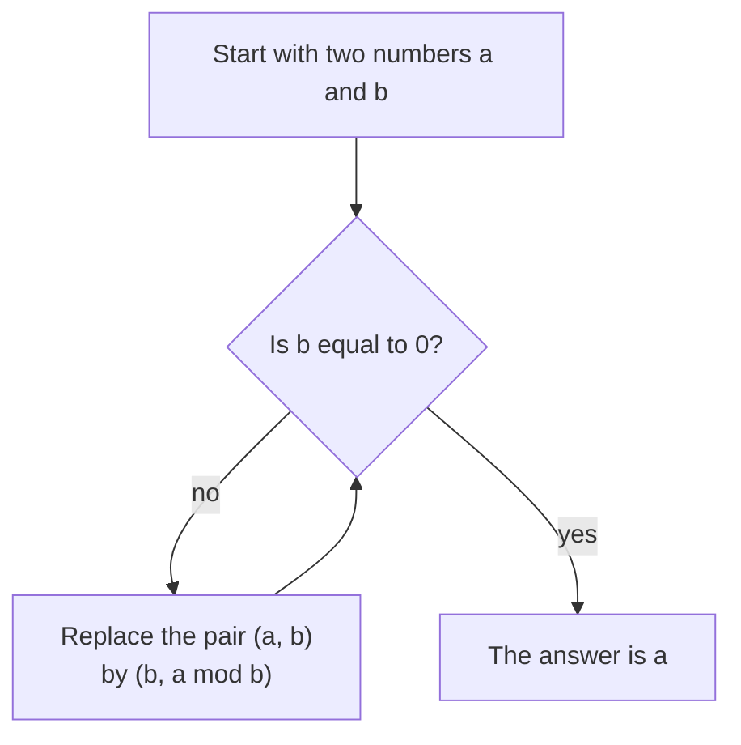
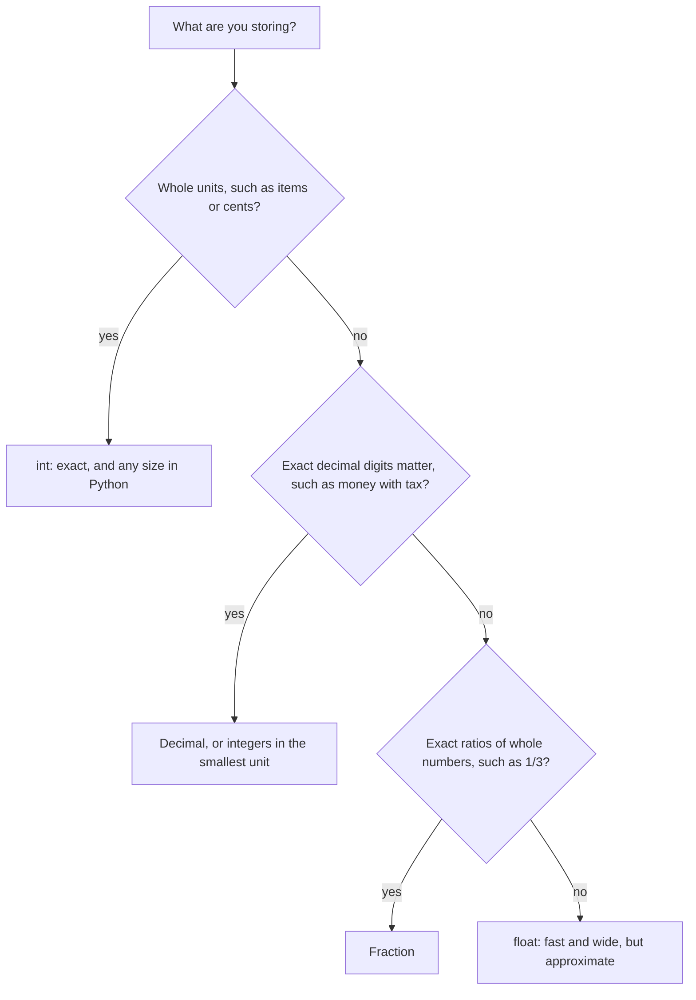

# Arithmetic, Fractions, Percentages and Ratios

<!-- BEGIN HEADER (generated by tools/build.py from the front matter; edit the front matter, not this block) -->
> [Home](../../../../README.md) › [Part I — Computer Science Foundations](../../index.md) › [2. Mathematics for Computer Science](../index.md) › [Chapter 1: Basic mathematics](index.md)

- **Difficulty:** Beginner
- **Estimated time:** about 75 minutes
- **Prerequisites:** none beyond the earlier lessons in this chapter
- **Syllabus topics covered:** `02.01.01` Arithmetic · `02.01.02` Fractions · `02.01.03` Percentages · `02.01.04` Ratios
- **Status:** Drafted (passes the automated checks; awaiting independent technical review). Last reviewed 2026-11-18.
<!-- END HEADER -->

## What you will learn

- Use the four operations and their laws with confidence, and know which of those laws a computer's floating-point numbers break.
- Explain integer division and remainder, including how Python and C differ for negative numbers, and choose between floor, ceiling, truncation and rounding.
- Add, multiply, compare and simplify fractions, and use Euclid's algorithm to find a greatest common divisor.
- Work with percentages, percentage change, percentage points and compound growth without the usual traps.
- Read and build ratios and proportions, and use them for scaling, aspect ratios and rates.
- Decide when a quantity belongs in an integer, an exact fraction, a decimal or a float.

## Introduction

Arithmetic looks like the least interesting part of computer science, yet a surprising share of real bugs live here. Money that is off by a cent, an image stretched by a pixel, a progress bar that reaches 101%, a list of results that loses its last page, an average that is quietly wrong: each is an arithmetic mistake, and each comes from a gap between the arithmetic taught at school and the arithmetic a computer performs.

This lesson covers four syllabus topics: arithmetic, fractions, percentages and ratios. The mathematics is simple on purpose. The skill is knowing exactly what each operation means inside a program, and the lesson keeps pointing at the gaps. Every later chapter of this subject, from discrete mathematics to probability and statistics, assumes this material. The examples are in Python, plus one short C program.

## Intuitive understanding

Picture a recipe. Scaling it up for more guests keeps the proportions of the ingredients fixed: that is a **ratio**. Saying "a quarter of the flour" describes a share of a whole: that is a **fraction**. Saying "25% of the flour" describes the same share counted out of 100: that is a **percentage**. Three ways of speaking about one idea, and most of this lesson is about moving between them without losing information.

A computer's arithmetic is like measuring with a ruler marked only in millimetres. Whole-number quantities are exact. Anything finer must be squeezed onto the nearest mark, and the error is tiny but real, so a long calculation can drift. Different number types are different rulers: integers and exact fractions never drift, decimals drift in controlled ways, and floating-point numbers are fast and wide but drift the most. The analogy has a limit, because a computer's rounding is also systematic: the same inputs always produce the same error, which makes it predictable once you know the rules.

## Technical foundations

### Kinds of numbers

The **natural numbers** are 0, 1, 2 and so on. The **integers** add the negatives. The **rational numbers** are fractions $a/b$ of integers with $b \neq 0$. The **real numbers** fill the whole number line and include irrational numbers such as $\sqrt{2}$ and $\pi$ that no fraction can equal. Mathematicians write these sets as $\mathbb{N}$, $\mathbb{Z}$, $\mathbb{Q}$ and $\mathbb{R}$. A computer cannot hold every real number, so it uses a different type for each need.

| Kind of number | Examples | Usual Python type | Exact? |
| --- | --- | --- | --- |
| Integers | −3, 0, 42 | `int` | Yes, of any size |
| Rational numbers | 1/3, −7/2 | `fractions.Fraction` | Yes |
| Decimal numbers | 0.10, 2.675 | `decimal.Decimal` | Yes, for decimal digits |
| Approximate reals | 0.1, 3.14159 | `float` | No: the nearest binary fraction |

### The four operations and their laws

Addition and multiplication obey three laws for any numbers $a$, $b$ and $c$. They are **commutative** ($a + b = b + a$), **associative** ($(a + b) + c = a + (b + c)$) and **distributive** ($a \times (b + c) = a \times b + a \times c$). Zero is the identity for addition and one is the identity for multiplication. Subtraction and division obey neither the commutative nor the associative law: $8 - 3 \neq 3 - 8$.

Integers and exact fractions obey every one of these laws. Floating-point numbers do not: adding in a different order can give a different answer, as the program in the step-by-step section shows. Order also matters for **precedence**, the rule about which operation binds first: parentheses, then exponents, then multiplication and division, then addition and subtraction. In Python `-2 ** 2` is $-4$, because the exponent binds tighter than the minus sign, while `(-2) ** 2` is 4.

### Division, quotient and remainder

Dividing whole numbers does not always give a whole number, so mathematicians divide with a remainder. For integers $a$ and $b \neq 0$ there is a **quotient** $q$ and a **remainder** $r$ such that $a = b \times q + r$. For a positive $b$ the usual convention is $0 \le r < b$. Computers add a complication: when $a$ or $b$ is negative, languages disagree about which quotient to choose.

| Division | Python `//` and `%` | C, Java and JavaScript `/` and `%` |
| --- | --- | --- |
| 7 ÷ 2 | 3, remainder 1 | 3, remainder 1 |
| −7 ÷ 2 | −4, remainder 1 | −3, remainder −1 |
| 7 ÷ −2 | −4, remainder −1 | −3, remainder 1 |

Python **floors** the quotient (rounds it down), so the remainder takes the sign of the divisor. C, Java and JavaScript **truncate** it (round toward zero), so the remainder takes the sign of the dividend. Both obey $a = b \times q + r$. C has guaranteed truncation only since the C99 standard; earlier standards left it open. The two programs below print the same cases so that you can see the difference.

<!-- run:python -->
```python
import math

# Division and remainder: Python rounds the quotient DOWN (floor), so the remainder
# takes the sign of the divisor and a == b * q + r always holds.
for a, b in [(7, 2), (-7, 2), (7, -2), (-7, -2)]:
    q, r = divmod(a, b)
    print(f"divmod({a:>2}, {b:>2}) = ({q:>2}, {r:>2})   check: {b} * {q} + {r} = {b * q + r}")

# Four ways to turn -2.5 into an integer
x = -2.5
print("floor", math.floor(x), "| ceil", math.ceil(x), "| trunc", math.trunc(x), "| round", round(x))

# round() sends exact halves to the nearest EVEN number ("banker's rounding")
print([round(v) for v in (0.5, 1.5, 2.5, 3.5)])
print(7 / 2, 7 // 2, 8 / 2)          # "/" always gives a float in Python 3
print(-2 ** 2, (-2) ** 2)            # exponentiation binds tighter than unary minus
```

<!-- expect -->
```text
divmod( 7,  2) = ( 3,  1)   check: 2 * 3 + 1 = 7
divmod(-7,  2) = (-4,  1)   check: 2 * -4 + 1 = -7
divmod( 7, -2) = (-4, -1)   check: -2 * -4 + -1 = 7
divmod(-7, -2) = ( 3, -1)   check: -2 * 3 + -1 = -7
floor -3 | ceil -2 | trunc -2 | round -2
[0, 2, 2, 4]
3.5 3 4.0
-4 4
```

<!-- run:c -->
```c
#include <stdio.h>

int main(void) {
    int a[] = {7, -7, 7};
    int b[] = {2, 2, -2};
    /* Since C99, integer division truncates toward zero and the remainder
       takes the sign of the dividend. Python's // and % round down instead. */
    for (int i = 0; i < 3; i++) {
        printf("%2d / %2d = %2d remainder %2d\n", a[i], b[i], a[i] / b[i], a[i] % b[i]);
    }
    return 0;
}
```

<!-- expect -->
```text
 7 /  2 =  3 remainder  1
-7 /  2 = -3 remainder -1
 7 / -2 = -3 remainder  1
```

The difference matters in practice. To wrap an index around a list of length $n$, `index % n` is always in range in Python, but in C a negative index can give a negative remainder and an out-of-range access. To test whether a number is odd, `n % 2 != 0` works in every language, while `n % 2 == 1` fails for negative numbers in C.

### Rounding

Turning a number with a fraction part into an integer needs a rule. **Floor** rounds down and **ceiling** rounds up. **Truncation** drops the fraction part, which is rounding toward zero. The line beginning `floor` in the Python output shows all three for $-2.5$, along with `round`. For negative numbers the four rules give different answers, so they are not interchangeable.

**Rounding to nearest** needs a second rule for exact halves. Schoolbook rounding sends them up. Python's `round` sends them to the nearest *even* number, so 0.5 becomes 0 and 2.5 becomes 2 (see the list of four numbers that follows). This is called round half to even, or banker's rounding. It avoids a bias: rounding every half up makes a long sum drift upward, while half to even drifts equally in both directions. It is also the default rounding mode of IEEE 754 floating-point arithmetic, described in [Floating Point and IEEE 754](../../01-computer-fundamentals/02-number-systems/05-floating-point-and-ieee-754.md#rounding-and-precision). When a rule such as "round half up" is required by law or by a contract, choose it explicitly, as the money example below does.

### Fractions

A **fraction** $a/b$ is a quotient of two integers, with $b \neq 0$. The top number is the **numerator** and the bottom is the **denominator**. Many fractions describe the same value: $1/2 = 2/4 = 50/100$. The **simplest form** divides both numbers by their **greatest common divisor (GCD)**, the largest integer that divides both. Four rules cover almost everything:

- **Add or subtract** after writing both fractions over a common denominator: $\frac{1}{3} + \frac{1}{6} = \frac{2}{6} + \frac{1}{6} = \frac{3}{6} = \frac{1}{2}$.
- **Multiply** numerators and denominators: $\frac{1}{3} \times \frac{1}{6} = \frac{1}{18}$.
- **Divide** by multiplying by the reciprocal: $\frac{1}{3} \div \frac{1}{6} = \frac{1}{3} \times \frac{6}{1} = 2$.
- **Compare** by cross-multiplying: $\frac{a}{b} < \frac{c}{d}$ exactly when $a \times d < c \times b$, for positive $b$ and $d$.

The GCD comes from one of the oldest algorithms still in use, described in Euclid's *Elements* more than two thousand years ago. **Euclid's algorithm** rests on one fact: $\gcd(a, b) = \gcd(b, a \bmod b)$. Any number that divides both $a$ and $b$ also divides the remainder $a \bmod b$, and the pairs get smaller until the remainder is 0.



*Reading the diagram:* the loop must end, because the second number is replaced by a remainder, which is always smaller than the number it came from. When it reaches 0, the first number is the GCD. The number of steps grows only with the number of digits, so the algorithm is fast even for enormous numbers.

### Percentages

A **percentage** is a fraction whose denominator is 100: $p\%$ means $p/100$. To find $p\%$ of $x$, compute $x \times p / 100$. **Percentage change** compares a new value with an old one: $\frac{\text{new} - \text{old}}{\text{old}} \times 100\%$. Three traps account for most percentage mistakes.

- **Changes multiply; they do not add.** A 25% rise followed by a 20% fall is $1.25 \times 0.80 = 1.00$, no change at all. A 20% rise followed by a 20% fall is $1.20 \times 0.80 = 0.96$, a net fall of 4%. Each percentage applies to a different base.
- **Percent and percentage points are different.** A rate that moves from 4% to 5% has risen by one *percentage point* and by 25% in *relative* terms. News and dashboards often blur the two.
- **Compound growth is repeated multiplication.** An amount growing by a rate $r$ per period is multiplied by $(1 + r)$ each period, so after $n$ periods it is $P(1 + r)^n$. The next lesson explains why such growth is so fast.

### Ratios and proportion

A **ratio** compares two quantities of the same kind. Writing $a:b$ says "for every $a$ of the first there are $b$ of the second", and it is unchanged if both numbers are multiplied or divided by the same factor: $4:6 = 2:3$. A **proportion** is an equation between two ratios, and **scaling** uses it: if a picture is 16:9 and its width becomes 1280, its height must be $1280 \times 9 / 16 = 720$. A **rate** is a ratio of different kinds of quantity, such as kilometres per hour or requests per second.

One trap deserves care. A ratio such as 1:3 compares *part to part*. A fraction compares a part with the *whole*. A mix of syrup and water in the ratio 1:3 has 1 + 3 = 4 parts in all, so the syrup is $1/4$ of the mix, which is 25%, and the water is 75%.

| Ratio | Parts in all | Fraction of the whole | Percentage |
| --- | --- | --- | --- |
| 1:3 | 1 + 3 = 4 | 1/4 and 3/4 | 25% and 75% |
| 2:3 | 2 + 3 = 5 | 2/5 and 3/5 | 40% and 60% |

Ratios and rates appear all over computing: the **aspect ratio** of a screen, the **compression ratio** (original size divided by compressed size), the **speedup** of a program (old running time divided by new), and the **hit rate** of a cache. [Memory and Storage](../../01-computer-fundamentals/05-computer-components/02-memory-and-storage.md#cache) shows why the last one matters.



*Reading the diagram:* start with the cheapest exact type and move to a less exact one only when the quantity forces it. Most money and counting problems end at the first or second box.

## Step-by-step working: exact and approximate arithmetic

The first program compares the number types. Its first two lines show the laws failing for floats, the next lines show exact fractions, then Euclid's algorithm prints every step, and the last lines handle money.

<!-- run:python -->
```python
from fractions import Fraction
from decimal import Decimal, ROUND_HALF_UP

# Floating-point addition is not associative, so the order of the additions matters
print((0.1 + 0.2) + 0.3, 0.1 + (0.2 + 0.3))
print(0.1 + 0.2 == 0.3, Fraction(1, 10) + Fraction(2, 10) == Fraction(3, 10))

# Exact rational arithmetic: fractions are reduced automatically
a, b = Fraction(1, 3), Fraction(1, 6)
print(a + b, a * b, a / b, a < b)
print(Fraction(84, 126), Fraction(0.75), Fraction("0.1"))
print("the float 0.1 is exactly", Fraction(0.1))

# Euclid's algorithm: gcd(a, b) = gcd(b, a mod b); print every step
def gcd_steps(a, b):
    while b:
        print(f"  gcd({a}, {b}) -> remainder {a % b}")
        a, b = b, a % b
    return a

print("gcd(84, 126) =", gcd_steps(84, 126))

# Money. Ten payments of 0.10 do not add up to 1.00 in floating point
total = 0.0
for _ in range(10):
    total += 0.1
print(total, total == 1.0)

# 2.675 is stored as 2.67499999..., so round() goes down; Decimal keeps the exact digits
print(round(2.675, 2), Decimal("2.675").quantize(Decimal("0.01"), rounding=ROUND_HALF_UP))

# Safest of all: whole cents and integer arithmetic. 3 items at 19.99 plus 8.25% tax
cents = 3 * 1999
tax = (cents * 825 + 5000) // 10000                # 8.25%, rounded half up, integers only
print("subtotal", cents, "+ tax", tax, "=", cents + tax, "cents")
```

<!-- expect -->
```text
0.6000000000000001 0.6
False True
1/2 1/18 2 False
2/3 3/4 1/10
the float 0.1 is exactly 3602879701896397/36028797018963968
  gcd(84, 126) -> remainder 84
  gcd(126, 84) -> remainder 42
  gcd(84, 42) -> remainder 0
gcd(84, 126) = 42
0.9999999999999999 False
2.67 2.68
subtotal 5997 + tax 495 = 6492 cents
```

*Reading the output.* Adding `0.1`, `0.2` and `0.3` in two different orders gives `0.6000000000000001` and `0.6`, so floating-point addition is not associative. Also `0.1 + 0.2 == 0.3` is `False` for floats but `True` for exact fractions. The `Fraction` lines match the rules above, and `Fraction` reduces to simplest form on its own. The float `0.1` turns out to be exactly 3602879701896397/36028797018963968, the nearest fraction whose denominator is a power of two (here $2^{55}$). That is why it is not one tenth. In Euclid's algorithm the first step swaps the numbers, because 84 mod 126 is 84, and the next steps leave remainders of 42 and then 0, so the GCD is 42.

The money lines show three remedies for the same trouble. Ten payments of 0.10 add up to `0.9999999999999999` in floating point. `round(2.675, 2)` gives 2.67 because the float 2.675 is stored slightly below 2.675, while `Decimal` holds the digits exactly and `ROUND_HALF_UP` gives the 2.68 a shopkeeper expects. The safest approach is to count whole cents and use integer arithmetic throughout: three items at 19.99 cost 5997 cents, the tax of 8.25% is $5997 \times 0.0825 = 494.7525$ cents, which rounds half up to 495, and the total is 6492 cents, or 64.92 in dollars. The expression `(cents * 825 + 5000) // 10000` performs that rounding with integers alone.

The second program covers percentages and ratios.

<!-- run:python -->
```python
from math import gcd

# Percentage change, and why successive changes multiply instead of adding
old, new = 80, 100
print("change from 80 to 100:", (new - old) / old * 100, "%")
price = 100
print("after +25% then -20%:", price * 1.25 * 0.8, "| after +20% then -20%:", price * 1.2 * 0.8)

# Percentage points versus percent: a conversion rate rising from 4% to 5%
before, after = 4, 5
print("difference:", after - before, "percentage point | relative increase:", (after - before) / before * 100, "%")

# Compound growth: 1000 at 4% a year
balance = 1000.0
for year in range(1, 4):
    balance *= 1.04
    print(f"year {year}: {balance:.2f}")
print("after 10 years:", f"{1000 * 1.04 ** 10:.2f}")

# Ratios: simplify with the gcd, then scale while keeping the proportion
w, h = 1920, 1080
g = gcd(w, h)
print(f"{w}x{h} is {w // g}:{h // g}")
new_w = 1280
print("scaled to width", new_w, "-> height", new_w * h // w, "| width 1000 ->", 1000 * h / w)

# Averaging ratios: the mean of two hit rates is not the overall hit rate
hits = [9, 500]
accesses = [10, 1000]
rates = [h_ / a_ for h_, a_ in zip(hits, accesses)]
print("mean of the rates:", f"{sum(rates) / 2:.1%}", "| overall rate:", f"{sum(hits) / sum(accesses):.1%}")

# Ceiling division with integers: pages needed for 101 items, 10 per page
n, k = 101, 10
print("pages:", (n + k - 1) // k, "| -(-n // k):", -(-n // k))
```

<!-- expect -->
```text
change from 80 to 100: 25.0 %
after +25% then -20%: 100.0 | after +20% then -20%: 96.0
difference: 1 percentage point | relative increase: 25.0 %
year 1: 1040.00
year 2: 1081.60
year 3: 1124.86
after 10 years: 1480.24
1920x1080 is 16:9
scaled to width 1280 -> height 720 | width 1000 -> 562.5
mean of the rates: 70.0% | overall rate: 50.4%
pages: 11 | -(-n // k): 11
```

*Reading the output.* A rise from 80 to 100 is a 25% change. A 25% rise followed by a 20% fall returns exactly to 100, while a 20% rise followed by a 20% fall ends at 96. A rate moving from 4% to 5% is a rise of one percentage point, which is a 25% relative increase. Growing 1000 at 4% a year gives 1040, then 1081.60 and 1124.86, and reaches 1480.24 after ten years. A 1920 × 1080 picture simplifies to 16:9, and scaling it to a width of 1280 gives a height of exactly 720, while a width of 1000 gives 562.5, which cannot be a pixel count. Two cache hit rates of 90% and 50% average to 70%, but the cache actually hit in 509 of 1010 accesses, 50.4%, because the 50% cache saw a hundred times more traffic. Finally, 101 items at 10 per page need 11 pages, and `(n + k - 1) // k` computes this ceiling with integers alone.

## Real-world applications

- **Money and billing.** Prices, taxes and invoices need exact decimal results with a stated rounding rule, so they are held as integers of the smallest unit or as `Decimal`, never as floats.
- **Pagination and chunking.** Splitting $n$ items into pages or batches of size $k$ needs the ceiling of $n/k$, written `(n + k - 1) // k` with integers.
- **Time and calendars.** Converting 3725 seconds into hours, minutes and seconds is a chain of `divmod` calls: 1 hour, 2 minutes and 5 seconds.
- **Wrapping around.** Hash tables, circular buffers and round-robin schedulers use remainders to keep an index inside a range.
- **Graphics and video.** Scaling an image or video to a new size keeps the aspect ratio, and rounding to whole pixels makes the result a pixel off.
- **Metrics and experiments.** A change in a conversion rate must be reported as percentage points or as relative change, and the two must never be confused.
- **Performance.** Speedup, cache hit rate and compression ratio are all ratios, and combining them correctly means working from totals, as the cache example shows.

## Comparisons and trade-offs

| Type | Exact for | Range | Speed | Typical use | Main danger |
| --- | --- | --- | --- | --- | --- |
| `int` | Whole numbers | Unlimited in Python, fixed width in C and Java | Fast | Counts, indexes, money in cents | Overflow in fixed-width languages |
| `Fraction` | Rational numbers | Unlimited | Slow, because it is done in software | Exact ratios, geometry, teaching | Numerators and denominators can grow very large |
| `Decimal` | Decimal digits | Wide, with chosen precision | Slower than `float` | Money, accounting | Still rounds: 1/3 has no finite decimal form |
| `float` | Sums of powers of two | About ±10³⁰⁸ for a double | Fastest, because the hardware does it | Science, graphics, machine learning | Rounding error accumulates |

There is no best type. Exactness costs speed and memory, and speed costs exactness. The skill is to pick the weakest type that is still correct for the quantity.

## Advanced concepts

- **Modular arithmetic.** The arithmetic of remainders, where numbers wrap around at a fixed modulus, as on a clock. It underlies hash tables, checksums and public-key cryptography, and later chapters of this subject return to it.
- **The extended Euclidean algorithm.** It keeps track of how each remainder is built from the original numbers and so finds integers $x$ and $y$ with $ax + by = \gcd(a, b)$. This is how modular inverses are computed.
- **Expression swell.** In exact rational arithmetic the numerators and denominators can grow with every operation, so a long exact computation can become slow even though each step is correct.
- **Decimal floating point.** The IEEE 754 standard defines decimal formats as well as binary ones, and Python's `decimal` module is built on a general decimal arithmetic specification.
- **Error analysis.** How rounding errors grow through a long calculation is the subject of numerical mathematics, which comes later in this subject (chapter 9).

## Common mistakes

> **Common mistake:** *Storing money in a float.* Binary floating point cannot represent 0.10 exactly, so errors creep into totals and comparisons. Use integers of the smallest unit, or `Decimal`.

- **Comparing floats with `==`.** `0.1 + 0.2 == 0.3` is false. Compare with a tolerance instead, as the third lesson of this chapter shows.
- **Adding percentages that have different bases.** A 25% rise and a 20% fall do not cancel to 5%.
- **Confusing percent with percentage points.** Going from 4% to 5% is one point, or 25%.
- **Averaging rates instead of totals.** Combine the numerators and the denominators, then divide.
- **Assuming `/` divides whole numbers.** In Python 3, `7 / 2` is 3.5 and `8 / 2` is 4.0, a float. Use `//` for floor division. In C, `/` on two `int` values truncates.
- **Forgetting that `%` can be negative.** In C, Java and JavaScript the remainder takes the sign of the dividend.
- **Losing the last page.** `n // k` drops a partial page. Use `(n + k - 1) // k`.

## Exercises

**Beginner**

1. Find the quotient and remainder of −17 ÷ 5 under Python's rules and under C's rules.
2. Simplify 84/126 and 45/75.
3. A shirt costs 80 dollars. A 25% discount is applied, and then a coupon takes a further 10% off the reduced price. What is the final price, and what is the overall discount?

**Intermediate**

4. A website's conversion rate rises from 2.5% to 3.0%. State the change in percentage points and the relative change.
5. A 4000 × 3000 photo is resized to a width of 1600 pixels, keeping its aspect ratio. What is the new height? A 1920 × 1080 video resized to a width of 1000 gives a height of 562.5; compare choosing 562 with choosing 563.
6. Write an expression, using only integer arithmetic, for the number of pages needed to show $n$ items at $k$ items per page. Check it for $n = 101$, $n = 100$ and $n = 1$ with $k = 10$.

**Advanced**

7. Server A handled 45 of its 50 requests successfully and server B handled 20 of its 100. What is the overall success rate? Why is it not the mean of the two servers' rates?

**Expert**

8. Count the steps Euclid's algorithm takes for $\gcd(89, 55)$ and for $\gcd(89, 56)$. Why does the first take more?

<details>
<summary>Solutions and hints</summary>

1. Under Python's rules, $-17 = 5 \times (-4) + 3$, so the quotient is −4 and the remainder is 3. Under C's rules the quotient is truncated to −3 and the remainder is $-17 - 5 \times (-3) = -2$.
2. $\gcd(84, 126) = 42$, so $84/126 = 2/3$. $\gcd(45, 75) = 15$, so $45/75 = 3/5$.
3. A 25% discount leaves 75% of 80, which is 60. A further 10% off the reduced price leaves 90% of 60, which is 54. The overall discount is $(80 - 54)/80 = 32.5\%$, not 35%, because the second percentage applies to a smaller base.
4. The change is $3.0 - 2.5 = 0.5$ percentage points. The relative change is $0.5 / 2.5 = 20\%$.
5. The aspect ratio is 4:3, so the new height is $1600 \times 3000 / 4000 = 1200$. A width of 1000 and a height of 562 gives a ratio of 1.7794, and a height of 563 gives 1.7762, against the true 16/9 = 1.7778. Each is about 0.1% out, which is invisible, so either is acceptable. Many tools pick one and crop or pad by a pixel.
6. The number of pages is $\lceil n/k \rceil$, which is `(n + k - 1) // k` in integer arithmetic. It gives 11 for $n = 101$, 10 for $n = 100$ and 1 for $n = 1$. Adding $k - 1$ pushes any non-zero remainder over the next multiple of $k$ and leaves an exact multiple unchanged.
7. Together the servers handled 65 successes in 150 requests, which is 43.3%. The mean of the two rates is $(90\% + 20\%)/2 = 55\%$, but that gives each server equal weight although server B handled twice the traffic. Rates must be recomputed from the totals.
8. The first takes 9 steps and the second takes 6. The numbers 89 and 55 are consecutive Fibonacci numbers, and for such a pair each step leaves the previous Fibonacci number as the remainder, so the numbers shrink as slowly as they can. Consecutive Fibonacci numbers are the worst case for Euclid's algorithm, a classical result usually attributed to Gabriel Lamé.

To check the numbers, run the program below. Its lines are numbered like the exercises.

<!-- run:python -->
```python
from fractions import Fraction

def euclid_steps(a, b):
    steps = 0
    while b:
        a, b = b, a % b
        steps += 1
    return steps

print("1.", divmod(-17, 5), "| C rules:", int(-17 / 5), -17 - 5 * int(-17 / 5))
print("2.", Fraction(84, 126), Fraction(45, 75))
print("3.", 80 * 0.75 * 0.9, f"{(80 - 54) / 80:.1%}")
print("4.", round(3.0 - 2.5, 10), f"{(3.0 - 2.5) / 2.5:.0%}")
print("5.", 1600 * 3000 // 4000, 1000 * 1080 / 1920, [f"{w / h:.4f}" for w, h in ((1000, 562), (1000, 563), (16, 9))])
print("6.", [(n + 10 - 1) // 10 for n in (101, 100, 1)])
print("7.", f"{(45 + 20) / (50 + 100):.1%}", f"{(0.9 + 0.2) / 2:.0%}")
print("8.", euclid_steps(89, 55), euclid_steps(89, 56))
```

<!-- expect -->
```text
1. (-4, 3) | C rules: -3 -2
2. 2/3 3/5
3. 54.0 32.5%
4. 0.5 20%
5. 1200 562.5 ['1.7794', '1.7762', '1.7778']
6. [11, 10, 1]
7. 43.3% 55%
8. 9 6
```

</details>

## Interview and practical questions

**Why should you not use floating point for money?** Binary floating point cannot represent decimal fractions such as 0.10 exactly, so errors creep into sums and comparisons. Use integers of the smallest unit, such as cents, or a decimal type with an explicit rounding rule.

**What do `-7 // 2` and `-7 % 2` give in Python, and what would `-7 / 2` and `-7 % 2` give in C?** Python gives −4 and 1, because it floors the quotient. C gives −3 and −1, because it truncates toward zero.

**How do you compute a ceiling division with integers?** Use `(n + k - 1) // k`, or in Python `-(-n // k)`.

**What is the difference between a percentage and a percentage point?** A percentage point is the arithmetic difference between two percentages. A relative change compares the difference with the starting value, so a move from 4% to 5% is one percentage point and 25% in relative terms.

**How does Euclid's algorithm work, and how fast is it?** It repeatedly replaces the pair $(a, b)$ by $(b, a \bmod b)$ until the second number is 0, and the first is then the GCD. The number of steps grows with the number of digits of the inputs, not with their size.

## Further reading

**Research**

- David Goldberg, "What Every Computer Scientist Should Know About Floating-Point Arithmetic", *ACM Computing Surveys*, vol. 23, no. 1 (1991).

**Textbooks**

- Ronald L. Graham, Donald E. Knuth and Oren Patashnik, *Concrete Mathematics* (Addison-Wesley).
- Eric Lehman, F. Thomson Leighton and Albert R. Meyer, *Mathematics for Computer Science* (MIT OpenCourseWare, free to read).
- Donald E. Knuth, *The Art of Computer Programming, Volume 2: Seminumerical Algorithms* (Addison-Wesley).

**Official documentation**

- Python: [`fractions`](https://docs.python.org/3/library/fractions.html), [`decimal`](https://docs.python.org/3/library/decimal.html) and [`math`](https://docs.python.org/3/library/math.html).
- The rule for integer division in C is in the ISO C standard, in the section on multiplicative operators.

<!-- BEGIN FOOTER (generated by tools/build.py) -->
---

## Related topics

- [Binary Arithmetic](../../01-computer-fundamentals/02-number-systems/03-binary-arithmetic.md)
- [Floating-Point Representation and IEEE 754](../../01-computer-fundamentals/02-number-systems/05-floating-point-and-ieee-754.md)

## Navigation

**Previous:** [subject index](../index.md) · **Up:** [Chapter 1: Basic mathematics](index.md) · **Next:** [Exponents and Logarithms](02-exponents-and-logarithms.md)
<!-- END FOOTER -->
