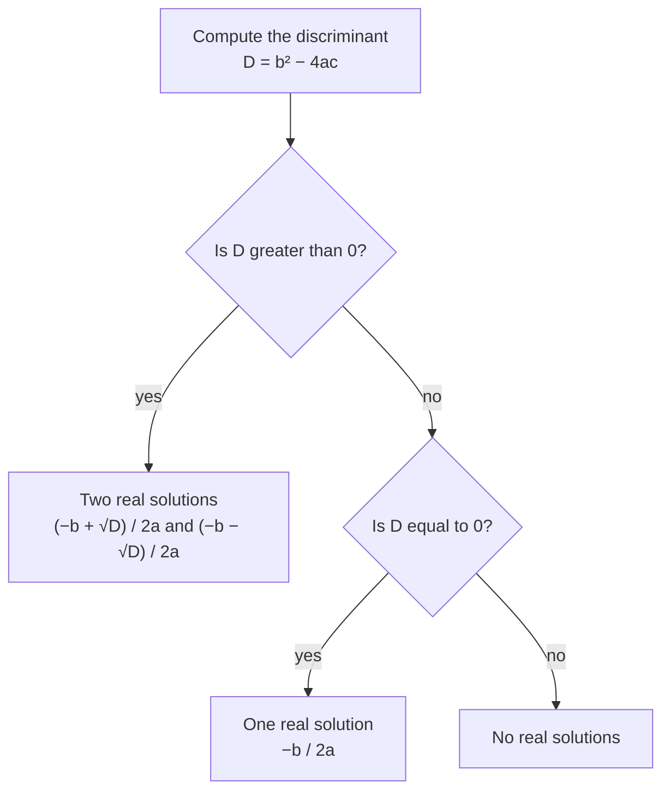
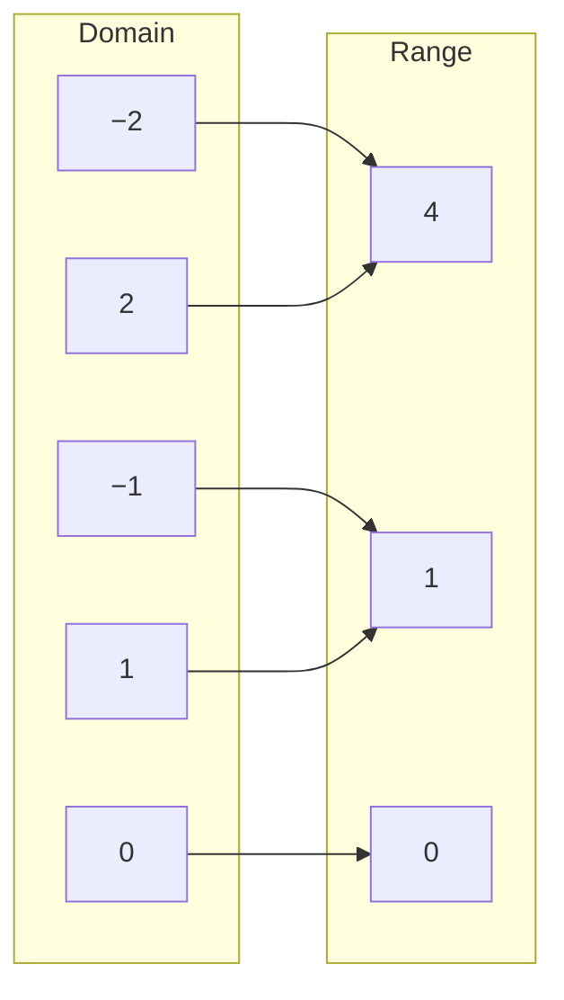

# Algebra, Equations and Functions

<!-- BEGIN HEADER (generated by tools/build.py from the front matter; edit the front matter, not this block) -->
> [Home](../../../../README.md) › [Part I — Computer Science Foundations](../../index.md) › [2. Mathematics for Computer Science](../index.md) › [Chapter 1: Basic mathematics](index.md)

- **Difficulty:** Beginner to intermediate
- **Estimated time:** about 90 minutes
- **Prerequisites:** [Arithmetic, Fractions, Percentages and Ratios](01-arithmetic-fractions-percentages-and-ratios.md)
- **Syllabus topics covered:** `02.01.07` Algebra · `02.01.08` Equations and inequalities · `02.01.09` Functions
- **Status:** Drafted (passes the automated checks; awaiting independent technical review). Last reviewed 2026-11-18.
<!-- END HEADER -->

## What you will learn

- Use variables and expressions, expand and factor simple expressions, and see why `x = x + 1` in code is not an equation.
- Solve linear equations, quadratic equations and pairs of linear equations, and check every answer by substitution.
- Solve linear and absolute-value inequalities, including the sign flip, and use them to state bounds and tolerances.
- Define a function with its domain, codomain and range, compose functions, and invert them when that is possible.
- Tell a mathematical function from a function in a program, and explain why that difference matters.

## Introduction

Algebra is arithmetic with unknowns. Instead of computing a result from known numbers, you describe a relationship and then find the number that makes it true: how many gigabytes make two price plans cost the same, which input makes a formula produce a target, how far a ray travels before it hits a sphere. Programmers use algebra all the time, in formulas, in the bounds of loops and in models of performance and cost.

This lesson covers three syllabus topics: algebra, equations and inequalities, and functions. Functions are the central idea of both mathematics and programming, so the lesson ends by separating the two meanings of the word. Functions are also a topic of chapter 2 of this subject, on discrete mathematics, which is the natural place to study them formally.

## Intuitive understanding

An equation is a balance scale. Whatever you do to one pan you must do to the other, and the scale stays level. To solve $3x + 5 = 20$, take 5 from both pans and then divide both pans by 3, and the unknown is left alone on one side. An inequality is a balance that tips instead of staying level, and almost the same rules apply, with one exception: multiplying or dividing both sides by a negative number turns the tip the other way, as if you had turned the scale around.

A function is a vending machine. You press one selection and exactly one item comes out, and the same selection always gives the same item. The machine in a real building is not quite like that. It can run out of stock or jam, so the same press can give different results at different times. A function in mathematics has no such behaviour, and neither has the pure function of programming. The functions that behave like the real machine, with changing stock, are the ones that are not mathematical functions, and the last section explains why that matters.

## Technical foundations

### Variables, expressions and the distributive law

A **variable** is a name for a number that is unknown or can vary. An **expression** combines variables, numbers and operations, such as $3x + 5$. To **evaluate** it, substitute a number for each variable. To **simplify** it, combine like terms: $3x + 2x = 5x$. To **expand** it, apply the distributive law $a(b + c) = ab + ac$. **Factoring** is expanding in reverse. Three identities come up so often that they are worth knowing by heart.

| Identity | Example |
| --- | --- |
| $(a + b)^2 = a^2 + 2ab + b^2$ | $(x + 3)^2 = x^2 + 6x + 9$ |
| $(a - b)^2 = a^2 - 2ab + b^2$ | $(x - 3)^2 = x^2 - 6x + 9$ |
| $(a + b)(a - b) = a^2 - b^2$ | $(x + 3)(x - 3) = x^2 - 9$ |

Note that the equals sign means something different in code. In algebra, $x = x + 1$ is a claim that no number satisfies. In most programming languages, `x = x + 1` is an **assignment**: it computes the right side and stores the result in $x$, so it is an instruction, and the comparison "is equal to" is written `==`. Keeping the two meanings apart saves a lot of confusion.

### Solving equations

An **equation** says that two expressions are equal. To **solve** it is to find every value of the unknown that makes it true. The balance principle is the only tool a linear equation needs: do the same thing to both sides.

A **linear equation** $ax + b = c$ has the solution $x = (c - b)/a$ when $a \neq 0$. If $a = 0$ the equation either has no solution (when $b \neq c$) or is true for every $x$ (when $b = c$). A **quadratic equation** $ax^2 + bx + c = 0$, with $a \neq 0$, has solutions given by the **quadratic formula**

$$x = \frac{-b \pm \sqrt{b^2 - 4ac}}{2a}.$$

The expression under the root, $D = b^2 - 4ac$, is the **discriminant**, and it tells you how many real solutions to expect.



A **system** of two linear equations in two unknowns, such as $2x + y = 5$ and $x - y = 1$, asks for the one pair $(x, y)$ that satisfies both. The two standard methods are **substitution** (solve one equation for $y$ and put the result into the other) and **elimination** (add or subtract the equations to cancel one unknown). For $a_1 x + b_1 y = c_1$ and $a_2 x + b_2 y = c_2$ there is also a formula, called Cramer's rule. With $D = a_1 b_2 - a_2 b_1$, the solution is $x = (c_1 b_2 - c_2 b_1)/D$ and $y = (a_1 c_2 - a_2 c_1)/D$, provided $D \neq 0$. When $D = 0$ the lines are parallel or the same line, so there is no single solution.

Every answer should be **checked by substituting it back** into the original equation. This is not a formality. When both sides of an equation are squared, solutions can appear that do not solve the original equation. They are called **extraneous solutions**, and the last lines of the program below show one.

<!-- run:python -->
```python
import math
from fractions import Fraction

# Linear equation a*x + b = c: subtract b from both sides, then divide both sides by a
def solve_linear(a, b, c):
    if a == 0:
        raise ValueError("a is 0: there is no single solution")
    return Fraction(c - b, a)

for a, b, c in [(3, 5, 20), (4, 1, 2)]:
    x = solve_linear(a, b, c)
    print(f"{a}x + {b} = {c}  ->  x = {x}   check: {a * x + b == c}")

# Quadratic a*x^2 + b*x + c = 0: the discriminant d = b^2 - 4ac decides how many real roots
def solve_quadratic(a, b, c):
    d = b * b - 4 * a * c
    if d < 0:
        return []                                       # no real roots
    root = math.isqrt(d)
    if root * root == d:                                # perfect square: exact rational roots
        return sorted({Fraction(-b - root, 2 * a), Fraction(-b + root, 2 * a)})
    r = math.sqrt(d)
    return [round((-b - r) / (2 * a), 6), round((-b + r) / (2 * a), 6)]

for a, b, c in [(1, -5, 6), (1, -6, 9), (1, 0, -2), (1, 0, 1)]:
    print(f"{a}x^2 {b:+d}x {c:+d} = 0  ->", [str(r) for r in solve_quadratic(a, b, c)])

# Two linear equations in two unknowns, by Cramer's rule:  a1*x + b1*y = c1,  a2*x + b2*y = c2
def solve_system(a1, b1, c1, a2, b2, c2):
    det = a1 * b2 - a2 * b1
    if det == 0:
        return None                                     # parallel or identical lines
    return Fraction(c1 * b2 - c2 * b1, det), Fraction(a1 * c2 - a2 * c1, det)

x, y = solve_system(2, 1, 5, 1, -1, 1)
print("2x + y = 5 and x - y = 1  ->  x =", x, " y =", y)

# Squaring both sides can add solutions that do not solve the original equation
for candidate in (2, -1):
    print(f"x = {candidate:>2} solves x^2 - x - 2 = 0: {candidate**2 - candidate - 2 == 0}; "
          f"solves sqrt(x + 2) = x: {math.sqrt(candidate + 2) == candidate}")
```

<!-- expect -->
```text
3x + 5 = 20  ->  x = 5   check: True
4x + 1 = 2  ->  x = 1/4   check: True
1x^2 -5x +6 = 0  -> ['2', '3']
1x^2 -6x +9 = 0  -> ['3']
1x^2 +0x -2 = 0  -> ['-1.414214', '1.414214']
1x^2 +0x +1 = 0  -> []
2x + y = 5 and x - y = 1  ->  x = 2  y = 1
x =  2 solves x^2 - x - 2 = 0: True; solves sqrt(x + 2) = x: True
x = -1 solves x^2 - x - 2 = 0: True; solves sqrt(x + 2) = x: False
```

*Reading the output.* The first two lines solve linear equations exactly: $3x + 5 = 20$ gives $x = 5$, and $4x + 1 = 2$ gives the fraction $1/4$, and each answer passes the check. The quadratic $x^2 - 5x + 6 = 0$ has the discriminant 1, a perfect square, so its roots are the exact integers 2 and 3. For $x^2 - 6x + 9 = 0$ the discriminant is 0 and there is one repeated root, 3. For $x^2 - 2 = 0$ the discriminant, 8, is not a perfect square, so the roots are irrational and the program prints them rounded. For $x^2 + 1 = 0$ the discriminant is negative and there is no real root. The system gives $x = 2$ and $y = 1$. In the last two lines, squaring $\sqrt{x + 2} = x$ gives $x^2 - x - 2 = 0$, whose roots are 2 and $-1$. The root 2 solves the original equation, and $-1$ does not, because the square root of 1 is $+1$, not $-1$. The root $-1$ is extraneous.

### Inequalities

An **inequality** compares two expressions with $<$, $\le$, $>$ or $\ge$. A **solution** is a set of values, usually an interval of the number line. Solving works like solving an equation, with one rule added: **multiplying or dividing both sides by a negative number reverses the inequality**. For example, $-2x + 3 > 7$ becomes $-2x > 4$ after subtracting 3, and then $x < -2$ after dividing by $-2$.

Intervals have a compact notation: $(a, b)$ means $a < x < b$, with the ends left out, and $[a, b]$ means $a \le x \le b$, with the ends included. The **absolute value** $|x|$ is the distance of $x$ from zero, so

$$|x - a| < r \iff a - r < x < a + r,$$

which says "$x$ is within $r$ of $a$". This is exactly the form of a **tolerance**. A test such as `abs(a - b) < 1e-9` asks whether $a$ and $b$ are within $10^{-9}$ of each other, and it is the right way to compare floating-point numbers, as the first lesson of this chapter showed.

Inequalities run all through programs. A loop condition such as `i < n`, a bounds check such as `0 <= i < len(items)` and the guarantee that an algorithm finishes are all inequalities. The program below checks the algebra by brute force, which is a very useful habit: a quick loop over small values catches a sign error immediately.

<!-- run:python -->
```python
import math

# -2x + 3 > 7: subtract 3, then divide by -2, which FLIPS the inequality, giving x < -2
print([x for x in range(-6, 7) if -2 * x + 3 > 7])

# |x - 5| < 2 means "x is within 2 of 5", which is the same as 3 < x < 7
print([x for x in range(0, 11) if abs(x - 5) < 2], [x for x in range(0, 11) if 3 < x < 7])

# The same idea compares floating-point numbers with a tolerance
a, b = 0.1 + 0.2, 0.3
print(a == b, abs(a - b) < 1e-9, math.isclose(a, b))
```

<!-- expect -->
```text
[-6, -5, -4, -3]
[4, 5, 6] [4, 5, 6]
False True True
```

*Reading the output.* The integers from −6 to 6 that satisfy $-2x + 3 > 7$ are exactly those below −2, as the algebra predicted. The second line shows that $|x - 5| < 2$ and $3 < x < 7$ select the same integers, 4, 5 and 6. In the last line, `0.1 + 0.2 == 0.3` is false, while the tolerance test and `math.isclose` both say the numbers are close enough.

### Functions

A **function** $f : A \to B$ assigns to every element $x$ of a set $A$, the **domain**, exactly one element $f(x)$ of a set $B$, the **codomain**. The set of outputs that actually occur is the **range** (or image), and it can be smaller than the codomain. For example, $f(x) = x^2$ from the real numbers to the real numbers has the range of all non-negative numbers.

The phrase "exactly one" makes two demands. Every element of the domain must have an output, so a function must be defined on its whole domain. And no element may have two different outputs, which is what separates a function from a general relation. A function can be given as a rule (a formula or a piece of code), as a table when the domain is finite, or as a graph.



*Reading the diagram:* every input has exactly one arrow leaving it, which is what makes this a function, but two inputs can share an output: both −2 and 2 map to 4.

Functions can be combined. The **composition** $(g \circ f)(x) = g(f(x))$ applies $f$ first and then $g$, and the order matters: with $f(x) = x^2$ and $g(x) = x + 1$, $g(f(3)) = 10$ but $f(g(3)) = 16$. An **inverse function** $f^{-1}$ undoes $f$, so that $f^{-1}(f(x)) = x$. An inverse exists only when different inputs always give different outputs, a property called **one-to-one**. The function $x^2$ on the integers from $-2$ to $2$ has no inverse, because 4 could have come from $-2$ or from 2. Restricting the domain to non-negative numbers makes it one-to-one and brings back the square root as its inverse. These properties have standard names (injective, surjective and bijective), and chapter 2 of this subject, on discrete mathematics, is the natural place to study them formally.

Some functions are defined by cases, such as the absolute value $|x|$. Some familiar operations are functions too: the **floor** and **ceiling** from the first lesson turn a real number into an integer, and the remainder $n \bmod 3$ turns an integer into one of 0, 1 or 2.

### Functions in programs

A function in mathematics depends only on its input and does nothing else. A **pure function** in a program has the same two properties: the same arguments always give the same result, and calling it changes nothing outside itself. Many functions in code are not pure. A function that reads the clock, a random number generator, a file or the network can give different results for the same arguments. A function that updates a counter has a **side effect**. Such a routine is useful, but it is not a mathematical function of its arguments.

| | Mathematical function | Typical programming function |
| --- | --- | --- |
| Same input, same output | Always | Not always: time, randomness, files, state |
| Side effects | None | Allowed |
| Defined on the whole domain | By definition | May fail or loop for some inputs |

Purity pays off. Pure functions are easy to test, because the result depends only on the arguments. They can run in parallel without interfering. And they can be **memoized**: since the same input always gives the same output, a program can remember results and skip repeated work. The last block of the program below does this with `lru_cache`.

<!-- run:python -->
```python
import math
from functools import lru_cache

def is_function(pairs):
    """A set of (input, output) pairs is a function if no input has two different outputs."""
    seen = {}
    for x, y in pairs:
        if x in seen and seen[x] != y:
            return False
        seen[x] = y
    return True

def f(x): return x * x
def g(x): return x + 1

domain = [-2, -1, 0, 1, 2]
print(is_function([(x, f(x)) for x in domain]), is_function([(1, "a"), (1, "b")]))
image = sorted({f(x) for x in domain})
print("image of f on the domain:", image)
print("one-to-one?", len(image) == len(domain), "| 4 = f(-2) = f(2), so f has no inverse on this domain")

# Composition: apply one function after the other; the order matters
print("g(f(3)) =", g(f(3)), "| f(g(3)) =", f(g(3)))

# An inverse undoes the function: h(x) = 2x + 3 is one-to-one, with inverse (y - 3) / 2
def h(x): return 2 * x + 3
def h_inverse(y): return (y - 3) / 2
print(all(h_inverse(h(x)) == x for x in range(-5, 6)), all(h(h_inverse(y)) == y for y in (3, 5, 9)))

# Floor, ceiling and remainder are functions too
for x in (-1.5, -0.5, 0.5, 1.5):
    print(f"x = {x:>4}: floor {math.floor(x):>2}, ceiling {math.ceil(x):>2}")
print([n % 3 for n in range(-4, 5)])

# A programming "function" is not always a mathematical one
counter = 0
def next_id():
    global counter
    counter += 1
    return counter
print(next_id(), next_id(), next_id())                  # same (empty) input, different outputs

# Same input always gives the same output, so results can be remembered safely
calls = 0
@lru_cache(maxsize=None)
def fib(n):
    global calls
    calls += 1
    return n if n < 2 else fib(n - 1) + fib(n - 2)
print(fib(30), "computed with", calls, "calls")
```

<!-- expect -->
```text
True False
image of f on the domain: [0, 1, 4]
one-to-one? False | 4 = f(-2) = f(2), so f has no inverse on this domain
g(f(3)) = 10 | f(g(3)) = 16
True True
x = -1.5: floor -2, ceiling -1
x = -0.5: floor -1, ceiling  0
x =  0.5: floor  0, ceiling  1
x =  1.5: floor  1, ceiling  2
[2, 0, 1, 2, 0, 1, 2, 0, 1]
1 2 3
832040 computed with 31 calls
```

*Reading the output.* `is_function` accepts the table of squares and rejects a table in which input 1 has two outputs. The image of the squaring function on the domain is 0, 1 and 4, and the check for one-to-one fails because 4 comes from two inputs. Composition in the two orders gives 10 and 16. The function $h(x) = 2x + 3$ is one-to-one, and its inverse $(y - 3)/2$ undoes it in both directions. The floor and ceiling lines show how the two differ for negative numbers. The remainders $n \bmod 3$ for $n$ from −4 to 4 repeat the pattern 2, 0, 1, as Python defines them. `next_id()` returns 1, 2, 3 for the same empty input, so it is not a function in the mathematical sense. Finally, the memoized `fib(30)` needed only 31 calls to compute 832,040, because every repeated call was answered from memory, which is safe only because the function is pure.

## Step-by-step working: choosing between two price plans

A cloud provider offers two plans for storage. Plan A costs 20 dollars a month plus 0.05 dollars per gigabyte. Plan B costs 0.15 dollars per gigabyte and nothing else. Which is cheaper? Let $x$ be the number of gigabytes. The monthly costs are $20 + 0.05x$ and $0.15x$. They are equal when $20 + 0.05x = 0.15x$. Subtract $0.05x$ from both sides to get $20 = 0.10x$, so $x = 200$. To decide which plan wins on each side of that point, solve the inequality $20 + 0.05x < 0.15x$ in the same way, which gives $x > 200$: plan A is cheaper above 200 GB, and plan B is cheaper below it.

<!-- run:python -->
```python
from fractions import Fraction

# Plan A: 20 dollars a month plus 0.05 per GB.  Plan B: 0.15 per GB, nothing else.
fixed, rate_a, rate_b = Fraction(20), Fraction(5, 100), Fraction(15, 100)

# They cost the same when 20 + 0.05x = 0.15x.  Subtract 0.05x from both sides: 20 = 0.10x.
break_even = fixed / (rate_b - rate_a)
print("break-even at", break_even, "GB")

# The inequality 20 + 0.05x < 0.15x says when plan A is cheaper: x > 200
for gb in (100, 200, 300):
    cost_a, cost_b = fixed + rate_a * gb, rate_b * gb
    cheaper = "A" if cost_a < cost_b else "B" if cost_b < cost_a else "same"
    print(f"{gb:>3} GB: plan A {float(cost_a):>5.2f}, plan B {float(cost_b):>5.2f}, cheaper: {cheaper}")
```

<!-- expect -->
```text
break-even at 200 GB
100 GB: plan A 25.00, plan B 15.00, cheaper: B
200 GB: plan A 30.00, plan B 30.00, cheaper: same
300 GB: plan A 35.00, plan B 45.00, cheaper: A
```

*Reading the output.* The program uses exact fractions, so the break-even point is exactly 200, with no rounding. At 100 GB plan B is cheaper, at 200 GB the plans cost the same, and at 300 GB plan A is cheaper, in agreement with the algebra. The same pattern, one equation for the tie and one inequality for the decision, appears whenever two costs, speeds or capacities are compared.

## Real-world applications

- **Solving for an unknown input.** A formula in a program often has to be run backwards: given a target time, find the speed; given a budget, find the quantity. That is solving an equation.
- **Break-even and capacity planning.** Comparing the cost of two designs, or the point at which a cache or a server pool stops being enough, is the equation-and-inequality pattern above.
- **Bounds, loops and invariants.** Loop conditions, array-index checks and the arguments that show an algorithm terminates are all inequalities.
- **Floating-point comparison.** Testing whether two computed numbers agree uses an absolute or relative tolerance, which is an absolute-value inequality.
- **Graphics.** Finding where two lines cross is a system of two equations, and finding where a ray meets a sphere comes down to a quadratic equation whose discriminant says whether it hits.
- **Testing and caching.** Pure functions can be tested by checking inputs against outputs and cached without risk.
- **Compilers.** Optimizers apply algebraic identities, such as replacing `x * 1` with `x` and `x + 0` with `x`, where the identities hold for the data type in question.

## Comparisons and trade-offs

There are three ways to get a solution to an equation.

| Approach | Gives | Strength | Weakness | Example |
| --- | --- | --- | --- | --- |
| Closed-form formula | An exact answer | Exact and immediate | Exists only for some equations | The quadratic formula |
| Numerical method | An approximate answer | Works for almost any equation | Approximate, and needs care to converge | Bisection or Newton's method |
| Computer algebra | A symbolic answer | Manipulates exact expressions | Can be slow, and limited in scope | Libraries such as SymPy |

Exact formulas are best when they exist. When they do not, numerical methods, introduced in chapter 9 of this subject, take over.

## Advanced concepts

- **Equations of higher degree.** There are formulas for cubic and quartic equations, but the Abel–Ruffini theorem shows there is no general formula, built from roots, for equations of degree five and higher. Numerical methods are used instead.
- **Newton's method.** A numerical method that improves a guess $x$ with the update $x - f(x)/f'(x)$, which needs the derivative from calculus.
- **Many unknowns.** Systems with many equations and unknowns are handled with matrices, which are the subject of the linear algebra chapter.
- **Partial functions.** A function that is undefined for some inputs, such as division by zero or the square root of a negative number, is called partial. Programs represent the missing cases with errors or with optional values.
- **Functions as values.** In many languages a function can be passed to another function. The lambda calculus, a model of computation built entirely from functions, is one of the foundations of theoretical computer science.

## Common mistakes

> **Common mistake:** *Doing something to only one side of an equation.* Whatever you add, multiply or divide by, you must do to both sides, or the equation changes.

- **Dividing by something that could be zero.** Dividing both sides of $x^2 = 3x$ by $x$ loses the solution $x = 0$. Move everything to one side and factor instead.
- **Forgetting to flip an inequality.** Multiplying or dividing by a negative number reverses it.
- **Squaring without checking.** Squaring both sides can add extraneous solutions, so substitute every candidate into the original equation.
- **Confusing `=` with `==`.** In code, one assigns and the other compares.
- **Reading $f(x)$ as $f \times x$.** The notation means "the value of $f$ at $x$".
- **Expanding $(a + b)^2$ as $a^2 + b^2$.** The middle term $2ab$ is missing.
- **Assuming every function in code is mathematical.** If it reads state, time or randomness, or changes something, the same call can give different results.

## Exercises

**Beginner**

1. Solve $5x - 7 = 18$ and $2(x + 3) = x + 10$.
2. Expand $(x + 4)(x - 4)$ and factor $x^2 - 9$.
3. For each set of pairs, say whether it is a function from $\{1, 2, 3\}$ to $\{a, b\}$: (a) $\{(1, a), (2, b), (3, a)\}$; (b) $\{(1, a), (1, b), (2, a), (3, b)\}$; (c) $\{(1, a), (2, b)\}$.

**Intermediate**

4. Solve $x^2 - 7x + 10 = 0$, and say how many real solutions $2x^2 + 3x + 5 = 0$ has without solving it.
5. Solve the system $3x + 2y = 12$ and $x - y = 1$.
6. Solve $-3x + 4 \le 13$ and $|2x - 1| < 5$ together, and list the integers from −8 to 8 that satisfy both.

**Advanced**

7. Solve $\sqrt{2x + 3} = x$ and explain why one of the candidates must be rejected.
8. For $f(x) = 2x + 3$ and $g(x) = x^2$ find $(f \circ g)(x)$, $(g \circ f)(x)$ and the inverse of $f$.

**Expert**

9. A function `price(item)` reads today's exchange rate from the network. Why is it unsafe to cache its results with `lru_cache`, and what change would make it safe?

<details>
<summary>Solutions and hints</summary>

1. $5x - 7 = 18$ gives $5x = 25$, so $x = 5$. For $2(x + 3) = x + 10$, expanding gives $2x + 6 = x + 10$, so $x = 4$. Both check by substitution.
2. $(x + 4)(x - 4) = x^2 - 16$ by the difference of squares, and $x^2 - 9 = (x - 3)(x + 3)$.
3. (a) Yes. (b) No: input 1 has two outputs. (c) No: input 3 has no output, and a function must be defined on its whole domain.
4. $x^2 - 7x + 10 = (x - 2)(x - 5)$, so $x = 2$ or $x = 5$. For $2x^2 + 3x + 5 = 0$ the discriminant is $3^2 - 4 \cdot 2 \cdot 5 = -31$, which is negative, so there is no real solution.
5. From the second equation $x = y + 1$. Substituting into the first gives $3(y + 1) + 2y = 12$, so $5y = 9$ and $y = 9/5$, and then $x = 14/5$. Cramer's rule gives the same, with $D = 3 \cdot (-1) - 1 \cdot 2 = -5$.
6. The first inequality gives $-3x \le 9$, so $x \ge -3$. The second gives $-5 < 2x - 1 < 5$, so $-2 < x < 3$. Both hold for $-2 < x < 3$, and the integers in that range are −1, 0, 1 and 2.
7. Squaring gives $2x + 3 = x^2$, which is $x^2 - 2x - 3 = 0$, with roots 3 and −1. Substituting shows that $x = 3$ works ($\sqrt{9} = 3$), but $x = -1$ does not ($\sqrt{1} = 1$, not $-1$). So −1 is an extraneous root, introduced by squaring, and the only solution is 3.
8. $(f \circ g)(x) = f(x^2) = 2x^2 + 3$ and $(g \circ f)(x) = (2x + 3)^2 = 4x^2 + 12x + 9$. The inverse of $f$ is $f^{-1}(y) = (y - 3)/2$.
9. A cached result is returned whenever the arguments repeat, so after the first call the function would keep returning the first exchange rate it saw, even when the real rate changes. The function is not pure, because its result depends on something other than its arguments. Making the rate an explicit argument, `price(item, rate)`, makes it pure, and then caching is safe.

To check the numbers, run the program below. Its lines are numbered like the exercises.

<!-- run:python -->
```python
import math
from fractions import Fraction

def is_function_on(pairs, domain):
    """True if every element of the domain has exactly one output."""
    outputs = {}
    for x, y in pairs:
        if outputs.setdefault(x, y) != y:
            return False
    return set(outputs) == set(domain)

f = lambda x: 2 * x + 3
g = lambda x: x * x

print("1.", 5 * 5 - 7 == 18, 2 * (4 + 3) == 4 + 10)
print("2.", all((x + 4) * (x - 4) == x * x - 16 and x * x - 9 == (x - 3) * (x + 3) for x in range(-5, 6)))
print("3.", [is_function_on(p, [1, 2, 3]) for p in ([(1, "a"), (2, "b"), (3, "a")],
                                                   [(1, "a"), (1, "b"), (2, "a"), (3, "b")],
                                                   [(1, "a"), (2, "b")])])
print("4.", [x for x in range(-10, 11) if x * x - 7 * x + 10 == 0], "discriminant:", 3 * 3 - 4 * 2 * 5)
print("5.", 3 * Fraction(14, 5) + 2 * Fraction(9, 5) == 12, Fraction(14, 5) - Fraction(9, 5) == 1)
print("6.", [x for x in range(-8, 9) if -3 * x + 4 <= 13 and abs(2 * x - 1) < 5])
print("7.", [(c, math.sqrt(2 * c + 3) == c) for c in (3, -1)])
print("8.", all(f(g(x)) == 2 * x * x + 3 and g(f(x)) == 4 * x * x + 12 * x + 9 for x in range(-5, 6)),
      all((f(x) - 3) / 2 == x for x in range(-5, 6)))
```

<!-- expect -->
```text
1. True True
2. True
3. [True, False, False]
4. [2, 5] discriminant: -31
5. True True
6. [-1, 0, 1, 2]
7. [(3, True), (-1, False)]
8. True True
```

</details>

## Interview and practical questions

**What is the difference between `=` and `==`?** In most languages `=` assigns a value to a variable and `==` compares two values for equality. In algebra the equals sign states that two things are equal, so `x = x + 1` is a valid assignment but an impossible equation.

**What is a pure function and why does it matter?** A pure function returns the same result for the same arguments and has no side effects. Pure functions are easy to test, safe to run in parallel and safe to cache.

**How do you tell how many real roots a quadratic equation has?** Compute the discriminant $b^2 - 4ac$. If it is positive there are two real roots, if zero one, and if negative none.

**Why do you reverse an inequality when you multiply by a negative number?** Multiplying by a negative number reflects the number line, so the order of two numbers is swapped. For example $2 < 3$ but $-2 > -3$.

**How would you solve $ax + b = c$ in code?** Check that $a$ is not zero, then compute $(c - b)/a$, using exact fractions if the inputs are integers. Handle $a = 0$ separately: there is either no solution or every number is a solution.

## Further reading

**Research**

- John Backus, "Can Programming Be Liberated from the von Neumann Style?", *Communications of the ACM* 21(8), 1978.

**Textbooks**

- Eric Lehman, F. Thomson Leighton and Albert R. Meyer, *Mathematics for Computer Science* (MIT OpenCourseWare, free to read).
- Ronald L. Graham, Donald E. Knuth and Oren Patashnik, *Concrete Mathematics* (Addison-Wesley).
- Harold Abelson and Gerald Jay Sussman, *Structure and Interpretation of Computer Programs* (MIT Press), on functions in programs.

**Official documentation**

- Python: [`math.isclose`](https://docs.python.org/3/library/math.html#math.isclose), [`functools.lru_cache`](https://docs.python.org/3/library/functools.html#functools.lru_cache) and [`fractions`](https://docs.python.org/3/library/fractions.html).

<!-- BEGIN FOOTER (generated by tools/build.py) -->
---

## Related topics

- [Exponents and Logarithms](02-exponents-and-logarithms.md)
- [Boolean Algebra and De Morgan's Laws](../../01-computer-fundamentals/04-boolean-logic/02-boolean-algebra-and-de-morgans-laws.md)

## Navigation

**Previous:** [Exponents and Logarithms](02-exponents-and-logarithms.md) · **Up:** [Chapter 1: Basic mathematics](index.md) · **Next:** [subject index](../index.md)
<!-- END FOOTER -->
