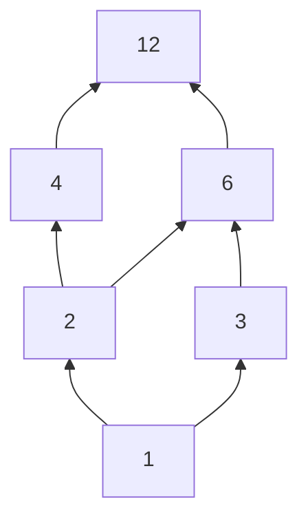
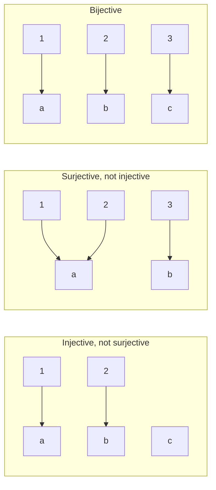

# Sets, Relations and Functions

<!-- BEGIN HEADER (generated by tools/build.py from the front matter; edit the front matter, not this block) -->
> [Home](../../../../README.md) › [Part I — Computer Science Foundations](../../index.md) › [2. Mathematics for Computer Science](../index.md) › [Chapter 2: Discrete mathematics](index.md)

- **Difficulty:** Beginner to intermediate
- **Estimated time:** about 90 minutes
- **Prerequisites:** [Algebra, Equations and Functions](../01-basic-mathematics/03-algebra-equations-and-functions.md)
- **Syllabus topics covered:** `02.02.01` Sets · `02.02.02` Relations · `02.02.03` Functions
- **Status:** Drafted (passes the automated checks; awaiting independent technical review). Last reviewed 2026-11-20.
<!-- END HEADER -->

## What you will learn

- Describe a set by listing its elements or by a rule, and use union, intersection, difference, complement, power set and Cartesian product.
- State and test the basic laws of sets, including De Morgan's laws and the counting rule for a union.
- Define a relation as a set of pairs, and test whether it is reflexive, symmetric, antisymmetric or transitive.
- Recognise equivalence relations and partial orders, and compute equivalence classes and a transitive closure.
- Define a function formally, tell one-to-one and onto functions apart, and count the functions between small sets.
- Connect each idea to its form in computing: Python sets, database tables, hash functions and bit masks.

## Introduction

Discrete mathematics is the mathematics of things that can be counted one by one: collections, pairings, arrangements and steps. It is the language of data structures, databases, algorithms, networks and the proofs that programs are correct. Almost all of it grows from three ideas introduced in this lesson. A **set** is a collection of distinct objects. A **relation** says which objects are connected to which. A **function** gives every object exactly one result.

This lesson covers three syllabus topics: sets, relations and functions. The previous chapter used functions informally, with a domain, a range and a rule. Here they become precise, and they turn out to be a special kind of relation, which is itself a special kind of set. The lessons that follow in this chapter count, prove and solve recurrences using these tools.

## Intuitive understanding

A set is like a guest list. A name is either on the list or it is not, writing a name twice changes nothing, and the order in which the names are written does not matter. A relation is a list of connected pairs, such as the "is friends with" list of a social network, where each entry names two people. A function is a phone book with exactly one number for each name: look up any name and you find one answer, never two and never none.

The analogies have limits. A real guest list has an order and may repeat a name by mistake, while a set has neither. A real phone book may list a person twice or leave a person out, which a function cannot do. Mathematics removes those loopholes on purpose, and that is what makes its statements exact.

## Technical foundations

### Sets

A **set** is a collection of distinct objects, called its **elements**. Two sets are equal exactly when they have the same elements, so $\{1, 2, 3\} = \{3, 1, 2\} = \{1, 1, 2, 3\}$. A set can be written by listing its elements, or by a rule in **set-builder notation**: $\{x^2 \mid x \in \{1, \dots, 5\},\ x \text{ odd}\}$ means "the squares of the odd numbers from 1 to 5", which is $\{1, 9, 25\}$. A Python set comprehension reads almost the same way. The notation $x \in A$ means "$x$ is an element of $A$". The set $A$ is a **subset** of $B$, written $A \subseteq B$, when every element of $A$ is also in $B$. The **empty set** $\varnothing$ has no elements and is a subset of every set. The number of elements of a finite set is its **cardinality**, written $|A|$. Within a chosen **universal set** $U$, the **complement** of $A$ contains everything in $U$ that is not in $A$.

| Operation | Notation | Meaning | Python |
| --- | --- | --- | --- |
| Union | $A \cup B$ | Elements in $A$ or $B$ or both | `A \| B` |
| Intersection | $A \cap B$ | Elements in both | `A & B` |
| Difference | $A - B$ | Elements in $A$ but not in $B$ | `A - B` |
| Symmetric difference | $A \,\Delta\, B$ | Elements in exactly one of the two | `A ^ B` |
| Complement | $A^c$ | Elements of $U$ not in $A$ | `U - A` |
| Subset | $A \subseteq B$ | Every element of $A$ is in $B$ | `A <= B` |
| Power set | $\mathcal{P}(A)$ | The set of all subsets of $A$ | built with `itertools` |
| Cartesian product | $A \times B$ | All ordered pairs $(a, b)$ | `itertools.product(A, B)` |

An **ordered pair** $(a, b)$ differs from the set $\{a, b\}$: the order matters, so $(1, 2) \neq (2, 1)$ while $\{1, 2\} = \{2, 1\}$. Three counting rules follow from the definitions. The number of elements in a union is $|A \cup B| = |A| + |B| - |A \cap B|$, because the shared elements are counted twice by the first two terms. The Cartesian product has $|A \times B| = |A| \cdot |B|$ pairs. And the power set has $|\mathcal{P}(A)| = 2^{|A|}$ elements, because each element is either in a subset or out of it: two choices for each of $|A|$ elements.

The operations obey laws like those of ordinary arithmetic. Union and intersection are commutative and associative, and each distributes over the other: $A \cap (B \cup C) = (A \cap B) \cup (A \cap C)$. **De Morgan's laws** say that $(A \cup B)^c = A^c \cap B^c$ and $(A \cap B)^c = A^c \cup B^c$. These are the same laws as those of Boolean algebra in [Boolean Algebra and De Morgan's Laws](../../01-computer-fundamentals/04-boolean-logic/02-boolean-algebra-and-de-morgans-laws.md), with union playing the part of OR, intersection AND, and complement NOT. The program below tests all of this on small examples, and the last two lines of its output test two of the laws on every pair of subsets of a four-element universe.

<!-- run:python -->
```python
from itertools import chain, combinations, product

A = {1, 2, 3, 4}
B = {3, 4, 5}
print("union", sorted(A | B), "| intersection", sorted(A & B), "| difference", sorted(A - B), "| symmetric difference", sorted(A ^ B))
print("3 in A:", 3 in A, "| {1, 2} <= A:", {1, 2} <= A, "| A <= B:", A <= B, "| len(A):", len(A))
print("duplicates vanish:", {1, 2, 2, 3, 3, 3} == {1, 2, 3}, "| order is irrelevant:", {3, 1, 2} == {1, 2, 3})

# Set-builder notation {x squared | x in 1..5, x odd} is a comprehension
print(sorted({x * x for x in range(1, 6) if x % 2 == 1}))

def power_set(s):
    items = sorted(s)
    return [set(c) for c in chain.from_iterable(combinations(items, r) for r in range(len(items) + 1))]

subsets = power_set({1, 2, 3})
print(len(subsets), "subsets, and 2^3 =", 2 ** 3)
print([sorted(s) for s in subsets])

pairs = list(product({1, 2}, {"a", "b", "c"}))                  # the Cartesian product {1, 2} x {a, b, c}
print(len(pairs), "pairs:", sorted(pairs))

# Check two laws on every pair of subsets of a four-element universe
U = {1, 2, 3, 4}
everything = [frozenset(s) for s in power_set(U)]
ok = True
for X, Y in product(everything, repeat=2):
    de_morgan = (U - (X | Y) == (U - X) & (U - Y)) and (U - (X & Y) == (U - X) | (U - Y))
    counting = len(X | Y) == len(X) + len(Y) - len(X & Y)
    ok = ok and de_morgan and counting
print("De Morgan's laws and |X u Y| = |X| + |Y| - |X n Y| hold for all", len(everything) ** 2, "pairs:", ok)
```

<!-- expect -->
```text
union [1, 2, 3, 4, 5] | intersection [3, 4] | difference [1, 2] | symmetric difference [1, 2, 5]
3 in A: True | {1, 2} <= A: True | A <= B: False | len(A): 4
duplicates vanish: True | order is irrelevant: True
[1, 9, 25]
8 subsets, and 2^3 = 8
[[], [1], [2], [3], [1, 2], [1, 3], [2, 3], [1, 2, 3]]
6 pairs: [(1, 'a'), (1, 'b'), (1, 'c'), (2, 'a'), (2, 'b'), (2, 'c')]
De Morgan's laws and |X u Y| = |X| + |Y| - |X n Y| hold for all 256 pairs: True
```

*Reading the output.* The first line shows the four basic operations on $A = \{1, 2, 3, 4\}$ and $B = \{3, 4, 5\}$. The next two lines show membership, the subset test, that duplicates and order do not matter, and the set-builder example. The set $\{1, 2, 3\}$ has $2^3 = 8$ subsets, listed in the order of their size, and $\{1, 2\} \times \{a, b, c\}$ has $2 \times 3 = 6$ pairs. The last line checks De Morgan's laws and the union counting rule on all $16 \times 16 = 256$ pairs of subsets of a four-element universe. Checking every case settles the question for this four-element universe, because there are only finitely many cases, but it does not prove the laws for all sets. That needs a general argument.

### Relations

A **relation** $R$ from a set $A$ to a set $B$ is a subset of $A \times B$. We write $a \, R \, b$ when the pair $(a, b)$ is in $R$. A relation **on** a set $A$ is a subset of $A \times A$. Familiar examples are "less than or equal" on the integers, "divides" on the positive integers, "is a friend of" on a set of people, and "links to" on a set of web pages. A relation can be written as a set of pairs, as a table, as a directed graph with an arrow for each pair, or as a matrix of true and false entries.

Four properties describe a relation on a set $A$.

| Property | Meaning | Example |
| --- | --- | --- |
| Reflexive | $a \, R \, a$ for every $a$ | $\le$ on numbers |
| Symmetric | $a \, R \, b$ implies $b \, R \, a$ | "has the same remainder as" |
| Antisymmetric | $a \, R \, b$ and $b \, R \, a$ together imply $a = b$ | $\le$ and "divides" |
| Transitive | $a \, R \, b$ and $b \, R \, c$ together imply $a \, R \, c$ | $<$, $\le$ and "divides" |

An **equivalence relation** is reflexive, symmetric and transitive. It sorts the elements of its set into groups of related elements, called **equivalence classes**, and every element belongs to exactly one class. "Has the same remainder when divided by 3" is an example: it splits the integers into three classes. A **partial order** is reflexive, antisymmetric and transitive. It describes a ranking in which some pairs may be incomparable. "Divides" is a partial order, and so is "is a subset of". In a **total order** any two elements are comparable, as with $\le$ on numbers.



*Reading the diagram:* each arrow means "divides, with nothing in between", for the divisors of 12 that matter here. Following arrows upward gives every other pair: 1 divides 12 through 2 and 4. The numbers 4 and 6 are incomparable, because neither divides the other, so this order is partial and not total.

Two operations on relations are used constantly. The **composition** of $R$ and $S$ contains the pair $(a, c)$ whenever some $b$ gives $a \, R \, b$ and $b \, S \, c$: it follows a link and then another. The **transitive closure** of $R$ adds every pair that can be reached by following several links, which is the same as making $R$ transitive by adding as few pairs as possible. It answers the question "can I get from here to there?", and it is the reachability of a network.

<!-- run:python -->
```python
from itertools import product

def is_reflexive(R, A):     return all((a, a) in R for a in A)
def is_symmetric(R):        return all((b, a) in R for (a, b) in R)
def is_antisymmetric(R):    return all(a == b for (a, b) in R if (b, a) in R)
def is_transitive(R):       return all((a, d) in R for (a, b) in R for (c, d) in R if b == c)

A = range(1, 7)
relations = {
    "less than or equal": {(a, b) for a, b in product(A, A) if a <= b},
    "divides":            {(a, b) for a, b in product(A, A) if b % a == 0},
    "same remainder mod 3": {(a, b) for a, b in product(A, A) if a % 3 == b % 3},
    "less than":          {(a, b) for a, b in product(A, A) if a < b},
}
print(f"{'relation':<22}{'reflexive':>10}{'symmetric':>10}{'antisymmetric':>14}{'transitive':>11}")
for name, R in relations.items():
    print(f"{name:<22}{is_reflexive(R, A)!s:>10}{is_symmetric(R)!s:>10}{is_antisymmetric(R)!s:>14}{is_transitive(R)!s:>11}")

# An equivalence relation splits its set into classes
mod3 = relations["same remainder mod 3"]
classes = {frozenset(b for (a2, b) in mod3 if a2 == a) for a in A}
print("classes:", sorted(sorted(c) for c in classes))

# Composing relations and taking the transitive closure (what can be reached by following links)
def compose(R, S):
    return {(a, c) for (a, b) in R for (b2, c) in S if b == b2}

def transitive_closure(R):
    closure = set(R)
    while True:
        bigger = closure | compose(closure, closure)
        if bigger == closure:
            return closure
        closure = bigger

links = {(1, 2), (2, 3), (3, 4), (5, 6)}                         # "has a direct link to"
reachable = transitive_closure(links)
print("reachable but not linked directly:", sorted(reachable - links))
print("1 reaches 4:", (1, 4) in reachable, "| 1 reaches 6:", (1, 6) in reachable)
```

<!-- expect -->
```text
relation               reflexive symmetric antisymmetric transitive
less than or equal          True     False          True       True
divides                     True     False          True       True
same remainder mod 3        True      True         False       True
less than                  False     False          True       True
classes: [[1, 4], [2, 5], [3, 6]]
reachable but not linked directly: [(1, 3), (1, 4), (2, 4)]
1 reaches 4: True | 1 reaches 6: False
```

*Reading the output.* The table checks four relations on the numbers 1 to 6. The relation $\le$ is a partial order, and in fact a total one. "Divides" is a partial order too. "Has the same remainder mod 3" is an equivalence relation: reflexive, symmetric and transitive, but not antisymmetric, because $1 \, R \, 4$ and $4 \, R \, 1$ with $1 \neq 4$. "Less than" is not reflexive, since no number is less than itself, although it is transitive. The classes of the equivalence relation are $\{1, 4\}$, $\{2, 5\}$ and $\{3, 6\}$. The last lines take four direct links and compute what can be reached: 1 reaches 3 and 4 through the others, but 1 cannot reach 6.

### Functions

A **function** $f : A \to B$ is a relation from $A$ to $B$ in which every element of $A$ appears as the first element of exactly one pair. The set $A$ is the **domain**, $B$ is the **codomain**, and the set of outputs that actually occur is the **range** or image. For an element $y$ of $B$, its **preimage** is the set of inputs that map to it: $f^{-1}(y) = \{x \in A \mid f(x) = y\}$. The preimage can have several elements, one, or none.

Two properties say how a function pairs up inputs and outputs. A function is **injective** (one-to-one) if different inputs always give different outputs. It is **surjective** (onto) if every element of the codomain is an output, so the range is the whole codomain. A function that is both is **bijective**: it pairs the elements of $A$ and $B$ perfectly, and only a bijection has an inverse.



*Reading the diagram:* in the first picture nothing maps to $c$, so the function is not onto. In the second, 1 and 2 share the output $a$, so it is not one-to-one. Only in the third does each element on the right have exactly one partner on the left.

The functions between small sets can be counted. A function from $A$ to $B$ chooses an output for each of $|A|$ inputs, and each choice has $|B|$ options, so there are $|B|^{|A|}$ functions. An injective function must give each input a different output: $|B|$ choices for the first, $|B| - 1$ for the second, and so on. If $|A| > |B|$ this runs out of choices and there are no injective functions at all, which is the idea behind the pigeonhole principle, the subject of the last lesson of this chapter. Bijections exist only between sets of equal size, and between two sets of $n$ elements there are $n!$ of them. The next lesson counts such arrangements, and the last lesson counts the surjective functions.

<!-- run:python -->
```python
from itertools import product

def all_functions(A, B):
    """Every function from A to B, each written as a dictionary."""
    A = sorted(A)
    return [dict(zip(A, outputs)) for outputs in product(sorted(B), repeat=len(A))]

def is_injective(f):         return len(set(f.values())) == len(f)
def is_surjective(f, B):     return set(f.values()) == set(B)

for A, B in [({1, 2, 3}, {"a", "b"}), ({1, 2}, {"a", "b", "c"}), ({1, 2, 3}, {"a", "b", "c"})]:
    fs = all_functions(A, B)
    injective = sum(is_injective(f) for f in fs)
    surjective = sum(is_surjective(f, B) for f in fs)
    bijective = sum(is_injective(f) and is_surjective(f, B) for f in fs)
    print(f"|A| = {len(A)}, |B| = {len(B)}: {len(fs):>2} functions (|B|^|A| = {len(B) ** len(A):>2}); "
          f"injective {injective}, surjective {surjective}, bijective {bijective}")

# A bijection can be undone; a function that is not injective has preimages with several elements
f = {1: "a", 2: "c", 3: "b"}
inverse = {y: x for x, y in f.items()}
print(inverse, "| inverse undoes f:", all(inverse[f[x]] == x for x in f))
g = {1: "a", 2: "a", 3: "b"}
print("preimage of 'a' under g:", sorted(x for x in g if g[x] == "a"))
```

<!-- expect -->
```text
|A| = 3, |B| = 2:  8 functions (|B|^|A| =  8); injective 0, surjective 6, bijective 0
|A| = 2, |B| = 3:  9 functions (|B|^|A| =  9); injective 6, surjective 0, bijective 0
|A| = 3, |B| = 3: 27 functions (|B|^|A| = 27); injective 6, surjective 6, bijective 6
{'a': 1, 'c': 2, 'b': 3} | inverse undoes f: True
preimage of 'a' under g: [1, 2]
```

*Reading the output.* The program builds every function between small sets and classifies each one. From a 3-element set to a 2-element set there are $2^3 = 8$ functions, none injective (three inputs cannot have three different outputs among two) and 6 surjective. From a 2-element set to a 3-element set there are $3^2 = 9$ functions, 6 injective ($3 \times 2$) and none surjective. Between two 3-element sets there are 27 functions, of which exactly the $3! = 6$ bijections are both injective and surjective. For finite sets of equal size, injective, surjective and bijective all coincide. The last lines show a bijection being undone, and the preimage of an output with two inputs.

## Step-by-step working: every function defines an equivalence relation

The three ideas of this lesson meet in one example. Take any function $f$ and relate two inputs when they give the same output: $x \sim y$ exactly when $f(x) = f(y)$. This relation is always an equivalence relation, because equality of outputs is reflexive, symmetric and transitive. Its equivalence classes are the preimages of the function: all the inputs that share an output sit in one class.

The program below applies this to a list of email addresses and the function that extracts the domain. Grouping the addresses by domain is exactly the computation of the equivalence classes.

<!-- run:python -->
```python
from collections import defaultdict

emails = ["ann@example.com", "bob@example.org", "cy@example.com",
          "di@school.edu", "ed@example.org", "flo@example.com"]

def domain(address):
    return address.split("@")[1]

# Grouping by a function: the classes are the sets of inputs that give the same output
classes = defaultdict(list)
for address in emails:
    classes[domain(address)].append(address)
for name, members in sorted(classes.items()):
    print(f"{name:<12} class size {len(members)}: {members}")

# "Has the same domain as" is the relation that this function induces
same_domain = {(a, b) for a in emails for b in emails if domain(a) == domain(b)}
reflexive = all((a, a) in same_domain for a in emails)
symmetric = all((b, a) in same_domain for (a, b) in same_domain)
transitive = all((a, d) in same_domain for (a, b) in same_domain for (c, d) in same_domain if b == c)
print(len(same_domain), "related pairs; equivalence relation:", reflexive and symmetric and transitive)
print("pairs = 3^2 + 2^2 + 1^2 =", 3 ** 2 + 2 ** 2 + 1 ** 2, "| classes:", len(classes))
```

<!-- expect -->
```text
example.com  class size 3: ['ann@example.com', 'cy@example.com', 'flo@example.com']
example.org  class size 2: ['bob@example.org', 'ed@example.org']
school.edu   class size 1: ['di@school.edu']
14 related pairs; equivalence relation: True
pairs = 3^2 + 2^2 + 1^2 = 14 | classes: 3
```

*Reading the output.* The six addresses fall into three classes, by domain. The relation "has the same domain as" has $3^2 + 2^2 + 1^2 = 14$ pairs, because every class of size $k$ contributes $k^2$ pairs, counting each address paired with itself. The program checks all three properties and confirms that the relation is an equivalence relation. The same pattern appears whenever data is grouped: a hash table puts keys with the same hash into one bucket, `GROUP BY` in a database query groups rows with the same value, and a dictionary of lists groups items by a key.

## Real-world applications

- **Python sets and dictionaries.** A set gives fast membership tests and removes duplicates, and a dictionary is a finite function from keys to values. Set operations compute the overlap or the difference of two collections in one expression.
- **Relational databases.** A table is a relation: a set of rows over named columns. This is the model proposed by E. F. Codd in 1970, and it explains why SQL has set operations (`UNION`, `INTERSECT` and `EXCEPT`) and why a join is a composition of relations. In practice SQL tables may contain repeated rows, so they are really multisets unless you ask for `DISTINCT`. `UNION` removes duplicates, while `UNION ALL` keeps them.
- **Permissions and roles.** A user's rights can be modelled as a set of permissions. Combining two roles is a union, and the rights two roles share are an intersection.
- **Networks and dependencies.** A graph is a set of vertices with a relation on them. Reachability is the transitive closure, and a "depends on" relation between software packages or build steps is a partial order, which a build system uses to decide the order of work.
- **Hashing and bucketing.** A hash function maps an unbounded set of keys into a finite set of values. It cannot be injective, so different keys sometimes share a bucket, and the buckets are the equivalence classes of "has the same hash".
- **Bit masks.** A subset of a small universe is stored as the bits of an integer, with one bit for each possible element. Union is bitwise OR, intersection is AND and complement is NOT, as in [Number Systems](../../01-computer-fundamentals/02-number-systems/index.md) and the logic chapter of Subject 1.
- **Search engines.** A query such as "cats AND NOT dogs" is evaluated as set operations on the sets of documents that contain each word.

## Comparisons and trade-offs

Python offers several collection types. Their differences are the differences between mathematical structures.

| Type | Order matters? | Repeats allowed? | Elements must be hashable? | Mathematical idea |
| --- | --- | --- | --- | --- |
| `list` | Yes | Yes | No | A sequence |
| `tuple` | Yes | Yes | No | An ordered pair, triple or longer tuple |
| `set` | No | No | Yes | A set |
| `frozenset` | No | No | Yes | A set that can itself be an element of another set |
| `dict` | Keys are unordered as a set | Keys are unique | Keys must be | A finite function |
| `collections.Counter` | No | Counts repeats | Yes | A multiset |

A relation can be stored as a set of pairs, which uses space in proportion to the number of pairs, or as a matrix with one entry for every possible pair, which uses space in proportion to $|A|^2$ but answers "is $a \, R \, b$?" in a single lookup. A sparse relation, such as the links between web pages, suits the set of pairs, and a dense one suits the matrix.

## Advanced concepts

- **Russell's paradox.** Allowing the "set of all sets that do not contain themselves" leads to a contradiction. It shows that sets cannot be defined by any rule whatever, and it led to axiomatic set theories in which sets are built only in controlled ways.
- **Infinite sets.** Some infinite sets are bigger than others. The integers can be listed one after another (they are *countable*), but Cantor's diagonal argument shows that the real numbers cannot. This has a consequence for programming: there are only countably many programs but uncountably many functions from integers to integers, so most functions cannot be computed by any program.
- **Quotients and modular arithmetic.** The integers modulo $n$ are the equivalence classes of the relation "has the same remainder when divided by $n$". Arithmetic on the classes is the modular arithmetic used in hashing and cryptography.
- **Lattices and Boolean algebras.** The subsets of a set, ordered by inclusion, form a structure with a greatest and a least element in which every two elements have a union and an intersection. This unifies set theory and Boolean logic.
- **Composition is associative.** For functions, $(h \circ g) \circ f = h \circ (g \circ f)$, which is why a pipeline of transformations can be grouped in any way without changing its meaning.

## Common mistakes

> **Common mistake:** *Confusing an element with a subset.* $1 \in \{1, 2\}$ is true, and $1 \subseteq \{1, 2\}$ is meaningless. The set $\{1\}$ is a subset of $\{1, 2\}$, and $\{1\} \in \{\{1\}\}$.

- **Writing `{}` for the empty set in Python.** It creates an empty dictionary. Use `set()`.
- **Forgetting that the empty set is a subset of every set.** A set with $n$ elements has $2^n$ subsets, including $\varnothing$ and the set itself.
- **Treating a pair as a set.** $(1, 2) \neq (2, 1)$, but $\{1, 2\} = \{2, 1\}$.
- **Thinking symmetric and antisymmetric are opposites.** Equality is both, and "less than or equal" is the second without the first. Some relations are neither.
- **Calling something a function when an input has two outputs or none.** Both break the definition.
- **Assuming one-to-one implies onto.** It does so only between finite sets of the same size.
- **Putting a list in a set.** Set elements must be hashable, so use a tuple or a `frozenset` instead.

## Exercises

**Beginner**

1. Let $A = \{1, 2, 3, 4, 5, 6\}$ and $B = \{2, 4, 6, 8\}$. Find $A \cup B$, $A \cap B$, $A - B$, $B - A$ and $|A \cup B|$.
2. How many subsets does a set with 10 elements have, and how many of them have exactly 2 elements?
3. Is "is a parent of" on a set of people reflexive? Symmetric? Transitive?

**Intermediate**

4. Show that "has the same last digit as" on the integers from 10 to 39 is an equivalence relation. How many classes does it have, and how big is each?
5. Is "divides" on $\{1, 2, 3, 4, 6, 12\}$ a partial order? How many pairs $(a, b)$ with $a \neq b$ does it contain, and which pairs of numbers are incomparable?
6. How many functions are there from a 4-element set to a 3-element set, and how many from a 3-element set to a 4-element set? How many of each kind are injective?

**Advanced**

7. Find the transitive closure of the relation $\{(1, 2), (2, 3), (3, 1), (4, 5)\}$ and count its pairs.
8. Show that a set with $n$ elements has $2^n$ subsets by building a bijection between the subsets and the binary strings of length $n$. Illustrate it with bit masks in Python.

**Expert**

9. Why can a hash function from strings to 32-bit integers not be injective? What follows for hash tables?

<details>
<summary>Solutions and hints</summary>

1. $A \cup B = \{1, 2, 3, 4, 5, 6, 8\}$, $A \cap B = \{2, 4, 6\}$, $A - B = \{1, 3, 5\}$, $B - A = \{8\}$ and $|A \cup B| = 7 = 6 + 4 - 3$.
2. There are $2^{10} = 1024$ subsets. The subsets with exactly 2 elements number $10 \cdot 9 / 2 = 45$, because there are 10 choices for the first element, 9 for the second, and each pair is counted twice. The next lesson calls this "10 choose 2".
3. It is not reflexive, since nobody is their own parent. It is not symmetric: if $a$ is a parent of $b$, then $b$ is not a parent of $a$. It is not transitive: a parent of a parent is a grandparent.
4. Define $f(n)$ as the last digit of $n$. Then "same last digit" means $f(a) = f(b)$, so it is reflexive, symmetric and transitive, which makes it an equivalence relation. It has 10 classes, one for each digit, and each contains 3 numbers, for example $\{10, 20, 30\}$ and $\{11, 21, 31\}$.
5. Every number divides itself (reflexive), if $a$ divides $b$ and $b$ divides $a$ then $a = b$ (antisymmetric), and divisibility chains (transitive), so it is a partial order. It contains 12 pairs of different numbers. The incomparable pairs are $(2, 3)$, $(3, 4)$ and $(4, 6)$, so it is not a total order.
6. From a 4-element set to a 3-element set there are $3^4 = 81$ functions and none is injective, since 4 inputs cannot have 4 different outputs among 3. From a 3-element set to a 4-element set there are $4^3 = 64$ functions, of which $4 \cdot 3 \cdot 2 = 24$ are injective.
7. The elements 1, 2 and 3 form a cycle, so each can reach all three, including itself: 9 pairs. Adding $(4, 5)$ gives 10 pairs.
8. For each of the $n$ elements decide "in" or "out". Writing 1 for "in" and 0 for "out" turns a subset into a binary string of length $n$, and every string gives back exactly one subset, so the correspondence is a bijection. There are $2^n$ binary strings, so there are $2^n$ subsets. In Python the integer `mask` stands for the subset `{i for i in range(n) if (mask >> i) & 1}`. For example, the mask 5 = $101_2$ stands for $\{0, 2\}$, and the program below lists the 8 subsets of $\{0, 1, 2\}$ for the masks 0 to 7.
9. There are far more strings than 32-bit values. Even the strings of five bytes number $256^5 = 2^{40}$, which is more than $2^{32}$, so two different strings must share a value. This is the pigeonhole principle, covered in the last lesson of this chapter. A hash table must therefore handle collisions, and equal hash values never prove that two keys are equal.

To check the numbers, run the program below. Its lines are numbered like the exercises.

<!-- run:python -->
```python
from itertools import product
from math import comb, perm

A, B = {1, 2, 3, 4, 5, 6}, {2, 4, 6, 8}
print("1.", sorted(A | B), sorted(A & B), sorted(A - B), sorted(B - A), len(A | B))
print("2.", 2 ** 10, comb(10, 2))

numbers = range(10, 40)
same_digit = {(a, b) for a, b in product(numbers, numbers) if a % 10 == b % 10}
classes = {frozenset(b for (a, b) in same_digit if a == x) for x in numbers}
print("4.", len(classes), "classes, sizes", {len(c) for c in classes})

S = [1, 2, 3, 4, 6, 12]
print("5.", len([(a, b) for a in S for b in S if a != b and b % a == 0]), "pairs; incomparable:",
      [(a, b) for a in S for b in S if a < b and b % a != 0])
print("6.", 3 ** 4, 4 ** 3, perm(3, 4), perm(4, 3))

R = {(1, 2), (2, 3), (3, 1), (4, 5)}
closure = set(R)
while True:
    bigger = closure | {(a, d) for (a, b) in closure for (c, d) in closure if b == c}
    if bigger == closure:
        break
    closure = bigger
print("7.", len(closure), "pairs")

print("8.", [sorted(i for i in range(3) if (mask >> i) & 1) for mask in range(8)])
```

<!-- expect -->
```text
1. [1, 2, 3, 4, 5, 6, 8] [2, 4, 6] [1, 3, 5] [8] 7
2. 1024 45
4. 10 classes, sizes {3}
5. 12 pairs; incomparable: [(2, 3), (3, 4), (4, 6)]
6. 81 64 0 24
7. 10 pairs
8. [[], [0], [1], [0, 1], [2], [0, 2], [1, 2], [0, 1, 2]]
```

</details>

## Interview and practical questions

**What is the difference between a list, a tuple and a set in Python?** A list is an ordered sequence that can be changed and may contain repeats. A tuple is an ordered sequence that cannot be changed. A set is an unordered collection of distinct, hashable elements with fast membership tests.

**How many subsets does an $n$-element set have, and why?** $2^n$. Each element is either in a subset or not, which is two choices, made independently for each of the $n$ elements.

**What are the properties of an equivalence relation, and where do you meet one in programming?** It is reflexive, symmetric and transitive, and it splits a set into disjoint classes. Grouping records by a key, putting items with the same hash in one bucket and treating two strings as equal when they match ignoring case are all equivalence relations.

**Why can a hash function not be injective?** The set of possible keys is much larger than the set of hash values, so by the pigeonhole principle some keys must share a value, and a hash table needs a way to resolve such collisions.

**What is the difference between `UNION` and `UNION ALL` in SQL?** `UNION` combines two result sets and removes duplicate rows, as a set union does. `UNION ALL` keeps every row, so it treats the results as multisets.

## Further reading

**Research**

- E. F. Codd, "A Relational Model of Data for Large Shared Data Banks", *Communications of the ACM* 13(6), June 1970, pages 377 to 387.

**Textbooks**

- Kenneth H. Rosen, *Discrete Mathematics and Its Applications* (McGraw-Hill).
- Eric Lehman, F. Thomson Leighton and Albert R. Meyer, *Mathematics for Computer Science* (MIT OpenCourseWare, free to read).
- Paul R. Halmos, *Naive Set Theory* (Springer).

**Official documentation**

- Python: [set types](https://docs.python.org/3/library/stdtypes.html#set-types-set-frozenset) and [`itertools`](https://docs.python.org/3/library/itertools.html).

<!-- BEGIN FOOTER (generated by tools/build.py) -->
---

## Related topics

- [Exponents and Logarithms](../01-basic-mathematics/02-exponents-and-logarithms.md)
- [Boolean Algebra and De Morgan's Laws](../../01-computer-fundamentals/04-boolean-logic/02-boolean-algebra-and-de-morgans-laws.md)

## Navigation

**Previous:** [Algebra, Equations and Functions](../01-basic-mathematics/03-algebra-equations-and-functions.md) · **Up:** [Chapter 2: Discrete mathematics](index.md) · **Next:** [Sequences, Permutations and Combinations](02-sequences-permutations-and-combinations.md)
<!-- END FOOTER -->
