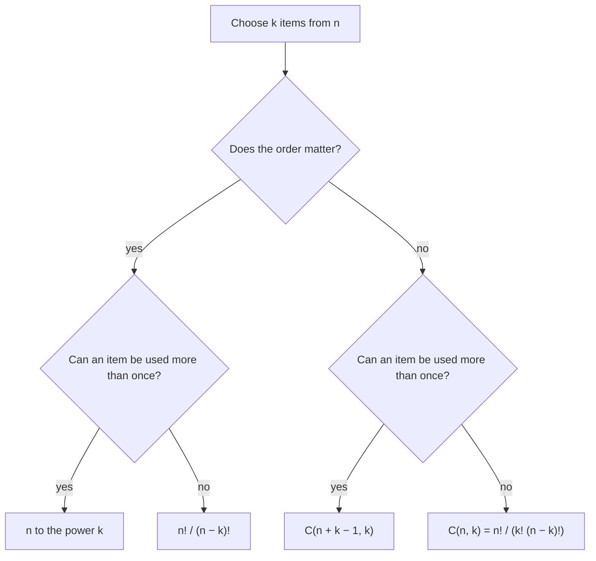

# Sequences, Permutations and Combinations

<!-- BEGIN HEADER (generated by tools/build.py from the front matter; edit the front matter, not this block) -->
> [Home](../../../../README.md) › [Part I — Computer Science Foundations](../../index.md) › [2. Mathematics for Computer Science](../index.md) › [Chapter 2: Discrete mathematics](index.md)

- **Difficulty:** Beginner to intermediate
- **Estimated time:** about 90 minutes
- **Prerequisites:** [Sets, Relations and Functions](01-sets-relations-and-functions.md)
- **Syllabus topics covered:** `02.02.04` Sequences · `02.02.05` Permutations · `02.02.06` Combinations
- **Status:** Drafted (passes the automated checks; awaiting independent technical review). Last reviewed 2026-11-20.
<!-- END HEADER -->

## What you will learn

- Describe a sequence by a formula or by a rule that builds each term from the one before, and add up arithmetic and geometric sequences.
- Use the rules of sum and product to count outcomes, and decide whether order matters.
- Count permutations and combinations, with and without repetition, using factorials and binomial coefficients.
- Read Pascal's triangle and use the binomial theorem.
- See how fast counts grow, and connect them to password spaces, brute-force search and fair shuffling.
- Check a counting formula by listing every case for a small example in Python.

## Introduction

"How many?" is one of the most useful questions in computing. How many steps will this loop run? How many passwords must an attacker try? How many test configurations does this program have? How many ways can these jobs be ordered? The branch of mathematics that answers such questions is **combinatorics**, and it is the basis of algorithm analysis, security estimates and, in a later chapter, probability.

This lesson covers three syllabus topics: sequences, permutations and combinations. A **sequence** is an ordered list of numbers. A **permutation** is an ordered arrangement of objects, and a **combination** is an unordered selection. The previous lesson supplies the vocabulary: a sequence is a function whose inputs are positions, and a permutation is a bijection from a set to itself.

## Intuitive understanding

Getting dressed is a counting problem. With 3 shirts, 4 pairs of trousers and 2 pairs of shoes you can make $3 \times 4 \times 2 = 24$ outfits, because each choice can be combined with every choice before it. Seating four guests in a row is different: the order matters, so swapping two guests gives a new arrangement. Choosing two of the four to sit by the window is different again: the order does not matter, because the same pair is chosen whichever name you say first.

Order is the key question in almost every counting problem. A "combination lock" is badly named for that reason: it opens only for the right digits in the right order, so it is really a permutation lock. The analogies assume that every choice is independent and always available. In real problems rules such as "no repeats" or "the manager must be on the team" change the count, and much of the skill is in spotting them.

## Technical foundations

### Sequences

A **sequence** is an ordered list $a_1, a_2, a_3, \dots$ of numbers, one for each position. It can be defined by a formula for the $n$th term, such as $a_n = 3n + 2$, which gives $5, 8, 11, 14, \dots$. It can also be defined by a rule that builds each term from the one before, together with a starting value: $a_1 = 5$ and $a_{n+1} = a_n + 3$. Rules of the second kind are called **recurrence relations** and are the subject of the next lesson.

Two kinds of sequence are especially common. In an **arithmetic sequence** each term is the previous one plus a constant step $d$, so $a_n = a_1 + (n - 1)d$. In a **geometric sequence** each term is the previous one times a constant ratio $r$, so $a_n = a_1 r^{n-1}$. The first grows steadily and the second grows exponentially, as in compound interest from the first chapter of this subject.

A **series** is a sum of the terms of a sequence, written with the sigma symbol: $\sum_{i=1}^{n} a_i = a_1 + a_2 + \dots + a_n$. Reading it is like reading a loop: the index $i$ runs from the lower limit to the upper limit, and the terms are added. Two sums come up constantly.

$$\sum_{i=1}^{n} i = \frac{n(n+1)}{2} \qquad\text{and}\qquad \sum_{i=0}^{n-1} r^i = \frac{r^n - 1}{r - 1}\ \ (r \neq 1).$$

The first follows by pairing the first and last terms: there are $n/2$ pairs and each pair adds up to $n + 1$. For $r = 2$ the second gives $1 + 2 + 4 + \dots + 2^{n-1} = 2^n - 1$, which is the largest number that fits in $n$ bits, written as $n$ ones. The first sum counts the steps of a double loop. If a loop compares every pair of positions $i < j$ among $n$ items, it makes $(n - 1) + (n - 2) + \dots + 1 = n(n-1)/2$ comparisons.

<!-- run:python -->
```python
# Arithmetic and geometric sequences: an explicit formula for the n-th term, or a recurrence from the term before
def arithmetic(first, step, n):
    return first + (n - 1) * step

def geometric(first, ratio, n):
    return first * ratio ** (n - 1)

print([arithmetic(3, 4, n) for n in range(1, 8)])
print([geometric(2, 3, n) for n in range(1, 8)])

terms = [3]                                       # the same arithmetic sequence, built one term from the last
for _ in range(6):
    terms.append(terms[-1] + 4)
print(terms == [arithmetic(3, 4, n) for n in range(1, 8)])

# Sums: 1 + 2 + ... + n = n(n + 1)/2, and 1 + 2 + 4 + ... + 2^(n-1) = 2^n - 1
for n in (10, 100, 1000):
    print(n, sum(range(1, n + 1)), n * (n + 1) // 2)
print(sum(2 ** k for k in range(10)), 2 ** 10 - 1)

# A double loop that compares every pair of positions i < j performs n(n - 1)/2 comparisons
n = 6
comparisons = sum(1 for i in range(n) for j in range(i + 1, n))
print(comparisons, n * (n - 1) // 2)
```

<!-- expect -->
```text
[3, 7, 11, 15, 19, 23, 27]
[2, 6, 18, 54, 162, 486, 1458]
True
10 55 55
100 5050 5050
1000 500500 500500
1023 1023
15 15
```

*Reading the output.* The first two lines list the arithmetic sequence $3, 7, 11, \dots$ and the geometric sequence $2, 6, 18, \dots$. The third line shows that building the arithmetic sequence one term at a time gives the same list as the formula. The next lines compare a direct sum with the formula $n(n+1)/2$ for $n = 10$, 100 and 1000, then $1 + 2 + 4 + \dots + 512 = 1023 = 2^{10} - 1$, and finally the 15 comparisons made by a double loop over 6 items.

### The rules of sum and product

The two basic counting rules are very simple. The **rule of sum** says that if one task can be done in $m$ ways and a different task in $n$ ways, and the two cannot both happen, then there are $m + n$ ways to do one or the other. The **rule of product** says that if a procedure has two steps, with $m$ ways to do the first and then $n$ ways to do the second whatever the first was, then there are $m \times n$ ways to do both. It extends to any number of steps. This is the counting rule for the Cartesian product $|A \times B| = |A| \cdot |B|$ from the previous lesson.

The rule of product explains many familiar sizes. A string of $k$ symbols from an alphabet of $n$ symbols can be chosen in $n \times n \times \dots \times n = n^k$ ways, which is also the number of functions from $k$ positions to $n$ symbols. A bit string of length $n$ has $2^n$ possibilities. An IPv4 address has four bytes of 256 values each, so there are $256^4 = 2^{32} = 4{,}294{,}967{,}296$ addresses.

### Permutations

A **permutation** is an arrangement of distinct objects in order. There are $n$ choices for the first position, $n - 1$ for the second, and so on, so $n$ objects can be arranged in

$$n! = n \times (n-1) \times \dots \times 2 \times 1$$

ways, where $n!$ is read "$n$ factorial", and $0! = 1$ by convention. If only $k$ of the $n$ objects are placed, the number of **$k$-permutations** is

$$P(n, k) = n \times (n-1) \times \dots \times (n - k + 1) = \frac{n!}{(n-k)!}.$$

This is also the number of injective functions from a $k$-element set to an $n$-element set, counted in the previous lesson. When repeats are allowed, the count is the simpler $n^k$ from the product rule.

### Combinations

A **combination** is a selection in which order does not matter. Take the $k$-permutations of $n$ objects. Each selection of $k$ objects appears $k!$ times among them, once for each order, so the number of selections is

$$C(n, k) = \binom{n}{k} = \frac{n!}{k!\,(n-k)!},$$

read "$n$ choose $k$". Choosing $k$ objects to take is the same as choosing the $n - k$ to leave behind, so $\binom{n}{k} = \binom{n}{n-k}$. This number is also the number of $k$-element subsets of an $n$-element set. If repeats are allowed but order still does not matter, the count is $\binom{n + k - 1}{k}$, a result known as "stars and bars".



*Reading the diagram:* two questions pick the formula. For $n = 10$ and $k = 3$ the four answers are 1000, 720, 220 and 120, and the program below confirms each one by listing all the cases.

### Pascal's triangle and the binomial theorem

The binomial coefficients can be arranged in a triangle in which each row starts and ends with 1 and every other entry is the sum of the two entries above it. This is **Pascal's rule**, $\binom{n}{k} = \binom{n-1}{k-1} + \binom{n-1}{k}$. It has a counting proof. Single out one object. A $k$-element selection either contains it, which leaves $\binom{n-1}{k-1}$ ways to pick the other $k - 1$, or does not, which leaves $\binom{n-1}{k}$ ways to pick all $k$ from the rest.

The same numbers are the coefficients in the **binomial theorem**:

$$(a + b)^n = \sum_{k=0}^{n} \binom{n}{k} a^{n-k} b^k.$$

To see why, multiply out $n$ copies of $(a + b)$: a term with $k$ factors of $b$ arises by choosing which $k$ of the $n$ brackets supply the $b$, and there are $\binom{n}{k}$ ways to choose. Setting $a = b = 1$ shows that each row of the triangle adds up to $2^n$, which agrees with the number of subsets of an $n$-element set.

<!-- run:python -->
```python
import math
from itertools import combinations, combinations_with_replacement, permutations, product

# Rule of product: 3 shirts, 4 pairs of trousers, 2 pairs of shoes
print(3 * 4 * 2, len(list(product(range(3), range(4), range(2)))))

# Permutations (order matters, no repeats)
print(math.factorial(5), len(list(permutations(range(5)))))               # all orderings of 5 items
print(math.perm(10, 3), len(list(permutations(range(10), 3))))          # ordered choices of 3 from 10

# Combinations (order does not matter): each choice of 3 appears 3! times among the permutations
print(math.comb(10, 3), len(list(combinations(range(10), 3))), math.perm(10, 3) // math.factorial(3))

# With repetition allowed
print(10 ** 3, len(list(product(range(10), repeat=3))))                                           # ordered
print(math.comb(10 + 3 - 1, 3), len(list(combinations_with_replacement(range(10), 3))))          # unordered

# Pascal's triangle: each entry is the sum of the two above it, and also C(n, k)
for n in range(6):
    print(" ".join(f"{math.comb(n, k):>2}" for k in range(n + 1)).center(24).rstrip())
print(all(math.comb(n, k) == math.comb(n - 1, k - 1) + math.comb(n - 1, k) for n in range(1, 20) for k in range(1, n)))

# The binomial theorem and the row sum 2^n (the number of subsets of an n-element set)
a, b, n = 3, 5, 7
print(sum(math.comb(n, k) * a ** (n - k) * b ** k for k in range(n + 1)) == (a + b) ** n, sum(math.comb(10, k) for k in range(11)) == 2 ** 10)
```

<!-- expect -->
```text
24 24
120 120
720 720
120 120 120
1000 1000
220 220
            1
          1  1
         1  2  1
       1  3  3  1
      1  4  6  4  1
    1  5 10 10  5  1
True
True True
```

*Reading the output.* Each pair of numbers compares a formula with a brute-force list built by `itertools`: 24 outfits, $5! = 120$ orderings, $P(10, 3) = 720$, $\binom{10}{3} = 120$ shown three ways (the formula, the list, and $P(10, 3)/3! = 720/6$), 1000 ordered codes with repeats and 220 unordered selections with repeats. Then comes Pascal's triangle up to row 5, a check of Pascal's rule for all rows below 20, and two checks of the binomial theorem and the row sum.

## Step-by-step working: counting what grows

Counts grow fast, and seeing how fast is half the point of learning to count. The first program prints factorials, the number of round trips through $n$ cities (the travelling salesman problem), the size of a password space and two famous selections.

<!-- run:python -->
```python
import math

for n in (5, 10, 15, 20, 25):
    print(f"{n:>2}! = {math.factorial(n):,}")

# Round trips through n cities, ignoring the starting city and the direction: (n - 1)! / 2
for cities in (5, 10, 15, 20):
    print(f"{cities:>2} cities: {math.factorial(cities - 1) // 2:,} different tours")

# Random passwords: 8 characters from 62 letters and digits; each bit doubles the space
space = 62 ** 8
print(f"62^8 = {space:,}, which is about 2^{math.log2(space):.1f}")
print(f"6 numbers from 49: {math.comb(49, 6):,} tickets | 5 cards from 52: {math.comb(52, 5):,} hands")

# Stirling's approximation n! ~ sqrt(2 pi n) (n / e)^n
for n in (10, 20, 50):
    approximation = math.sqrt(2 * math.pi * n) * (n / math.e) ** n
    print(f"n = {n:>2}: n! / approximation = {math.factorial(n) / approximation:.4f}")
```

<!-- expect -->
```text
 5! = 120
10! = 3,628,800
15! = 1,307,674,368,000
20! = 2,432,902,008,176,640,000
25! = 15,511,210,043,330,985,984,000,000
 5 cities: 12 different tours
10 cities: 181,440 different tours
15 cities: 43,589,145,600 different tours
20 cities: 60,822,550,204,416,000 different tours
62^8 = 218,340,105,584,896, which is about 2^47.6
6 numbers from 49: 13,983,816 tickets | 5 cards from 52: 2,598,960 hands
n = 10: n! / approximation = 1.0084
n = 20: n! / approximation = 1.0042
n = 50: n! / approximation = 1.0017
```

*Reading the output.* The factorial of 20 already exceeds $2 \times 10^{18}$ and the factorial of 25 has 26 digits. A tour that visits $n$ cities once each and returns can start anywhere and run in either direction, so there are $(n - 1)!/2$ different tours: 181,440 for 10 cities but over $6 \times 10^{16}$ for 20, which is why checking every tour is hopeless beyond a handful of cities. Eight random characters from 62 letters and digits give $62^8 \approx 2.2 \times 10^{14}$ passwords, about $2^{47.6}$, so each such password is worth about 47.6 bits (see [Exponents and Logarithms](../01-basic-mathematics/02-exponents-and-logarithms.md)). A lottery that draws 6 numbers from 49 has 13,983,816 equally likely tickets, and there are 2,598,960 five-card poker hands. The last lines compare $n!$ with Stirling's approximation, $n! \approx \sqrt{2\pi n}\,(n/e)^n$: the ratio is 1.0084 at $n = 10$ and gets closer to 1 as $n$ grows.

The second program turns that into a table of password spaces. A count of possibilities says how hard guessing is only when every character is chosen at random; people choose passwords very unevenly, which makes the real space far smaller.

<!-- run:python -->
```python
import math

# How many passwords of each kind exist, if every character is chosen at random?
policies = [("8 lowercase letters", 26, 8), ("8 letters and digits", 62, 8),
            ("12 letters and digits", 62, 12), ("16 from all 94 printable characters", 94, 16)]
for name, symbols, length in policies:
    space = symbols ** length
    print(f"{name:<38}{space:>34,}  about 2^{math.log2(space):.1f}")
print("each extra character multiplies the count by the alphabet size:", 62 ** 9 // 62 ** 8)
```

<!-- expect -->
```text
8 lowercase letters                                      208,827,064,576  about 2^37.6
8 letters and digits                                 218,340,105,584,896  about 2^47.6
12 letters and digits                      3,226,266,762,397,899,821,056  about 2^71.5
16 from all 94 printable characters   37,157,429,083,410,091,685,945,089,785,856  about 2^104.9
each extra character multiplies the count by the alphabet size: 62
```

*Reading the output.* Each extra character multiplies the space by the alphabet size, as the last line shows, so length matters more than variety: going from 8 to 12 letters and digits multiplies the space by $62^4 \approx 14.8$ million, while widening 8 lowercase letters to 62 characters multiplies it by only about 1,000.

### A counting proof that a shuffle is unfair

Counting can prove that an algorithm is wrong. A common way to shuffle a list of $n$ items goes through the positions and swaps each one with a randomly chosen position from the *whole* list. The random choices form a sequence of $n$ numbers, each from $n$ possibilities, so there are $n^n$ equally likely sequences. A fair shuffle would give each of the $n!$ orderings the same number of sequences, which needs $n!$ to divide $n^n$. For $n \ge 3$ it never does, because $n - 1$ is a factor of $n!$ and has nothing in common with $n^n$. So the naive shuffle cannot be fair. The Fisher–Yates shuffle swaps position $i$ with a random position among the first $i + 1$ only, working from the end. It has $n \times (n-1) \times \dots \times 2 = n!$ equally likely sequences, and each one produces a different ordering.

<!-- run:python -->
```python
from collections import Counter
from itertools import product
from math import factorial

def naive_shuffle(choices, n):
    """For each position i, swap it with a position j chosen from ALL n positions."""
    items = list(range(n))
    for i, j in enumerate(choices):
        items[i], items[j] = items[j], items[i]
    return tuple(items)

def fisher_yates(choices, n):
    """Go from the end: swap position i with a position j chosen from 0..i only."""
    items = list(range(n))
    for i, j in zip(range(n - 1, 0, -1), choices):
        items[i], items[j] = items[j], items[i]
    return tuple(items)

for n in (3, 4):
    naive = Counter(naive_shuffle(c, n) for c in product(range(n), repeat=n))
    fair = Counter(fisher_yates(c, n) for c in product(*[range(i + 1) for i in range(n - 1, 0, -1)]))
    print(f"n = {n}: {n}^{n} = {n ** n} equally likely choice sequences, {factorial(n)} orderings")
    print(f"   naive shuffle: each ordering arises {min(naive.values())} to {max(naive.values())} times;  "
          f"Fisher-Yates: {n}! = {sum(fair.values())} sequences, each ordering {min(fair.values())} to {max(fair.values())} time(s)")
print("n^n is divisible by n! only for n = 1 and 2:", [n for n in range(1, 9) if n ** n % factorial(n) == 0])
```

<!-- expect -->
```text
n = 3: 3^3 = 27 equally likely choice sequences, 6 orderings
   naive shuffle: each ordering arises 4 to 5 times;  Fisher-Yates: 3! = 6 sequences, each ordering 1 to 1 time(s)
n = 4: 4^4 = 256 equally likely choice sequences, 24 orderings
   naive shuffle: each ordering arises 8 to 15 times;  Fisher-Yates: 4! = 24 sequences, each ordering 1 to 1 time(s)
n^n is divisible by n! only for n = 1 and 2: [1, 2]
```

*Reading the output.* For three items the naive shuffle produces some orderings 4 times and others 5 times out of 27 sequences, while Fisher–Yates produces each of the 6 orderings exactly once. For four items the naive shuffle's counts range from 8 to 15 out of 256, so the most likely ordering is nearly twice as likely as the least likely. The last line lists, for $n$ up to 8, the values for which $n^n$ is divisible by $n!$: only 1 and 2.

## Real-world applications

- **Security.** The size of a password or key space is a count, and its logarithm in base 2 is the number of bits, which is how key strength is quoted. The figure assumes the characters are chosen uniformly at random.
- **Testing.** A program with $n$ independent on-or-off options has $2^n$ configurations, so testing all of them stops being possible beyond a few dozen options. Techniques that test every pair of option values, rather than every combination, rely on counting to show how much smaller the test set can be.
- **Search and optimization.** Brute-force search over orderings is a search over $n!$ permutations, and over subsets a search over $2^n$. The travelling salesman problem, scheduling and the knapsack problem all face these counts, which is why heuristics and clever pruning matter.
- **Addressing and naming.** An IPv4 address has $2^{32}$ values and an IPv6 address has $2^{128}$. Counting shows how many devices a scheme can name.
- **Probability.** The probability of an event with equally likely outcomes is the number of favourable outcomes divided by the total, so lotteries, card games and risk estimates are counting problems. A later chapter develops this.
- **Randomized algorithms.** A fair shuffle, a random sample and a random permutation for a test all need the counting argument above to be correct.
- **Databases.** The number of different orders in which a query's tables can be joined grows factorially, which is why query optimizers prune the choices instead of listing them all.

## Comparisons and trade-offs

The four counting situations for choosing $k$ items from $n$ differ in two respects, whether order matters and whether items may repeat. The last column uses $n = 10$ and $k = 3$.

| Order matters? | Repeats allowed? | Count | Example for $n = 10$, $k = 3$ |
| --- | --- | --- | --- |
| Yes | Yes | $n^k$ | 1000 three-digit codes |
| Yes | No | $n!/(n-k)!$ | 720 ordered choices of 3 of 10 |
| No | No | $\binom{n}{k}$ | 120 teams of 3 from 10 |
| No | Yes | $\binom{n+k-1}{k}$ | 220 selections of 3 scoops from 10 flavours |

Counting a quantity with a formula is almost always better than listing it. Listing, as `itertools` does lazily, is useful for checking a formula on small cases, but the number of objects explodes: the 15 cities of the travelling salesman example already give more than $4 \times 10^{10}$ tours.

## Advanced concepts

- **Multinomial coefficients.** The number of distinct arrangements of the letters of MISSISSIPPI is $11!/(1!\,4!\,4!\,2!) = 34{,}650$, because swapping equal letters changes nothing. The general formula $n!/(k_1!\,k_2!\cdots k_m!)$ counts the arrangements of a collection that contains repeated objects.
- **Catalan numbers.** The sequence $1, 1, 2, 5, 14, 42, \dots$, given by $\frac{1}{n+1}\binom{2n}{n}$, counts balanced strings of brackets, the shapes of binary trees with $n$ nodes and many other structures. It appears whenever a recursive structure is built from two smaller ones.
- **Generating functions.** A sequence can be packed into a single power series whose coefficients are the terms. Algebra on the series then solves counting problems and recurrences that are hard to attack directly.
- **Counting the complement.** "At least one" is often easiest as the total minus "none". The last lesson of this chapter develops this into the inclusion-exclusion principle.
- **Listing in order.** Algorithms exist that produce all permutations or combinations one at a time in a systematic order without storing them all, which is how `itertools` works. Donald Knuth's *The Art of Computer Programming, Volume 4A*, treats them at length.

## Common mistakes

> **Common mistake:** *Using permutations when order does not matter, or the reverse.* Decide first whether swapping two chosen items gives a different outcome. A committee is a combination; a ranked list of winners is a permutation.

- **Forgetting the repetition rule.** A PIN may repeat digits, so it has $10^4$ possibilities, while a ranking of distinct people has no repeats.
- **Counting the same outcome twice.** Choosing a chair and then two other members of a team counts each team once for each possible chair if you are not careful.
- **Misjudging the number of terms in a sum.** The sum from 1 to $n$ has $n$ terms, and the sum from 0 to $n - 1$ also has $n$ terms.
- **Treating factorial growth as merely exponential.** $n!$ outgrows $c^n$ for every constant $c$.
- **Counting "at least one" directly.** It is usually easier to count the total and subtract the cases with none.
- **Shuffling by swapping with any position.** As shown above, that cannot be uniform for three or more items.

## Exercises

**Beginner**

1. Write the next three terms and a formula for the $n$th term of $5, 8, 11, 14, \dots$.
2. In how many ways can 6 books be arranged on a shelf, and in how many ways can 2 of them be chosen to take on a trip?

**Intermediate**

3. A PIN has 4 digits and all four digits are different. How many such PINs are there?
4. A password has 8 characters, each a lowercase letter or a digit (36 symbols). How many passwords are there, and about how many bits is that?
5. A committee of 4 is chosen from 6 men and 5 women so that exactly 2 of its members are women. How many committees are possible?

**Advanced**

6. Prove Pascal's rule, $\binom{n}{k} = \binom{n-1}{k-1} + \binom{n-1}{k}$, by a counting argument.
7. In how many ways can 10 identical tasks be given to 4 servers, if a server may receive none? In how many ways if every server must receive at least one?

**Expert**

8. Show that the number of subsets of an $n$-element set with an even number of elements is $2^{n-1}$, for $n \ge 1$.

<details>
<summary>Solutions and hints</summary>

1. The step is 3, so the next terms are 17, 20 and 23, and $a_n = 5 + 3(n - 1) = 3n + 2$.
2. The books can be arranged in $6! = 720$ ways. Two books can be chosen in $\binom{6}{2} = 6 \cdot 5 / 2 = 15$ ways.
3. There are 10 choices for the first digit, 9 for the second, 8 for the third and 7 for the fourth: $10 \cdot 9 \cdot 8 \cdot 7 = 5040$.
4. Each of the 8 characters has 36 possibilities, so there are $36^8 = 2{,}821{,}109{,}907{,}456$ passwords. That is $8 \log_2 36 \approx 41.4$ bits.
5. Choose the 2 women in $\binom{5}{2} = 10$ ways and the 2 men in $\binom{6}{2} = 15$ ways, and multiply: 150 committees.
6. Single out one object. Count the $k$-element selections that contain it, which is $\binom{n-1}{k-1}$ because the other $k - 1$ come from the remaining $n - 1$, and those that do not contain it, which is $\binom{n-1}{k}$ because all $k$ come from the remaining $n - 1$. Every selection is in exactly one of the two groups, so the counts add to $\binom{n}{k}$.
7. Represent a distribution as stars (tasks) separated by 3 bars (the boundaries between the 4 servers). Placing the 3 bars among $10 + 3 = 13$ positions gives $\binom{13}{3} = 286$ ways. If every server must get at least one, first give each server one task, which leaves 6 tasks to distribute freely: $\binom{6 + 3}{3} = \binom{9}{3} = 84$ ways.
8. By the binomial theorem, $0 = (1 - 1)^n = \sum_{k} (-1)^k \binom{n}{k}$, so the even-sized subsets and the odd-sized subsets are equally many. Together they number $2^n$, so each kind numbers $2^{n-1}$. For $n = 10$ the even-sized subsets number $1 + 45 + 210 + 210 + 45 + 1 = 512$.

To check the numbers, run the program below. Its lines are numbered like the exercises.

<!-- run:python -->
```python
import math
from itertools import product

print("1.", [5 + 3 * (n - 1) for n in range(1, 8)])
print("2.", math.factorial(6), math.comb(6, 2))
print("3.", math.perm(10, 4), 10 * 9 * 8 * 7)
print("4.", f"{36 ** 8:,}", round(math.log2(36 ** 8), 1))
print("5.", math.comb(5, 2) * math.comb(6, 2))
print("6.", all(math.comb(n, k) == math.comb(n - 1, k - 1) + math.comb(n - 1, k) for n in range(1, 13) for k in range(1, n)))
loads = [t for t in product(range(11), repeat=4) if sum(t) == 10]
print("7.", len(loads), math.comb(13, 3), len([t for t in loads if min(t) >= 1]), math.comb(9, 3))
print("8.", sum(math.comb(10, k) for k in range(0, 11, 2)), 2 ** 9)
```

<!-- expect -->
```text
1. [5, 8, 11, 14, 17, 20, 23]
2. 720 15
3. 5040 5040
4. 2,821,109,907,456 41.4
5. 150
6. True
7. 286 286 84 84
8. 512 512
```

</details>

## Interview and practical questions

**What is the difference between a permutation and a combination?** In a permutation the order of the chosen items matters, so $P(n, k) = n!/(n-k)!$. In a combination it does not, so $C(n, k) = n!/(k!\,(n-k)!)$, which is the number of permutations divided by $k!$.

**How many ways can the letters ABC be arranged, and how many subsets does $\{A, B, C\}$ have?** There are $3! = 6$ arrangements and $2^3 = 8$ subsets.

**Why is the naive shuffle biased?** It makes $n^n$ equally likely sequences of random choices, and $n!$ does not divide $n^n$ for $n \ge 3$, so the orderings cannot all be equally likely. Fisher–Yates uses exactly $n!$ sequences.

**How do you estimate how long it takes to try every password of a given kind?** Divide the size of the space, $n^k$ for $k$ characters from an alphabet of $n$, by the number of guesses per second. The result assumes the password was chosen uniformly at random, which people's passwords rarely are.

**Why is the number of tours in the travelling salesman problem $(n-1)!/2$?** Fix the starting city, since a tour is a cycle, which leaves $(n-1)!$ orderings of the others. Each tour and its reverse are the same route, so divide by 2.

## Further reading

**Textbooks**

- Kenneth H. Rosen, *Discrete Mathematics and Its Applications* (McGraw-Hill), the chapters on counting.
- Ronald L. Graham, Donald E. Knuth and Oren Patashnik, *Concrete Mathematics* (Addison-Wesley), the chapter on binomial coefficients.
- Richard P. Stanley, *Enumerative Combinatorics* (Cambridge University Press).
- Donald E. Knuth, *The Art of Computer Programming, Volume 4A: Combinatorial Algorithms, Part 1* (Addison-Wesley).
- Eric Lehman, F. Thomson Leighton and Albert R. Meyer, *Mathematics for Computer Science* (MIT OpenCourseWare, free to read).

**Official documentation**

- Python: [`math.comb`, `math.perm` and `math.factorial`](https://docs.python.org/3/library/math.html) and [`itertools`](https://docs.python.org/3/library/itertools.html).

<!-- BEGIN FOOTER (generated by tools/build.py) -->
---

## Related topics

- [Exponents and Logarithms](../01-basic-mathematics/02-exponents-and-logarithms.md)
- [Algebra, Equations and Functions](../01-basic-mathematics/03-algebra-equations-and-functions.md)

## Navigation

**Previous:** [Sets, Relations and Functions](01-sets-relations-and-functions.md) · **Up:** [Chapter 2: Discrete mathematics](index.md) · **Next:** [Mathematical Induction and Recurrence Relations](03-induction-and-recurrence-relations.md)
<!-- END FOOTER -->
