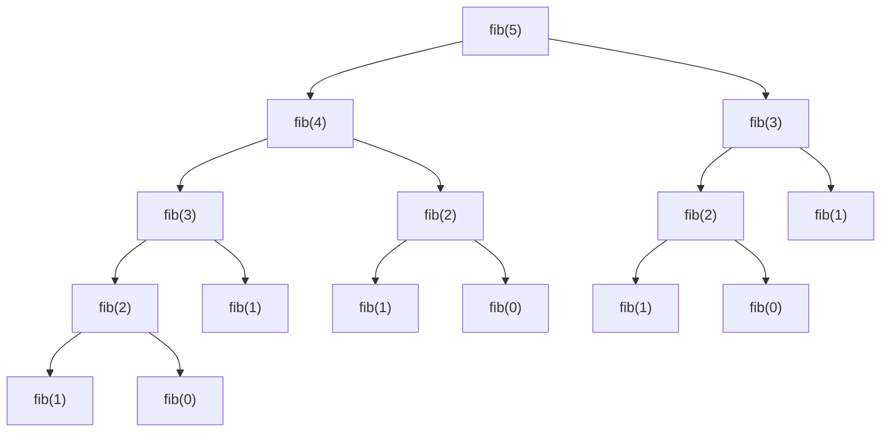

# Mathematical Induction and Recurrence Relations

<!-- BEGIN HEADER (generated by tools/build.py from the front matter; edit the front matter, not this block) -->
> [Home](../../../../README.md) › [Part I — Computer Science Foundations](../../index.md) › [2. Mathematics for Computer Science](../index.md) › [Chapter 2: Discrete mathematics](index.md)

- **Difficulty:** Intermediate
- **Estimated time:** about 90 minutes
- **Prerequisites:** [Sequences, Permutations and Combinations](02-sequences-permutations-and-combinations.md)
- **Syllabus topics covered:** `02.02.07` Mathematical induction · `02.02.08` Recurrence relations
- **Status:** Drafted (passes the automated checks; awaiting independent technical review). Last reviewed 2026-11-20.
<!-- END HEADER -->

## What you will learn

- State the principle of mathematical induction and write a proof with a base case and an inductive step.
- Use strong induction when a step needs more than the previous case, and structural induction for trees and lists.
- Explain why checking many examples is not a proof, and spot a flawed inductive argument.
- Define a sequence or a recursive program by a recurrence relation, and solve simple recurrences by unrolling and by guessing and proving.
- Derive the cost of Tower of Hanoi, naive Fibonacci, binary search and merge sort.
- Compute Fibonacci numbers by memoization, by a closed form and by fast doubling.

## Introduction

A program that works on whole numbers of any size has infinitely many cases to get right, and no amount of testing can cover them all. **Mathematical induction** is the standard way to prove that a statement holds for every whole number, and it is the mathematical twin of recursion and loops: a recursive function is correct for the same reason that an induction proof is valid. Its partner, the **recurrence relation**, describes a quantity in terms of earlier values of itself, and it is how the running time of a recursive algorithm is written down.

This lesson covers two syllabus topics, mathematical induction and recurrence relations. It uses the sequences of the previous lesson, the exponents and logarithms of the first chapter of this subject, and the idea of a pure, memoizable function from the lesson on functions in that chapter.

## Intuitive understanding

Picture a long row of dominoes. If the first domino falls, and every domino that falls knocks over the next, then all of them fall. Induction has exactly those two parts. The **base case** tips the first domino, and the **inductive step** shows that each domino knocks over its successor. Neither part alone is enough: a perfect chain with no first push never starts, and a first push with a gap in the chain stops.

A recurrence is a recipe that says how to get each step from earlier ones. To count the ways to climb a staircase taking one or two steps at a time, notice that the last move was either a single step from step $n-1$ or a double step from step $n-2$, so $\text{ways}(n) = \text{ways}(n-1) + \text{ways}(n-2)$. The analogy has a limit: dominoes fall in a physical order, while a proof by induction is a logical argument that must be correct at every link, not merely plausible for the first few.

## Technical foundations

### Mathematical induction

Suppose $P(n)$ is a statement about a whole number $n$, such as "$1 + 2 + \dots + n = n(n+1)/2$". To prove that $P(n)$ holds for every $n \ge n_0$:

1. **Base case.** Prove that $P(n_0)$ is true.
2. **Inductive step.** Prove that for every $k \ge n_0$, if $P(k)$ is true then $P(k+1)$ is true. The assumption that $P(k)$ is true is called the **inductive hypothesis**.

The conclusion is that $P(n)$ is true for all $n \ge n_0$. This is valid because a failure would have a first case. Suppose $P(n)$ were false for some $n$, and take the smallest such $n$. It is not $n_0$, because the base case holds, so $P(n-1)$ is true. But the inductive step then gives $P(n)$, a contradiction. The argument uses the fact that every non-empty set of whole numbers has a smallest element.

Here is an example: the sum of the first $n$ odd numbers is $n^2$. For $n = 1$ the sum is $1 = 1^2$, which is the base case. For the step, assume $1 + 3 + \dots + (2k - 1) = k^2$. Adding the next odd number, $2k + 1$, gives $k^2 + 2k + 1 = (k+1)^2$, which is the statement for $k + 1$. By induction it holds for every $n \ge 1$. Note where the hypothesis was used: the sum up to $k$ was replaced by $k^2$. A proof by induction that never uses the hypothesis is suspect.

### Strong induction and structural induction

Sometimes the step from $k$ to $k + 1$ needs more than the previous case. In **strong induction** the inductive hypothesis is that $P(m)$ holds for *all* $m$ from $n_0$ up to $k$, and the step proves $P(k+1)$ from them. A classic example: every amount of 12 cents or more can be paid with 4-cent and 5-cent stamps. The base cases are $12 = 4+4+4$, $13 = 4+4+5$, $14 = 4+5+5$ and $15 = 5+5+5$. For any amount $n \ge 16$, the amount $n - 4$ is at least 12, so by hypothesis it can be paid, and one more 4-cent stamp pays $n$.

**Structural induction** proves statements about recursively defined structures such as lists and trees, using the structure itself in place of $n$. A **full binary tree** is either a single leaf or a root with two subtrees that are full binary trees. The claim is that a full binary tree with $n$ internal nodes has $n + 1$ leaves. A single leaf has 0 internal nodes and 1 leaf. For a root with subtrees of $i$ and $j$ internal nodes, the hypothesis gives $i + 1$ and $j + 1$ leaves, so the whole tree has $i + j + 1$ internal nodes (the root counts) and $(i + 1) + (j + 1) = (i + j + 1) + 1$ leaves.

### Evidence is not proof

Testing a formula for many values is useful, because it can reveal an error, but it proves nothing about the values not tested. The famous polynomial $n^2 + n + 41$ gives a prime for every $n$ from 0 to 39. A bold conjecture would be that it is always prime, and it is false at $n = 40$. The program below shows that, along with checks that merely agree with true statements and the stamp problem.

<!-- run:python -->
```python
# Checking many cases is evidence, not proof
print("1 + 2 + ... + n = n(n+1)/2 holds for every n up to 2000:",
      all(sum(range(1, n + 1)) == n * (n + 1) // 2 for n in range(1, 2001)))
print("the sum of the first n odd numbers is n^2, for n up to 500:",
      all(sum(range(1, 2 * n, 2)) == n * n for n in range(1, 501)))

# A famous warning: n^2 + n + 41 is prime for n = 0, 1, ..., 39, and then fails
def is_prime(m):
    if m < 2:
        return False
    d = 2
    while d * d <= m:
        if m % d == 0:
            return False
        d += 1
    return True

first_failure = next(n for n in range(100) if not is_prime(n * n + n + 41))
value = first_failure ** 2 + first_failure + 41
print(f"n^2 + n + 41 is prime for n = 0 to {first_failure - 1}, but n = {first_failure} gives {value} = 41 x {value // 41}")

# Strong induction: every amount from 12 cents up can be paid with 4-cent and 5-cent stamps
def payable(amount):
    return any((amount - 5 * fives) % 4 == 0 for fives in range(amount // 5 + 1))

print("amounts below 12 that cannot be paid:", [n for n in range(1, 12) if not payable(n)])
print("every amount from 12 to 200 can be paid:", all(payable(n) for n in range(12, 201)))
```

<!-- expect -->
```text
1 + 2 + ... + n = n(n+1)/2 holds for every n up to 2000: True
the sum of the first n odd numbers is n^2, for n up to 500: True
n^2 + n + 41 is prime for n = 0 to 39, but n = 40 gives 1681 = 41 x 41
amounts below 12 that cannot be paid: [1, 2, 3, 6, 7, 11]
every amount from 12 to 200 can be paid: True
```

*Reading the output.* The first two lines check two true formulas for thousands of cases, which is reassuring but not a proof. The third line is the warning: the polynomial is prime for $n = 0$ to 39, and for $n = 40$ it gives $1681 = 41 \times 41$. The last two lines show that the amounts which cannot be paid with 4- and 5-cent stamps are 1, 2, 3, 6, 7 and 11, and that every amount from 12 to 200 can be paid, as the strong-induction proof says it must for all larger amounts too.

Faulty inductions are instructive. The "proof" that all horses are the same colour argues that in any set of $n$ horses all have the same colour, by induction on $n$. The step takes $n + 1$ horses, removes one, removes another and compares the two groups of $n$. It works unless $n = 1$, because then the two groups of one horse share no horse, so nothing links them. The step fails at the very first link, from 1 horse to 2. A base case with a step that fails for it proves nothing.

### Recurrence relations

A **recurrence relation** defines each term of a sequence from earlier terms, together with **initial conditions** that start the sequence. Many familiar things are defined this way: $n! = n \cdot (n-1)!$ with $0! = 1$, the Fibonacci numbers $F(n) = F(n-1) + F(n-2)$ with $F(0) = 0$ and $F(1) = 1$, and compound growth $a_n = (1 + r)\,a_{n-1}$. A recursive function in a program is a recurrence, and the number of steps it takes is another.

To **solve** a recurrence is to find a formula for the $n$th term. Three methods cover most cases.

- **Unrolling.** Substitute the recurrence into itself until a pattern appears. For $T(n) = 2T(n-1) + 1$ with $T(0) = 0$: $T(n) = 2(2T(n-2) + 1) + 1 = 4T(n-2) + 3 = 8T(n-3) + 7 = \dots = 2^n T(0) + (2^n - 1) = 2^n - 1$.
- **Guess and prove.** Compute a few terms, guess a formula and prove it by induction. From $T(1), \dots, T(5) = 1, 3, 7, 15, 31$ one guesses $2^n - 1$. For the step, $T(k+1) = 2T(k) + 1 = 2(2^k - 1) + 1 = 2^{k+1} - 1$.
- **The characteristic equation.** For a linear recurrence with constant coefficients such as $a_n = c_1 a_{n-1} + c_2 a_{n-2}$, try $a_n = x^n$. This gives $x^2 = c_1 x + c_2$. If it has two different roots $r_1$ and $r_2$, then $a_n = A r_1^n + B r_2^n$, and the constants $A$ and $B$ are fixed by the initial conditions.

For the Fibonacci numbers the characteristic equation is $x^2 = x + 1$, with roots $\varphi = (1 + \sqrt{5})/2 \approx 1.618$, the golden ratio, and $\psi = (1 - \sqrt{5})/2 \approx -0.618$. The initial conditions give **Binet's formula**:

$$F(n) = \frac{\varphi^n - \psi^n}{\sqrt{5}}.$$

Since $|\psi| < 1$, the term $\psi^n / \sqrt{5}$ is smaller than $1/2$ in absolute value, so $F(n)$ is simply the integer nearest to $\varphi^n / \sqrt{5}$. The Fibonacci numbers therefore grow exponentially, by a factor of about 1.618 at each step.

| Recurrence | Solution | Where it appears |
| --- | --- | --- |
| $T(n) = T(n-1) + 1$ | $n$ | A loop that does one step per item |
| $T(n) = T(n-1) + n$ | $n(n+1)/2$ | A loop inside a loop |
| $T(n) = 2T(n-1) + 1$ | $2^n - 1$ | Tower of Hanoi |
| $T(n) = T(n/2) + 1$ | $\log_2 n + 1$ | Binary search |
| $T(n) = 2T(n/2) + n$ | $n \log_2 n$ | Merge sort |
| $F(n) = F(n-1) + F(n-2)$ | about $\varphi^n/\sqrt{5}$ | Fibonacci numbers, and naive recursion for them |

The solutions assume sensible initial conditions, and for the halving recurrences that $n$ is a power of 2. The merge-sort recurrence reads: sorting $n$ items takes two sorts of half the size plus $n$ steps to merge the results.



*Reading the diagram:* computing `fib(5)` the naive way takes 15 calls, because the same subproblems are solved again and again: `fib(3)` twice, `fib(2)` three times. The number of calls satisfies a recurrence of its own, $C(n) = C(n-1) + C(n-2) + 1$, which is why it grows as fast as the Fibonacci numbers themselves.

## Step-by-step working: the cost of recursion

The first program writes the recurrences of this lesson as code and counts what they predict. It checks the Hanoi formula, counts the ways to climb stairs, counts the calls made by naive Fibonacci, shows how memoization removes them, and compares merge sort and binary search with their closed forms.

<!-- run:python -->
```python
from functools import lru_cache

# Tower of Hanoi: T(n) = 2 T(n-1) + 1 with T(0) = 0, so T(n) = 2^n - 1
def hanoi_moves(n):
    return 0 if n == 0 else 2 * hanoi_moves(n - 1) + 1
print([hanoi_moves(n) for n in range(1, 9)], [2 ** n - 1 for n in range(1, 9)])

# Climbing n stairs one or two at a time: ways(n) = ways(n-1) + ways(n-2), the Fibonacci rule
def ways(n):
    return 1 if n <= 1 else ways(n - 1) + ways(n - 2)
print([ways(n) for n in range(1, 11)])

# Naive Fibonacci: how many calls does the recursion make?
calls = 0
def fib(n):
    global calls
    calls += 1
    return n if n < 2 else fib(n - 1) + fib(n - 2)

for n in (10, 20, 25):
    calls = 0
    value = fib(n)
    print(f"fib({n}) = {value:>6,} needs {calls:>7,} calls")

memo_calls = 0
@lru_cache(maxsize=None)
def fib_memo(n):
    global memo_calls
    memo_calls += 1
    return n if n < 2 else fib_memo(n - 1) + fib_memo(n - 2)
print(f"with memoization fib(90) = {fib_memo(90):,} needs {memo_calls} calls")

# Merge sort: T(n) = 2 T(n/2) + n with T(1) = 0, so T(n) = n log2 n when n = 2^k
def merge_cost(n):
    return 0 if n == 1 else 2 * merge_cost(n // 2) + n
print([(2 ** k, merge_cost(2 ** k), 2 ** k * k) for k in (1, 2, 3, 10)])

# Binary search: T(n) = T(n/2) + 1 with T(1) = 1, so T(n) = log2 n + 1 when n = 2^k
def search_cost(n):
    return 1 if n == 1 else search_cost(n // 2) + 1
print([(2 ** k, search_cost(2 ** k)) for k in (0, 3, 10, 20)])
```

<!-- expect -->
```text
[1, 3, 7, 15, 31, 63, 127, 255] [1, 3, 7, 15, 31, 63, 127, 255]
[1, 2, 3, 5, 8, 13, 21, 34, 55, 89]
fib(10) =     55 needs     177 calls
fib(20) =  6,765 needs  21,891 calls
fib(25) = 75,025 needs 242,785 calls
with memoization fib(90) = 2,880,067,194,370,816,120 needs 91 calls
[(2, 2, 2), (4, 8, 8), (8, 24, 24), (1024, 10240, 10240)]
[(1, 1), (8, 4), (1024, 11), (1048576, 21)]
```

*Reading the output.* The first line shows that the recurrence $T(n) = 2T(n-1) + 1$ gives the same list as $2^n - 1$. The staircase counts 1, 2, 3, 5, 8, 13, 21, 34, 55, 89 are the Fibonacci numbers. Computing `fib(25)` the naive way takes 242,785 calls, which is exactly $2F(26) - 1$, and `fib(20)` takes 21,891 calls, so adding five to $n$ multiplies the work by about 11, which is $\varphi^5$. With memoization `fib(90)` needs only 91 calls, one for each value from 0 to 90, because every repeated call is answered from memory. The merge-sort costs equal $n \log_2 n$ exactly (a table of $(n, \text{cost}, n \log_2 n)$ with the last two columns equal), and the binary-search costs equal $\log_2 n + 1$: 4 comparisons for 8 items, 11 for 1024 and 21 for $2^{20} = 1{,}048{,}576$ items, in line with the $\lfloor \log_2 n \rfloor + 1$ count of the first chapter of this subject.

The second program computes Fibonacci numbers exactly in two other ways. The closed form of Binet uses 80-digit decimal arithmetic so that the rounding is exact. **Fast doubling** uses the identities $F(2k) = F(k)\,(2F(k+1) - F(k))$ and $F(2k+1) = F(k)^2 + F(k+1)^2$, so that each step halves $n$ and only about $\log_2 n$ steps are needed, as in fast exponentiation.

<!-- run:python -->
```python
from decimal import Decimal, getcontext

getcontext().prec = 80                          # 80 significant digits: ample for the numbers below
sqrt5 = Decimal(5).sqrt()
phi = (1 + sqrt5) / 2                           # the golden ratio, the positive root of x^2 = x + 1

def binet(n):
    """Closed form: F(n) is the integer nearest to phi^n / sqrt(5)."""
    return int((phi ** n / sqrt5).to_integral_value())

def fib_pair(n):
    """Fast doubling: returns (F(n), F(n+1)) using F(2k) = F(k)(2F(k+1) - F(k)) and F(2k+1) = F(k)^2 + F(k+1)^2."""
    if n == 0:
        return 0, 1
    a, b = fib_pair(n // 2)
    c, d = a * (2 * b - a), a * a + b * b
    return (d, c + d) if n % 2 else (c, d)

print("closed form agrees with fast doubling for n = 0 to 200:", all(binet(n) == fib_pair(n)[0] for n in range(201)))
print("F(10) =", fib_pair(10)[0], "| F(90) =", f"{fib_pair(90)[0]:,}", "| F(1000) has", len(str(fib_pair(1000)[0])), "digits")
print("F(31) / F(30) =", round(fib_pair(31)[0] / fib_pair(30)[0], 6), "| golden ratio =", round(float(phi), 6))
```

<!-- expect -->
```text
closed form agrees with fast doubling for n = 0 to 200: True
F(10) = 55 | F(90) = 2,880,067,194,370,816,120 | F(1000) has 209 digits
F(31) / F(30) = 1.618034 | golden ratio = 1.618034
```

*Reading the output.* The closed form and fast doubling agree for every $n$ from 0 to 200. $F(90)$ is 2,880,067,194,370,816,120, and $F(1000)$ has 209 digits, which fast doubling produces almost instantly. The ratio of consecutive Fibonacci numbers, $F(31)/F(30)$, is already 1.618034, the golden ratio to six places, which is the dominant root of the characteristic equation.

## Real-world applications

- **Correctness of programs.** A loop invariant is a statement proved by induction on the number of iterations: true before the loop, and preserved by each pass. A recursive function is proved correct by the same argument, using the correctness of the smaller calls as the inductive hypothesis.
- **Analysis of algorithms.** The running time of a recursive algorithm, such as merge sort, binary search or quicksort, is written as a recurrence and then solved. For the divide-and-conquer shapes $T(n) = aT(n/b) + f(n)$ a general result called the master theorem gives the answer directly.
- **Data structures.** Facts about trees, such as the leaf count of a full binary tree or the height of a balanced tree, are proved by structural induction. Compilers and proof tools reason about syntax trees the same way.
- **Dynamic programming.** Many optimization problems are solved by writing a recurrence for the best answer in terms of the best answers to smaller problems, then remembering the results. Computing Fibonacci numbers with memoization is the smallest example.
- **Signal processing and filters.** A digital filter computes each output value from the previous outputs and inputs, which is a linear recurrence, and its behaviour is analysed with the characteristic equation.
- **Random number generators.** A simple generator computes each number from the one before, $x_{n+1} = (a x_n + c) \bmod m$, a recurrence whose period and quality depend on the constants.
- **Finance and modelling.** The balance of a loan or an investment, after each period, follows a recurrence such as $a_n = (1 + r)\,a_{n-1} - p$.

## Comparisons and trade-offs

There are several ways to compute a Fibonacci number, and they differ enormously in cost.

| Method | Cost | Exact? | Comment |
| --- | --- | --- | --- |
| Naive recursion | About $\varphi^n$ calls | Yes | `fib(40)` already makes $2F(41) - 1 = 331{,}160{,}281$ calls |
| Memoization | About $n$ calls | Yes | Linear time and memory, but the recursion depth is $n$, which exceeds Python's default limit for large $n$ |
| Loop with two variables | $n$ additions | Yes | Linear time and constant extra memory |
| Fast doubling | About $\log_2 n$ steps | Yes | Best for huge $n$, using big-integer multiplication |
| Binet's formula in floats | A few operations | No | A double has 53 bits of precision, so it cannot store every integer above $2^{53}$, which $F(n)$ passes at $n = 79$ |

The lesson of the table is not specific to Fibonacci numbers. A recurrence is a specification, and the same specification can be turned into programs whose costs differ by astronomical factors. Recognising repeated subproblems, as in the recursion tree above, is the first step to a fast algorithm.

## Advanced concepts

- **The master theorem.** For recurrences of the form $T(n) = aT(n/b) + f(n)$, it states which of three cases applies and so gives the growth of $T(n)$ without solving the recurrence. It covers merge sort, binary search and many other divide-and-conquer algorithms.
- **Well-ordering and Peano's axioms.** The principle of induction is equivalent to the fact that every non-empty set of natural numbers has a least element. In Peano's axioms, which define the natural numbers, induction is one of the axioms.
- **Generating functions.** Packing a sequence into a power series turns a recurrence into an algebraic equation that can be solved exactly, and it handles recurrences that the characteristic equation cannot.
- **Nonlinear recurrences.** A simple formula such as the logistic map $x_{n+1} = r\,x_n(1 - x_n)$ behaves chaotically for some values of $r$, so that tiny changes in the starting value produce very different sequences. No closed form of the kind found above exists in general.
- **Proof assistants.** Programs such as Coq and Lean check proofs by machine, and induction over recursively defined data is one of their basic tools.

## Common mistakes

> **Common mistake:** *Omitting the base case, or proving the step only for cases the base case does not reach.* A step with no starting point proves nothing: the horses "proof" fails exactly because its step does not work from 1 horse to 2.

- **Assuming what you want to prove.** The inductive hypothesis is $P(k)$. Using $P(k+1)$ inside the proof of $P(k+1)$ is circular.
- **Treating many cases as a proof.** The polynomial $n^2 + n + 41$ is prime for 40 values and then fails.
- **Forgetting that the step needs the hypothesis.** If the proof of $P(k+1)$ never uses $P(k)$, either the statement is trivial or the proof is wrong.
- **Getting the initial conditions wrong.** A recurrence has many solutions, and only the initial conditions pick one. $a_n = 3a_{n-1}$ gives $5 \cdot 3^n$ if $a_0 = 5$ but $2 \cdot 3^n$ if $a_0 = 2$.
- **Applying a halving recurrence to a number that is not a power of 2.** The formulas in the table are exact for powers of 2 and approximate otherwise.
- **Ignoring repeated work in recursion.** A short recursive definition can hide an exponential running time.

## Exercises

**Beginner**

1. Prove by induction that $1 + 2 + 4 + \dots + 2^{n-1} = 2^n - 1$ for every $n \ge 1$.
2. Let $c_0 = 2$ and $c_n = 2c_{n-1} - 1$. Compute $c_1, \dots, c_5$, guess a formula and prove it by induction.

**Intermediate**

3. Prove by induction that $2^n > n$ for every $n \ge 0$. Take care with the step from $k = 0$.
4. Solve $a_n = 3a_{n-1}$ with $a_0 = 5$, and solve $a_n = a_{n-1} + 2n$ with $a_0 = 0$.
5. Prove by strong induction that every integer $n \ge 2$ is a product of one or more primes.

**Advanced**

6. Naive Fibonacci makes $C(n)$ calls, where $C(0) = C(1) = 1$ and $C(n) = C(n-1) + C(n-2) + 1$. Show by induction that $C(n) = 2F(n+1) - 1$, and check it for $n = 10$ and $n = 20$.
7. Solve $T(n) = T(n/2) + n$ with $T(1) = 1$ for $n$ a power of 2.

**Expert**

8. Binet's formula is exact in theory. Why is it rarely used with floating-point numbers, and what is a better way to compute a Fibonacci number of large index?

<details>
<summary>Solutions and hints</summary>

1. For $n = 1$ the sum is $1 = 2^1 - 1$. Assume $1 + 2 + \dots + 2^{k-1} = 2^k - 1$. Adding the next term, $2^k$, gives $2^k - 1 + 2^k = 2^{k+1} - 1$, which is the statement for $k + 1$.
2. The values are $c_1, \dots, c_5 = 3, 5, 9, 17, 33$, which suggests $c_n = 2^n + 1$. This holds for $n = 0$, since $2^0 + 1 = 2$. If $c_k = 2^k + 1$ then $c_{k+1} = 2(2^k + 1) - 1 = 2^{k+1} + 1$.
3. For $n = 0$, $2^0 = 1 > 0$. Assume $2^k > k$. Then $2^{k+1} = 2 \cdot 2^k > 2k$. For $k \ge 1$ we have $2k \ge k + 1$, so $2^{k+1} > k + 1$. For $k = 0$ the claim is $2^1 = 2 > 1$, which is checked directly, because the inequality $2k \ge k + 1$ fails when $k = 0$.
4. For $a_n = 3a_{n-1}$ with $a_0 = 5$, unrolling gives $a_n = 5 \cdot 3^n$. For $a_n = a_{n-1} + 2n$ with $a_0 = 0$, unrolling gives $a_n = 2 + 4 + \dots + 2n = 2(1 + 2 + \dots + n) = n(n+1)$.
5. Assume every integer from 2 to $k$ is a product of primes, and consider $k + 1$. If it is prime, it is a product of one prime. Otherwise $k + 1 = ab$ with $2 \le a, b \le k$, and by the hypothesis each of $a$ and $b$ is a product of primes, so $k + 1$ is too. Strong induction is needed because $a$ and $b$ can be any smaller numbers, not just $k$.
6. For $n = 0$ and $n = 1$, $C = 1$ and $2F(1) - 1 = 2F(2) - 1 = 1$. If the formula holds for $k$ and $k - 1$, then $C(k+1) = C(k) + C(k-1) + 1 = (2F(k+1) - 1) + (2F(k) - 1) + 1 = 2F(k+2) - 1$. This is a use of strong induction, since the step needs two earlier cases. The values are $C(10) = 177 = 2 \cdot 89 - 1$ and $C(20) = 21{,}891 = 2 \cdot 10946 - 1$.
7. Unrolling gives $T(n) = n + n/2 + n/4 + \dots + 2 + 1 = 2n - 1$, a geometric sum. So the work is dominated by the first level. For $n = 8$ it is 15, and for $n = 1024$ it is 2047.
8. A double holds only 53 bits of precision, so not every integer above $2^{53}$ can be stored exactly. The number $F(n)$ passes $2^{53}$ at $n = 79$, and the rounding of $\varphi^n$ becomes a problem sooner. Computing with integers avoids all of this. Fast doubling needs only about $\log_2 n$ steps and is exact for any $n$, and a simple loop with two variables is exact too.

To check the numbers, run the program below. Its lines are numbered like the exercises.

<!-- run:python -->
```python
def calls(n):
    return 1 if n < 2 else calls(n - 1) + calls(n - 2) + 1

def fib(n):
    a, b = 0, 1
    for _ in range(n):
        a, b = b, a + b
    return a

def halving_cost(n):
    return 1 if n == 1 else halving_cost(n // 2) + n

print("1.", all(sum(2 ** i for i in range(n)) == 2 ** n - 1 for n in range(1, 101)))
c, a, b = [2], [5], [0]
for n in range(1, 6):
    c.append(2 * c[-1] - 1)
    a.append(3 * a[-1])
    b.append(b[-1] + 2 * n)
print("2.", c, [2 ** n + 1 for n in range(6)])
print("3.", all(2 ** n > n for n in range(0, 201)))
print("4.", a == [5 * 3 ** n for n in range(6)], b == [n * (n + 1) for n in range(6)], b)
print("6.", calls(10), 2 * fib(11) - 1, calls(20), 2 * fib(21) - 1)
print("7.", [(2 ** k, halving_cost(2 ** k), 2 * 2 ** k - 1) for k in (3, 10)])
print("8.", next(n for n in range(200) if fib(n) > 2 ** 53), fib(78) < 2 ** 53, 2 * fib(41) - 1)
```

<!-- expect -->
```text
1. True
2. [2, 3, 5, 9, 17, 33] [2, 3, 5, 9, 17, 33]
3. True
4. True True [0, 2, 6, 12, 20, 30]
6. 177 177 21891 21891
7. [(8, 15, 15), (1024, 2047, 2047)]
8. 79 True 331160281
```

</details>

## Interview and practical questions

**What are the two parts of a proof by induction, and why is each needed?** The base case establishes the first statement, and the inductive step shows that each statement implies the next. Without the base case the chain has no start, and without the step it does not continue.

**What is the difference between weak and strong induction?** In weak induction the step uses only the previous case, $P(k)$. In strong induction it may use all earlier cases, $P(n_0), \dots, P(k)$. They prove the same statements, but strong induction is more convenient when the step needs several earlier cases.

**What recurrence describes the running time of merge sort, and what is its solution?** $T(n) = 2T(n/2) + n$, which solves to $n \log_2 n$ for $n$ a power of 2.

**Why is naive recursive Fibonacci slow, and how do you fix it?** It recomputes the same subproblems, so the number of calls grows like the Fibonacci numbers themselves. Memoization, which stores each result, or a loop that carries the last two values, brings it down to linear time.

**Does checking a formula for the first million cases prove it?** No. $n^2 + n + 41$ is prime for $n = 0$ to 39 and fails at $n = 40$. Only a general argument, such as induction, covers all cases.

## Further reading

**Textbooks**

- Daniel J. Velleman, *How to Prove It: A Structured Approach* (Cambridge University Press).
- Ronald L. Graham, Donald E. Knuth and Oren Patashnik, *Concrete Mathematics* (Addison-Wesley), the first chapter on recurrent problems.
- Thomas H. Cormen, Charles E. Leiserson, Ronald L. Rivest and Clifford Stein, *Introduction to Algorithms* (MIT Press), the chapters on divide-and-conquer and on solving recurrences.
- Eric Lehman, F. Thomson Leighton and Albert R. Meyer, *Mathematics for Computer Science* (MIT OpenCourseWare, free to read), the chapter on induction.
- Kenneth H. Rosen, *Discrete Mathematics and Its Applications* (McGraw-Hill).

**Official documentation**

- Python: [`functools.lru_cache`](https://docs.python.org/3/library/functools.html#functools.lru_cache) and [`decimal`](https://docs.python.org/3/library/decimal.html).

<!-- BEGIN FOOTER (generated by tools/build.py) -->
---

## Related topics

- [Exponents and Logarithms](../01-basic-mathematics/02-exponents-and-logarithms.md)
- [Algebra, Equations and Functions](../01-basic-mathematics/03-algebra-equations-and-functions.md)

## Navigation

**Previous:** [Sequences, Permutations and Combinations](02-sequences-permutations-and-combinations.md) · **Up:** [Chapter 2: Discrete mathematics](index.md) · **Next:** [The Pigeonhole Principle and Inclusion-Exclusion](04-pigeonhole-and-inclusion-exclusion.md)
<!-- END FOOTER -->
