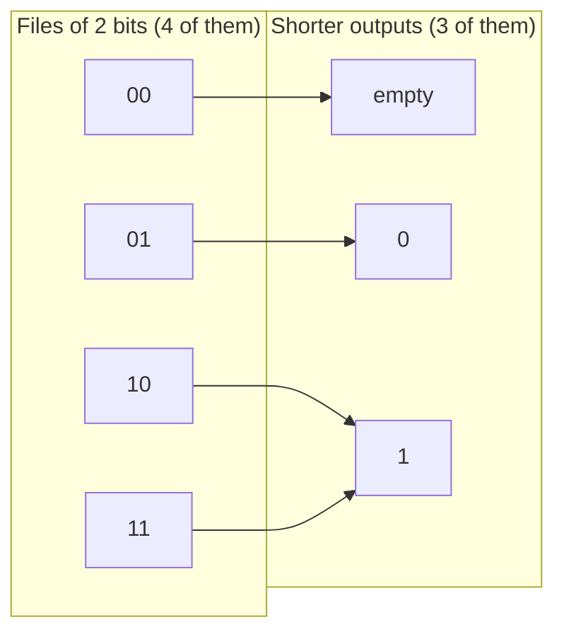

# The Pigeonhole Principle and Inclusion-Exclusion

<!-- BEGIN HEADER (generated by tools/build.py from the front matter; edit the front matter, not this block) -->
> [Home](../../../../README.md) › [Part I — Computer Science Foundations](../../index.md) › [2. Mathematics for Computer Science](../index.md) › [Chapter 2: Discrete mathematics](index.md)

- **Difficulty:** Intermediate
- **Estimated time:** about 90 minutes
- **Prerequisites:** [Sequences, Permutations and Combinations](02-sequences-permutations-and-combinations.md)
- **Syllabus topics covered:** `02.02.09` Pigeonhole principle · `02.02.10` Inclusion-exclusion principle
- **Status:** Drafted (passes the automated checks; awaiting independent technical review). Last reviewed 2026-11-20.
<!-- END HEADER -->

## What you will learn

- State the pigeonhole principle and its generalized form, and use it to prove that something must repeat or exist.
- Recognise pigeonhole arguments in hashing, compression and everyday puzzles.
- Use the birthday bound to estimate when a collision becomes likely rather than merely certain.
- Use inclusion-exclusion to count the size of a union of two, three or many sets.
- Apply inclusion-exclusion to derangements, onto functions and the count of integers coprime to $n$.
- Check a counting argument by brute force on small cases.

## Introduction

This lesson covers two counting principles that look almost too simple to matter. The **pigeonhole principle** says that if more objects are placed in boxes than there are boxes, some box holds at least two. **Inclusion-exclusion** says how to count a union of overlapping sets without counting the overlaps more than once. Between them they prove that no compression scheme can shrink every file, explain why hash collisions cannot be avoided, and count arrangements such as "nobody gets their own gift".

They cover the last two syllabus topics of this chapter, the pigeonhole principle and the inclusion-exclusion principle. Both build on the counting of the previous lessons, and both reappear in the probability chapter later in this subject. The next chapter, on mathematical logic, turns from counting to reasoning.

## Intuitive understanding

Put 10 pigeons into 9 pigeonholes and some hole must hold two pigeons. You do not know which hole, and you do not have to: the argument only says that a crowded hole exists. In the same way, if you pull socks from a drawer of black and white socks in the dark, three socks always contain a matching pair, whatever the colours, because there are only two colours to go round.

Inclusion-exclusion is bookkeeping for overlaps. A class has 20 students who like pizza and 15 who like pasta. Adding gives 35, but anyone who likes both was counted twice, so you subtract the number who like both once. With three groups the corrections themselves overlap, and you must add the triple overlap back. The analogies hide one point: the pigeonhole principle proves that a repeat *exists* but gives no way to find it, while inclusion-exclusion gives the exact count.

## Technical foundations

### The pigeonhole principle

**Pigeonhole principle.** If $n$ objects are placed into $m$ boxes and $n > m$, then some box contains at least two objects. The proof is one line: if every box held at most one object, there would be at most $m < n$ objects. The **generalized pigeonhole principle** says that some box contains at least $\lceil n/m \rceil$ objects, where $\lceil \cdot \rceil$ rounds up. If every box held fewer, say at most $\lceil n/m \rceil - 1 < n/m$ objects, the total would be less than $n$. In the language of the first lesson of this chapter, the principle says that there is no injective function from a larger finite set to a smaller one.

The art lies in choosing the objects and the boxes. Four examples follow.

- **Birth months.** Among 13 people, two were born in the same month, because there are 12 months. Among 25 people, three share a month, since $\lceil 25/12 \rceil = 3$.
- **Remainders.** Among any $n + 1$ integers, two have a difference divisible by $n$. The objects are the integers and the boxes are the $n$ possible remainders on division by $n$: two of the integers share a remainder, so their difference is a multiple of $n$.
- **Friends.** In any group of $n \ge 2$ people, two have the same number of friends within the group. The possible numbers of friends are $0, 1, \dots, n - 1$, which is $n$ boxes, but a person with 0 friends and a person with $n - 1$ friends cannot both exist, so only $n - 1$ boxes are available for $n$ people.
- **Compression.** There are $2^n$ files of $n$ bits but only $2^n - 1$ bit strings that are shorter, counting the empty string. So any scheme that maps every file to a shorter one must map two different files to the same output, and no decompressor can then recover both. **No lossless compressor can shorten every file**, and any one that shortens some must lengthen others.



*Reading the diagram:* however the four files are mapped to the three shorter strings, two files must share an output, as 10 and 11 do here, and a decompressor cannot tell which one it came from.

<!-- run:python -->
```python
import math
from itertools import combinations, product

# The best you can do when putting n items into m boxes is a largest box of ceil(n / m)
def smallest_possible_fullest_box(n, m):
    best = n
    for assignment in product(range(m), repeat=n):                 # the box chosen for each item
        best = min(best, max(assignment.count(box) for box in range(m)))
    return best

for n, m in [(5, 4), (7, 3), (9, 3), (6, 6)]:
    print(f"{n} items in {m} boxes: some box holds at least {smallest_possible_fullest_box(n, m)} (ceil(n/m) = {math.ceil(n / m)})")

# Any n + 1 integers include two whose difference is a multiple of n (two share a remainder mod n)
n = 5
holds = all(any((x - y) % n == 0 for x, y in combinations(chosen, 2)) for chosen in combinations(range(20), n + 1))
print(f"every {n + 1}-element subset of 0..19 has two numbers differing by a multiple of {n}:", holds)

# In any group of two or more people, two have the same number of friends: check every graph on 5 vertices
pairs = list(combinations(range(5), 2))
always = True
for mask in range(2 ** len(pairs)):
    degree = [0] * 5
    for bit, (u, v) in enumerate(pairs):
        if (mask >> bit) & 1:
            degree[u] += 1
            degree[v] += 1
    always = always and len(set(degree)) < 5
print(f"all {2 ** len(pairs)} friendship graphs on 5 people have two people with equal degree:", always)

# Counting argument for compression: n-bit strings against all shorter strings (lengths 0 to n-1)
for bits in (8, 16, 32):
    print(f"{bits}-bit files: {2 ** bits:,} of them, but only {2 ** bits - 1:,} shorter bit strings")

# Pigeonhole in action: colour every pair among 6 people "friends" or "strangers".  Someone always has a trio of
# mutual friends or a trio of mutual strangers.  With only 5 people a colouring can avoid both.
def has_one_colour_triangle(people, colouring):
    edges = list(combinations(range(people), 2))
    colour = {edge: (colouring >> bit) & 1 for bit, edge in enumerate(edges)}
    return any(colour[(a, b)] == colour[(a, c)] == colour[(b, c)] for a, b, c in combinations(range(people), 3))

print("all", 2 ** 15, "colourings of 6 people contain a one-colour trio:",
      all(has_one_colour_triangle(6, mask) for mask in range(2 ** 15)))
print("some colouring of 5 people has no one-colour trio:",
      any(not has_one_colour_triangle(5, mask) for mask in range(2 ** 10)))
```

<!-- expect -->
```text
5 items in 4 boxes: some box holds at least 2 (ceil(n/m) = 2)
7 items in 3 boxes: some box holds at least 3 (ceil(n/m) = 3)
9 items in 3 boxes: some box holds at least 3 (ceil(n/m) = 3)
6 items in 6 boxes: some box holds at least 1 (ceil(n/m) = 1)
every 6-element subset of 0..19 has two numbers differing by a multiple of 5: True
all 1024 friendship graphs on 5 people have two people with equal degree: True
8-bit files: 256 of them, but only 255 shorter bit strings
16-bit files: 65,536 of them, but only 65,535 shorter bit strings
32-bit files: 4,294,967,296 of them, but only 4,294,967,295 shorter bit strings
all 32768 colourings of 6 people contain a one-colour trio: True
some colouring of 5 people has no one-colour trio: True
```

*Reading the output.* The first lines find, by trying every assignment, the best that can be done with $n$ items and $m$ boxes: the fullest box must hold $\lceil n/m \rceil$ items, with equality when the items are spread as evenly as possible (6 items in 6 boxes need only 1 per box). The next line confirms that every 6-element subset of $\{0, \dots, 19\}$ contains two numbers whose difference is a multiple of 5. The next confirms the friends argument on all 1024 friendship graphs on 5 people. The compression lines show that for each file size there is exactly one fewer shorter string than there are files. The last two lines are a famous consequence of the principle: whichever way the 15 pairs among 6 people are labelled "friends" or "strangers", some trio is all friends or all strangers, and the 5-person case shows that 6 people are really needed, since 5 can avoid it.

### The birthday bound and hash collisions

The pigeonhole principle guarantees a collision once there are more items than values, but collisions become *likely* much earlier. If $k$ items each take one of $N$ equally likely values, the probability that all are different is $\prod_{i=0}^{k-1}(1 - i/N)$, and the probability of at least one repeat is one minus that. The repeat becomes more likely than not at about $k \approx 1.1774\sqrt{N}$, the square root of $2N \ln 2$. For $N = 365$ birthdays this is about 23 people, which surprises most people on first meeting it, and so it is often called the birthday paradox. The next program computes these probabilities.

<!-- run:python -->
```python
def p_shared(k, days):
    """Probability that among k random items drawn from `days` equally likely values, two are equal."""
    p_all_different = 1.0
    for i in range(k):
        p_all_different *= (days - i) / days
    return 1 - p_all_different

print([(k, round(p_shared(k, 365), 3)) for k in (10, 23, 40, 70)], "| certain at 366:", p_shared(366, 365) == 1.0)
print("a 32-bit hash with 77,163 keys:", round(p_shared(77_163, 2 ** 32), 3), "| with 10,000 keys:", round(p_shared(10_000, 2 ** 32), 4))
```

<!-- expect -->
```text
[(10, 0.117), (23, 0.507), (40, 0.891), (70, 0.999)] | certain at 366: True
a 32-bit hash with 77,163 keys: 0.5 | with 10,000 keys: 0.0116
```

*Reading the output.* With 23 people the probability of a shared birthday is 0.507, with 40 it is 0.891 and with 70 it is 0.999, yet it is certain only at 366. For a hash with $2^{32}$ possible values, a collision has even odds after about 77,163 keys, and about a 1 in 86 chance already at 10,000 keys, although the principle only guarantees one at $2^{32} + 1$.

| Number of possible values $N$ | Collision guaranteed at | Even odds of a collision at about |
| --- | --- | --- |
| 365 birthdays | 366 items | 23 items |
| $2^{32} = 4{,}294{,}967{,}296$ | $2^{32} + 1$ items | 77,163 items |
| $2^{64}$ | $18{,}446{,}744{,}073{,}709{,}551{,}617$ items | about 5.06 billion items |

The consequence for design is that a hash of $b$ bits is expected to produce a collision after about $2^{b/2}$ inputs, not $2^b$. This is why hash functions meant to resist collisions have outputs twice as long as the security level that they aim for.

### Inclusion-exclusion

For two sets, $|A \cup B| = |A| + |B| - |A \cap B|$, as in the first lesson of this chapter. For three sets:

$$|A \cup B \cup C| = |A| + |B| + |C| - |A \cap B| - |A \cap C| - |B \cap C| + |A \cap B \cap C|.$$

The pattern is to add the sizes of the sets, subtract the sizes of all pairwise intersections, add back the triple intersections, and continue, alternating signs. For any number of sets $A_1, \dots, A_n$:

$$\left|\bigcup_{i=1}^{n} A_i\right| = \sum_{k=1}^{n} (-1)^{k+1} \sum_{|I| = k} \left|\bigcap_{i \in I} A_i\right|.$$

The reason is a counting argument on single elements. An element that lies in exactly $j$ of the sets is counted $\binom{j}{1} - \binom{j}{2} + \binom{j}{3} - \dots \pm \binom{j}{j}$ times by the formula. The binomial theorem shows that $\sum_{i=0}^{j} (-1)^i \binom{j}{i} = 0$ for $j \ge 1$, so this alternating sum equals 1: every element of the union is counted exactly once. The number of elements in *none* of the sets is $|U|$ minus the union, which is the same alternating sum starting from $|U|$ itself.

Here is a worked example. How many of the integers from 1 to 100 are divisible by none of 2, 3 and 5? Let $A$, $B$ and $C$ be the multiples of 2, 3 and 5.

| Set | Size |
| --- | --- |
| $A$, multiples of 2 | 50 |
| $B$, multiples of 3 | 33 |
| $C$, multiples of 5 | 20 |
| $A \cap B$, multiples of 6 | 16 |
| $A \cap C$, multiples of 10 | 10 |
| $B \cap C$, multiples of 15 | 6 |
| $A \cap B \cap C$, multiples of 30 | 3 |

The union has $50 + 33 + 20 - 16 - 10 - 6 + 3 = 74$ elements, so $100 - 74 = 26$ integers are divisible by none of the three.

## Step-by-step working: counting overlaps

The program below checks the worked example by brute force, implements the general formula for any list of sets, and then applies it to three classic counts: derangements, onto functions and Euler's totient.

- A **derangement** is an ordering of $n$ items in which no item is in its original place. Let $A_i$ be the set of orderings that leave item $i$ in place. Then $|A_i \cap A_j \cap \dots|$ with $k$ items fixed is $(n-k)!$, and there are $\binom{n}{k}$ ways to choose them, so inclusion-exclusion gives $D(n) = \sum_{k=0}^{n} (-1)^k \frac{n!}{k!}$.
- An **onto function** from an $n$-element set to an $m$-element set is a function that hits every output. Let $A_i$ be the functions that never produce output $i$. Then $k$ chosen outputs are missed in $(m-k)^n$ functions, and the number of onto functions is $\sum_{k=0}^{m} (-1)^k \binom{m}{k} (m-k)^n$.
- **Euler's totient** $\varphi(n)$ counts the integers from 1 to $n$ that have no common factor with $n$ other than 1. Let $A_p$ be the multiples of each prime $p$ that divides $n$. Inclusion-exclusion over these sets gives $\varphi(n) = n \prod_{p \mid n} (1 - 1/p)$.

<!-- run:python -->
```python
import math
from itertools import combinations, permutations

N = 100
A = {n for n in range(1, N + 1) if n % 2 == 0}
B = {n for n in range(1, N + 1) if n % 3 == 0}
C = {n for n in range(1, N + 1) if n % 5 == 0}
by_formula = len(A) + len(B) + len(C) - len(A & B) - len(A & C) - len(B & C) + len(A & B & C)
print("numbers up to 100 divisible by 2, 3 or 5:", len(A | B | C), "by the formula:", by_formula, "| divisible by none:", N - len(A | B | C))

def union_size(sets):
    """Inclusion-exclusion: add single sets, subtract pairs, add triples, and so on."""
    total = 0
    for k in range(1, len(sets) + 1):
        for chosen in combinations(sets, k):
            total += (-1) ** (k + 1) * len(set.intersection(*chosen))
    return total
print("general formula agrees:", union_size([A, B, C]) == len(A | B | C))

# Derangements: orderings in which no item stays in its original place
def derangements(n):
    return sum((-1) ** k * (math.factorial(n) // math.factorial(k)) for k in range(n + 1))

def brute_force(n):
    return sum(all(p[i] != i for i in range(n)) for p in permutations(range(n)))

print([(n, derangements(n), brute_force(n)) for n in range(1, 7)])
print("D(10) / 10! =", round(derangements(10) / math.factorial(10), 6), "| 1/e =", round(1 / math.e, 6))

# Onto functions from an n-element set to an m-element set
def onto(n, m):
    return sum((-1) ** k * math.comb(m, k) * (m - k) ** n for k in range(m + 1))
print("onto functions 3 -> 2:", onto(3, 2), "| 4 -> 3:", onto(4, 3), "| 5 -> 3:", onto(5, 3))

# Euler's totient: how many of 1..n have no factor in common with n?
def totient(n):
    return sum(1 for k in range(1, n + 1) if math.gcd(k, n) == 1)
print([(n, totient(n)) for n in (12, 30, 97)], "| 30 * (1 - 1/2) * (1 - 1/3) * (1 - 1/5) =", round(30 * (1 - 1 / 2) * (1 - 1 / 3) * (1 - 1 / 5)))
```

<!-- expect -->
```text
numbers up to 100 divisible by 2, 3 or 5: 74 by the formula: 74 | divisible by none: 26
general formula agrees: True
[(1, 0, 0), (2, 1, 1), (3, 2, 2), (4, 9, 9), (5, 44, 44), (6, 265, 265)]
D(10) / 10! = 0.367879 | 1/e = 0.367879
onto functions 3 -> 2: 6 | 4 -> 3: 36 | 5 -> 3: 150
[(12, 4), (30, 8), (97, 96)] | 30 * (1 - 1/2) * (1 - 1/3) * (1 - 1/5) = 8
```

*Reading the output.* The first lines confirm the example: 74 of the numbers up to 100 are divisible by 2, 3 or 5, so 26 are divisible by none, and the general formula agrees. The derangement counts are 0, 1, 2, 9, 44 and 265 for 1 to 6 items, and counting all orderings one by one gives the same numbers. The proportion $D(10)/10!$ is 0.367879, which matches $1/e$ to six places: for large $n$ about 36.8% of random orderings leave nothing in place. The onto counts are 6 for 3 items onto 2, which is the number found by listing in the first lesson of this chapter, then 36 and 150. The last line gives $\varphi(12) = 4$, $\varphi(30) = 8$ and $\varphi(97) = 96$, and shows the product formula for 30.

## Real-world applications

- **Hash tables and checksums.** More keys than buckets means a collision. The generalized principle says that with $n$ keys and $m$ buckets some bucket holds at least $\lceil n/m \rceil$ keys, so a table must handle collisions however good its hash function is.
- **Compression.** The counting argument shows that every lossless compressor makes some inputs longer. Practical compressors succeed because real files are far from random, so a few patterns can be given short codes at the cost of lengthening patterns that rarely occur.
- **Cryptography.** The birthday bound is why collision-resistant hash functions have long outputs. An attacker needs only about $2^{b/2}$ attempts, not $2^b$, to find two inputs with the same $b$-bit hash.
- **Analytics and databases.** Counting the distinct users who visited a website, used a mobile app or both is a union of overlapping sets: add the two audiences and subtract the overlap, which avoids counting the same person twice.
- **Random assignments.** If each of $n$ people draws a name from a hat, the chance that nobody draws their own name tends to $1/e \approx 36.8\%$, which is the derangement count in action.
- **Surjections and mappings.** The number of ways to assign $n$ jobs to $m$ workers so that every worker has at least one job is the number of onto functions.
- **Number theory.** Euler's totient counts the usable multipliers in modular arithmetic, and it appears in public-key cryptography.
- **Probability.** The probability of a union of events follows the same alternating formula, and truncating it after an even or odd number of terms gives a lower or an upper bound.

## Comparisons and trade-offs

The two principles answer different questions. Pigeonhole proves that a repeat exists and says nothing about which items repeat. Inclusion-exclusion computes an exact size. They are often combined with the other tools of this chapter.

| Technique | Answers | Typical use |
| --- | --- | --- |
| Rule of sum and product | How many outcomes of a sequence of choices? | Passwords, outfits, addresses |
| Permutations and combinations | How many ordered or unordered selections? | Arrangements, committees, hands |
| Complement counting | How many have at least one of something? | Total minus the cases with none |
| Inclusion-exclusion | How many are in a union of overlapping sets? | Overlapping categories, derangements, onto functions |
| Pigeonhole principle | Must two items share a box? | Collisions, impossibility of compression |
| Brute-force enumeration | What is the exact answer for a small case? | Checking a formula before trusting it |

Inclusion-exclusion has $2^n - 1$ terms for $n$ sets, so it is practical only for a few sets or when the intersections have a simple pattern, as with the factors of a number.

## Advanced concepts

- **Ramsey theory.** The friends-and-strangers result above is the start of a large subject. Ramsey theory asks how large a structure must be before some pattern is unavoidable, and it generalizes the pigeonhole principle. The number of people needed to guarantee a trio of mutual friends or mutual strangers is 6, which the program above confirmed by checking every case.
- **Bonferroni inequalities.** Stopping inclusion-exclusion after an odd number of terms overcounts the union and stopping after an even number undercounts it, which gives upper and lower bounds when the full formula is too expensive.
- **Möbius inversion.** A far-reaching generalization of inclusion-exclusion from sets to ordered structures, used in number theory and combinatorics.
- **Double counting.** A powerful proof technique counts one quantity in two different ways and equates the answers. The pigeonhole principle and inclusion-exclusion are both instances of it.
- **Collision attacks.** A real attack on a hash function succeeds if it finds a collision faster than the birthday bound, which is why a hash is considered broken when it can be done in fewer than about $2^{b/2}$ steps.

## Common mistakes

> **Common mistake:** *Choosing the wrong boxes.* A pigeonhole argument depends on defining the objects and the boxes cleverly. Before applying it, say exactly what the boxes are and check that there are fewer boxes than objects.

- **Forgetting the rounding up.** The generalized principle gives $\lceil n/m \rceil$, not $n/m$. A hundred people and twelve months give at least 9 in a month, not 8.33.
- **Expecting the principle to find the crowded box.** It proves that one exists, and nothing more.
- **Being off by one.** To force a repeat among $m$ boxes you need $m + 1$ objects, not $m$.
- **Mixing up certain and likely.** A collision is guaranteed only at $N + 1$ items, but it is likely at about $\sqrt{N}$. Designing as if collisions were rare until the table is full is a classic error.
- **Dropping the alternating signs in inclusion-exclusion.** Add the singles, subtract the pairs, add the triples, and so on.
- **Forgetting the highest-order intersection.** With three sets the term $+|A \cap B \cap C|$ is required.
- **Using inclusion-exclusion on disjoint sets.** If the sets do not overlap, simply add their sizes.

## Exercises

**Beginner**

1. A drawer holds loose black and white socks, 10 of each. How many socks must you take in the dark to be sure of a matching pair, and how many to be sure of a pair of black socks?
2. How many people must be in a room to be sure that two share a birth month, and to be sure that three do?

**Intermediate**

3. Show that among any 5 points in a $2 \times 2$ square, two are at distance at most $\sqrt{2}$ from each other.
4. Use inclusion-exclusion to count the integers from 1 to 1000 that are divisible by 3 or by 7.
5. How many integers from 1 to 100 are divisible by none of 2, 3 and 7?

**Advanced**

6. How many ways are there to put 7 letters into 7 addressed envelopes so that no letter is in its own envelope?
7. Count the onto functions from a 5-element set to a 4-element set.

**Expert**

8. Prove the generalized pigeonhole principle, and use it to show that among 100 people at least 9 share a birth month.
9. A hash function maps strings to 64-bit values. How many strings must be hashed to be sure of a collision, and about how many for even odds?

<details>
<summary>Solutions and hints</summary>

1. Three socks are enough, because there are only two colours, so two of them match. To be sure of two black socks, take all 10 white socks first in the worst case and then 2 more: 12 socks.
2. Thirteen people are enough for two to share a month, since there are 12 months. For three, $\lceil n/12 \rceil \ge 3$ needs $n \ge 25$: 24 people can have exactly two per month, but a 25th forces a third.
3. Divide the square into four $1 \times 1$ squares. Five points and four small squares mean that two points lie in the same small square (a point on a boundary can be assigned to either neighbour). The largest distance inside a $1 \times 1$ square is its diagonal, $\sqrt{2}$.
4. There are $\lfloor 1000/3 \rfloor = 333$ multiples of 3, $\lfloor 1000/7 \rfloor = 142$ multiples of 7 and $\lfloor 1000/21 \rfloor = 47$ multiples of both, so $333 + 142 - 47 = 428$.
5. The multiples of 2, 3 and 7 number 50, 33 and 14. The pairwise multiples (of 6, 14 and 21) number 16, 7 and 4, and the multiples of 42 number 2. The union has $50 + 33 + 14 - 16 - 7 - 4 + 2 = 72$ elements, so $100 - 72 = 28$ integers are divisible by none of them.
6. This is the number of derangements of 7 items: $D(7) = \sum_{k=0}^{7} (-1)^k \, 7!/k! = 1854$. Listing all 5040 orderings and counting those with no fixed point gives the same number.
7. By inclusion-exclusion the count is $4^5 - 4 \cdot 3^5 + 6 \cdot 2^5 - 4 \cdot 1^5 = 1024 - 972 + 192 - 4 = 240$. Checking all $4^5 = 1024$ functions gives the same count.
8. Suppose every one of the $m$ boxes held at most $\lceil n/m \rceil - 1$ objects. Since $\lceil n/m \rceil - 1 < n/m$, the total would be less than $m \cdot (n/m) = n$, which contradicts the fact that there are $n$ objects. For 100 people and 12 months, $\lceil 100/12 \rceil = 9$.
9. Certainty needs $2^{64} + 1 = 18{,}446{,}744{,}073{,}709{,}551{,}617$ strings. Even odds arrive at about $\sqrt{2 \ln 2 \cdot 2^{64}}$, which is about 5.06 billion strings, far fewer, because the number of pairs grows with the square of the number of strings.

To check the numbers, run the program below. Its lines are numbered like the exercises.

<!-- run:python -->
```python
import math
from itertools import permutations, product
from math import comb, factorial

print("2.", next(n for n in range(1, 99) if math.ceil(n / 12) >= 2), next(n for n in range(1, 99) if math.ceil(n / 12) >= 3))
print("4.", 1000 // 3 + 1000 // 7 - 1000 // 21, len([n for n in range(1, 1001) if n % 3 == 0 or n % 7 == 0]))
print("5.", 100 - len([n for n in range(1, 101) if n % 2 == 0 or n % 3 == 0 or n % 7 == 0]), 100 - (50 + 33 + 14 - 16 - 7 - 4 + 2))
d7 = sum((-1) ** k * factorial(7) // factorial(k) for k in range(8))
print("6.", d7, sum(all(p[i] != i for i in range(7)) for p in permutations(range(7))))
onto = sum(1 for f in product(range(4), repeat=5) if set(f) == {0, 1, 2, 3})
print("7.", onto, sum((-1) ** k * comb(4, k) * (4 - k) ** 5 for k in range(5)))
print("8.", math.ceil(100 / 12))
print("9.", f"{2 ** 64 + 1:,}", round(math.sqrt(2 * math.log(2) * 2 ** 64) / 1e9, 2), "billion")
```

<!-- expect -->
```text
2. 13 25
4. 428 428
5. 28 28
6. 1854 1854
7. 240 240
8. 9
9. 18,446,744,073,709,551,617 5.06 billion
```

</details>

## Interview and practical questions

**State the pigeonhole principle and give an example from computing.** If more than $m$ objects are placed in $m$ boxes, some box has at least two. In computing, any hash function from a large set of keys to a smaller set of values must have collisions.

**Why can no compression algorithm shrink every file?** There are $2^n$ files of $n$ bits but only $2^n - 1$ shorter strings, so two files would have to share a compressed form, and the original could not be recovered. A lossless compressor that shortens some files must lengthen others.

**What is the birthday paradox and why does it matter for hashing?** With $N$ equally likely values, a repeat becomes more likely than not after only about $1.18\sqrt{N}$ items. For a $b$-bit hash that is about $2^{b/2}$ items, so hashes must be long enough to make even that many attempts infeasible.

**Write the inclusion-exclusion formula for three sets.** $|A \cup B \cup C| = |A| + |B| + |C| - |A \cap B| - |A \cap C| - |B \cap C| + |A \cap B \cap C|$.

**What is a derangement, and what fraction of orderings are derangements?** A derangement is an ordering in which no item is in its original position. For large $n$ about $1/e \approx 36.8\%$ of all orderings are derangements.

## Further reading

**Textbooks**

- Kenneth H. Rosen, *Discrete Mathematics and Its Applications* (McGraw-Hill), the sections on the pigeonhole principle and on inclusion-exclusion.
- Eric Lehman, F. Thomson Leighton and Albert R. Meyer, *Mathematics for Computer Science* (MIT OpenCourseWare, free to read).
- Ronald L. Graham, Donald E. Knuth and Oren Patashnik, *Concrete Mathematics* (Addison-Wesley).
- Richard P. Stanley, *Enumerative Combinatorics* (Cambridge University Press), for inclusion-exclusion and Möbius inversion.

**Official documentation**

- Python: [`itertools`](https://docs.python.org/3/library/itertools.html) and [`math`](https://docs.python.org/3/library/math.html), for `comb`, `factorial` and `gcd`.

<!-- BEGIN FOOTER (generated by tools/build.py) -->
---

## Related topics

- [Sets, Relations and Functions](01-sets-relations-and-functions.md)
- [Mathematical Induction and Recurrence Relations](03-induction-and-recurrence-relations.md)

## Navigation

**Previous:** [Mathematical Induction and Recurrence Relations](03-induction-and-recurrence-relations.md) · **Up:** [Chapter 2: Discrete mathematics](index.md) · **Next:** [subject index](../index.md)
<!-- END FOOTER -->
