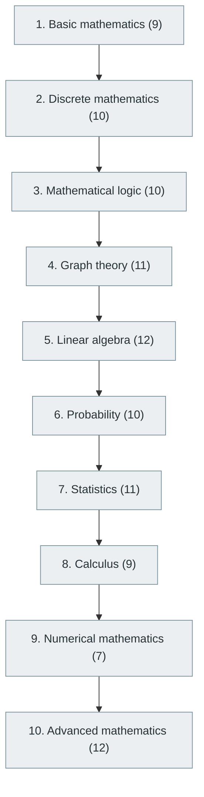

# 2. Mathematics for Computer Science

> [Home](../../../README.md) › [Part I — Computer Science Foundations](../index.md) › Subject 2

- **Status:** Not started (0 of 101 syllabus topics have a drafted lesson)
- **Source tags:** Beginner → Research level
- **Syllabus size:** 10 chapters, 101 topics

## Introduction

The mathematical toolkit behind algorithms, graphics, cryptography, AI and quantum computing: discrete mathematics, logic, graph theory, linear algebra, probability, statistics, calculus and numerical methods.

> Mathematics is particularly important for algorithms, graphics, AI, cryptography, scientific computing and quantum computing.

## Learning outcomes

After working through this subject you should be able to:

- Write and critique proofs by induction, contradiction and contrapositive
- Count with permutations, combinations and recurrences
- Compute with vectors and matrices and interpret eigenvalues, probability distributions and gradients

## Prerequisites

None. This subject can be started without knowledge of another subject in this library.

## Beginner-to-advanced progression

The chapters below follow the order of the source syllabus, which moves from foundational to advanced material. Colour shows documentation status (grey = not started, amber = in progress, green = drafted or better).

## Chapters and topics

### Chapter 1: Basic mathematics

9 topics · status: **Not started**

*Planned location:* `docs/01-computer-science-foundations/02-mathematics-for-computer-science/01-basic-mathematics/`. No lessons yet.

Syllabus topics in this chapter (9)

- `02.01.01` Arithmetic — *not started*
- `02.01.02` Fractions — *not started*
- `02.01.03` Percentages — *not started*
- `02.01.04` Ratios — *not started*
- `02.01.05` Exponents — *not started*
- `02.01.06` Logarithms — *not started*
- `02.01.07` Algebra — *not started*
- `02.01.08` Equations and inequalities — *not started*
- `02.01.09` Functions — *not started*

### Chapter 2: Discrete mathematics

10 topics · status: **Not started**

*Planned location:* `docs/01-computer-science-foundations/02-mathematics-for-computer-science/02-discrete-mathematics/`. No lessons yet.

Syllabus topics in this chapter (10)

- `02.02.01` Sets — *not started*
- `02.02.02` Relations — *not started*
- `02.02.03` Functions — *not started*
- `02.02.04` Sequences — *not started*
- `02.02.05` Permutations — *not started*
- `02.02.06` Combinations — *not started*
- `02.02.07` Mathematical induction — *not started*
- `02.02.08` Recurrence relations — *not started*
- `02.02.09` Pigeonhole principle — *not started*
- `02.02.10` Inclusion-exclusion principle — *not started*

### Chapter 3: Mathematical logic

10 topics · status: **Not started**

*Planned location:* `docs/01-computer-science-foundations/02-mathematics-for-computer-science/03-mathematical-logic/`. No lessons yet.

Syllabus topics in this chapter (10)

- `02.03.01` Propositional logic — *not started*
- `02.03.02` Predicate logic — *not started*
- `02.03.03` First-order logic — *not started*
- `02.03.04` Quantifiers — *not started*
- `02.03.05` Logical equivalence — *not started*
- `02.03.06` Proof techniques — *not started*
- `02.03.07` Direct proof — *not started*
- `02.03.08` Contradiction — *not started*
- `02.03.09` Contrapositive — *not started*
- `02.03.10` Formal reasoning — *not started*

### Chapter 4: Graph theory

11 topics · status: **Not started**

*Planned location:* `docs/01-computer-science-foundations/02-mathematics-for-computer-science/04-graph-theory/`. No lessons yet.

Syllabus topics in this chapter (11)

- `02.04.01` Vertices and edges — *not started*
- `02.04.02` Directed and undirected graphs — *not started*
- `02.04.03` Weighted graphs — *not started*
- `02.04.04` Trees — *not started*
- `02.04.05` Cycles — *not started*
- `02.04.06` Connected components — *not started*
- `02.04.07` Bipartite graphs — *not started*
- `02.04.08` Graph coloring — *not started*
- `02.04.09` Planar graphs — *not started*
- `02.04.10` Eulerian and Hamiltonian paths — *not started*
- `02.04.11` Network flow — *not started*

### Chapter 5: Linear algebra

12 topics · status: **Not started**

*Planned location:* `docs/01-computer-science-foundations/02-mathematics-for-computer-science/05-linear-algebra/`. No lessons yet.

Syllabus topics in this chapter (12)

- `02.05.01` Scalars — *not started*
- `02.05.02` Vectors — *not started*
- `02.05.03` Matrices — *not started*
- `02.05.04` Matrix multiplication — *not started*
- `02.05.05` Matrix transformations — *not started*
- `02.05.06` Determinants — *not started*
- `02.05.07` Eigenvalues — *not started*
- `02.05.08` Eigenvectors — *not started*
- `02.05.09` Vector spaces — *not started*
- `02.05.10` Linear independence — *not started*
- `02.05.11` Singular value decomposition — *not started*
- `02.05.12` Tensor algebra — *not started*

### Chapter 6: Probability

10 topics · status: **Not started**

*Planned location:* `docs/01-computer-science-foundations/02-mathematics-for-computer-science/06-probability/`. No lessons yet.

Syllabus topics in this chapter (10)

- `02.06.01` Random variables — *not started*
- `02.06.02` Probability distributions — *not started*
- `02.06.03` Conditional probability — *not started*
- `02.06.04` Bayes' theorem — *not started*
- `02.06.05` Independent events — *not started*
- `02.06.06` Expected values — *not started*
- `02.06.07` Variance — *not started*
- `02.06.08` Standard deviation — *not started*
- `02.06.09` Markov chains — *not started*
- `02.06.10` Bayesian inference — *not started*

### Chapter 7: Statistics

11 topics · status: **Not started**

*Planned location:* `docs/01-computer-science-foundations/02-mathematics-for-computer-science/07-statistics/`. No lessons yet.

Syllabus topics in this chapter (11)

- `02.07.01` Descriptive statistics — *not started*
- `02.07.02` Inferential statistics — *not started*
- `02.07.03` Sampling — *not started*
- `02.07.04` Hypothesis testing — *not started*
- `02.07.05` Confidence intervals — *not started*
- `02.07.06` Correlation — *not started*
- `02.07.07` Regression — *not started*
- `02.07.08` ANOVA — *not started*
- `02.07.09` Statistical significance — *not started*
- `02.07.10` Experimental design — *not started*
- `02.07.11` Bayesian statistics — *not started*

### Chapter 8: Calculus

9 topics · status: **Not started**

*Planned location:* `docs/01-computer-science-foundations/02-mathematics-for-computer-science/08-calculus/`. No lessons yet.

Syllabus topics in this chapter (9)

- `02.08.01` Limits — *not started*
- `02.08.02` Continuity — *not started*
- `02.08.03` Differentiation — *not started*
- `02.08.04` Integration — *not started*
- `02.08.05` Partial derivatives — *not started*
- `02.08.06` Multivariable calculus — *not started*
- `02.08.07` Gradients — *not started*
- `02.08.08` Gradient descent — *not started*
- `02.08.09` Vector calculus — *not started*

### Chapter 9: Numerical mathematics

7 topics · status: **Not started**

*Planned location:* `docs/01-computer-science-foundations/02-mathematics-for-computer-science/09-numerical-mathematics/`. No lessons yet.

Syllabus topics in this chapter (7)

- `02.09.01` Numerical approximation — *not started*
- `02.09.02` Numerical integration — *not started*
- `02.09.03` Numerical differentiation — *not started*
- `02.09.04` Error analysis — *not started*
- `02.09.05` Floating-point errors — *not started*
- `02.09.06` Numerical optimization — *not started*
- `02.09.07` Iterative algorithms — *not started*

### Chapter 10: Advanced mathematics

12 topics · status: **Not started**

*Planned location:* `docs/01-computer-science-foundations/02-mathematics-for-computer-science/10-advanced-mathematics/`. No lessons yet.

Syllabus topics in this chapter (12)

- `02.10.01` Information theory — *not started*
- `02.10.02` Entropy — *not started*
- `02.10.03` Combinatorial optimization — *not started*
- `02.10.04` Operations research — *not started*
- `02.10.05` Game theory — *not started*
- `02.10.06` Number theory — *not started*
- `02.10.07` Abstract algebra — *not started*
- `02.10.08` Group theory — *not started*
- `02.10.09` Differential equations — *not started*
- `02.10.10` Convex optimization — *not started*
- `02.10.11` Stochastic processes — *not started*
- `02.10.12` Computational geometry — *not started*

## Recommended reading order

1. Chapter 1 — Basic mathematics
2. Chapter 2 — Discrete mathematics
3. Chapter 3 — Mathematical logic
4. Chapter 4 — Graph theory
5. Chapter 5 — Linear algebra
6. Chapter 6 — Probability
7. Chapter 7 — Statistics
8. Chapter 8 — Calculus
9. Chapter 9 — Numerical mathematics
10. Chapter 10 — Advanced mathematics

Within a chapter, read lessons in numeric order. Pick the later chapters only when the earlier ones feel comfortable; the syllabus orders them from fundamental to advanced.

## Related subjects

- [9. Data Structures and Algorithms (DSA)](../../02-programming-and-software-development/09-data-structures-and-algorithms/index.md)
- [35. Mathematics for Machine Learning](../../09-artificial-intelligence-and-machine-learning/35-mathematics-for-machine-learning/index.md)
- [31. Cybersecurity and Software Security](../../07-software-quality-and-cybersecurity/31-cybersecurity-and-software-security/index.md)
- [54. Quantum Computing](../../10-specialized-software-engineering-domains/54-quantum-computing/index.md)

## Suggested practical projects

- Matrix operations and Gaussian elimination from scratch
- Monte Carlo simulations of probability puzzles

*Full project write-ups (requirements, architecture, stages, tests, extensions) are planned; see [ROADMAP.md](../../../ROADMAP.md).*

---

**Previous subject:** [1. Computer Fundamentals](../01-computer-fundamentals/index.md) · **Up:** [Part I](../index.md) · **Next subject:** [3. Digital Logic and Computer Organization](../03-digital-logic-and-computer-organization/index.md)
