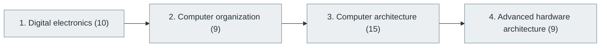

# 3. Digital Logic and Computer Organization

> [Home](../../../README.md) › [Part I — Computer Science Foundations](../index.md) › Subject 3

- **Status:** Not started (0 of 43 syllabus topics have a drafted lesson)
- **Source tags:** —
- **Syllabus size:** 4 chapters, 43 topics

## Introduction

From transistors and logic gates to combinational and sequential circuits, datapaths, instruction sets, pipelining, caches and modern processor architectures.

## Learning outcomes

After working through this subject you should be able to:

- Design combinational and sequential circuits from gates and flip-flops
- Describe a CPU datapath, control unit and instruction set, and compare RISC with CISC
- Explain pipeline hazards and how the cache hierarchy shapes performance

## Prerequisites

- [1. Computer Fundamentals](../01-computer-fundamentals/index.md)

## Beginner-to-advanced progression

The chapters below follow the order of the source syllabus, which moves from foundational to advanced material. Colour shows documentation status (grey = not started, amber = in progress, green = drafted or better).

## Chapters and topics

### Chapter 1: Digital electronics

10 topics · status: **Not started**

*Planned location:* `docs/01-computer-science-foundations/03-digital-logic-and-computer-organization/01-digital-electronics/`. No lessons yet.

Syllabus topics in this chapter (10)

- `03.01.01` Logic gates — *not started*
- `03.01.02` Combinational circuits — *not started*
- `03.01.03` Sequential circuits — *not started*
- `03.01.04` Flip-flops — *not started*
- `03.01.05` Registers — *not started*
- `03.01.06` Multiplexers — *not started*
- `03.01.07` Decoders — *not started*
- `03.01.08` Encoders — *not started*
- `03.01.09` Counters — *not started*
- `03.01.10` State machines — *not started*

### Chapter 2: Computer organization

9 topics · status: **Not started**

*Planned location:* `docs/01-computer-science-foundations/03-digital-logic-and-computer-organization/02-computer-organization/`. No lessons yet.

Syllabus topics in this chapter (9)

- `03.02.01` CPU architecture — *not started*
- `03.02.02` ALU — *not started*
- `03.02.03` Control unit — *not started*
- `03.02.04` Registers — *not started*
- `03.02.05` Instruction sets — *not started*
- `03.02.06` Memory hierarchy — *not started*
- `03.02.07` Cache architecture — *not started*
- `03.02.08` Bus architecture — *not started*
- `03.02.09` Interrupt handling — *not started*

### Chapter 3: Computer architecture

15 topics · status: **Not started**

*Planned location:* `docs/01-computer-science-foundations/03-digital-logic-and-computer-organization/03-computer-architecture/`. No lessons yet.

Syllabus topics in this chapter (15)

- `03.03.01` Von Neumann architecture — *not started*
- `03.03.02` Harvard architecture — *not started*
- `03.03.03` RISC — *not started*
- `03.03.04` CISC — *not started*
- `03.03.05` ARM — *not started*
- `03.03.06` x86 — *not started*
- `03.03.07` RISC-V — *not started*
- `03.03.08` Instruction set architecture — *not started*
- `03.03.09` Pipelining — *not started*
- `03.03.10` Superscalar processors — *not started*
- `03.03.11` Out-of-order execution — *not started*
- `03.03.12` Branch prediction — *not started*
- `03.03.13` Speculative execution — *not started*
- `03.03.14` Multicore processors — *not started*
- `03.03.15` NUMA architecture — *not started*

### Chapter 4: Advanced hardware architecture

9 topics · status: **Not started**

*Planned location:* `docs/01-computer-science-foundations/03-digital-logic-and-computer-organization/04-advanced-hardware-architecture/`. No lessons yet.

Syllabus topics in this chapter (9)

- `03.04.01` GPU architecture — *not started*
- `03.04.02` TPU and AI accelerators — *not started*
- `03.04.03` FPGA — *not started*
- `03.04.04` ASIC — *not started*
- `03.04.05` System-on-Chip — *not started*
- `03.04.06` Heterogeneous computing — *not started*
- `03.04.07` Neuromorphic computing — *not started*
- `03.04.08` Chiplet architecture — *not started*
- `03.04.09` Memory-centric computing — *not started*

## Recommended reading order

1. Chapter 1 — Digital electronics
2. Chapter 2 — Computer organization
3. Chapter 3 — Computer architecture
4. Chapter 4 — Advanced hardware architecture

Within a chapter, read lessons in numeric order. Pick the later chapters only when the earlier ones feel comfortable; the syllabus orders them from fundamental to advanced.

## Related subjects

- [4. Operating Systems](../04-operating-systems/index.md)
- [49. Embedded Systems and Firmware Engineering](../../10-specialized-software-engineering-domains/49-embedded-systems-and-firmware-engineering/index.md)
- [53. High-Performance Computing (HPC)](../../10-specialized-software-engineering-domains/53-high-performance-computing/index.md)

## Suggested practical projects

- A software simulator for a small CPU
- A cache simulator that reports hit rates for access traces

*Full project write-ups (requirements, architecture, stages, tests, extensions) are planned; see [ROADMAP.md](../../../ROADMAP.md).*

---

**Previous subject:** [2. Mathematics for Computer Science](../02-mathematics-for-computer-science/index.md) · **Up:** [Part I](../index.md) · **Next subject:** [4. Operating Systems](../04-operating-systems/index.md)
