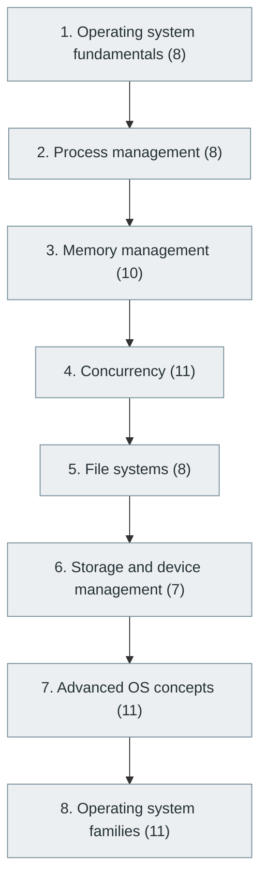

# 4. Operating Systems

> [Home](../../../README.md) › [Part I — Computer Science Foundations](../index.md) › Subject 4

- **Status:** Not started (0 of 74 syllabus topics have a drafted lesson)
- **Source tags:** —
- **Syllabus size:** 8 chapters, 74 topics

## Introduction

How an operating system manages processes, memory, files, devices and concurrency, and how those mechanisms shape every program that runs on top of it.

## Learning outcomes

After working through this subject you should be able to:

- Explain processes, threads, scheduling and context switches
- Explain virtual memory, paging and file systems
- Recognise and prevent race conditions and deadlocks

## Prerequisites

- [1. Computer Fundamentals](../01-computer-fundamentals/index.md)
- [3. Digital Logic and Computer Organization](../03-digital-logic-and-computer-organization/index.md)

## Beginner-to-advanced progression

The chapters below follow the order of the source syllabus, which moves from foundational to advanced material. Colour shows documentation status (grey = not started, amber = in progress, green = drafted or better).

## Chapters and topics

### Chapter 1: Operating system fundamentals

8 topics · status: **Not started**

*Planned location:* `docs/01-computer-science-foundations/04-operating-systems/01-operating-system-fundamentals/`. No lessons yet.

Syllabus topics in this chapter (8)

- `04.01.01` What is an operating system? — *not started*
- `04.01.02` Kernel and user space — *not started*
- `04.01.03` System calls — *not started*
- `04.01.04` Boot process — *not started*
- `04.01.05` OS architecture — *not started*
- `04.01.06` Monolithic kernels — *not started*
- `04.01.07` Microkernels — *not started*
- `04.01.08` Hybrid kernels — *not started*

### Chapter 2: Process management

8 topics · status: **Not started**

*Planned location:* `docs/01-computer-science-foundations/04-operating-systems/02-process-management/`. No lessons yet.

Syllabus topics in this chapter (8)

- `04.02.01` Processes — *not started*
- `04.02.02` Threads — *not started*
- `04.02.03` Process states — *not started*
- `04.02.04` Context switching — *not started*
- `04.02.05` CPU scheduling — *not started*
- `04.02.06` Process synchronization — *not started*
- `04.02.07` Inter-process communication — *not started*
- `04.02.08` Signals — *not started*

### Chapter 3: Memory management

10 topics · status: **Not started**

*Planned location:* `docs/01-computer-science-foundations/04-operating-systems/03-memory-management/`. No lessons yet.

Syllabus topics in this chapter (10)

- `04.03.01` RAM management — *not started*
- `04.03.02` Virtual memory — *not started*
- `04.03.03` Paging — *not started*
- `04.03.04` Segmentation — *not started*
- `04.03.05` Page tables — *not started*
- `04.03.06` Memory allocation — *not started*
- `04.03.07` Heap and stack — *not started*
- `04.03.08` Memory protection — *not started*
- `04.03.09` Memory leaks — *not started*
- `04.03.10` Garbage collection — *not started*

### Chapter 4: Concurrency

11 topics · status: **Not started**

*Planned location:* `docs/01-computer-science-foundations/04-operating-systems/04-concurrency/`. No lessons yet.

Syllabus topics in this chapter (11)

- `04.04.01` Multithreading — *not started*
- `04.04.02` Locks — *not started*
- `04.04.03` Mutexes — *not started*
- `04.04.04` Semaphores — *not started*
- `04.04.05` Monitors — *not started*
- `04.04.06` Condition variables — *not started*
- `04.04.07` Race conditions — *not started*
- `04.04.08` Deadlocks — *not started*
- `04.04.09` Starvation — *not started*
- `04.04.10` Lock-free algorithms — *not started*
- `04.04.11` Atomic operations — *not started*

### Chapter 5: File systems

8 topics · status: **Not started**

*Planned location:* `docs/01-computer-science-foundations/04-operating-systems/05-file-systems/`. No lessons yet.

Syllabus topics in this chapter (8)

- `04.05.01` Files and directories — *not started*
- `04.05.02` File permissions — *not started*
- `04.05.03` Inodes — *not started*
- `04.05.04` Journaling — *not started*
- `04.05.05` File system caching — *not started*
- `04.05.06` File system allocation — *not started*
- `04.05.07` Virtual file systems — *not started*
- `04.05.08` Distributed file systems — *not started*

### Chapter 6: Storage and device management

7 topics · status: **Not started**

*Planned location:* `docs/01-computer-science-foundations/04-operating-systems/06-storage-and-device-management/`. No lessons yet.

Syllabus topics in this chapter (7)

- `04.06.01` Device drivers — *not started*
- `04.06.02` I/O management — *not started*
- `04.06.03` Interrupts — *not started*
- `04.06.04` DMA — *not started*
- `04.06.05` Block devices — *not started*
- `04.06.06` Character devices — *not started*
- `04.06.07` Disk scheduling — *not started*

### Chapter 7: Advanced OS concepts

11 topics · status: **Not started**

*Planned location:* `docs/01-computer-science-foundations/04-operating-systems/07-advanced-os-concepts/`. No lessons yet.

Syllabus topics in this chapter (11)

- `04.07.01` Kernel programming — *not started*
- `04.07.02` Kernel modules — *not started*
- `04.07.03` Virtualization — *not started*
- `04.07.04` Hypervisors — *not started*
- `04.07.05` Containers — *not started*
- `04.07.06` Real-time operating systems — *not started*
- `04.07.07` Embedded operating systems — *not started*
- `04.07.08` eBPF — *not started*
- `04.07.09` Linux internals — *not started*
- `04.07.10` Android internals — *not started*
- `04.07.11` Distributed operating systems — *not started*

### Chapter 8: Operating system families

11 topics · status: **Not started**

*Planned location:* `docs/01-computer-science-foundations/04-operating-systems/08-operating-system-families/`. No lessons yet.

Syllabus topics in this chapter (11)

- `04.08.01` Linux — *not started*
- `04.08.02` Windows — *not started*
- `04.08.03` macOS — *not started*
- `04.08.04` Android — *not started*
- `04.08.05` iOS — *not started*
- `04.08.06` FreeBSD — *not started*
- `04.08.07` OpenBSD — *not started*
- `04.08.08` Unix — *not started*
- `04.08.09` QNX — *not started*
- `04.08.10` FreeRTOS — *not started*
- `04.08.11` Zephyr — *not started*

## Recommended reading order

1. Chapter 1 — Operating system fundamentals
2. Chapter 2 — Process management
3. Chapter 3 — Memory management
4. Chapter 4 — Concurrency
5. Chapter 5 — File systems
6. Chapter 6 — Storage and device management
7. Chapter 7 — Advanced OS concepts
8. Chapter 8 — Operating system families

Within a chapter, read lessons in numeric order. Pick the later chapters only when the earlier ones feel comfortable; the syllabus orders them from fundamental to advanced.

## Related subjects

- [5. Computer Networking](../05-computer-networking/index.md)
- [29. Performance Engineering](../../06-cloud-devops-and-infrastructure/29-performance-engineering/index.md)
- [53. High-Performance Computing (HPC)](../../10-specialized-software-engineering-domains/53-high-performance-computing/index.md)
- [6. Programming Fundamentals](../../02-programming-and-software-development/06-programming-fundamentals/index.md)

## Suggested practical projects

- A small Unix shell in C
- A page-replacement algorithm simulator

*Full project write-ups (requirements, architecture, stages, tests, extensions) are planned; see [ROADMAP.md](../../../ROADMAP.md).*

---

**Previous subject:** [3. Digital Logic and Computer Organization](../03-digital-logic-and-computer-organization/index.md) · **Up:** [Part I](../index.md) · **Next subject:** [5. Computer Networking](../05-computer-networking/index.md)
