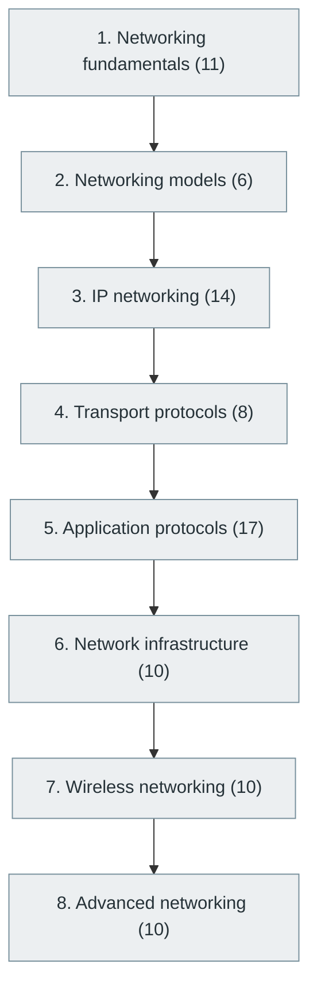

# 5. Computer Networking

> [Home](../../../README.md) › [Part I — Computer Science Foundations](../index.md) › Subject 5

- **Status:** Not started (0 of 86 syllabus topics have a drafted lesson)
- **Source tags:** —
- **Syllabus size:** 8 chapters, 86 topics

## Introduction

How machines communicate: network models, IP addressing and routing, TCP and UDP, application protocols such as HTTP and DNS, network infrastructure, wireless networking and advanced topics.

## Learning outcomes

After working through this subject you should be able to:

- Trace a request from browser to server across the layers of the network stack
- Explain how TCP provides reliability and how DNS, TLS and HTTP fit together
- Diagnose connectivity problems with standard tools

## Prerequisites

- [1. Computer Fundamentals](../01-computer-fundamentals/index.md)
- [4. Operating Systems](../04-operating-systems/index.md)

## Beginner-to-advanced progression

The chapters below follow the order of the source syllabus, which moves from foundational to advanced material. Colour shows documentation status (grey = not started, amber = in progress, green = drafted or better).

## Chapters and topics

### Chapter 1: Networking fundamentals

11 topics · status: **Not started**

*Planned location:* `docs/01-computer-science-foundations/05-computer-networking/01-networking-fundamentals/`. No lessons yet.

Syllabus topics in this chapter (11)

- `05.01.01` What is a computer network? — *not started*
- `05.01.02` LAN, WAN, MAN and PAN — *not started*
- `05.01.03` Network topologies — *not started*
- `05.01.04` Network devices — *not started*
- `05.01.05` Client-server communication — *not started*
- `05.01.06` Peer-to-peer networking — *not started*
- `05.01.07` Bandwidth — *not started*
- `05.01.08` Latency — *not started*
- `05.01.09` Throughput — *not started*
- `05.01.10` Packet switching — *not started*
- `05.01.11` Circuit switching — *not started*

### Chapter 2: Networking models

6 topics · status: **Not started**

*Planned location:* `docs/01-computer-science-foundations/05-computer-networking/02-networking-models/`. No lessons yet.

Syllabus topics in this chapter (6)

- `05.02.01` OSI model — *not started*
- `05.02.02` TCP/IP model — *not started*
- `05.02.03` Encapsulation — *not started*
- `05.02.04` Decapsulation — *not started*
- `05.02.05` Network layers — *not started*
- `05.02.06` Protocol stacks — *not started*

### Chapter 3: IP networking

14 topics · status: **Not started**

*Planned location:* `docs/01-computer-science-foundations/05-computer-networking/03-ip-networking/`. No lessons yet.

Syllabus topics in this chapter (14)

- `05.03.01` IPv4 — *not started*
- `05.03.02` IPv6 — *not started*
- `05.03.03` IP addressing — *not started*
- `05.03.04` Subnetting — *not started*
- `05.03.05` CIDR — *not started*
- `05.03.06` Public and private IP — *not started*
- `05.03.07` NAT — *not started*
- `05.03.08` Routing — *not started*
- `05.03.09` Static routing — *not started*
- `05.03.10` Dynamic routing — *not started*
- `05.03.11` BGP — *not started*
- `05.03.12` OSPF — *not started*
- `05.03.13` ICMP — *not started*
- `05.03.14` ARP — *not started*

### Chapter 4: Transport protocols

8 topics · status: **Not started**

*Planned location:* `docs/01-computer-science-foundations/05-computer-networking/04-transport-protocols/`. No lessons yet.

Syllabus topics in this chapter (8)

- `05.04.01` TCP — *not started*
- `05.04.02` UDP — *not started*
- `05.04.03` QUIC — *not started*
- `05.04.04` Three-way handshake — *not started*
- `05.04.05` Flow control — *not started*
- `05.04.06` Congestion control — *not started*
- `05.04.07` Retransmission — *not started*
- `05.04.08` Connection management — *not started*

### Chapter 5: Application protocols

17 topics · status: **Not started**

*Planned location:* `docs/01-computer-science-foundations/05-computer-networking/05-application-protocols/`. No lessons yet.

Syllabus topics in this chapter (17)

- `05.05.01` HTTP — *not started*
- `05.05.02` HTTPS — *not started*
- `05.05.03` HTTP/1.1 — *not started*
- `05.05.04` HTTP/2 — *not started*
- `05.05.05` HTTP/3 — *not started*
- `05.05.06` DNS — *not started*
- `05.05.07` DHCP — *not started*
- `05.05.08` FTP — *not started*
- `05.05.09` SFTP — *not started*
- `05.05.10` SMTP — *not started*
- `05.05.11` IMAP — *not started*
- `05.05.12` POP3 — *not started*
- `05.05.13` SSH — *not started*
- `05.05.14` WebSocket — *not started*
- `05.05.15` MQTT — *not started*
- `05.05.16` AMQP — *not started*
- `05.05.17` SNMP — *not started*

### Chapter 6: Network infrastructure

10 topics · status: **Not started**

*Planned location:* `docs/01-computer-science-foundations/05-computer-networking/06-network-infrastructure/`. No lessons yet.

Syllabus topics in this chapter (10)

- `05.06.01` Routers — *not started*
- `05.06.02` Switches — *not started*
- `05.06.03` Firewalls — *not started*
- `05.06.04` Proxies — *not started*
- `05.06.05` Reverse proxies — *not started*
- `05.06.06` Load balancers — *not started*
- `05.06.07` Gateways — *not started*
- `05.06.08` CDNs — *not started*
- `05.06.09` VPNs — *not started*
- `05.06.10` Network address translation — *not started*

### Chapter 7: Wireless networking

10 topics · status: **Not started**

*Planned location:* `docs/01-computer-science-foundations/05-computer-networking/07-wireless-networking/`. No lessons yet.

Syllabus topics in this chapter (10)

- `05.07.01` Wi-Fi — *not started*
- `05.07.02` Bluetooth — *not started*
- `05.07.03` NFC — *not started*
- `05.07.04` Zigbee — *not started*
- `05.07.05` Cellular networking — *not started*
- `05.07.06` 4G — *not started*
- `05.07.07` 5G — *not started*
- `05.07.08` 6G research — *not started*
- `05.07.09` Satellite networking — *not started*
- `05.07.10` Software-defined networking — *not started*

### Chapter 8: Advanced networking

10 topics · status: **Not started**

*Planned location:* `docs/01-computer-science-foundations/05-computer-networking/08-advanced-networking/`. No lessons yet.

Syllabus topics in this chapter (10)

- `05.08.01` Network virtualization — *not started*
- `05.08.02` Network function virtualization — *not started*
- `05.08.03` Software-defined networking — *not started*
- `05.08.04` Content delivery — *not started*
- `05.08.05` Anycast — *not started*
- `05.08.06` Multicast — *not started*
- `05.08.07` Zero-trust networking — *not started*
- `05.08.08` Network observability — *not started*
- `05.08.09` Network automation — *not started*
- `05.08.10` High-performance networking — *not started*

## Recommended reading order

1. Chapter 1 — Networking fundamentals
2. Chapter 2 — Networking models
3. Chapter 3 — IP networking
4. Chapter 4 — Transport protocols
5. Chapter 5 — Application protocols
6. Chapter 6 — Network infrastructure
7. Chapter 7 — Wireless networking
8. Chapter 8 — Advanced networking

Within a chapter, read lessons in numeric order. Pick the later chapters only when the earlier ones feel comfortable; the syllabus orders them from fundamental to advanced.

## Related subjects

- [16. Backend Development](../../04-building-software-products/16-backend-development/index.md)
- [22. Distributed Systems](../../05-distributed-systems-and-system-design/22-distributed-systems/index.md)
- [31. Cybersecurity and Software Security](../../07-software-quality-and-cybersecurity/31-cybersecurity-and-software-security/index.md)

## Suggested practical projects

- A TCP echo server and client
- A minimal HTTP/1.1 server built on sockets

*Full project write-ups (requirements, architecture, stages, tests, extensions) are planned; see [ROADMAP.md](../../../ROADMAP.md).*

---

**Previous subject:** [4. Operating Systems](../04-operating-systems/index.md) · **Up:** [Part I](../index.md) · **Next subject:** [6. Programming Fundamentals](../../02-programming-and-software-development/06-programming-fundamentals/index.md)
