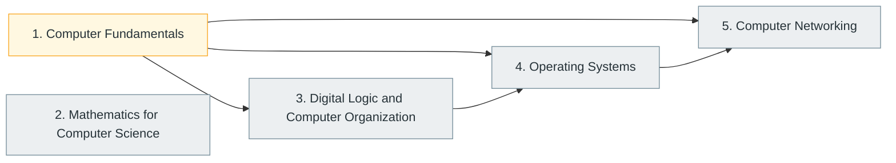

# Part I — Computer Science Foundations

> [Home](../../README.md) › Part I

**Status:** In progress

How computers represent information, how hardware executes programs, and the mathematics, operating-system and networking ideas that every later subject assumes.

> These are the foundations underneath almost everything a software engineer does.

## Subjects in this part

| # | Subject | What it covers | Topics | Status |
| --- | --- | --- | --- | --- |
| 1 | [Computer Fundamentals](01-computer-fundamentals/index.md) | What a computer is, how numbers, text and media are represented as bits, how Boolean logic underlies computation, what each hardware component does, and how a processor executes instructions. Every later subject uses this vocabulary. | 51 | In progress |
| 2 | [Mathematics for Computer Science](02-mathematics-for-computer-science/index.md) | The mathematical toolkit behind algorithms, graphics, cryptography, AI and quantum computing: discrete mathematics, logic, graph theory, linear algebra, probability, statistics, calculus and numerical methods. | 101 | Not started |
| 3 | [Digital Logic and Computer Organization](03-digital-logic-and-computer-organization/index.md) | From transistors and logic gates to combinational and sequential circuits, datapaths, instruction sets, pipelining, caches and modern processor architectures. | 43 | Not started |
| 4 | [Operating Systems](04-operating-systems/index.md) | How an operating system manages processes, memory, files, devices and concurrency, and how those mechanisms shape every program that runs on top of it. | 74 | Not started |
| 5 | [Computer Networking](05-computer-networking/index.md) | How machines communicate: network models, IP addressing and routing, TCP and UDP, application protocols such as HTTP and DNS, network infrastructure, wireless networking and advanced topics. | 86 | Not started |

## How the subjects depend on each other

Solid arrows point from a prerequisite to the subject that builds on it. Only dependencies inside this part are drawn.

## What you need from other parts

Nothing outside this part is required.

---

**Up:** [Master index](../../MASTER-INDEX.md) · **Next part:** [Part II](../02-programming-and-software-development/index.md)
