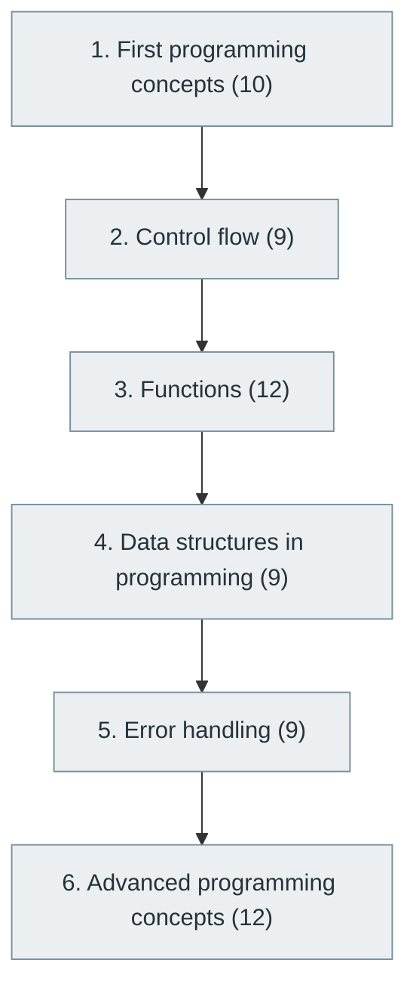

# 6. Programming Fundamentals

> [Home](../../../README.md) › [Part II — Programming and Software Development](../index.md) › Subject 6

- **Status:** Not started (0 of 61 syllabus topics have a drafted lesson)
- **Source tags:** Essential for every software developer
- **Syllabus size:** 6 chapters, 61 topics

## Introduction

The concepts common to almost every language: variables, control flow, functions, basic data structures, error handling and the first advanced ideas.

## Learning outcomes

After working through this subject you should be able to:

- Decompose a problem and express the solution as a program
- Use functions, collections and error handling idiomatically
- Read and debug unfamiliar code

## Prerequisites

- [1. Computer Fundamentals](../../01-computer-science-foundations/01-computer-fundamentals/index.md)

## Beginner-to-advanced progression

The chapters below follow the order of the source syllabus, which moves from foundational to advanced material. Colour shows documentation status (grey = not started, amber = in progress, green = drafted or better).

## Chapters and topics

### Chapter 1: First programming concepts

10 topics · status: **Not started**

*Planned location:* `docs/02-programming-and-software-development/06-programming-fundamentals/01-first-programming-concepts/`. No lessons yet.

Syllabus topics in this chapter (10)

- `06.01.01` What is programming? — *not started*
- `06.01.02` Source code — *not started*
- `06.01.03` Machine code — *not started*
- `06.01.04` Compilers and interpreters — *not started*
- `06.01.05` Variables — *not started*
- `06.01.06` Constants — *not started*
- `06.01.07` Data types — *not started*
- `06.01.08` Operators — *not started*
- `06.01.09` Expressions — *not started*
- `06.01.10` Input and output — *not started*

### Chapter 2: Control flow

9 topics · status: **Not started**

*Planned location:* `docs/02-programming-and-software-development/06-programming-fundamentals/02-control-flow/`. No lessons yet.

Syllabus topics in this chapter (9)

- `06.02.01` If-else — *not started*
- `06.02.02` Switch — *not started*
- `06.02.03` Loops — *not started*
- `06.02.04` For — *not started*
- `06.02.05` While — *not started*
- `06.02.06` Do-while — *not started*
- `06.02.07` Break and continue — *not started*
- `06.02.08` Nested loops — *not started*
- `06.02.09` Pattern programming — *not started*

### Chapter 3: Functions

12 topics · status: **Not started**

*Planned location:* `docs/02-programming-and-software-development/06-programming-fundamentals/03-functions/`. No lessons yet.

Syllabus topics in this chapter (12)

- `06.03.01` Function declaration — *not started*
- `06.03.02` Function calling — *not started*
- `06.03.03` Parameters — *not started*
- `06.03.04` Return values — *not started*
- `06.03.05` Scope — *not started*
- `06.03.06` Local and global variables — *not started*
- `06.03.07` Pass by value — *not started*
- `06.03.08` Pass by reference — *not started*
- `06.03.09` Recursion — *not started*
- `06.03.10` Function overloading — *not started*
- `06.03.11` Higher-order functions — *not started*
- `06.03.12` Closures — *not started*

### Chapter 4: Data structures in programming

9 topics · status: **Not started**

*Planned location:* `docs/02-programming-and-software-development/06-programming-fundamentals/04-data-structures-in-programming/`. No lessons yet.

Syllabus topics in this chapter (9)

- `06.04.01` Arrays — *not started*
- `06.04.02` Strings — *not started*
- `06.04.03` Structures — *not started*
- `06.04.04` Unions — *not started*
- `06.04.05` Enumerations — *not started*
- `06.04.06` Pointers — *not started*
- `06.04.07` References — *not started*
- `06.04.08` Dynamic memory — *not started*
- `06.04.09` Collections — *not started*

### Chapter 5: Error handling

9 topics · status: **Not started**

*Planned location:* `docs/02-programming-and-software-development/06-programming-fundamentals/05-error-handling/`. No lessons yet.

Syllabus topics in this chapter (9)

- `06.05.01` Syntax errors — *not started*
- `06.05.02` Runtime errors — *not started*
- `06.05.03` Logical errors — *not started*
- `06.05.04` Exceptions — *not started*
- `06.05.05` Exception propagation — *not started*
- `06.05.06` Custom exceptions — *not started*
- `06.05.07` Assertions — *not started*
- `06.05.08` Error codes — *not started*
- `06.05.09` Defensive programming — *not started*

### Chapter 6: Advanced programming concepts

12 topics · status: **Not started**

*Planned location:* `docs/02-programming-and-software-development/06-programming-fundamentals/06-advanced-programming-concepts/`. No lessons yet.

Syllabus topics in this chapter (12)

- `06.06.01` Memory management — *not started*
- `06.06.02` Stack and heap — *not started*
- `06.06.03` Pointers and references — *not started*
- `06.06.04` Generators — *not started*
- `06.06.05` Iterators — *not started*
- `06.06.06` Coroutines — *not started*
- `06.06.07` Asynchronous programming — *not started*
- `06.06.08` Event-driven programming — *not started*
- `06.06.09` Reactive programming — *not started*
- `06.06.10` Metaprogramming — *not started*
- `06.06.11` Reflection — *not started*
- `06.06.12` Dependency injection — *not started*

## Recommended reading order

1. Chapter 1 — First programming concepts
2. Chapter 2 — Control flow
3. Chapter 3 — Functions
4. Chapter 4 — Data structures in programming
5. Chapter 5 — Error handling
6. Chapter 6 — Advanced programming concepts

Within a chapter, read lessons in numeric order. Pick the later chapters only when the earlier ones feel comfortable; the syllabus orders them from fundamental to advanced.

## Related subjects

- [7. Programming Paradigms](../07-programming-paradigms/index.md)
- [8. Programming Languages and Ecosystem](../08-programming-languages-and-ecosystem/index.md)
- [9. Data Structures and Algorithms (DSA)](../09-data-structures-and-algorithms/index.md)

## Suggested practical projects

- A command-line task manager
- A text-adventure engine

*Full project write-ups (requirements, architecture, stages, tests, extensions) are planned; see [ROADMAP.md](../../../ROADMAP.md).*

---

**Previous subject:** [5. Computer Networking](../../01-computer-science-foundations/05-computer-networking/index.md) · **Up:** [Part II](../index.md) · **Next subject:** [7. Programming Paradigms](../07-programming-paradigms/index.md)
