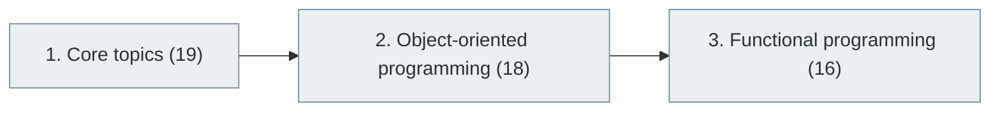

# 7. Programming Paradigms

> [Home](../../../README.md) › [Part II — Programming and Software Development](../index.md) › Subject 7

- **Status:** Not started (0 of 53 syllabus topics have a drafted lesson)
- **Source tags:** —
- **Syllabus size:** 3 chapters, 53 topics

## Introduction

The different ways programs can be organised: imperative, procedural, object-oriented, functional, declarative, concurrent, reactive and others, with object-oriented and functional programming covered in depth.

> You should understand the different ways programs can be designed.

## Learning outcomes

After working through this subject you should be able to:

- Identify the paradigm a codebase uses and its trade-offs
- Apply object-oriented and functional techniques appropriately
- Choose a paradigm that fits a problem

## Prerequisites

- [6. Programming Fundamentals](../06-programming-fundamentals/index.md)

## Beginner-to-advanced progression

The chapters below follow the order of the source syllabus, which moves from foundational to advanced material. Colour shows documentation status (grey = not started, amber = in progress, green = drafted or better).

## Chapters and topics

### Chapter 1: Core topics

19 topics · status: **Not started** · *heading synthesized (not in source)*

*Planned location:* `docs/02-programming-and-software-development/07-programming-paradigms/01-core-topics/`. No lessons yet.

Syllabus topics in this chapter (19)

- `07.01.01` Imperative programming — *not started*
- `07.01.02` Procedural programming — *not started*
- `07.01.03` Structured programming — *not started*
- `07.01.04` Object-oriented programming — *not started*
- `07.01.05` Functional programming — *not started*
- `07.01.06` Declarative programming — *not started*
- `07.01.07` Logic programming — *not started*
- `07.01.08` Event-driven programming — *not started*
- `07.01.09` Reactive programming — *not started*
- `07.01.10` Concurrent programming — *not started*
- `07.01.11` Parallel programming — *not started*
- `07.01.12` Aspect-oriented programming — *not started*
- `07.01.13` Data-oriented programming — *not started*
- `07.01.14` Component-based programming — *not started*
- `07.01.15` Message-driven programming — *not started*
- `07.01.16` Actor model — *not started*
- `07.01.17` Flow-based programming — *not started*
- `07.01.18` Constraint-based programming — *not started*
- `07.01.19` Domain-specific languages — *not started*

### Chapter 2: Object-oriented programming

18 topics · status: **Not started**

*Planned location:* `docs/02-programming-and-software-development/07-programming-paradigms/02-object-oriented-programming/`. No lessons yet.

Syllabus topics in this chapter (18)

- `07.02.01` Classes and objects — *not started*
- `07.02.02` Constructors — *not started*
- `07.02.03` Destructors — *not started*
- `07.02.04` Encapsulation — *not started*
- `07.02.05` Abstraction — *not started*
- `07.02.06` Inheritance — *not started*
- `07.02.07` Polymorphism — *not started*
- `07.02.08` Method overriding — *not started*
- `07.02.09` Method overloading — *not started*
- `07.02.10` Interfaces — *not started*
- `07.02.11` Abstract classes — *not started*
- `07.02.12` Composition — *not started*
- `07.02.13` Aggregation — *not started*
- `07.02.14` Association — *not started*
- `07.02.15` SOLID principles — *not started*
- `07.02.16` Dependency inversion — *not started*
- `07.02.17` Object lifecycle — *not started*
- `07.02.18` Advanced object modeling — *not started*

### Chapter 3: Functional programming

16 topics · status: **Not started**

*Planned location:* `docs/02-programming-and-software-development/07-programming-paradigms/03-functional-programming/`. No lessons yet.

Syllabus topics in this chapter (16)

- `07.03.01` Pure functions — *not started*
- `07.03.02` Immutability — *not started*
- `07.03.03` First-class functions — *not started*
- `07.03.04` Higher-order functions — *not started*
- `07.03.05` Lambda expressions — *not started*
- `07.03.06` Closures — *not started*
- `07.03.07` Map, filter and reduce — *not started*
- `07.03.08` Function composition — *not started*
- `07.03.09` Currying — *not started*
- `07.03.10` Partial application — *not started*
- `07.03.11` Recursion — *not started*
- `07.03.12` Pattern matching — *not started*
- `07.03.13` Monads — *not started*
- `07.03.14` Functors — *not started*
- `07.03.15` Lazy evaluation — *not started*
- `07.03.16` Referential transparency — *not started*

## Recommended reading order

1. Chapter 1 — Core topics
2. Chapter 2 — Object-oriented programming
3. Chapter 3 — Functional programming

Within a chapter, read lessons in numeric order. Pick the later chapters only when the earlier ones feel comfortable; the syllabus orders them from fundamental to advanced.

## Related subjects

- [8. Programming Languages and Ecosystem](../08-programming-languages-and-ecosystem/index.md)
- [12. Software Design Principles and Architecture](../../03-professional-software-engineering/12-software-design-principles-and-architecture/index.md)

## Suggested practical projects

- The same program written in three paradigms
- A small immutable-data library in a functional style

*Full project write-ups (requirements, architecture, stages, tests, extensions) are planned; see [ROADMAP.md](../../../ROADMAP.md).*

---

**Previous subject:** [6. Programming Fundamentals](../06-programming-fundamentals/index.md) · **Up:** [Part II](../index.md) · **Next subject:** [8. Programming Languages and Ecosystem](../08-programming-languages-and-ecosystem/index.md)
