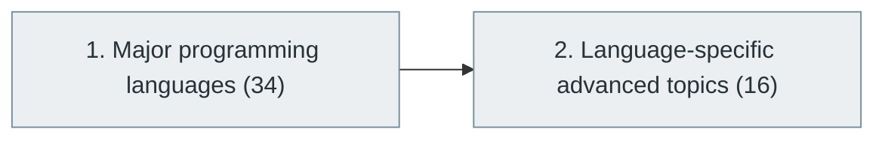

# 8. Programming Languages and Ecosystem

> [Home](../../../README.md) › [Part II — Programming and Software Development](../index.md) › Subject 8

- **Status:** Not started (0 of 50 syllabus topics have a drafted lesson)
- **Source tags:** —
- **Syllabus size:** 2 chapters, 50 topics

## Introduction

The major languages and what each is used for, with their runtimes, package managers, tooling and language-specific advanced topics.

> A software engineer does not need to master every programming language. However, you should understand the major language families and know which types of problems they solve.

## Learning outcomes

After working through this subject you should be able to:

- Match languages to problem domains
- Explain typing, memory-management and execution models across languages
- Learn a new language efficiently by mapping it to known concepts

## Prerequisites

- [6. Programming Fundamentals](../06-programming-fundamentals/index.md)

## Beginner-to-advanced progression

The chapters below follow the order of the source syllabus, which moves from foundational to advanced material. Colour shows documentation status (grey = not started, amber = in progress, green = drafted or better).

## Chapters and topics

### Chapter 1: Major programming languages

34 topics · status: **Not started** · *heading synthesized (not in source)*

*Planned location:* `docs/02-programming-and-software-development/08-programming-languages-and-ecosystem/01-major-programming-languages/`. No lessons yet.

Syllabus topics in this chapter (34)

- `08.01.01` C — Systems programming, embedded — *not started*
- `08.01.02` C++ — Systems, games, performance — *not started*
- `08.01.03` Java — Enterprise, backend, Android — *not started*
- `08.01.04` Python — Backend, AI, automation, data science — *not started*
- `08.01.05` JavaScript — Web development, full-stack — *not started*
- `08.01.06` TypeScript — Large-scale web development — *not started*
- `08.01.07` C# — .NET, enterprise, game development — *not started*
- `08.01.08` Go — Cloud, infrastructure, backend — *not started*
- `08.01.09` Rust — Systems, security, performance — *not started*
- `08.01.10` Kotlin — Android, backend — *not started*
- `08.01.11` Swift — iOS, macOS — *not started*
- `08.01.12` PHP — Web backend — *not started*
- `08.01.13` Ruby — Web applications — *not started*
- `08.01.14` Scala — Distributed data, functional systems — *not started*
- `08.01.15` R — Statistics and data science — *not started*
- `08.01.16` Julia — Scientific computing — *not started*
- `08.01.17` Dart — Cross-platform mobile — *not started*
- `08.01.18` Elixir — Concurrent distributed systems — *not started*
- `08.01.19` Erlang — Fault-tolerant distributed systems — *not started*
- `08.01.20` Haskell — Functional programming — *not started*
- `08.01.21` OCaml — Functional systems and compilers — *not started*
- `08.01.22` F# — Functional .NET development — *not started*
- `08.01.23` Clojure — Functional JVM development — *not started*
- `08.01.24` Lua — Scripting and game engines — *not started*
- `08.01.25` SQL — Database programming — *not started*
- `08.01.26` Bash — Unix automation — *not started*
- `08.01.27` PowerShell — Windows and infrastructure automation — *not started*
- `08.01.28` Assembly — Low-level programming — *not started*
- `08.01.29` Solidity — Blockchain smart contracts — *not started*
- `08.01.30` Verilog — Digital hardware design — *not started*
- `08.01.31` VHDL — Digital hardware design — *not started*
- `08.01.32` MATLAB — Engineering and numerical computing — *not started*
- `08.01.33` Fortran — Scientific and high-performance computing — *not started*
- `08.01.34` COBOL — Legacy enterprise systems — *not started*

### Chapter 2: Language-specific advanced topics

16 topics · status: **Not started**

*Planned location:* `docs/02-programming-and-software-development/08-programming-languages-and-ecosystem/02-language-specific-advanced-topics/`. No lessons yet.

Syllabus topics in this chapter (16)

- `08.02.01` Runtime environments — *not started*
- `08.02.02` Virtual machines — *not started*
- `08.02.03` Garbage collection — *not started*
- `08.02.04` Memory safety — *not started*
- `08.02.05` Type inference — *not started*
- `08.02.06` Static and dynamic typing — *not started*
- `08.02.07` Strong and weak typing — *not started*
- `08.02.08` Generic programming — *not started*
- `08.02.09` Template metaprogramming — *not started*
- `08.02.10` Language interoperability — *not started*
- `08.02.11` ABI — *not started*
- `08.02.12` FFI — *not started*
- `08.02.13` Reflection — *not started*
- `08.02.14` Language runtimes — *not started*
- `08.02.15` Compiler optimization — *not started*
- `08.02.16` Runtime performance — *not started*

## Recommended reading order

1. Chapter 1 — Major programming languages
2. Chapter 2 — Language-specific advanced topics

Within a chapter, read lessons in numeric order. Pick the later chapters only when the earlier ones feel comfortable; the syllabus orders them from fundamental to advanced.

## Related subjects

- [7. Programming Paradigms](../07-programming-paradigms/index.md)
- [10. Compilers and Programming Language Internals](../10-compilers-and-language-internals/index.md)
- [14. Development Environments and Tools](../../03-professional-software-engineering/14-development-environments-and-tools/index.md)

## Suggested practical projects

- One small service implemented in two languages and compared
- A benchmark of the same algorithm across languages

*Full project write-ups (requirements, architecture, stages, tests, extensions) are planned; see [ROADMAP.md](../../../ROADMAP.md).*

---

**Previous subject:** [7. Programming Paradigms](../07-programming-paradigms/index.md) · **Up:** [Part II](../index.md) · **Next subject:** [9. Data Structures and Algorithms (DSA)](../09-data-structures-and-algorithms/index.md)
