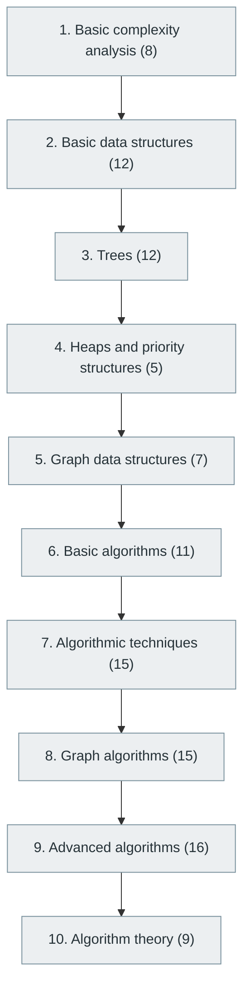

# 9. Data Structures and Algorithms (DSA)

> [Home](../../../README.md) › [Part II — Programming and Software Development](../index.md) › Subject 9

- **Status:** Not started (0 of 110 syllabus topics have a drafted lesson)
- **Source tags:** Core interview and problem-solving subject
- **Syllabus size:** 10 chapters, 110 topics

## Introduction

Complexity analysis, the core data structures (arrays, lists, hash tables, trees, heaps, graphs), classic and advanced algorithms, algorithmic techniques and the theory of computation behind them.

> This area should be studied from simple structures to advanced algorithmic techniques.

## Learning outcomes

After working through this subject you should be able to:

- Analyse time and space complexity
- Implement and choose among core data structures with reasoned trade-offs
- Apply sorting, searching, dynamic programming, greedy and graph algorithms

## Prerequisites

- [2. Mathematics for Computer Science](../../01-computer-science-foundations/02-mathematics-for-computer-science/index.md)
- [6. Programming Fundamentals](../06-programming-fundamentals/index.md)

## Beginner-to-advanced progression

The chapters below follow the order of the source syllabus, which moves from foundational to advanced material. Colour shows documentation status (grey = not started, amber = in progress, green = drafted or better).

## Chapters and topics

### Chapter 1: Basic complexity analysis

8 topics · status: **Not started**

*Planned location:* `docs/02-programming-and-software-development/09-data-structures-and-algorithms/01-basic-complexity-analysis/`. No lessons yet.

Syllabus topics in this chapter (8)

- `09.01.01` Time complexity — *not started*
- `09.01.02` Space complexity — *not started*
- `09.01.03` Big O — *not started*
- `09.01.04` Big Omega — *not started*
- `09.01.05` Big Theta — *not started*
- `09.01.06` Best, average and worst cases — *not started*
- `09.01.07` Amortized analysis — *not started*
- `09.01.08` Recurrence relations — *not started*

### Chapter 2: Basic data structures

12 topics · status: **Not started**

*Planned location:* `docs/02-programming-and-software-development/09-data-structures-and-algorithms/02-basic-data-structures/`. No lessons yet.

Syllabus topics in this chapter (12)

- `09.02.01` Arrays — *not started*
- `09.02.02` Strings — *not started*
- `09.02.03` Linked lists — *not started*
- `09.02.04` Singly linked lists — *not started*
- `09.02.05` Doubly linked lists — *not started*
- `09.02.06` Circular linked lists — *not started*
- `09.02.07` Stacks — *not started*
- `09.02.08` Queues — *not started*
- `09.02.09` Deques — *not started*
- `09.02.10` Hash tables — *not started*
- `09.02.11` Hash maps — *not started*
- `09.02.12` Sets — *not started*

### Chapter 3: Trees

12 topics · status: **Not started**

*Planned location:* `docs/02-programming-and-software-development/09-data-structures-and-algorithms/03-trees/`. No lessons yet.

Syllabus topics in this chapter (12)

- `09.03.01` Binary trees — *not started*
- `09.03.02` Binary search trees — *not started*
- `09.03.03` AVL trees — *not started*
- `09.03.04` Red-black trees — *not started*
- `09.03.05` B-trees — *not started*
- `09.03.06` B+ trees — *not started*
- `09.03.07` Segment trees — *not started*
- `09.03.08` Fenwick trees — *not started*
- `09.03.09` Tries — *not started*
- `09.03.10` Suffix trees — *not started*
- `09.03.11` Suffix arrays — *not started*
- `09.03.12` Merkle trees — *not started*

### Chapter 4: Heaps and priority structures

5 topics · status: **Not started**

*Planned location:* `docs/02-programming-and-software-development/09-data-structures-and-algorithms/04-heaps-and-priority-structures/`. No lessons yet.

Syllabus topics in this chapter (5)

- `09.04.01` Min heap — *not started*
- `09.04.02` Max heap — *not started*
- `09.04.03` Binary heap — *not started*
- `09.04.04` Fibonacci heap — *not started*
- `09.04.05` Priority queues — *not started*

### Chapter 5: Graph data structures

7 topics · status: **Not started**

*Planned location:* `docs/02-programming-and-software-development/09-data-structures-and-algorithms/05-graph-data-structures/`. No lessons yet.

Syllabus topics in this chapter (7)

- `09.05.01` Adjacency matrix — *not started*
- `09.05.02` Adjacency list — *not started*
- `09.05.03` Directed graphs — *not started*
- `09.05.04` Undirected graphs — *not started*
- `09.05.05` Weighted graphs — *not started*
- `09.05.06` Disjoint set union — *not started*
- `09.05.07` Union-find — *not started*

### Chapter 6: Basic algorithms

11 topics · status: **Not started**

*Planned location:* `docs/02-programming-and-software-development/09-data-structures-and-algorithms/06-basic-algorithms/`. No lessons yet.

Syllabus topics in this chapter (11)

- `09.06.01` Linear search — *not started*
- `09.06.02` Binary search — *not started*
- `09.06.03` Bubble sort — *not started*
- `09.06.04` Selection sort — *not started*
- `09.06.05` Insertion sort — *not started*
- `09.06.06` Merge sort — *not started*
- `09.06.07` Quick sort — *not started*
- `09.06.08` Heap sort — *not started*
- `09.06.09` Counting sort — *not started*
- `09.06.10` Radix sort — *not started*
- `09.06.11` Bucket sort — *not started*

### Chapter 7: Algorithmic techniques

15 topics · status: **Not started**

*Planned location:* `docs/02-programming-and-software-development/09-data-structures-and-algorithms/07-algorithmic-techniques/`. No lessons yet.

Syllabus topics in this chapter (15)

- `09.07.01` Two pointers — *not started*
- `09.07.02` Sliding window — *not started*
- `09.07.03` Prefix sums — *not started*
- `09.07.04` Difference arrays — *not started*
- `09.07.05` Fast and slow pointers — *not started*
- `09.07.06` Recursion — *not started*
- `09.07.07` Backtracking — *not started*
- `09.07.08` Divide and conquer — *not started*
- `09.07.09` Greedy algorithms — *not started*
- `09.07.10` Dynamic programming — *not started*
- `09.07.11` Memoization — *not started*
- `09.07.12` Tabulation — *not started*
- `09.07.13` Bit manipulation — *not started*
- `09.07.14` Meet-in-the-middle — *not started*
- `09.07.15` Binary search on answer — *not started*

### Chapter 8: Graph algorithms

15 topics · status: **Not started**

*Planned location:* `docs/02-programming-and-software-development/09-data-structures-and-algorithms/08-graph-algorithms/`. No lessons yet.

Syllabus topics in this chapter (15)

- `09.08.01` BFS — *not started*
- `09.08.02` DFS — *not started*
- `09.08.03` Topological sorting — *not started*
- `09.08.04` Dijkstra's algorithm — *not started*
- `09.08.05` Bellman-Ford — *not started*
- `09.08.06` Floyd-Warshall — *not started*
- `09.08.07` Prim's algorithm — *not started*
- `09.08.08` Kruskal's algorithm — *not started*
- `09.08.09` A* — *not started*
- `09.08.10` Strongly connected components — *not started*
- `09.08.11` Tarjan's algorithm — *not started*
- `09.08.12` Kosaraju's algorithm — *not started*
- `09.08.13` Minimum spanning trees — *not started*
- `09.08.14` Maximum flow — *not started*
- `09.08.15` Minimum cut — *not started*

### Chapter 9: Advanced algorithms

16 topics · status: **Not started**

*Planned location:* `docs/02-programming-and-software-development/09-data-structures-and-algorithms/09-advanced-algorithms/`. No lessons yet.

Syllabus topics in this chapter (16)

- `09.09.01` String matching — *not started*
- `09.09.02` KMP — *not started*
- `09.09.03` Rabin-Karp — *not started*
- `09.09.04` Z algorithm — *not started*
- `09.09.05` Manacher's algorithm — *not started*
- `09.09.06` Computational geometry — *not started*
- `09.09.07` Convex hull — *not started*
- `09.09.08` Number-theoretic algorithms — *not started*
- `09.09.09` Randomized algorithms — *not started*
- `09.09.10` Approximation algorithms — *not started*
- `09.09.11` Online algorithms — *not started*
- `09.09.12` Streaming algorithms — *not started*
- `09.09.13` External-memory algorithms — *not started*
- `09.09.14` Cache-efficient algorithms — *not started*
- `09.09.15` Parallel algorithms — *not started*
- `09.09.16` Distributed algorithms — *not started*

### Chapter 10: Algorithm theory

9 topics · status: **Not started**

*Planned location:* `docs/02-programming-and-software-development/09-data-structures-and-algorithms/10-algorithm-theory/`. No lessons yet.

Syllabus topics in this chapter (9)

- `09.10.01` P and NP — *not started*
- `09.10.02` NP-completeness — *not started*
- `09.10.03` NP-hardness — *not started*
- `09.10.04` Complexity classes — *not started*
- `09.10.05` Decidability — *not started*
- `09.10.06` Computability theory — *not started*
- `09.10.07` Reductions — *not started*
- `09.10.08` Lower bounds — *not started*
- `09.10.09` Quantum algorithms — *not started*

## Recommended reading order

1. Chapter 1 — Basic complexity analysis
2. Chapter 2 — Basic data structures
3. Chapter 3 — Trees
4. Chapter 4 — Heaps and priority structures
5. Chapter 5 — Graph data structures
6. Chapter 6 — Basic algorithms
7. Chapter 7 — Algorithmic techniques
8. Chapter 8 — Graph algorithms
9. Chapter 9 — Advanced algorithms
10. Chapter 10 — Algorithm theory

Within a chapter, read lessons in numeric order. Pick the later chapters only when the earlier ones feel comfortable; the syllabus orders them from fundamental to advanced.

## Related subjects

- [10. Compilers and Programming Language Internals](../10-compilers-and-language-internals/index.md)
- [23. System Design](../../05-distributed-systems-and-system-design/23-system-design/index.md)
- [29. Performance Engineering](../../06-cloud-devops-and-infrastructure/29-performance-engineering/index.md)

## Suggested practical projects

- Core data structures from scratch with a test suite
- An autocomplete service built on a trie
- A route planner using Dijkstra's algorithm

*Full project write-ups (requirements, architecture, stages, tests, extensions) are planned; see [ROADMAP.md](../../../ROADMAP.md).*

---

**Previous subject:** [8. Programming Languages and Ecosystem](../08-programming-languages-and-ecosystem/index.md) · **Up:** [Part II](../index.md) · **Next subject:** [10. Compilers and Programming Language Internals](../10-compilers-and-language-internals/index.md)
