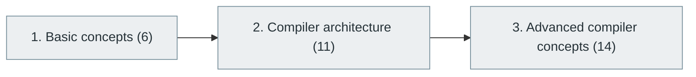

# 10. Compilers and Programming Language Internals

> [Home](../../../README.md) › [Part II — Programming and Software Development](../index.md) › Subject 10

- **Status:** Not started (0 of 31 syllabus topics have a drafted lesson)
- **Source tags:** —
- **Syllabus size:** 3 chapters, 31 topics

## Introduction

How source code becomes executable behaviour: lexing, parsing, semantic analysis, intermediate representations, optimisation, code generation, interpreters and virtual machines.

## Learning outcomes

After working through this subject you should be able to:

- Describe each phase of a compiler pipeline
- Build a lexer and parser for a small language
- Explain common optimisations and runtime systems

## Prerequisites

- [3. Digital Logic and Computer Organization](../../01-computer-science-foundations/03-digital-logic-and-computer-organization/index.md)
- [6. Programming Fundamentals](../06-programming-fundamentals/index.md)
- [8. Programming Languages and Ecosystem](../08-programming-languages-and-ecosystem/index.md)
- [9. Data Structures and Algorithms (DSA)](../09-data-structures-and-algorithms/index.md)

## Beginner-to-advanced progression

The chapters below follow the order of the source syllabus, which moves from foundational to advanced material. Colour shows documentation status (grey = not started, amber = in progress, green = drafted or better).

## Chapters and topics

### Chapter 1: Basic concepts

6 topics · status: **Not started**

*Planned location:* `docs/02-programming-and-software-development/10-compilers-and-language-internals/01-basic-concepts/`. No lessons yet.

Syllabus topics in this chapter (6)

- `10.01.01` Source code — *not started*
- `10.01.02` Compilation — *not started*
- `10.01.03` Interpretation — *not started*
- `10.01.04` Machine code — *not started*
- `10.01.05` Bytecode — *not started*
- `10.01.06` Assembly — *not started*

### Chapter 2: Compiler architecture

11 topics · status: **Not started**

*Planned location:* `docs/02-programming-and-software-development/10-compilers-and-language-internals/02-compiler-architecture/`. No lessons yet.

Syllabus topics in this chapter (11)

- `10.02.01` Lexical analysis — *not started*
- `10.02.02` Tokens — *not started*
- `10.02.03` Parsing — *not started*
- `10.02.04` Context-free grammars — *not started*
- `10.02.05` Abstract syntax trees — *not started*
- `10.02.06` Semantic analysis — *not started*
- `10.02.07` Type checking — *not started*
- `10.02.08` Intermediate representation — *not started*
- `10.02.09` Code generation — *not started*
- `10.02.10` Linking — *not started*
- `10.02.11` Loading — *not started*

### Chapter 3: Advanced compiler concepts

14 topics · status: **Not started**

*Planned location:* `docs/02-programming-and-software-development/10-compilers-and-language-internals/03-advanced-compiler-concepts/`. No lessons yet.

Syllabus topics in this chapter (14)

- `10.03.01` Compiler optimization — *not started*
- `10.03.02` Control-flow graphs — *not started*
- `10.03.03` Data-flow analysis — *not started*
- `10.03.04` Static single assignment — *not started*
- `10.03.05` Register allocation — *not started*
- `10.03.06` Instruction scheduling — *not started*
- `10.03.07` Just-in-time compilation — *not started*
- `10.03.08` Ahead-of-time compilation — *not started*
- `10.03.09` LLVM — *not started*
- `10.03.10` Garbage collector implementation — *not started*
- `10.03.11` Virtual machine design — *not started*
- `10.03.12` Interpreter design — *not started*
- `10.03.13` Formal language theory — *not started*
- `10.03.14` Program verification — *not started*

## Recommended reading order

1. Chapter 1 — Basic concepts
2. Chapter 2 — Compiler architecture
3. Chapter 3 — Advanced compiler concepts

Within a chapter, read lessons in numeric order. Pick the later chapters only when the earlier ones feel comfortable; the syllabus orders them from fundamental to advanced.

## Related subjects

- [4. Operating Systems](../../01-computer-science-foundations/04-operating-systems/index.md)
- [7. Programming Paradigms](../07-programming-paradigms/index.md)

## Suggested practical projects

- An expression parser and evaluator
- A bytecode virtual machine for a tiny language

*Full project write-ups (requirements, architecture, stages, tests, extensions) are planned; see [ROADMAP.md](../../../ROADMAP.md).*

---

**Previous subject:** [9. Data Structures and Algorithms (DSA)](../09-data-structures-and-algorithms/index.md) · **Up:** [Part II](../index.md) · **Next subject:** [11. Software Development Lifecycle (SDLC)](../../03-professional-software-engineering/11-software-development-lifecycle/index.md)
