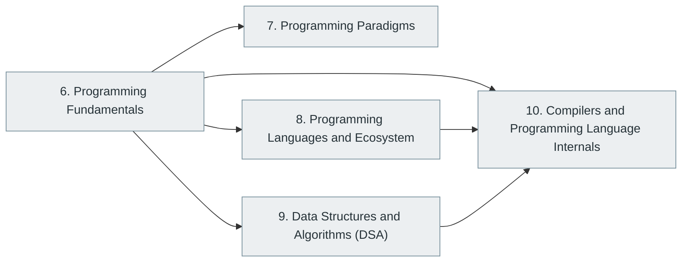

# Part II — Programming and Software Development

> [Home](../../README.md) › Part II

**Status:** Not started

Writing programs well: fundamentals, paradigms, language ecosystems, data structures and algorithms, and how compilers turn source code into running software.

## Subjects in this part

| # | Subject | What it covers | Topics | Status |
| --- | --- | --- | --- | --- |
| 6 | [Programming Fundamentals](06-programming-fundamentals/index.md) | The concepts common to almost every language: variables, control flow, functions, basic data structures, error handling and the first advanced ideas. | 61 | Not started |
| 7 | [Programming Paradigms](07-programming-paradigms/index.md) | The different ways programs can be organised: imperative, procedural, object-oriented, functional, declarative, concurrent, reactive and others, with object-oriented and functional programming covered in depth. | 53 | Not started |
| 8 | [Programming Languages and Ecosystem](08-programming-languages-and-ecosystem/index.md) | The major languages and what each is used for, with their runtimes, package managers, tooling and language-specific advanced topics. | 50 | Not started |
| 9 | [Data Structures and Algorithms (DSA)](09-data-structures-and-algorithms/index.md) | Complexity analysis, the core data structures (arrays, lists, hash tables, trees, heaps, graphs), classic and advanced algorithms, algorithmic techniques and the theory of computation behind them. | 110 | Not started |
| 10 | [Compilers and Programming Language Internals](10-compilers-and-language-internals/index.md) | How source code becomes executable behaviour: lexing, parsing, semantic analysis, intermediate representations, optimisation, code generation, interpreters and virtual machines. | 31 | Not started |

## How the subjects depend on each other

Solid arrows point from a prerequisite to the subject that builds on it. Only dependencies inside this part are drawn.

## What you need from other parts

| Subject in this part | Prerequisite elsewhere |
| --- | --- |
| [6. Programming Fundamentals](06-programming-fundamentals/index.md) | [1. Computer Fundamentals](../01-computer-science-foundations/01-computer-fundamentals/index.md) |
| [9. Data Structures and Algorithms (DSA)](09-data-structures-and-algorithms/index.md) | [2. Mathematics for Computer Science](../01-computer-science-foundations/02-mathematics-for-computer-science/index.md) |
| [10. Compilers and Programming Language Internals](10-compilers-and-language-internals/index.md) | [3. Digital Logic and Computer Organization](../01-computer-science-foundations/03-digital-logic-and-computer-organization/index.md) |

---

**Previous part:** [Part I](../01-computer-science-foundations/index.md) · **Up:** [Master index](../../MASTER-INDEX.md) · **Next part:** [Part III](../03-professional-software-engineering/index.md)
