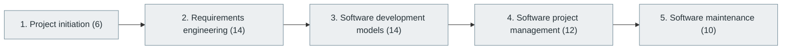

# 11. Software Development Lifecycle (SDLC)

> [Home](../../../README.md) › [Part III — Professional Software Engineering](../index.md) › Subject 11

- **Status:** Not started (0 of 56 syllabus topics have a drafted lesson)
- **Source tags:** —
- **Syllabus size:** 5 chapters, 56 topics

## Introduction

The whole life of a software product: initiation, requirements engineering, development models, project management and maintenance.

> A professional engineer needs to understand the entire life of a software product, not just writing code.

## Learning outcomes

After working through this subject you should be able to:

- Write testable requirements and user stories
- Compare waterfall, iterative and agile models
- Plan, estimate and track a project

## Prerequisites

- [6. Programming Fundamentals](../../02-programming-and-software-development/06-programming-fundamentals/index.md)

## Beginner-to-advanced progression

The chapters below follow the order of the source syllabus, which moves from foundational to advanced material. Colour shows documentation status (grey = not started, amber = in progress, green = drafted or better).

## Chapters and topics

### Chapter 1: Project initiation

6 topics · status: **Not started**

*Planned location:* `docs/03-professional-software-engineering/11-software-development-lifecycle/01-project-initiation/`. No lessons yet.

Syllabus topics in this chapter (6)

- `11.01.01` Problem identification — *not started*
- `11.01.02` Business objectives — *not started*
- `11.01.03` Feasibility analysis — *not started*
- `11.01.04` Stakeholder identification — *not started*
- `11.01.05` Product vision — *not started*
- `11.01.06` Scope definition — *not started*

### Chapter 2: Requirements engineering

14 topics · status: **Not started**

*Planned location:* `docs/03-professional-software-engineering/11-software-development-lifecycle/02-requirements-engineering/`. No lessons yet.

Syllabus topics in this chapter (14)

- `11.02.01` Functional requirements — *not started*
- `11.02.02` Non-functional requirements — *not started*
- `11.02.03` User requirements — *not started*
- `11.02.04` Business requirements — *not started*
- `11.02.05` System requirements — *not started*
- `11.02.06` Technical requirements — *not started*
- `11.02.07` Constraints — *not started*
- `11.02.08` User stories — *not started*
- `11.02.09` Acceptance criteria — *not started*
- `11.02.10` Use cases — *not started*
- `11.02.11` Requirements elicitation — *not started*
- `11.02.12` Requirements prioritization — *not started*
- `11.02.13` Requirements validation — *not started*
- `11.02.14` Requirements traceability — *not started*

### Chapter 3: Software development models

14 topics · status: **Not started**

*Planned location:* `docs/03-professional-software-engineering/11-software-development-lifecycle/03-software-development-models/`. No lessons yet.

Syllabus topics in this chapter (14)

- `11.03.01` Waterfall — *not started*
- `11.03.02` V-model — *not started*
- `11.03.03` Iterative development — *not started*
- `11.03.04` Incremental development — *not started*
- `11.03.05` Spiral model — *not started*
- `11.03.06` Prototype model — *not started*
- `11.03.07` RAD — *not started*
- `11.03.08` Agile — *not started*
- `11.03.09` Scrum — *not started*
- `11.03.10` Kanban — *not started*
- `11.03.11` Extreme Programming — *not started*
- `11.03.12` Lean software development — *not started*
- `11.03.13` DevOps — *not started*
- `11.03.14` Continuous delivery — *not started*

### Chapter 4: Software project management

12 topics · status: **Not started**

*Planned location:* `docs/03-professional-software-engineering/11-software-development-lifecycle/04-software-project-management/`. No lessons yet.

Syllabus topics in this chapter (12)

- `11.04.01` Project planning — *not started*
- `11.04.02` Task estimation — *not started*
- `11.04.03` Work breakdown structure — *not started*
- `11.04.04` Milestones — *not started*
- `11.04.05` Sprint planning — *not started*
- `11.04.06` Backlog management — *not started*
- `11.04.07` Risk management — *not started*
- `11.04.08` Resource management — *not started*
- `11.04.09` Project scheduling — *not started*
- `11.04.10` Dependencies — *not started*
- `11.04.11` Delivery tracking — *not started*
- `11.04.12` Project reporting — *not started*

### Chapter 5: Software maintenance

10 topics · status: **Not started**

*Planned location:* `docs/03-professional-software-engineering/11-software-development-lifecycle/05-software-maintenance/`. No lessons yet.

Syllabus topics in this chapter (10)

- `11.05.01` Corrective maintenance — *not started*
- `11.05.02` Adaptive maintenance — *not started*
- `11.05.03` Perfective maintenance — *not started*
- `11.05.04` Preventive maintenance — *not started*
- `11.05.05` Refactoring — *not started*
- `11.05.06` Technical debt — *not started*
- `11.05.07` Legacy modernization — *not started*
- `11.05.08` Version upgrades — *not started*
- `11.05.09` Deprecation — *not started*
- `11.05.10` Software retirement — *not started*

## Recommended reading order

1. Chapter 1 — Project initiation
2. Chapter 2 — Requirements engineering
3. Chapter 3 — Software development models
4. Chapter 4 — Software project management
5. Chapter 5 — Software maintenance

Within a chapter, read lessons in numeric order. Pick the later chapters only when the earlier ones feel comfortable; the syllabus orders them from fundamental to advanced.

## Related subjects

- [12. Software Design Principles and Architecture](../12-software-design-principles-and-architecture/index.md)
- [30. Software Testing and Quality Assurance](../../07-software-quality-and-cybersecurity/30-software-testing-and-quality-assurance/index.md)
- [59. Engineering Standards and Software Quality](../../12-professional-engineering-practices/59-engineering-standards-and-software-quality/index.md)
- [60. Software Configuration and Release Management](../../12-professional-engineering-practices/60-software-configuration-and-release-management/index.md)

## Suggested practical projects

- A requirements document and backlog for a small product
- A retrospective on an open-source project's release history

*Full project write-ups (requirements, architecture, stages, tests, extensions) are planned; see [ROADMAP.md](../../../ROADMAP.md).*

---

**Previous subject:** [10. Compilers and Programming Language Internals](../../02-programming-and-software-development/10-compilers-and-language-internals/index.md) · **Up:** [Part III](../index.md) · **Next subject:** [12. Software Design Principles and Architecture](../12-software-design-principles-and-architecture/index.md)
