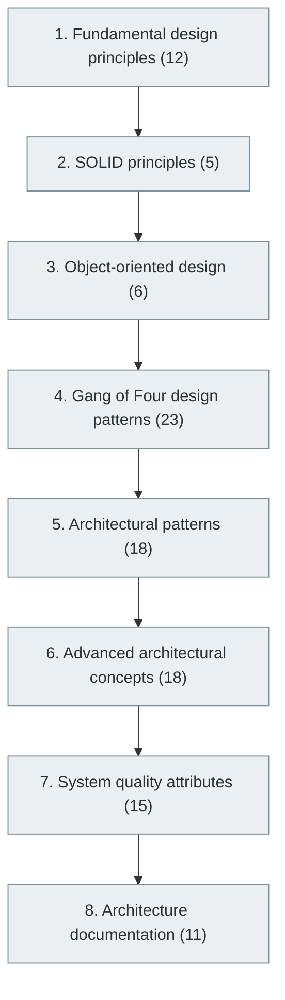

# 12. Software Design Principles and Architecture

> [Home](../../../README.md) › [Part III — Professional Software Engineering](../index.md) › Subject 12

- **Status:** Not started (0 of 108 syllabus topics have a drafted lesson)
- **Source tags:** Essential for senior engineers
- **Syllabus size:** 8 chapters, 108 topics

## Introduction

Design principles, SOLID, object-oriented design, the Gang of Four patterns, architectural patterns, domain-driven design, quality attributes and architecture documentation.

## Learning outcomes

After working through this subject you should be able to:

- Apply SOLID and recognise when a pattern helps or harms
- Choose an architectural style against quality-attribute requirements
- Document an architecture so others can use it

## Prerequisites

- [6. Programming Fundamentals](../../02-programming-and-software-development/06-programming-fundamentals/index.md)
- [7. Programming Paradigms](../../02-programming-and-software-development/07-programming-paradigms/index.md)

## Beginner-to-advanced progression

The chapters below follow the order of the source syllabus, which moves from foundational to advanced material. Colour shows documentation status (grey = not started, amber = in progress, green = drafted or better).

## Chapters and topics

### Chapter 1: Fundamental design principles

12 topics · status: **Not started**

*Planned location:* `docs/03-professional-software-engineering/12-software-design-principles-and-architecture/01-fundamental-design-principles/`. No lessons yet.

Syllabus topics in this chapter (12)

- `12.01.01` DRY — *not started*
- `12.01.02` KISS — *not started*
- `12.01.03` YAGNI — *not started*
- `12.01.04` Separation of concerns — *not started*
- `12.01.05` Modularity — *not started*
- `12.01.06` Cohesion — *not started*
- `12.01.07` Coupling — *not started*
- `12.01.08` Encapsulation — *not started*
- `12.01.09` Abstraction — *not started*
- `12.01.10` Reusability — *not started*
- `12.01.11` Extensibility — *not started*
- `12.01.12` Maintainability — *not started*

### Chapter 2: SOLID principles

5 topics · status: **Not started**

*Planned location:* `docs/03-professional-software-engineering/12-software-design-principles-and-architecture/02-solid-principles/`. No lessons yet.

Syllabus topics in this chapter (5)

- `12.02.01` Single Responsibility — *not started*
- `12.02.02` Open/Closed — *not started*
- `12.02.03` Liskov Substitution — *not started*
- `12.02.04` Interface Segregation — *not started*
- `12.02.05` Dependency Inversion — *not started*

### Chapter 3: Object-oriented design

6 topics · status: **Not started**

*Planned location:* `docs/03-professional-software-engineering/12-software-design-principles-and-architecture/03-object-oriented-design/`. No lessons yet.

Syllabus topics in this chapter (6)

- `12.03.01` GRASP — *not started*
- `12.03.02` Composition over inheritance — *not started*
- `12.03.03` Dependency injection — *not started*
- `12.03.04` Inversion of control — *not started*
- `12.03.05` Interface-based design — *not started*
- `12.03.06` Domain modeling — *not started*

### Chapter 4: Gang of Four design patterns

23 topics · status: **Not started**

*Planned location:* `docs/03-professional-software-engineering/12-software-design-principles-and-architecture/04-gang-of-four-design-patterns/`. No lessons yet.

Syllabus topics in this chapter (23)

**Creational patterns**

- `12.04.01` Singleton — *not started*
- `12.04.02` Factory Method — *not started*
- `12.04.03` Abstract Factory — *not started*
- `12.04.04` Builder — *not started*
- `12.04.05` Prototype — *not started*

**Structural patterns**

- `12.04.06` Adapter — *not started*
- `12.04.07` Bridge — *not started*
- `12.04.08` Composite — *not started*
- `12.04.09` Decorator — *not started*
- `12.04.10` Facade — *not started*
- `12.04.11` Flyweight — *not started*
- `12.04.12` Proxy — *not started*

**Behavioral patterns**

- `12.04.13` Chain of Responsibility — *not started*
- `12.04.14` Command — *not started*
- `12.04.15` Interpreter — *not started*
- `12.04.16` Iterator — *not started*
- `12.04.17` Mediator — *not started*
- `12.04.18` Memento — *not started*
- `12.04.19` Observer — *not started*
- `12.04.20` State — *not started*
- `12.04.21` Strategy — *not started*
- `12.04.22` Template Method — *not started*
- `12.04.23` Visitor — *not started*

### Chapter 5: Architectural patterns

18 topics · status: **Not started**

*Planned location:* `docs/03-professional-software-engineering/12-software-design-principles-and-architecture/05-architectural-patterns/`. No lessons yet.

Syllabus topics in this chapter (18)

- `12.05.01` Layered architecture — *not started*
- `12.05.02` Three-tier architecture — *not started*
- `12.05.03` N-tier architecture — *not started*
- `12.05.04` Client-server architecture — *not started*
- `12.05.05` MVC — *not started*
- `12.05.06` MVP — *not started*
- `12.05.07` MVVM — *not started*
- `12.05.08` Clean architecture — *not started*
- `12.05.09` Hexagonal architecture — *not started*
- `12.05.10` Onion architecture — *not started*
- `12.05.11` Modular monolith — *not started*
- `12.05.12` Microservices — *not started*
- `12.05.13` Service-oriented architecture — *not started*
- `12.05.14` Event-driven architecture — *not started*
- `12.05.15` Serverless architecture — *not started*
- `12.05.16` Plugin architecture — *not started*
- `12.05.17` Pipe-and-filter architecture — *not started*
- `12.05.18` Peer-to-peer architecture — *not started*

### Chapter 6: Advanced architectural concepts

18 topics · status: **Not started**

*Planned location:* `docs/03-professional-software-engineering/12-software-design-principles-and-architecture/06-advanced-architectural-concepts/`. No lessons yet.

Syllabus topics in this chapter (18)

- `12.06.01` Domain-driven design — *not started*
- `12.06.02` Bounded contexts — *not started*
- `12.06.03` Aggregates — *not started*
- `12.06.04` Entities and value objects — *not started*
- `12.06.05` CQRS — *not started*
- `12.06.06` Event sourcing — *not started*
- `12.06.07` Saga pattern — *not started*
- `12.06.08` Transactional outbox — *not started*
- `12.06.09` Strangler pattern — *not started*
- `12.06.10` Backend for Frontend — *not started*
- `12.06.11` API gateway pattern — *not started*
- `12.06.12` Service discovery — *not started*
- `12.06.13` Sidecar pattern — *not started*
- `12.06.14` Ambassador pattern — *not started*
- `12.06.15` Anti-corruption layer — *not started*
- `12.06.16` Distributed system architecture — *not started*
- `12.06.17` Multi-tenant architecture — *not started*
- `12.06.18` Multi-region architecture — *not started*

### Chapter 7: System quality attributes

15 topics · status: **Not started**

*Planned location:* `docs/03-professional-software-engineering/12-software-design-principles-and-architecture/07-system-quality-attributes/`. No lessons yet.

Syllabus topics in this chapter (15)

- `12.07.01` Scalability — *not started*
- `12.07.02` Performance — *not started*
- `12.07.03` Availability — *not started*
- `12.07.04` Reliability — *not started*
- `12.07.05` Resilience — *not started*
- `12.07.06` Fault tolerance — *not started*
- `12.07.07` Security — *not started*
- `12.07.08` Maintainability — *not started*
- `12.07.09` Portability — *not started*
- `12.07.10` Interoperability — *not started*
- `12.07.11` Usability — *not started*
- `12.07.12` Accessibility — *not started*
- `12.07.13` Observability — *not started*
- `12.07.14` Testability — *not started*
- `12.07.15` Recoverability — *not started*

### Chapter 8: Architecture documentation

11 topics · status: **Not started**

*Planned location:* `docs/03-professional-software-engineering/12-software-design-principles-and-architecture/08-architecture-documentation/`. No lessons yet.

Syllabus topics in this chapter (11)

- `12.08.01` UML — *not started*
- `12.08.02` Class diagrams — *not started*
- `12.08.03` Sequence diagrams — *not started*
- `12.08.04` Activity diagrams — *not started*
- `12.08.05` Component diagrams — *not started*
- `12.08.06` Deployment diagrams — *not started*
- `12.08.07` State diagrams — *not started*
- `12.08.08` C4 model — *not started*
- `12.08.09` Architecture decision records — *not started*
- `12.08.10` Threat models — *not started*
- `12.08.11` Data-flow diagrams — *not started*

## Recommended reading order

1. Chapter 1 — Fundamental design principles
2. Chapter 2 — SOLID principles
3. Chapter 3 — Object-oriented design
4. Chapter 4 — Gang of Four design patterns
5. Chapter 5 — Architectural patterns
6. Chapter 6 — Advanced architectural concepts
7. Chapter 7 — System quality attributes
8. Chapter 8 — Architecture documentation

Within a chapter, read lessons in numeric order. Pick the later chapters only when the earlier ones feel comfortable; the syllabus orders them from fundamental to advanced.

## Related subjects

- [11. Software Development Lifecycle (SDLC)](../11-software-development-lifecycle/index.md)
- [16. Backend Development](../../04-building-software-products/16-backend-development/index.md)
- [22. Distributed Systems](../../05-distributed-systems-and-system-design/22-distributed-systems/index.md)
- [23. System Design](../../05-distributed-systems-and-system-design/23-system-design/index.md)

## Suggested practical projects

- Refactor a legacy module towards a clean architecture
- A decision log (ADRs) for a small system

*Full project write-ups (requirements, architecture, stages, tests, extensions) are planned; see [ROADMAP.md](../../../ROADMAP.md).*

---

**Previous subject:** [11. Software Development Lifecycle (SDLC)](../11-software-development-lifecycle/index.md) · **Up:** [Part III](../index.md) · **Next subject:** [13. Version Control and Developer Workflow](../13-version-control-and-developer-workflow/index.md)
