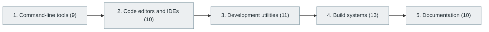

# 14. Development Environments and Tools

> [Home](../../../README.md) › [Part III — Professional Software Engineering](../index.md) › Subject 14

- **Status:** Not started (0 of 53 syllabus topics have a drafted lesson)
- **Source tags:** —
- **Syllabus size:** 5 chapters, 53 topics

## Introduction

The command line, editors and IDEs, debuggers and utilities, build systems and documentation tooling that make an engineer productive.

## Learning outcomes

After working through this subject you should be able to:

- Work fluently in a Unix shell
- Debug with a debugger rather than print statements alone
- Set up a reproducible build

## Prerequisites

- [1. Computer Fundamentals](../../01-computer-science-foundations/01-computer-fundamentals/index.md)
- [6. Programming Fundamentals](../../02-programming-and-software-development/06-programming-fundamentals/index.md)

## Beginner-to-advanced progression

The chapters below follow the order of the source syllabus, which moves from foundational to advanced material. Colour shows documentation status (grey = not started, amber = in progress, green = drafted or better).

## Chapters and topics

### Chapter 1: Command-line tools

9 topics · status: **Not started**

*Planned location:* `docs/03-professional-software-engineering/14-development-environments-and-tools/01-command-line-tools/`. No lessons yet.

Syllabus topics in this chapter (9)

- `14.01.01` Terminal — *not started*
- `14.01.02` Shell — *not started*
- `14.01.03` Bash — *not started*
- `14.01.04` Zsh — *not started*
- `14.01.05` PowerShell — *not started*
- `14.01.06` Linux commands — *not started*
- `14.01.07` Pipes and redirection — *not started*
- `14.01.08` Environment variables — *not started*
- `14.01.09` Shell scripting — *not started*

### Chapter 2: Code editors and IDEs

10 topics · status: **Not started**

*Planned location:* `docs/03-professional-software-engineering/14-development-environments-and-tools/02-code-editors-and-ides/`. No lessons yet.

Syllabus topics in this chapter (10)

- `14.02.01` VS Code — *not started*
- `14.02.02` IntelliJ IDEA — *not started*
- `14.02.03` PyCharm — *not started*
- `14.02.04` Eclipse — *not started*
- `14.02.05` Visual Studio — *not started*
- `14.02.06` Android Studio — *not started*
- `14.02.07` Xcode — *not started*
- `14.02.08` Vim — *not started*
- `14.02.09` Neovim — *not started*
- `14.02.10` Emacs — *not started*

### Chapter 3: Development utilities

11 topics · status: **Not started**

*Planned location:* `docs/03-professional-software-engineering/14-development-environments-and-tools/03-development-utilities/`. No lessons yet.

Syllabus topics in this chapter (11)

- `14.03.01` Debuggers — *not started*
- `14.03.02` Profilers — *not started*
- `14.03.03` Linters — *not started*
- `14.03.04` Formatters — *not started*
- `14.03.05` Static analyzers — *not started*
- `14.03.06` Package managers — *not started*
- `14.03.07` Build tools — *not started*
- `14.03.08` Dependency managers — *not started*
- `14.03.09` API clients — *not started*
- `14.03.10` Database clients — *not started*
- `14.03.11` Local development containers — *not started*

### Chapter 4: Build systems

13 topics · status: **Not started**

*Planned location:* `docs/03-professional-software-engineering/14-development-environments-and-tools/04-build-systems/`. No lessons yet.

Syllabus topics in this chapter (13)

- `14.04.01` Make — *not started*
- `14.04.02` CMake — *not started*
- `14.04.03` Maven — *not started*
- `14.04.04` Gradle — *not started*
- `14.04.05` npm — *not started*
- `14.04.06` pnpm — *not started*
- `14.04.07` Yarn — *not started*
- `14.04.08` Webpack — *not started*
- `14.04.09` Vite — *not started*
- `14.04.10` Bazel — *not started*
- `14.04.11` Buck — *not started*
- `14.04.12` Ninja — *not started*
- `14.04.13` MSBuild — *not started*

### Chapter 5: Documentation

10 topics · status: **Not started**

*Planned location:* `docs/03-professional-software-engineering/14-development-environments-and-tools/05-documentation/`. No lessons yet.

Syllabus topics in this chapter (10)

- `14.05.01` README — *not started*
- `14.05.02` API documentation — *not started*
- `14.05.03` Technical specifications — *not started*
- `14.05.04` Architecture documentation — *not started*
- `14.05.05` OpenAPI/Swagger — *not started*
- `14.05.06` AsyncAPI — *not started*
- `14.05.07` Markdown — *not started*
- `14.05.08` Documentation generators — *not started*
- `14.05.09` Runbooks — *not started*
- `14.05.10` ADRs — *not started*

## Recommended reading order

1. Chapter 1 — Command-line tools
2. Chapter 2 — Code editors and IDEs
3. Chapter 3 — Development utilities
4. Chapter 4 — Build systems
5. Chapter 5 — Documentation

Within a chapter, read lessons in numeric order. Pick the later chapters only when the earlier ones feel comfortable; the syllabus orders them from fundamental to advanced.

## Related subjects

- [13. Version Control and Developer Workflow](../13-version-control-and-developer-workflow/index.md)
- [26. DevOps Engineering](../../06-cloud-devops-and-infrastructure/26-devops-engineering/index.md)

## Suggested practical projects

- A dotfiles repository and setup script
- A Makefile or CMake build for a multi-file project

*Full project write-ups (requirements, architecture, stages, tests, extensions) are planned; see [ROADMAP.md](../../../ROADMAP.md).*

---

**Previous subject:** [13. Version Control and Developer Workflow](../13-version-control-and-developer-workflow/index.md) · **Up:** [Part III](../index.md) · **Next subject:** [15. Database Management Systems (DBMS)](../../04-building-software-products/15-database-management-systems/index.md)
