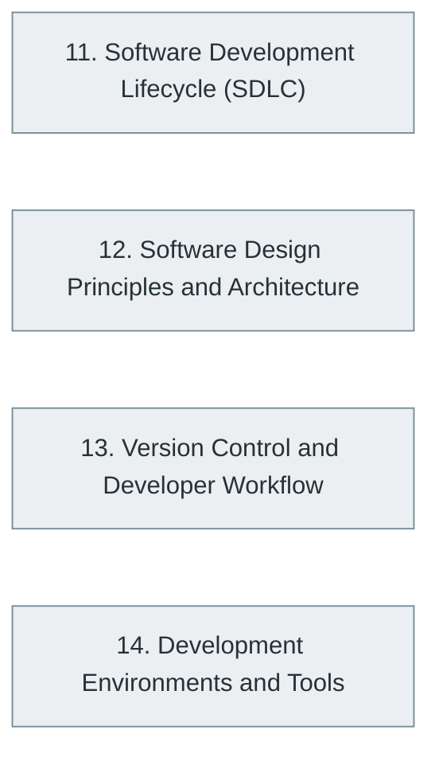

# Part III — Professional Software Engineering

> [Home](../../README.md) › Part III

**Status:** Not started

The discipline around the code: lifecycle models, requirements, design principles and patterns, architecture, version control, tooling and documentation.

## Subjects in this part

| # | Subject | What it covers | Topics | Status |
| --- | --- | --- | --- | --- |
| 11 | [Software Development Lifecycle (SDLC)](11-software-development-lifecycle/index.md) | The whole life of a software product: initiation, requirements engineering, development models, project management and maintenance. | 56 | Not started |
| 12 | [Software Design Principles and Architecture](12-software-design-principles-and-architecture/index.md) | Design principles, SOLID, object-oriented design, the Gang of Four patterns, architectural patterns, domain-driven design, quality attributes and architecture documentation. | 108 | Not started |
| 13 | [Version Control and Developer Workflow](13-version-control-and-developer-workflow/index.md) | Git from first commit to advanced history manipulation, hosting platforms, branching strategies, pull requests and collaborative workflows. | 35 | Not started |
| 14 | [Development Environments and Tools](14-development-environments-and-tools/index.md) | The command line, editors and IDEs, debuggers and utilities, build systems and documentation tooling that make an engineer productive. | 53 | Not started |

## How the subjects depend on each other

Solid arrows point from a prerequisite to the subject that builds on it. Only dependencies inside this part are drawn.

## What you need from other parts

| Subject in this part | Prerequisite elsewhere |
| --- | --- |
| [11. Software Development Lifecycle (SDLC)](11-software-development-lifecycle/index.md) | [6. Programming Fundamentals](../02-programming-and-software-development/06-programming-fundamentals/index.md) |
| [12. Software Design Principles and Architecture](12-software-design-principles-and-architecture/index.md) | [6. Programming Fundamentals](../02-programming-and-software-development/06-programming-fundamentals/index.md) |
| [12. Software Design Principles and Architecture](12-software-design-principles-and-architecture/index.md) | [7. Programming Paradigms](../02-programming-and-software-development/07-programming-paradigms/index.md) |
| [13. Version Control and Developer Workflow](13-version-control-and-developer-workflow/index.md) | [1. Computer Fundamentals](../01-computer-science-foundations/01-computer-fundamentals/index.md) |
| [14. Development Environments and Tools](14-development-environments-and-tools/index.md) | [1. Computer Fundamentals](../01-computer-science-foundations/01-computer-fundamentals/index.md) |
| [14. Development Environments and Tools](14-development-environments-and-tools/index.md) | [6. Programming Fundamentals](../02-programming-and-software-development/06-programming-fundamentals/index.md) |

---

**Previous part:** [Part II](../02-programming-and-software-development/index.md) · **Up:** [Master index](../../MASTER-INDEX.md) · **Next part:** [Part IV](../04-building-software-products/index.md)
